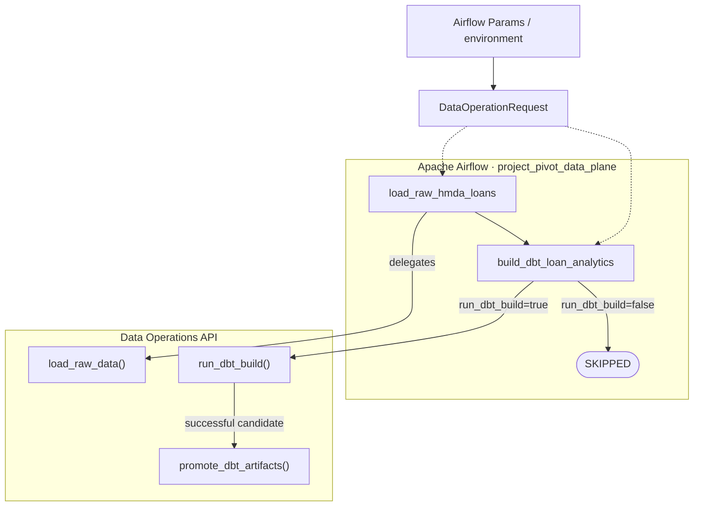

# Orchestration: Apache Airflow Data Plane

**`orchestration`은 Bronze 적재와 dbt 분석만 연결한다.** Domain business logic은 공개 API로 위임하며, reliability lifecycle과 recovery/evaluation은 Airflow DAG에 넣지 않는다.

> [!IMPORTANT]
> **`project_pivot_data_plane`은 수동 data-plane 실행 전용이다.** Schedule과 automatic retry를 사용하지 않으며 approval이나 승인된 side effect를 암묵적으로 실행하지 않는다.

## Scope

| In scope | Out of scope |
| --- | --- |
| Airflow `DAG`, TaskFlow task와 logical `Asset` 등록 | 원천 파일 파싱과 DuckDB 적재 구현 |
| 지원된 runtime override를 `DataOperationRequest`로 변환 | dbt 모델 구현과 artifact 검증 |
| task dependency, task state와 asset update evidence | reliability lifecycle, approval, backfill, evaluation |
| Bronze → Silver/Gold 실행 순서 | schedule, automatic retry, sensor, dynamic mapping, custom operator/plugin/executor |

데이터 실행의 application boundary는 [`data-operations.md`](data-operations.md)다. data 계약은 [`hmda-data.md`](hmda-data.md), [`data-platform.md`](data-platform.md)에 있다.

## Entry Point And Workflow Graph

[`project_pivot_data_plane.py`](../../src/project_pivot/orchestration/dags/project_pivot_data_plane.py)가 유일한 active Airflow DAG entry point다. DAG에는 raw load와 analytics build 두 task만 등록된다.

Airflow가 전체 data-plane 순서를 유일하게 소유한다. `DataOperationRequest`, `RawLoadResult`, `DbtBuildResult`, DataFrame과 Arrow table은 task transport payload로 전달하지 않고 dependency edge만 사용한다.

## Tasks And Evidence

| Task | Delegated API | Successful asset evidence |
| --- | --- | --- |
| `load_raw_hmda_loans` | `load_raw_data()` | database path, source root, file count, year, HMDA row count |
| `build_dbt_loan_analytics` | `run_dbt_build()` → `promote_dbt_artifacts()` | return code, manifest path, run results path, projection identity |

Task execution state와 data update evidence는 별개다. 성공한 raw task는 raw logical asset event를 기록하고, analytics task는 dbt candidate가 promotion된 뒤에만 analytics asset event를 기록한다. 실패하거나 skip된 analytics task는 성공 update evidence를 남기지 않는다.

`run_dbt_build=False`이면 analytics task는 명시적으로 `SKIPPED`가 된다. raw task 성공은 보존되고 candidate promotion은 실행되지 않는다.

## Runtime Configuration

[`config.py`](../../src/project_pivot/orchestration/config.py)의 `data_operation_request_from_runtime()`이 지원된 override를 최종 [`DataOperationRequest`](../../src/project_pivot/data_operations/request.py)로 변환한다. Precedence는 explicit runtime value > supported environment value > request default이며, 최종 validation은 Data Operations model이 소유한다.

Airflow trigger surface는 다음 runtime override만 노출한다.

- `database_path`
- `source_root`
- `source_year`
- `source_file`
- `run_dbt_build`

Exact default와 validation rule은 `DataOperationRequest`가 소유하며 Airflow adapter는 이를 복제하지 않는다.

Airflow adapter는 file discovery, ingestion, dbt subprocess, artifact validation/promotion, 오류 변환을 직접 구현하지 않는다.

## Graph Boundaries

Data-plane DAG 밖에 다음 항목을 둔다.

- schedule, automatic retry, sensor, dynamic mapping, distributed executor, custom operator/plugin
- `run_incident_lifecycle()`
- approval과 `execute_approved_backfill()`
- evaluation, LLMOps와 report 파일 작성

이 분리는 pipeline 실행이 데이터 변환만 수행하고 Reliability control plane의 read-only lifecycle 또는 승인된 side effect를 암묵적으로 실행하지 않게 한다.

## Reading Order

1. [`project_pivot_data_plane.py`](../../src/project_pivot/orchestration/dags/project_pivot_data_plane.py)
1. [`config.py`](../../src/project_pivot/orchestration/config.py)
1. [`tests/orchestration/test_airflow_dag.py`](../../tests/orchestration/test_airflow_dag.py)
1. [`tests/orchestration/test_airflow_execution.py`](../../tests/orchestration/test_airflow_execution.py)
