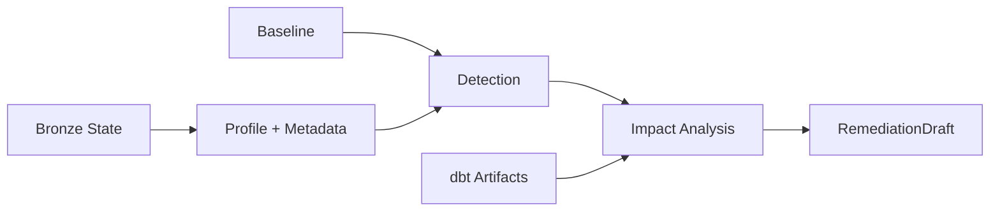
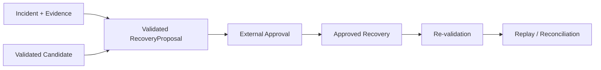

# Reliability: Evidence, Approval And Recovery

**`reliability`는 deterministic evidence로 incident를 판단하고, read-only analysis와 승인된 state mutation을 분리한다.** Lifecycle은 profile, detection, impact와 `RemediationDraft`를 만들고, recovery와 evaluation은 별도 API에서 명시적으로 실행한다.

> [!IMPORTANT]
> **Lifecycle은 데이터를 변경하지 않는다.** `RemediationDraft`는 실행 지시나 approval이 아니며, recovery authority는 exact validated `RecoveryProposal`과 외부 approval에서만 나온다.

## Scope

| In scope | Out of scope |
| --- | --- |
| metadata/profile evidence와 incident detection | source acquisition과 dbt model 작성 |
| dbt lineage impact와 deterministic remediation draft | Dagster orchestration |
| validated recovery proposal과 approved recovery | automatic approval |
| deterministic recovery/replay evaluation | human approval UI와 production monitoring |

Normative behavior는 [`../../openspec/specs/`](../../openspec/specs/)의 Reliability capability Specs가 소유한다.

## Read-Only Lifecycle

Detection은 volume, null, schema와 freshness 같은 deterministic rule을 다룬다. Freshness는 Bronze에서 실제로 측정 가능한 timestamp를 사용하며 측정 불가능한 상태를 fresh로 간주하지 않는다. Exact threshold와 evidence payload는 canonical Spec을 따른다.

## Recovery Path

Partition content recovery, freshness-bound recovery와 schema/table restoration은 대상 state가 다르지만 같은 원칙을 공유한다. **승인된 before/after state와 실제 target이 일치할 때만 mutation하고, 이미 expected state라면 mutation을 반복하지 않으며, 어느 쪽도 아니면 새 validation과 approval을 요구한다.**

## Public Surface

| Area | Surface |
| --- | --- |
| Evidence / profile | table metadata, profile snapshot, table-state identity |
| Detection / impact | basic incident detection, dbt impact analysis |
| Remediation | deterministic `RemediationDraft` creation |
| Partition recovery | validated proposal, approval-bound backfill와 re-validation |
| Schema recovery | complete candidate validation과 approved exact table restoration |
| Evaluation | volume/null/freshness/schema recovery vertical slices와 evaluation report |

정확한 model field, API signature, threshold, serialization과 failure scenario는 canonical Spec과 [`reliability/__init__.py`](../../src/project_pivot/reliability/__init__.py)를 확인한다.

## Safety Boundaries

- Read-only lifecycle은 approval, candidate staging, recovery, dbt execution 또는 report write를 자동으로 수행하지 않는다.
- `RemediationDraft`와 `RecoveryProposal`은 다른 artifact다. Draft는 권고이고 proposal은 승인 가능한 exact mutation contract다.
- Approval은 proposal의 incident, target, candidate, validated state와 mutation action에 결합된다.
- Content identity, freshness temporal state와 table schema/content state는 필요한 scope에서 독립 evidence로 검증한다.
- Mutation 뒤 verification이 실패하면 완료된 mutation을 숨기지 않고 replay/reconciliation evidence로 보존한다.
- Replay가 expected after-state를 확인하면 mutation을 반복하지 않고 verification을 재개한다.
- Disposable evaluation은 operational database를 암묵적으로 재사용하지 않는다.

## Contracts And Evidence

- Shared contracts: [`reliability-data-contracts`](../../openspec/specs/reliability-data-contracts/spec.md)
- Profile: [`reliability-profile-snapshots`](../../openspec/specs/reliability-profile-snapshots/spec.md)
- Detection: [`reliability-incident-detection`](../../openspec/specs/reliability-incident-detection/spec.md)
- Remediation: [`reliability-remediation-draft`](../../openspec/specs/reliability-remediation-draft/spec.md)
- Recovery: [`reliability-recovery-backfill`](../../openspec/specs/reliability-recovery-backfill/spec.md)
- Evaluation: [`reliability-evaluation-report`](../../openspec/specs/reliability-evaluation-report/spec.md)
- Executable specification: [`tests/reliability`](../../tests/reliability)

## Reading Order

1. [`reliability/__init__.py`](../../src/project_pivot/reliability/__init__.py)에서 public surface를 확인한다.
2. Read-only composition은 [`data_operations/incident_lifecycle.py`](../../src/project_pivot/data_operations/incident_lifecycle.py)를 읽는다.
3. 필요한 capability의 canonical Spec으로 이동해 exact requirement를 확인한다.
4. Safety boundary와 regression oracle은 [`tests/reliability`](../../tests/reliability)에서 확인한다.
