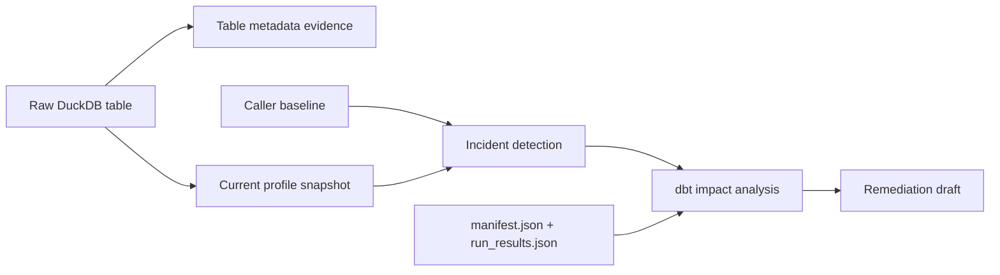

# Reliability

`reliability`는 raw table과 dbt artifact로 incident, downstream 영향, remediation draft를 계산한다. lifecycle은 read-only다. 승인된 backfill과 evaluation report 작성은 별도 API다.

## Scope

| In scope | Out of scope |
| --- | --- |
| table metadata와 profile snapshot 생성 | 자동 backfill, 자동 승인 |
| profile 기반 incident 탐지 | dbt 모델 수정 또는 `dbt build` 실행 |
| dbt lineage 영향 분석과 remediation draft | Dagster job 등록 |
| 승인된 backfill validation, synthetic case 평가 | human approval UI, 장기 모니터링 |

원천 적재와 dbt 모델 계약은 [`hmda-data.md`](hmda-data.md), [`data-platform.md`](data-platform.md)에 있다. application lifecycle 조합은 [`data-operations.md`](data-operations.md)가 소유한다.

## Read-only Lifecycle

`run_incident_lifecycle(request, baseline)`는 다음 순서로 current 상태를 읽고 결과를 조합한다.

| Step | Input | Output |
| --- | --- | --- |
| Metadata | raw DuckDB table | row count evidence |
| Profile | raw DuckDB table, partition, profile columns | `ProfileSnapshot` |
| Detection | baseline, current profile, thresholds | `DetectionResult[]` |
| Impact | incident, `manifest.json`, `run_results.json` | `ImpactAnalysisResult` |
| Remediation | incident, evidence, lineage evidence | `RemediationDraft` |

baseline과 current는 같은 asset·partition이어야 한다. lifecycle은 메타데이터, profile, artifact만 읽고 `LifecycleResult`를 반환한다. 각 요약 목록은 처음 탐지한 순서를 유지하며 중복을 제거한다. approval 생성, source 접근, partition overwrite, validation, report 파일 작성은 수행하지 않는다.

## Detection And Impact

`detect_basic_incidents(DetectionRequest)`는 baseline/current profile을 비교한다.

| Incident | Default threshold | Evidence |
| --- | --- | --- |
| `volume_drop` | row count 감소 비율 $\geq 0.5$ | baseline/current row count, drop ratio |
| `null_spike` | null rate 증가량 $\geq 0.1$ | 컬럼, baseline/current null rate |
| `schema_drift` | schema hash 변경 | baseline/current schema hash |
| `freshness_delay` | freshness 지연 $\geq 60$분 | delay, threshold minutes |

threshold는 `DetectionThresholds`로 교체할 수 있다. `analyze_dbt_impact(ImpactAnalysisRequest)`는 manifest의 source/model dependency를 따라 downstream asset을 계산하고, manifest와 run results 경로를 `LineageEvidence`에 기록한다. 유효하지 않거나 누락된 artifact는 `ImpactAnalysisError`다.

`create_remediation_draft(RemediationDraftRequest)`는 evidence와 lineage를 바탕으로 권장 조치, backfill 조치, validation 조치, dbt test 제안을 결정론적으로 만든다. draft는 실행 지시가 아니라 approval 검토 대상이다.

## Recovery And Evaluation

Lifecycle 밖의 side effect는 명시적 API로만 실행한다.

| Capability | API | Boundary |
| --- | --- | --- |
| Recovery | `execute_approved_backfill(connection, request)` | 승인 상태와 `overwrite_partition`, `rerun_profile_snapshot` action을 검증한 뒤 partition을 덮어쓰고 profile을 다시 만든다. |
| Evaluation | `build_evaluation_report(cases)` | synthetic case 결과를 집계한다. |
| Evaluation output | `write_evaluation_report(report, output_path)` | Markdown report 파일을 쓴다. |

승인되지 않았거나 필수 action이 없는 backfill은 source 파일을 읽기 전에 `ApprovalGateError`로 차단한다. 승인된 backfill 결과는 적재 행 수와 새 profile row count의 일치 여부를 `BackfillValidationResult`로 반환한다.

## Public Surface

외부 호출자는 [`reliability/__init__.py`](../../src/project_pivot/reliability/__init__.py)의 re-export를 사용한다.

| Area | Main APIs |
| --- | --- |
| Profile and metadata | `create_profile_snapshot`, `create_table_metadata_evidence` |
| Detection | `detect_basic_incidents` |
| Impact and draft | `analyze_dbt_impact`, `create_remediation_draft` |
| Recovery | `execute_approved_backfill` |
| Evaluation | `build_evaluation_report`, `render_evaluation_report_markdown`, `write_evaluation_report` |

계약 모델은 `reliability/contracts`에 있으며, 알 수 없는 필드는 거부되고 모델은 변경 불가다.

## Reading Order

1. [`reliability/__init__.py`](../../src/project_pivot/reliability/__init__.py)
2. [`incident_lifecycle.py`](../../src/project_pivot/data_operations/incident_lifecycle.py)
3. [`tests/reliability/test_basic_incident_detection.py`](../../tests/reliability/test_basic_incident_detection.py)
4. [`tests/reliability/test_impact_analysis.py`](../../tests/reliability/test_impact_analysis.py)
5. [`tests/reliability/test_approval_backfill_validation.py`](../../tests/reliability/test_approval_backfill_validation.py)
6. [`tests/reliability/test_evaluation_report.py`](../../tests/reliability/test_evaluation_report.py)
