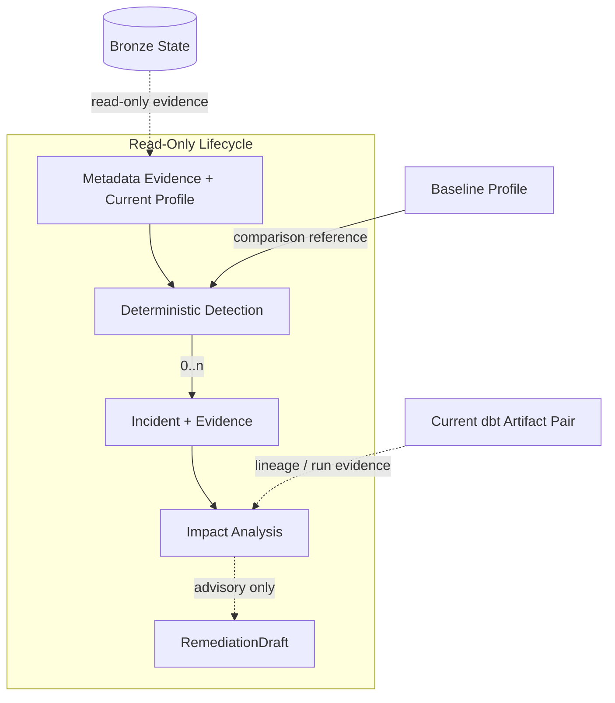
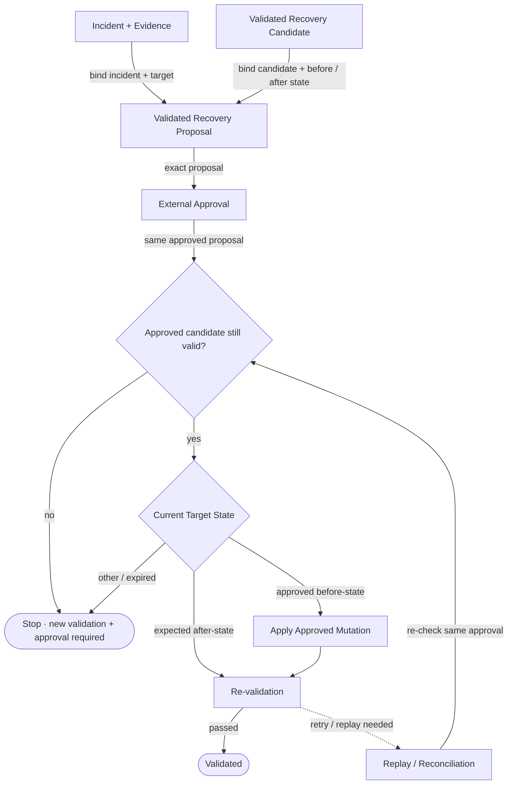

# Reliability: Evidence, Approval And Recovery

**`reliability`는 deterministic evidence로 incident를 판단하고, read-only analysis와 승인된 state mutation을 분리한다.** Lifecycle은 profile, detection, impact와 `RemediationDraft`를 만들고, recovery와 evaluation은 별도 API에서 명시적으로 실행한다.

> [!IMPORTANT]
> **Lifecycle은 데이터를 변경하지 않는다.** `RemediationDraft`는 실행 지시나 approval이 아니며, recovery authority는 scope에 맞는 exact validated recovery proposal과 corresponding external approval에서만 나온다.

## Scope

| In scope | Out of scope |
| --- | --- |
| metadata/profile evidence와 incident detection | source acquisition과 dbt model 작성 |
| dbt lineage impact와 deterministic remediation draft | Airflow data-plane orchestration |
| validated recovery proposal과 approved recovery | automatic approval |
| deterministic recovery/replay evaluation | human approval UI와 production monitoring |

Normative behavior는 [`../../openspec/specs/`](../../openspec/specs/)의 Reliability capability Specs가 소유한다.

## Read-Only Lifecycle

Detection은 volume, null, schema와 freshness 같은 deterministic rule을 다룬다. Freshness는 Bronze에서 실제로 측정 가능한 timestamp를 사용하며 측정 불가능한 상태를 fresh로 간주하지 않는다. Exact threshold와 evidence payload는 canonical Spec을 따른다.

## Bounded Agentic Review

`review_null_spike()`는 deterministic `null_spike` `Incident`, 실제 `Evidence`와 `RemediationDraft`를 snapshot으로 고정한 뒤 OpenAI-compatible provider에 advisory review만 요청한다. Provider output은 canonical identity·numeric facts·evidence reference와 action boundary에 다시 대조되며, approval·recovery·mutation API로 전달되지 않는다.

| Result | Boundary |
| --- | --- |
| `accepted` | Structured output, accepted deterministic validation과 durable invocation evidence가 모두 존재한다. |
| `validation_failed` | Response schema 또는 deterministic guard가 실패하며 provider output을 public result로 노출하지 않는다. |
| `unavailable` | Bounded transport attempt가 실패한다. |
| `input_rejected` | Provider 호출 전 identity, evidence, canonical target 또는 prompt-size preflight가 실패한다. |
| `provenance_failed` | Provider 결과를 create-only invocation evidence로 보존하지 못해 acceptance를 차단한다. |

Provider가 실제로 호출된 logical review는 `HMDA_RELIABILITY_ARTIFACTS_DIR/agentic-review/invocations/<invocation_id>.json`에 canonical input, parsed output이 있으면 해당 output, validation, sanitized configuration, prompt digest, `project_revision`, latency, attempt count와 available usage를 기록한다. API key, credential, raw rendered prompt, raw log와 raw provider error는 기록하지 않는다.

`AgenticReviewSettings`는 environment를 암묵적으로 읽지 않는다. Application caller는 `base_url`, `api_key`와 `model`을 명시적으로 전달한다. Opt-in live harness만 다음 environment를 읽는다.

| Environment | Meaning |
| --- | --- |
| `HMDA_AGENTIC_REVIEW_LIVE` | `true`일 때만 live provider proof를 활성화한다. |
| `HMDA_AGENTIC_REVIEW_BASE_URL` | Ollama 또는 cloud OpenAI-compatible `/v1` base URL |
| `HMDA_AGENTIC_REVIEW_API_KEY` | Provider credential. Invocation evidence에 저장하지 않는다. |
| `HMDA_AGENTIC_REVIEW_MODEL` | Provider model ID |
| `HMDA_AGENTIC_REVIEW_PROJECT_REVISION` | Caller가 고정한 application revision |
| `HMDA_AGENTIC_REVIEW_TIMEOUT_SECONDS` | Request timeout seconds |
| `HMDA_AGENTIC_REVIEW_MAX_RETRIES` | Adapter-owned transport retry count |
| `HMDA_AGENTIC_REVIEW_MAX_OUTPUT_TOKENS` | Common `max_tokens` wire limit |
| `HMDA_AGENTIC_REVIEW_MAX_PROMPT_BYTES` | Provider 호출 전 rendered-message byte limit |
| `HMDA_AGENTIC_REVIEW_MAX_OUTPUT_BYTES` | Provider response byte limit |

`temperature=0`, non-streaming JSON object, no-tools와 SDK hidden retry `0`은 common adapter contract로 고정하며 environment override를 제공하지 않는다.

## Recovery Path

Partition content recovery, freshness-bound recovery와 schema/table restoration은 대상 state가 다르지만 같은 원칙을 공유한다. **승인된 before/after state와 실제 target이 일치할 때만 mutation하고, 이미 expected state라면 mutation을 반복하지 않으며, 어느 쪽도 아니면 새 validation과 approval을 요구한다.**

Partition content와 freshness recovery는 `RecoveryProposal`과 `Approval`을 사용한다. Schema/table restoration은 별도 `SchemaRecoveryProposal`과 `SchemaRecoveryApproval`을 사용한다. 두 contract 계열은 exact target/candidate/state/action binding 원칙을 공유하지만 서로를 대체하지 않는다.

## Public Surface

| Area | Surface |
| --- | --- |
| Evidence / profile | table metadata, profile snapshot, table-state identity |
| Detection / impact | basic incident detection, dbt impact analysis |
| Remediation | deterministic `RemediationDraft` creation |
| Agentic review | evidence-bound `null_spike` advisory review, deterministic validation과 invocation evidence |
| Partition recovery | `RecoveryProposal`과 approval-bound backfill/re-validation |
| Schema recovery | `SchemaRecoveryProposal`과 complete candidate 기반 exact table restoration |
| Evaluation | volume/null/freshness/schema recovery vertical slices와 evaluation report |

정확한 model field, API signature, threshold, serialization과 failure scenario는 canonical Spec과 [`reliability/__init__.py`](../../src/hmda_reliability/reliability/__init__.py)를 확인한다.

## Safety Boundaries

- Read-only lifecycle은 approval, candidate staging, recovery, dbt execution 또는 report write를 자동으로 수행하지 않는다.
- Agentic review의 유일한 filesystem mutation은 provider-started invocation evidence의 create-only write다. `input_rejected`는 evidence directory도 만들지 않는다.
- Model output은 approval 또는 recovery authority가 아니며 deterministic Reliability truth를 변경하지 않는다.
- `RemediationDraft`와 validated recovery proposal은 다른 artifact다. Draft는 권고이고 proposal은 승인 가능한 exact mutation contract이며 concrete proposal type은 recovery scope에 따라 다르다.
- Approval은 해당 proposal의 incident, target, candidate, validated state와 mutation action에 결합된다.
- Content identity, freshness temporal state와 table schema/content state는 필요한 scope에서 독립 evidence로 검증한다.
- Mutation 뒤 verification이 실패하면 완료된 mutation을 숨기지 않고 replay/reconciliation evidence로 보존한다.
- Replay가 expected after-state를 확인하면 mutation을 반복하지 않고 verification을 재개한다.
- Disposable evaluation은 operational database를 암묵적으로 재사용하지 않는다.

## Contracts And Evidence

- Shared contracts: [`reliability-data-contracts`](../../openspec/specs/reliability-data-contracts/spec.md)
- Profile: [`reliability-profile-snapshots`](../../openspec/specs/reliability-profile-snapshots/spec.md)
- Detection: [`reliability-incident-detection`](../../openspec/specs/reliability-incident-detection/spec.md)
- Remediation: [`reliability-remediation-draft`](../../openspec/specs/reliability-remediation-draft/spec.md)
- Partition recovery: [`reliability-recovery-backfill`](../../openspec/specs/reliability-recovery-backfill/spec.md)
- Schema recovery: [`reliability-schema-recovery`](../../openspec/specs/reliability-schema-recovery/spec.md)
- Evaluation: [`reliability-evaluation-report`](../../openspec/specs/reliability-evaluation-report/spec.md)
- Executable specification: [`tests/reliability`](../../tests/reliability)

## Reading Order

1. [`reliability/__init__.py`](../../src/hmda_reliability/reliability/__init__.py)에서 public surface를 확인한다.
1. Read-only composition은 [`data_operations/incident_lifecycle.py`](../../src/hmda_reliability/data_operations/incident_lifecycle.py)를 읽는다.
1. 필요한 capability의 canonical Spec으로 이동해 exact requirement를 확인한다.
1. Safety boundary와 regression oracle은 [`tests/reliability`](../../tests/reliability)에서 확인한다.
