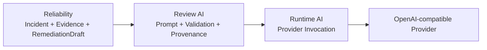

# Review AI: Evidence-Bound Advisory Review

**`review_ai`는 deterministic Reliability truth를 변경하지 않고, 제공된 evidence 안에서 advisory review를 생성하고 검증한다.** Review semantics와 provenance는 이 domain이 소유하고, provider 호출 mechanics는 `runtime_ai`에 위임한다.

## Scope

| In scope | Out of scope |
| --- | --- |
| review input/output contract와 prompt identity | incident detection과 recovery contract |
| canonical input projection과 prompt rendering | provider SDK transport와 provider credential 관리 |
| deterministic output validation | approval 또는 mutation authority |
| review orchestration과 invocation provenance | 범용 AI gateway, routing, agent framework |

## Dependency Boundary

Source dependency는 `review_ai -> reliability`와 `review_ai -> runtime_ai`만 허용한다. `Reliability`는 AI review를 import하지 않으며, `Runtime AI`는 review policy나 Reliability contract를 알지 않는다.

## Review Boundary

`review_null_spike()`는 deterministic `null_spike` `Incident`, 실제 `Evidence`와 `RemediationDraft`를 immutable review input으로 고정한다. Provider output은 canonical identity, numeric facts, evidence reference와 forbidden-action boundary에 다시 대조된다.

| Result | Boundary |
| --- | --- |
| `accepted` | Structured output, accepted deterministic validation과 durable invocation evidence가 모두 존재한다. |
| `validation_failed` | Response schema 또는 deterministic guard가 실패하며 provider output을 public result로 노출하지 않는다. |
| `unavailable` | Bounded provider invocation이 실패한다. |
| `input_rejected` | Provider 호출 전 identity, evidence, canonical target 또는 prompt-size preflight가 실패한다. |
| `provenance_failed` | Provider 결과를 create-only invocation evidence로 보존하지 못해 acceptance를 차단한다. |

Provider가 실제로 호출된 logical review는 `HMDA_RELIABILITY_ARTIFACTS_DIR/agentic-review/invocations/<invocation_id>.json`에 sanitized evidence를 남긴다. API key, credential, raw rendered prompt, raw log와 raw provider error는 저장하지 않는다.

## Public Surface

- `AgenticReviewInput`, `AgenticReviewOutput`, `AgenticReviewResult`
- `PromptIdentity`, `render_review_prompt()`
- `validate_agentic_review()`
- `AgenticInvocationEvidence`, `InvocationEvidenceStore`
- `review_null_spike()`

정확한 field와 validation behavior는 [`../../src/hmda_reliability/review_ai/`](../../src/hmda_reliability/review_ai/)와 [`../../tests/review_ai/`](../../tests/review_ai/)에서 확인한다.

## Safety Boundaries

- Model output은 approval 또는 recovery authority가 아니다.
- Prompt에 전달되는 incident, evidence와 draft는 untrusted data로 취급한다.
- Provider output은 deterministic validation을 통과해도 Reliability truth를 수정하지 않는다.
- `input_rejected`는 provider를 호출하지 않고 invocation evidence directory도 만들지 않는다.
- Review-specific provenance store는 두 번째 독립 consumer가 생기기 전까지 이 domain이 소유한다.

## Reading Order

1. [`review_ai/__init__.py`](../../src/hmda_reliability/review_ai/__init__.py)에서 public surface를 확인한다.
1. [`contracts.py`](../../src/hmda_reliability/review_ai/contracts.py)와 [`prompt.py`](../../src/hmda_reliability/review_ai/prompt.py)에서 review input과 provider boundary를 확인한다.
1. [`validator.py`](../../src/hmda_reliability/review_ai/validator.py)와 [`service.py`](../../src/hmda_reliability/review_ai/service.py)에서 deterministic guard와 orchestration을 확인한다.
1. Provider mechanics가 필요하면 [Runtime AI](runtime-ai.md)로 이동한다.
