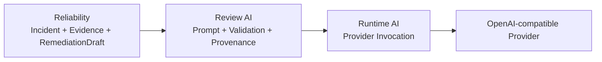

# Review AI: Evidence-Bound Advisory Review

**`review_ai`는 deterministic Reliability truth를 변경하지 않고, 제공된 evidence 안에서 advisory review를 생성하고 검증한다.** Review semantics와 provenance는 이 domain이 소유하고, provider 호출 mechanics는 `runtime_ai`에 위임한다.

## Scope

| In scope | Out of scope |
| --- | --- |
| review input/output contract와 prompt identity | incident detection과 recovery contract |
| bounded context projection과 canonical prompt rendering | provider SDK transport와 provider credential 관리 |
| deterministic output validation과 human utility evaluation | approval 또는 mutation authority |
| review orchestration과 invocation provenance | 범용 AI gateway, routing, agent framework |
| 검증된 synthetic invocation의 optional 외부 관찰 projection | 자동 계측, 외부 점수의 repository importer |

Review 실행과 validation의 normative behavior는 [`reliability-agentic-review`](../../openspec/specs/reliability-agentic-review/spec.md) Spec이 소유한다. 프롬프트 리소스 작성, 한국어 지시문·설명문과 변경 추적은 [`review-ai-prompt-engineering`](../../openspec/specs/review-ai-prompt-engineering/spec.md) Spec이 소유한다. Source는 current implementation을, tests는 executable expectation을 제공한다. Passing evidence는 matching repository revision의 command, CI result 또는 보존된 runtime evidence에서 확인한다.

## Dependency Boundary

Source dependency는 `review_ai -> reliability`와 `review_ai -> runtime_ai`만 허용한다. `Reliability`는 AI review를 import하지 않으며, `Runtime AI`는 review policy나 Reliability contract를 알지 않는다.

## Review Boundary

`review_null_spike()`는 deterministic `null_spike` `Incident`, 실제 `Evidence`와 `RemediationDraft`를 immutable review input으로 고정한다. Provider에 전달되는 input에는 incident 판단에 직접 관련된 Evidence의 bounded projection과 `missing_evidence`/`unconfirmed_context` gap이 포함된다. Provider output은 canonical identity, numeric facts와 provided evidence reference의 structured facts에 대조된다. Validation result는 structured-fact policy identity를 사용하며, 기존 forbidden-action evidence는 historical provenance로 보존된다. 결과는 acceptance, preflight rejection, provider unavailability, validation failure와 provenance failure를 typed result로 구분하며 exact input/output, status/failure mapping과 validation contract는 canonical Spec이 소유한다.

Provider가 실제로 호출된 logical review는 sanitized invocation evidence를 남긴다. Credential, raw rendered prompt, raw log와 raw provider error는 저장하지 않는다. Durable provenance의 required behavior와 record contract는 canonical Spec이 소유하고, exact implementation은 source에서 확인하며 tests는 executable expectation을 제공한다. Passing evidence는 matching repository revision의 command, CI result 또는 보존된 runtime evidence에서 확인한다.

Runtime이 반환한 응답 본문은 검증 전에 별도 로컬 파일에 보존하고 결과의 `response_path`로 제공한다. 따라서 출력 계약에 실패해도 실제 모델 답변을 조사할 수 있다. 이 파일의 보존은 review acceptance와 별개이며 sanitized record나 외부 projection에 원문을 추가하지 않는다.

Review utility는 `rubric_v1` human rubric으로 평가한다. `added_value`, `actionability`, `evidence_awareness`, `uncertainty_handling`, `prioritization`을 사람이 점수와 rationale로 판정하고, 같은 case/version/rubric/revision의 baseline/candidate 평가를 invocation identity, change-under-test와 human decision에 연결해 비교한다. Positive, restatement-negative와 hedging-negative 사례는 판별력을 확인하는 test fixture로만 사용한다. 이 계약은 전용 evaluation store나 고정 점수 proof runner를 제공하지 않고, 자동 LLM judge도 사용하지 않는다.

## Optional External Observation

명시적으로 활성화한 synthetic live harness는 local provenance를 검증한 뒤 허용된 invocation record를 Langfuse에 사후 projection할 수 있다. Projection은 Review AI의 public API, `runtime_ai` transport, local record 또는 acceptance authority를 변경하지 않는다. SDK는 optional이며 별도 process에서 실행되고, 실패는 core review 결과와 분리된다. 정확한 output digest를 유지하기 위해 SDK media detection/upload를 끈다. SDK 반환만으로 원격 ingestion이나 human evaluation 완료를 주장하지 않는다.

Review AI의 offline suite, live provider proof, human rubric 평가와 Langfuse local setup·projection·annotation 절차는 [Review AI Evaluation](../development/review-ai-evaluation.md)이 안내한다. Remote annotation을 repository evaluation으로 자동 import하지 않으며, 실제 utility 판단은 사람이 소유한다.

## Package Root API

`hmda_reliability.review_ai` package root는 review consumer가 직접 사용하는 최소 surface만 노출한다.

- `AgenticReviewInput`, `AgenticReviewOutput`, `AgenticReviewResult`
- `BoundedReviewContext`, `AgenticReviewUtilityContribution`
- `RUBRIC_V1`, `ReviewValueAssessment`, `ReviewValueComparisonEvidence`
- `PromptIdentity`
- `compare_review_value()`
- `review_null_spike()`

Prompt rendering, deterministic validation, provenance contract/store와 storage error는 domain 내부 module surface다. 필요할 때 owning module을 직접 읽고, 두 번째 외부 consumer가 생기기 전에는 package root API를 넓히지 않는다.

## Safety Boundaries

- Model output은 approval 또는 recovery authority가 아니다.
- Prompt에 전달되는 incident, evidence와 draft는 untrusted data로 취급한다.
- Provider output은 deterministic validation을 통과해도 Reliability truth를 수정하지 않는다.
- Provider 호출 전 거부된 input은 invocation provenance를 만들지 않는다.
- Review-specific provenance store는 두 번째 독립 consumer가 생기기 전까지 이 domain이 소유한다.

## Contracts And Evidence

- Canonical capability contract: [`reliability-agentic-review`](../../openspec/specs/reliability-agentic-review/spec.md)
- Current implementation: [`review_ai`](../../src/hmda_reliability/review_ai/)
- Executable specification: [`tests/review_ai`](../../tests/review_ai/)

## Reading Order

1. Exact review requirement를 판단할 때는 canonical [`reliability-agentic-review`](../../openspec/specs/reliability-agentic-review/spec.md) Spec을 확인한다.
1. [`review_ai/__init__.py`](../../src/hmda_reliability/review_ai/__init__.py)에서 current public surface를 확인한다.
1. [`contracts.py`](../../src/hmda_reliability/review_ai/contracts.py), [`context.py`](../../src/hmda_reliability/review_ai/context.py)와 [`prompt/`](../../src/hmda_reliability/review_ai/prompt/)에서 current review input, bounded context와 provider boundary 구현을 확인한다. 모듈의 분할·재사용·조립과 실제 메시지 전달은 [Prompt Composition](../development/review-ai-prompts.md)이 안내한다.
1. [`evaluation/value.py`](../../src/hmda_reliability/review_ai/evaluation/value.py)에서 human rubric과 baseline/candidate comparison contract를 확인한다.
1. [`evaluation/langfuse.py`](../../src/hmda_reliability/review_ai/evaluation/langfuse.py)에서 optional projection과 수동 annotation helper를 확인한다.
1. [`validator.py`](../../src/hmda_reliability/review_ai/validator.py)와 [`service.py`](../../src/hmda_reliability/review_ai/service.py)에서 current deterministic guard와 orchestration 구현을 확인한다.
1. Provider mechanics가 필요하면 [Runtime AI](runtime-ai.md)로 이동한다.
