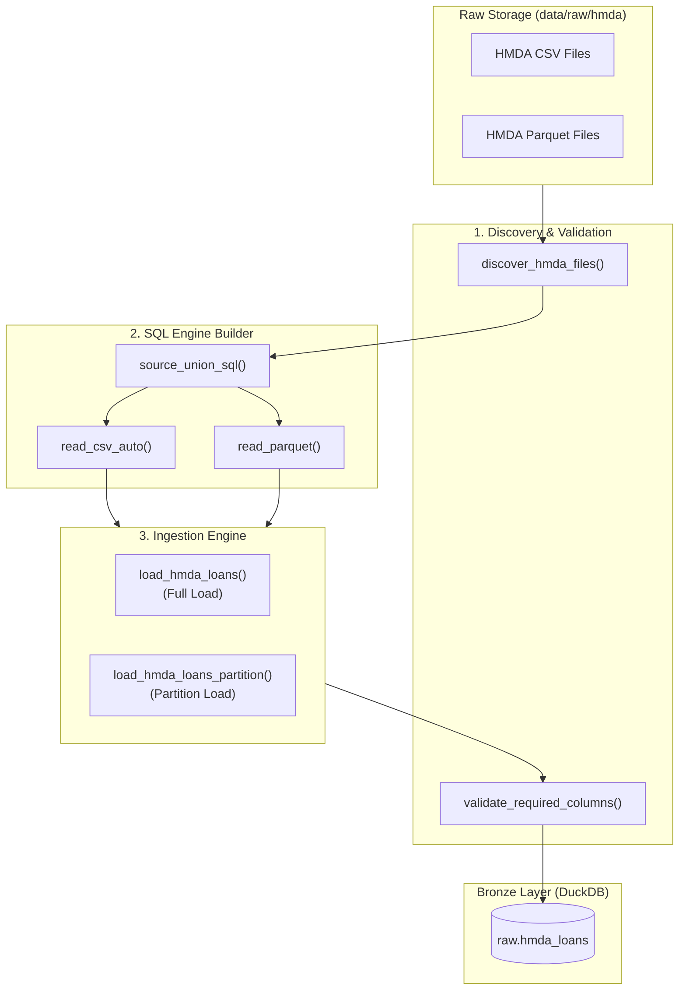

# HMDA Data Pipeline: Source to Bronze Layer Technical Report

## Summary

Project Pivot의 **Bronze Layer 파이프라인**은 `data/raw/hmda` 디렉터리의 원천 데이터(`.csv`, `.parquet`)를 감지·검증하고 메타데이터를 결합하여 DuckDB의 `raw.hmda_loans` 테이블로 멱등(Idempotent) 적재하는 구조입니다.

원천 데이터의 필드 타입이나 정규화를 강제하지 않고 원본 데이터를 그대로 보존하며, 전체 적재(`CREATE OR REPLACE`) 및 연도/파일 단위의 파티션 트랜잭션 적재 기능을 제공합니다.

---

## Bronze Pipeline Architecture

---

## Key Components and Logic Breakdown

### 1. 원천 파일 탐색 및 분류 ([src/project_pivot/hmda_data/ingestion/discovery.py](../../src/project_pivot/hmda_data/ingestion/discovery.py#L10-L46))

- **지원 확장자 검증**: `.csv` 및 `.parquet` 파일만 필터링하여 오름차순 정렬 처리합니다.
- **예외 처리 및 진단 로그**:
  - 지정한 원천 디렉터리가 없거나 지원 파일이 없는 경우 `HMDADataLoadError` 예외를 발생시킵니다.
  - 지원하지 않는 파일(예: `.txt`, `.json`)이 섞여 있을 경우 거부하지 않고 로그로 기록(`_LOGGER.info`)한 뒤 지원 파일만 진행합니다.

### 2. 동적 SQL 조립 및 메타데이터 추가 ([src/project_pivot/hmda_data/ingestion/_source_query.py](../../src/project_pivot/hmda_data/ingestion/_source_query.py#L10-L91))

- **포맷별 Reader 분기**:
  - CSV 파일: DuckDB `read_csv_auto(?, header=true, nullstr=['NA', ''], sample_size=200000, filename=true)` 사용
  - Parquet 파일: DuckDB `read_parquet(?, filename=true)` 사용
- **추적용 메타데이터 컬럼 자동 주입**:
  - `source_file`: 원천 파일의 전체 경로
  - `source_file_name`: `parse_filename(filename)`을 통한 순수 파일명
  - `source_year`: 파일명에서 추출한 4자리 연도 (`TRY_CAST(regexp_extract(..., '(\\d{4})', 1) AS INTEGER)`)
  - `ingested_at`: 적재 수행 시각 (`current_timestamp`)
- **이름 기반 스키마 병합**: 여러 원천 파일 간의 컬럼 순서나 구성을 `UNION ALL BY NAME`으로 유연하게 조합합니다.

### 3. 필수 컬럼 및 정합성 검증 ([src/project_pivot/hmda_data/ingestion/_common.py](../../src/project_pivot/hmda_data/ingestion/_common.py#L10-L40))

- **Required Columns**:
  - `activity_year`, `loan_purpose`, `action_taken`, `loan_amount`, `income`, `state_code`, `county_code`
- **검증 시점**: 테이블 생성 또는 파티션 교체 직후 필수 컬럼 누락 여부를 확인하며, 결손 발생 시 `HMDADataValidationError`를 던져 안전하게 원복합니다.

### 4. 멱등적 적재 (Idempotent Load Strategies)

| 구분 | 모듈 / 함수 | 동작 및 보장 방식 |
| --- | --- | --- |
| **전체 적재 (Full Load)** | [src/project_pivot/hmda_data/ingestion/full_load.py](../../src/project_pivot/hmda_data/ingestion/full_load.py#L22-L40) | • `CREATE OR REPLACE TABLE raw.hmda_loans` 구문을 수행하여 전체 재적재 시에도 중복이 발생하지 않는 원자성을 보장합니다. |
| **파티션 적재 (Partition Load)** | [src/project_pivot/hmda_data/ingestion/partition.py](../../src/project_pivot/hmda_data/ingestion/partition.py#L22-L60) | • 임시 스태이징 테이블(`__hmda_loans_partition_stage`)을 통해 데이터를 먼저 검증합니다. • 검증 성공 시 기존 대상 연도/파일 파티션을 `DELETE` 후 새 데이터를 `INSERT`하는 단일 트랜잭션 처리를 진행합니다. |

---

## Data Contract Specifications

| 사양 항목 | 규칙 및 계약 내용 | 참조 파일 |
| --- | --- | --- |
| **원천 디렉터리** | `data/raw/hmda` | [docs/domains/hmda-data.md](docs/domains/hmda-data.md#L19) |
| **타겟 스키마/테이블** | `raw.hmda_loans` | [src/project_pivot/hmda_data/ingestion/_common.py](../../src/project_pivot/hmda_data/ingestion/_common.py#L15) |
| **데이터 원본 보존** | 원천 필드의 Nullability 및 코드값 정규화를 수행하지 않고 원형 유지 | [docs/domains/hmda-data.md](../domains/hmda-data.md#L27) |
| **적재 오류 관리** | `HMDADataLoadError` (파일/적재 실패), `HMDADataValidationError` (필수 컬럼 누락) | [src/project_pivot/hmda_data/errors.py](../../src/project_pivot/hmda_data/errors.py) |
