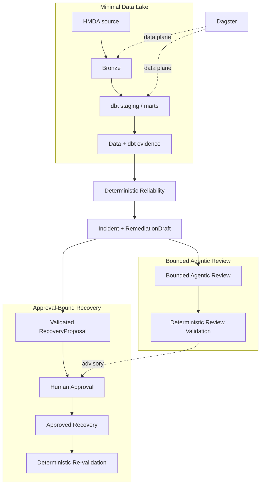

# MVP

> **Active goal:** 로컬 HMDA 데이터로 최소 Data Lake를 end-to-end로 실행하고,
> 그 위에서 evidence-first Reliability와 제한된 Agentic review가 안전하게 동작함을 증명한다.

이 문서는 **현재 MVP의 목표, scope와 acceptance만 소유한다.** 현재 구현 상태, validation 결과와 blocker는 여기서 관리하지 않는다.

MVP는 단순한 ETL 데모도, LLM을 붙인 anomaly demo도 아니다. **신뢰할 수 있는 데이터 상태를 만들고 → 문제를 결정론적으로 증명하고 → AI가 그 근거를 검토 가능한 형태로 해석하며 → 사람의 승인 뒤에만 복구하는 작은 완결 시스템**을 증명한다.

## MVP Value

MVP는 두 capability가 함께 존재해야 한다.

### Minimal Data Lake

HMDA Data가 local source를 검증해 DuckDB Bronze까지 적재하고, Data Platform이 그 Bronze를 dbt staging/mart로 변환한다. 결과는 downstream Reliability가 다시 추적할 수 있는 data와 dbt evidence를 남긴다.

### Agentic Reliability

Deterministic reliability layer를 먼저 만들고, 제한된 Agentic reviewer가 그 evidence와 기존 `RemediationDraft`를 설명·검토한다. AI 판단은 관찰·평가 가능해야 하며 실제 state change 권한은 갖지 않는다.

**Data Lake만 있거나 Agentic demo만 있어서는 이 MVP가 아니다.**

## System Proof

Dagster는 최소 Data Lake의 data plane을 실행한다. Reliability control-plane, Agentic review와 approval을 data plane에 암묵적으로 자동 결합하지 않는다. Agentic review는 MVP proof에는 필요하지만 기존 deterministic `RecoveryProposal` / approval / recovery contract의 authority를 대체하거나 새로운 authorization prerequisite를 만들지 않는다.

## System Invariants

1. **Deterministic truth first** — detection과 핵심 safety 판단을 LLM에 맡기지 않는다.
2. **Evidence-bound AI** — Agentic 판단은 저장소가 제공한 evidence와 deterministic `RemediationDraft`를 근거로 한다.
3. **Proposal-bound approval** — human approval은 검증된 `RecoveryProposal`에 결합된다.
4. **Advisory, not authoritative** — Agentic review는 human decision을 보조하지만 approval/recovery authority를 획득하거나 변경하지 않는다.
5. **Human-controlled mutation** — AI output만으로 데이터 state를 변경할 수 없다.
6. **Locally reproducible core** — Data Lake, Reliability와 safety contract는 외부 model 호출 없이 반복 검증할 수 있다.
7. **Observable live judgment** — 실제 Agentic invocation은 입력 근거, model/prompt 조건, 결과와 실행 비용·성능을 검토할 evidence를 남긴다.
8. **Acceptance over feature count** — 기능 수보다 하나의 완결된 proof로 MVP를 판단한다.

## Domain Completion Gates

[`domains/OVERVIEW.md`](domains/OVERVIEW.md)와 각 domain 문서는 domain 구조와 ownership을 설명하는 human-readable guide다. Current capability의 normative contract는 [`../openspec/specs/`](../openspec/specs/)가 소유한다. 여기서는 MVP에서 필요한 proof만 정의한다.

| Domain | MVP proof |
| --- | --- |
| [HMDA Data](domains/hmda-data.md) | 같은 source와 case에서 재현 가능한 Source → Bronze state와 synthetic incident input을 만든다. |
| [Data Platform](domains/data-platform.md) | Bronze → staging → mart와 채택된 dbt artifact/lineage evidence를 추적할 수 있다. |
| [Data Operations](domains/data-operations.md) | ingestion/dbt/reliability execution과 candidate/current adoption boundary, failure evidence가 명확하다. |
| [Reliability](domains/reliability.md) | deterministic incident → bounded Agentic review + validated proposal/approval → recovery → re-validation을 닫는다. |
| [Orchestration](domains/orchestration.md) | Bronze와 dbt analytical layer의 local data plane을 Dagster dependency로 반복 실행한다. |

## MVP Acceptance

하나의 current revision에서 다음 proof가 모두 성립하면 완료한다.

- **Data Lake proof** — HMDA source가 Bronze와 dbt analytical layer까지 재현 가능하게 흐른다.
- **Reliability proof** — 대표 synthetic incident를 deterministic evidence로 탐지·설명하고 recovery 뒤 같은 기준으로 다시 검증한다.
- **Agentic contract proof** — structured review contract, evidence binding, forbidden-action guardrail과 evaluation을 deterministic하게 반복 검증할 수 있다.
- **Live Agentic proof** — 같은 revision에서 실제 model invocation이 evidence와 `RemediationDraft`를 기반으로 structured review를 최소 한 번 만들고, model/config, prompt identity, project revision, evidence refs, output, latency와 제공 가능한 usage(token/cost)를 invocation evidence로 남긴다. 이 proof는 deterministic regression과 동일하게 취급하지 않는다.
- **Safety proof** — Agentic output은 deterministic guardrail과 proposal-bound human approval을 우회해 mutation을 일으킬 수 없고, LLM availability 자체가 recovery authority를 부여하거나 변경하지 않는다.
- **Reproducibility proof** — 정상, incident, recovery와 주요 failure/retry의 deterministic 결과를 같은 revision에서 다시 설명할 수 있고 live invocation 결과는 evidence로 보존된다.

## Scope

**In scope**

- local HMDA CSV/Parquet와 Source → DuckDB Bronze 적재
- dbt staging/marts와 artifact evidence
- Dagster local data plane
- deterministic profiling, incident, impact, `RemediationDraft`, recovery와 evaluation
- 대표 synthetic incident를 사용하는 최소 Agentic review
- Agentic contract evaluation과 최소 한 번의 observable live model proof
- validated `RecoveryProposal`, human approval, recovery와 re-validation

**Out of scope**

- cloud deployment와 distributed lakehouse
- 범용 multi-dataset ingestion platform
- 모든 incident type의 완전한 기능 parity
- LLM 기반 anomaly detection 또는 승인 없는 automatic recovery
- autonomous RCA, multi-agent workflow와 approval UI
- production SLO, security-grade authorization와 multi-host coordination
- 특정 LLM provider 또는 LLMOps vendor를 canonical source로 고정하는 것

## Lifecycle

이 문서는 MVP가 active인 동안만 유지한다. MVP 종료 시 durable architecture/domain guidance와 구현·검증된 capability contract를 각각 `docs/**`와 `openspec/specs/**`의 owning location에 반영한 뒤 이 phase 문서를 `main`에서 삭제한다. Historical 보존을 위한 별도 docs archive는 만들지 않는다.
