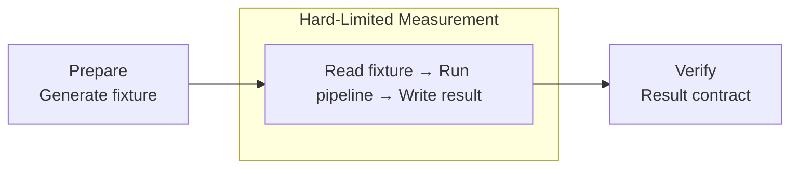

# OOM Testing: Python Data Pipeline Guide

**대표 workload가 정해진 process memory budget 안에서 정확한 결과를 만드는지 검증한다.** DuckDB, Polars 기반 로컬 data pipeline을 대상으로 별도 process에 실제 hard limit을 적용한다.

| Item | Scope |
| --- | --- |
| Target | DuckDB·Polars 기반 로컬 data pipeline |
| Resource boundary | 별도 process 또는 container의 hard limit |
| Pass condition | 정상 종료와 결과 정확성을 모두 충족 |

> [!WARNING]
> **통과 결과는 지정한 fixture, pipeline, resource 설정과 환경에만 적용된다.** 모든 입력에서 OOM이 발생하지 않는다는 보장이 아니다.

## 1. 무엇을 증명하는 테스트인가

다음 조건에서 안정적으로 동작했음을 증명한다.

- 지정된 데이터 특성
- 지정된 pipeline 경로
- 지정된 process 메모리 예산
- 지정된 thread와 temp disk 설정
- 지정된 timeout

따라서 결과는 다음처럼 표현한다.

> 대표 fixture를 사용한 pipeline이 process 메모리 3 GiB 제한 안에서 결과 검증을 통과했다.

`OOM-safe`, `메모리 문제 없음`처럼 범위가 불분명한 표현은 사용하지 않는다.

## 2. 테스트 계층

| 계층 | 목적 | 실행 시점 |
| --- | --- | --- |
| Correctness | 작은 데이터로 결과 로직 검증 | 모든 변경 |
| Memory budget | 대표 데이터로 메모리 예산 검증 | pipeline 변경·CI |
| Stress | skew·고 cardinality 등 최악 조건 탐색 | 수동·정기 실행 |

### Correctness test

작은 fixture로 schema, row 수, null 처리, 집계 결과를 빠르게 검증한다.

이 테스트는 OOM 안정성을 증명하지 않는다.

### Memory-budget test

대표 fixture를 사용해 별도 process 전체에 hard limit을 적용한다.

이 문서의 기본 검증 대상이다.

### Stress test

운영 데이터보다 불리한 조건을 넣어 pipeline의 한계를 찾는다.

- 극단적인 join skew
- 높은 group cardinality
- 긴 문자열
- 많은 partition과 작은 파일
- 대형 sort·window·join 연속 실행

Stress test 실패가 항상 결함을 뜻하지는 않는다. 발견된 한계와 허용 범위를 기록한다.

## 3. 핵심 원칙

### Process 전체에 Hard Limit을 적용한다

DuckDB `memory_limit`만으로는 충분하지 않다.

Python 객체, Arrow buffer, Polars, native library와 일부 DuckDB operation은 별도 메모리를 사용할 수 있다. 외부에서 process 전체 메모리를 제한해야 한다.

### Fixture 생성은 측정 밖에서 수행한다

fixture 생성까지 같은 제한 안에서 실행하면 pipeline이 아닌 데이터 생성기의 메모리가 결과에 섞인다.



fixture 생성 자체가 실제 pipeline에 포함되는 경우에만 측정 대상에 넣는다.

### 종료 상태와 결과 정확성을 함께 검증한다

process가 종료 코드 0으로 끝났어도 결과가 잘못되면 실패다.

반대로 OOM으로 종료된 process에는 결과 파일이 일부 남을 수 있으므로 파일 존재만으로 통과시키지 않는다.

## 4. 메모리 예산 정하기

예산은 실제 배포 또는 개인 개발 환경보다 약간 엄격하게 잡는다.

예시:

| 항목 | 시작값 |
| --- | ---: |
| Process hard limit | 3 GiB |
| DuckDB `memory_limit` | 1.5~1.8 GiB |
| DuckDB `threads` | 1~2 |
| `POLARS_MAX_THREADS` | 1~2 |
| Swap | 0 |
| Timeout | 15분 |

DuckDB 내부 예산은 process hard limit보다 충분히 낮게 둔다. 남은 공간은 Python, Arrow, Polars와 native overhead가 사용한다.

값은 공식 상한이 아니라 보수적인 시작점이다. 실제 workload 측정 후 조정한다.

## 5. 대표 fixture 설계

row 수만 실제와 비슷하게 만드는 것으로는 부족하다.

| 특성 | 확인할 내용 |
| --- | --- |
| Schema | column 수, dtype, nested type |
| Row 폭 | 문자열과 binary 평균·최대 길이 |
| Null | column별 null 비율 |
| Cardinality | join key와 group key의 distinct 수 |
| Skew | 특정 key에 row가 몰리는 정도 |
| Files | 파일 수와 평균 파일 크기 |
| Partition | partition 수와 불균형 |
| Operations | 실제 join·sort·group·window 조합 |

대표 fixture는 deterministic하게 생성하고 seed와 생성 설정을 저장한다.

fixture 식별 정보 예시:

```yaml
fixture: trips-medium-v1
seed: 20260730
rows: 20000000
files: 64
join_key_distinct: 1800000
null_rate:
  zone_id: 0.02
  fare_amount: 0.01
```

## 6. pytest 구성

Memory test를 일반 unit test와 분리한다.

```toml
[tool.pytest.ini_options]
addopts = ["--strict-markers"]
markers = [
  "memory: representative process-level memory-budget test",
  "stress: worst-case resource stress test",
]
```

테스트는 pipeline의 public entrypoint를 호출하고 결과 계약을 검증한다.

```python
from pathlib import Path

import pytest

from project.pipeline import run_pipeline


@pytest.mark.memory
def test_pipeline_completes_with_representative_fixture(
    representative_fixture: Path,
    tmp_path: Path,
) -> None:
    output_path = tmp_path / "result.parquet"

    result = run_pipeline(
        source_path=representative_fixture,
        output_path=output_path,
        duckdb_memory_limit="1600MB",
        duckdb_threads=2,
        duckdb_temp_directory=tmp_path / "duckdb-temp",
    )

    assert result.succeeded
    assert output_path.exists()
    assert_output_contract(output_path)
```

fixture는 session fixture에서 즉석 생성하지 않는 것을 기본으로 한다. 미리 준비된 파일이나 이전 CI step에서 생성한 artifact를 사용한다.

Memory gate는 일반 Python entrypoint를 호출해 검증하며, UI나 notebook을 별도 실행 단위로 두지 않는다.

## 7. WSL·Linux 실행

### 사전 확인

다음 명령이 성공해야 user systemd와 cgroup memory control을 사용할 수 있다.

```bash
systemd-run --user --wait --pipe \
  -p MemoryMax=64M \
  true
```

실패하면 systemd가 활성화되어 있는지 확인한다. 메모리 제한을 적용하지 못한 실행은 memory-budget test로 인정하지 않는다.

### 표준 실행

```bash
systemd-run --user --wait --pipe --collect \
  --unit=pipeline-memory-test \
  -p "WorkingDirectory=$PWD" \
  -p MemoryMax=3G \
  -p MemorySwapMax=0 \
  /usr/bin/time -v \
  env \
    POLARS_MAX_THREADS=2 \
    POLARS_VERBOSE=1 \
  timeout --signal=TERM 15m \
  uv run pytest -m memory -q
```

각 장치의 역할:

| 장치 | 역할 |
| --- | --- |
| `MemoryMax=3G` | process tree 전체 hard limit |
| `MemorySwapMax=0` | swap으로 memory pressure를 숨기지 않음 |
| `/usr/bin/time -v` | peak RSS와 실행 시간 관측 |
| `timeout 15m` | 비정상 장기 실행 차단 |
| `POLARS_VERBOSE=1` | streaming fallback 진단 |
| `pytest -m memory` | memory test만 선택 |

> [!IMPORTANT]
> **`/usr/bin/time -v`는 memory를 측정할 뿐 제한하지 않는다.** Memory-budget test에는 systemd, container runtime 등 실제 hard limit이 필요하다.

### systemd를 사용할 수 없는 환경

container runtime이나 CI runner가 제공하는 process/container memory limit을 사용한다.

예시 원칙:

```text
container memory limit = process budget
container swap limit = memory limit
내부 DuckDB limit < container memory limit
```

`ulimit -v`나 Python 내부 RSS 감시만을 기본 hard limit으로 사용하지 않는다. native allocation과 memory mapping에서 동작이 환경별로 달라질 수 있다.

## 8. Pass Criteria

다음 조건을 모두 충족해야 한다.

- test command exit code가 0
- systemd 또는 container가 memory limit 초과로 종료하지 않음
- timeout 미초과
- output schema 정상
- 핵심 row 수와 business invariant 정상
- output이 완전하게 commit됨
- temp disk limit 미초과
- 허용되지 않은 Polars fallback이 없음

### 결과 검증 예시

대형 결과에 전체 row 비교를 강제하지 않는다.

- schema 비교
- row count
- key uniqueness
- null invariant
- 금액·수량 합계
- min/max 범위
- partition별 count
- 정렬과 무관한 checksum

정렬되지 않은 결과에 파일 byte checksum을 사용하면 실행마다 값이 달라질 수 있다. 논리적 결과를 canonicalize하거나 order-independent invariant를 사용한다.

## 9. 반복 실행과 여유율

메모리 peak는 allocator, file layout와 실행 순서에 따라 달라질 수 있다.

- 같은 fixture로 3회 실행
- 세 실행 중 최대 peak RSS 기록
- hard limit에 15~25% 이상의 여유 확보
- 결과와 환경 정보를 함께 저장

예를 들어 3 GiB 제한에서 peak RSS가 반복적으로 2.9 GiB라면 통과했더라도 안정적이라고 보지 않는다.

권장 판정:

| Peak 사용률 | 판정 |
| ---: | --- |
| 75% 이하 | 양호 |
| 75~85% | 관찰 |
| 85% 초과 | 개선 필요 |
| limit 초과 | 실패 |

이 비율은 프로젝트 정책이며 보편적인 성능 기준은 아니다.

## 10. Failure Diagnosis

### 종료 코드만으로 OOM을 단정하지 않는다

`137`은 보통 `SIGKILL`을 의미하지만 원인이 반드시 OOM인 것은 아니다.

다음을 함께 확인한다.

```bash
journalctl --user -u pipeline-memory-test
journalctl -k --since "10 minutes ago"
dmesg | tail -n 100
```

WSL 환경과 권한 설정에 따라 kernel log 접근이 제한될 수 있다.

### 진단 순서

1. eager materialization을 찾는다.
1. DuckDB `threads`를 낮춘다.
1. DuckDB `memory_limit`을 process limit보다 더 낮춘다.
1. `WHERE`와 projection을 앞당긴다.
1. `.df()`, `.pl()`, `.fetchall()`, `.to_arrow_table()`, `collect()`을 제거한다.
1. 큰 결과를 `COPY ... TO`, `write_parquet()` 또는 `sink_*()`로 바꾼다.
1. join·sort·window 사이에 stage를 만든다.
1. join skew와 group cardinality를 확인한다.
1. temp directory 공간과 limit을 확인한다.
1. Polars fallback 로그와 physical plan을 확인한다.

메모리 예산을 올려 테스트를 통과시키기 전에 pipeline 개선 가능성을 먼저 검토한다.

## 11. CI 운영

### 실행 정책

| 변경 | Correctness | Memory budget | Stress |
| --- | ---: | ---: | ---: |
| 일반 로직 | 필수 | 선택 | 불필요 |
| scan·join·group 변경 | 필수 | 필수 | 선택 |
| dtype·schema 변경 | 필수 | 필수 | 선택 |
| partition 전략 변경 | 필수 | 필수 | 권장 |
| 성능 최적화 | 필수 | 필수 | 권장 |

Memory test는 일반 unit test와 다른 job으로 분리한다.

- memory limit을 실제로 강제할 수 있는 runner 사용
- 동일한 fixture와 tool version 고정
- 동시에 다른 무거운 job을 실행하지 않음
- peak RSS, elapsed time, temp disk와 결과 invariant 기록
- 이전 기준과 비교하되 작은 변동만으로 실패시키지 않음

runner 자체의 메모리가 매번 달라지는 환경에서는 결과를 release gate로 사용하지 않는다.

## 12. 에이전트 작업 규칙

에이전트는 다음을 지킨다.

- memory test를 실행하지 않았다면 OOM 안정성을 검증했다고 말하지 않는다.
- `memory_limit` 설정만으로 process 전체가 제한되었다고 가정하지 않는다.
- fixture 생성 비용과 pipeline 실행 비용을 구분한다.
- 대표 fixture의 schema, cardinality와 skew를 기록한다.
- 실행 command, memory budget, peak RSS와 결과를 보고한다.
- 실패 시 예산을 먼저 늘리지 않고 eager 경계와 blocking operation을 조사한다.
- 테스트 통과 범위를 데이터·예산·환경과 함께 명시한다.

권장 보고 형식:

```text
Result: PASS
Case: trips-medium-v1
Process limit: 3 GiB
DuckDB limit: 1.6 GiB
Threads: DuckDB 2 / Polars 2
Peak RSS: 2.2 GiB
Elapsed: 4m 18s
Output: schema, row count, invariants passed
Environment: WSL2 Ubuntu, Python/DuckDB/Polars versions recorded
```

## 13. Minimum Checklist

- [ ] correctness test와 memory test를 분리했다.
- [ ] fixture를 측정 구간 밖에서 준비했다.
- [ ] fixture가 실제 schema·cardinality·skew를 반영한다.
- [ ] 별도 process 또는 container에 hard limit을 적용했다.
- [ ] swap과 timeout 정책을 명시했다.
- [ ] DuckDB 내부 limit을 외부 limit보다 낮게 설정했다.
- [ ] 결과 schema·row 수·invariant를 검증했다.
- [ ] peak RSS와 실행 시간을 기록했다.
- [ ] 동일 조건으로 반복 실행했다.
- [ ] 통과 범위와 환경을 보고했다.

## 공식 참고 자료

### DuckDB

- [Out-of-Memory Issues](https://duckdb.org/docs/current/guides/performance/oom)
- [Limits](https://duckdb.org/docs/current/operations_manual/limits)

### Polars

- [LazyFrame API](https://docs.pola.rs/api/python/stable/reference/lazyframe/)

### pytest

- [How to mark test functions](https://docs.pytest.org/en/stable/how-to/mark.html)
- [How to invoke pytest](https://docs.pytest.org/en/stable/how-to/usage.html)

### systemd

- [systemd-run](https://www.freedesktop.org/software/systemd/man/latest/systemd-run.html)
- [systemd.resource-control](https://www.freedesktop.org/software/systemd/man/latest/systemd.resource-control.html)
