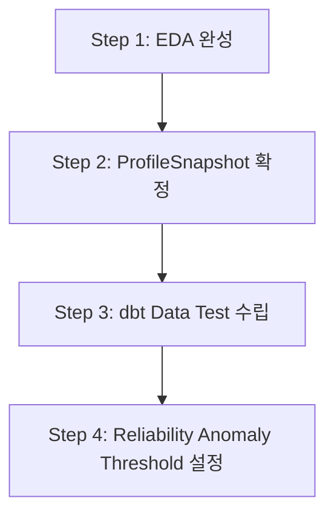

# HMDA EDA 진행 현황 및 후속 실행 과제 제안서

## 1. 현재 EDA 진행 현황 (Current Progress)

현재 `notebooks/eda_mo.py` 기반으로 HMDA 원천 데이터(`data/raw/hmda/year_2025.csv`)에 대한 1차 탐색이 진행되었습니다.

### 완료 항목

- **DuckDB 기반 CSV 자동 스키마 추론**: sample size 200,000 기준 raw data 로딩 구조 구현.
- **필수 컬럼 스키마 검증**: `activity_year`, `state_code`, `county_code`, `loan_purpose`, `action_taken`, `loan_amount`, `income` 7개 핵심 컬럼 타입 및 존재 여부 확인.
- **기본 프로파일링 산출**: 전체 행 수(Row count), 연도별 파티션 건수, 필수 컬럼별 Null 개수 및 결측률(Null rate) 측정.
- **Freshness 및 Hash 산출**: `observed_at` 타임스탬프 기반 freshness 측정 체계 및 `schema_hash` 생성 매핑 정의.

---

## 2. 미완료 분석 항목 (Remaining EDA Scope)

현재 EDA는 기초 스키마 및 결측률 측정 단계에 머물러 있으며, 후속 파이프라인 구축을 위해 아래 핵심 탐색이 추가 필요합니다.

### A. 수치형 데이터 분포 및 이상치 탐색

- `loan_amount`, `income` 컬럼의 분위수(Percentiles: p25, p50, p75, p99) 및 극단값/음수/0값 분포 확인.
- 소득 대비 대출금액 비율(`loan_amount / income`)의 비정상 분포 파악.

### B. 범주형 데이터 도메인 유효성 검증

- `action_taken`, `loan_purpose` 코드값의 HMDA 공식 규격 대비 미정의 값(Unmapped code) 존재 여부.
- `state_code`, `county_code` FIPS 코드의 자리수, 포맷 및 유효 지역 코드 검증.

### C. 데이터 오염 패턴 및 결합 결측 분석

- 특정 주(State) 또는 대출 목적(Loan Purpose)에 집중된 결측 패턴(Multi-column missingness) 분석.

---

## 3. 후속 실행 제안 (Next Steps Roadmap)

EDA 결과를 dbt 파이프라인 및 Data Reliability lifecycle에 연결하기 위한 4단계 액션 플랜입니다.

### Step 1: EDA 추가 탐색 완료 (1차)

- DuckDB SQL 쿼리로 이상치/범주 분포 요약 통계 산출.
- 복잡한 시각화 대신 DuckDB 집계 결과를 표 단위로 빠르게 확정.

### Step 2: ProfileSnapshot 스키마 및 영구화 확정

- `eda_evidence` 구조를 production `ProfileSnapshot` 모델과 1:1 동기화.
- Bronze 적재 시 프로파일링 결과가 JSON/테이블 형태로 자동 저장되도록 구조화.

### Step 3: dbt Silver/Gold 품질 검증 규칙 수립

- EDA에서 파악된 정상 범위를 dbt test 제약조건으로 전환.
  - `not_null`: 필수 7개 컬럼
  - `accepted_values`: `action_taken`, `loan_purpose`
  - `dbt_expectations` 또는 수치 범주 test: `loan_amount > 0`

### Step 4: Reliability Lifecycle 연계 (Anomaly Detection)

- raw 데이터 적재 시 Schema Drift 및 Null rate spike 감지 기준값 설정.
- Incident 발생 시 Remediation draft 생성을 위한 baseline 데이터 세팅.

---

## 4. 효율 중심 (Ponytail / YAGNI) 가이드라인

- **커스텀 데이터 프로파일러 작성 금지**: DuckDB 내장 통계 함수(`summarize()`, `quantile_cont()`) 활용.
- **과도한 시각화 지양**: EDA 목적은 파이프라인 제약조건 도출이므로 숫자로 검증 가능한 표(Table) 위주 정제.
- **불필요한 전처리 프레임워크 도입 지양**: dbt 기본 test 기능으로 커버 가능한 규칙은 dbt schema.yml에 즉각 반영.
