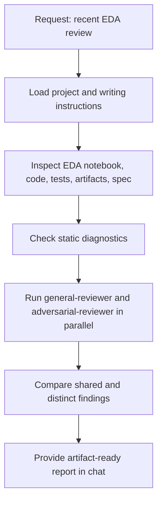
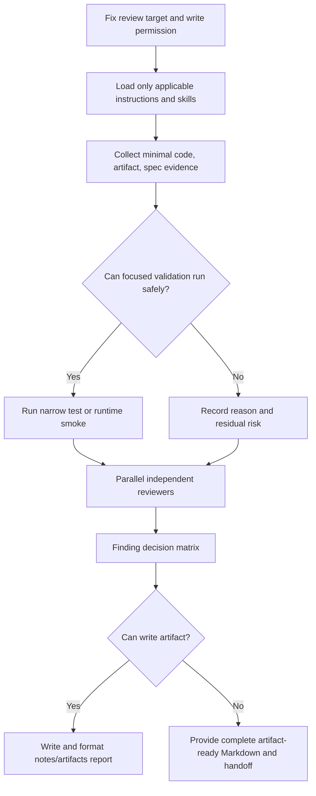

# EDA Review Agent Asset 및 Workflow 개선 보고서

## Summary

이번 HMDA EDA review는 code, test, artifact, canonical spec을 대조하고 서로
다른 관점의 reviewer 두 명을 병렬 실행했다. 정적 review 품질은 양호했지만,
EDA 특성상 중요한 runtime validation과 요청된 Markdown artifact 전달은
완료하지 못했다.

종합 평가는 **6.5/10**이다.

| Dimension | Score | Assessment |
| --- | ---: | --- |
| Review target 설정 | 8.0/10 | notebook, shared entrypoint, fixture, memory runner, report, spec을 핵심 범위로 잡았다. |
| Instruction routing | 7.5/10 | project, Korean, Markdown 지침을 적용했다. |
| Evidence inspection | 8.0/10 | code, tests, manifest, memory report, full-source evidence, diagnostics를 교차 확인했다. |
| Subagent delegation | 8.5/10 | 일반 correctness와 adversarial 관점을 병렬로 분리했다. |
| Runtime/test validation | 3.5/10 | 실제 focused test 또는 memory runner 재실행의 증거가 없다. |
| EDA-specific asset usage | 4.5/10 | `prj-testing`을 명시적으로 적용하지 않았고 Marimo runtime 검증을 수행하지 않았다. |
| Finding synthesis traceability | 6.0/10 | 공통 finding을 대조했지만 채택·기각·보류 근거 matrix가 남지 않았다. |
| Requested deliverable completion | 2.0/10 | mode 제약을 준수했지만 `notes/artifacts` file은 생성되지 않았다. |

## Workflow Performed



### Effective Steps

- Project rules, development guide, architecture guide, Korean, Markdown guidance를
  먼저 읽었다.
- 최근 EDA의 실제 구현과 evidence를 함께 읽었다.
  - shared EDA entrypoint
  - deterministic fixture manifest
  - process-level memory report
  - full-source observation
  - canonical OpenSpec requirement
- `general-reviewer`와 `adversarial-reviewer`를 병렬 실행했다.
- 두 reviewer가 공통으로 지적한 fixture-contract validation 공백을
  최우선 finding으로 통합했다.
- full-source uncontrolled peak RSS와 fixture-level 3 GiB 통과를 구분했다.

## Material Workflow Gaps

### P1: Runtime Validation Asset를 사용하지 않았다

[DEVELOPMENT](../../../docs/DEVELOPMENT.md)는 HMDA EDA correctness test와 memory
workload의 전용 실행 경로를 제공한다. 그러나 이번 review에서는 test code와
저장된 결과를 읽었을 뿐, 다음과 같은 focused validation을 재실행한 증거가 없다.

```bash
uv run pytest tests/hmda_data/test_eda.py \
  tests/hmda_data/test_eda_fixture.py \
  tests/hmda_data/test_eda_memory_helpers.py
```

영향:

- finding이 정적 code review인지, 실행으로 확인된 결함인지 구분하기 어렵다.
- artifact가 현재 working tree와 동기화되어 있는지 확인하지 못한다.
- memory report의 `3/3 passed`는 과거 evidence로만 취급해야 한다.

개선:

1. test를 단순 열람할 때와 실제 validation을 설계·실행할 때를 구분한다.
1. validation을 선택할 때 `prj-testing` skill을 먼저 적용한다.
1. 실행이 state change를 유발하거나 권한과 충돌하면 실행하지 않은 이유와
   residual risk를 보고서에 명시한다.
1. 각 finding에 `Evidence`, `Validation`, `Remaining uncertainty`를 기록한다.

### P1: Requested Artifact 전달이 끊겼다

사용자는 review report를 `notes/artifacts`에 작성해 달라고 요청했다. 그러나
Review Orchestrator mode는 repository state 변경을 금지하므로 파일 작성이
수행되지 않았다.

파일을 쓰지 않은 것은 mode 준수지만, 사용자가 요청한 deliverable은 미완료다.

개선:

- 작업 시작 시 `requested artifact path`, `current write permission`, `chat fallback`을
  분리해 결정한다.
- write 권한이 없으면 즉시 artifact-ready Markdown 전체를 제공하고,
  state-write 권한이 있는 agent 또는 다음 turn으로 명시적 handoff한다.
- "파일 작성 불가"와 "review 수행 불가"를 혼동하지 않는다.

### P2: EDA Notebook Runtime 경계를 확인하지 않았다

대상에는 [EDA notebook](../../../notebooks/eda_mo.py)이 포함된다. 정적 diagnostics는
통과했지만, 다음 항목은 이번 review에서 확인되지 않았다.

- active Marimo kernel이 있는지
- UI button state 변경 뒤 계산 cell이 올바르게 재실행되는지
- parse failure 뒤 stale `eda_evidence`가 남지 않는지
- 현재 artifact와 notebook output이 일치하는지

`marimo-pair-vscode` skill은 active notebook kernel이 있는 경우 적용 가능한
workflow다. 현재 active kernel 존재 여부를 먼저 확인하지 않았으므로, 해당 asset를
적용하지 않은 것은 명확한 누락이라기보다 **판단 근거가 없는 생략**이다.

개선:

1. notebook review 시작 시 active kernel 여부를 확인한다.
1. kernel이 있으면 Marimo workflow를 적용해 정상 fixture와 malformed fixture
   smoke를 분리 실행한다.
1. kernel이 없으면 static review로 범위를 제한하고 runtime state는
   미검증으로 명시한다.

### P2: Reviewer 결과의 채택·기각 과정이 Artifact로 남지 않았다

병렬 delegation 자체는 좋았다. 일반 reviewer는 contract와 regression을,
adversarial reviewer는 false pass, failure cleanup, traceability를 집중했다.

하지만 최종 report에는 다음 판단의 근거가 구조적으로 남지 않았다.

- 두 reviewer가 공통으로 제시한 finding
- 한 reviewer만 제시했지만 채택한 finding
- evidence 부족으로 보류하거나 기각한 finding
- 기존 completion report의 boundary statement를 문제로 보지 않은 이유

개선:

| Candidate finding | Reviewer | Evidence checked | Decision | Reason |
| --- | --- | --- | --- | --- |
| Fixture contract is not enforced | Both | manifest validation, spec, tests | Accepted | spec requirement과 실제 validation의 gap이 직접 확인됨 |
| Runner cleanup failure | Adversarial | exception path in runner | Accepted | cleanup/report write가 `finally`로 보장되지 않음 |
| Full-source guarantee overclaim | Both | completion report | Rejected | report가 fixture-level 결과와 full-source observation을 명시적으로 구분함 |

이 matrix는 finding 수를 늘리기 위한 장치가 아니라, 최종 판단의 재현성을 위한
최소 evidence ledger다.

### P3: Asset 사용의 목적 구분이 약했다

이번 workflow에서 Ponytail guidance는 범위 확장 방지에는 도움이 됐지만, EDA
품질의 핵심인 data provenance, artifact freshness, fixture representativeness,
runtime behavior를 대신 검증하지는 못한다.

개선:

- Ponytail: 불필요한 탐색·변경·추상화 억제에 한정한다.
- `prj-testing`: test 선택과 실행 근거에 사용한다.
- Marimo workflow: live notebook state가 review 결론에 영향을 줄 때 사용한다.
- Reviewer agents: 독립적 counterexample 탐색과 finding quality 향상에 사용한다.
- Chronicle: 과거 session과 반복된 workflow friction을 근거로 개선점을 도출할 때
  사용한다.

## Asset Usage Matrix

| Asset or mechanism | Used | Quality | Improvement |
| --- | --- | --- | --- |
| Project rules and architecture docs | Yes | Good | Review target과 system boundary 고정에 활용 |
| Korean and Markdown instructions | Yes | Good | Artifact-ready Markdown 구조에 반영 |
| Ponytail | Yes | Partial | 범위 절제에 한정하고 EDA validation 대체 수단으로 쓰지 않기 |
| `general-reviewer` | Yes | Good | correctness, regression, contract review 담당 |
| `adversarial-reviewer` | Yes | Good | false pass, cleanup, traceability 반증 담당 |
| `prj-testing` | No | Material gap | test validation 선택·실행 전 필수 적용 |
| Marimo runtime workflow | Not verified | Material gap | active kernel 여부 확인 후 적용 또는 제한 명시 |
| Chronicle | Yes, after review | Useful | 반복되는 EDA workflow friction을 session history로 확인 |
| State-write-capable delivery path | No | Material gap | report artifact를 실제 생성할 권한/agent를 초기에 결정 |

## Evidence From Recent Sessions

최근 session history는 EDA 관련 작업이 연속적으로 이어졌음을 보여 준다.

| Date | Session theme | Workflow signal |
| --- | --- | --- |
| 2026-07-29 | EDA schema 및 review planning | EDA contract 정의가 반복 논의됨 |
| 2026-07-30 | notebook OOM 발생 | runtime memory validation 필요성이 명확해짐 |
| 2026-07-30 | EDA normalization 및 file split 논의 | scope와 artifact 구조가 여러 session에 분산됨 |
| 2026-07-31 | implementation completion 확인 | implementation evidence와 completion report가 생성됨 |
| 2026-07-31 | current EDA review | 구현 결과의 독립 review와 artifact 작성 요청 |

이 패턴은 EDA의 설계, 구현, memory validation, review가 별도 session으로
분리되면서 context handoff 비용이 커졌음을 의미한다. 다음 EDA 변경은
"contract -> implementation -> runtime validation -> independent review ->
artifact delivery"의 순서를 하나의 명시적 workflow로 고정하는 편이 낫다.

## Recommended Workflow



### Operating Rules

1. 시작 전에 target, behavior, requested artifact path, write permission을
   한 문장으로 고정한다.
1. `notebooks/*.py`가 target이면 active Marimo kernel 존재 여부를 먼저 확인한다.
1. pytest를 선택하거나 실행하면 `prj-testing` skill을 먼저 적용한다.
1. reviewer에게 동일 target을 주되 질문을 겹치지 않게 배분한다.
1. finding마다 severity, reachability, evidence, validation status, residual risk를
   기록한다.
1. final report에는 채택·기각·보류된 reviewer claim의 판단 근거를 남긴다.
1. mode가 file write를 막는 경우 report를 "제안"으로 축약하지 않고
   artifact-ready 본문 전체를 제공한다.

## Final Assessment

이번 review는 static evidence와 독립 reviewer 관점에서는 충분히 신중했다.
특히 fixture contract의 P1 문제를 두 reviewer의 독립적인 근거로 확인한 점은
강점이다.

그러나 EDA는 runtime, data artifact, notebook state의 영향을 크게 받는다.
따라서 다음 review부터는 test/Marimo validation routing과 file deliverable
권한 결정을 초기에 수행해야 한다.

가장 큰 개선 한 가지는 다음이다.

> **Review target을 읽은 직후, `runtime validation 가능 여부`와
> `artifact write 권한`을 먼저 판정한다.**

이 순서만 고정해도 검증 한계와 deliverable 누락을 동시에 줄일 수 있다.
