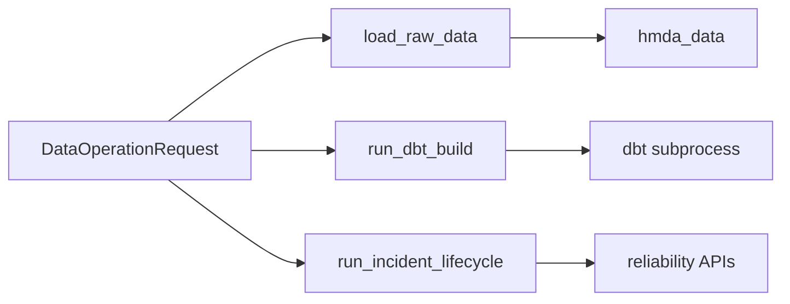

# Data Operations Domain Guide

## Summary

`data_operations`는 여러 도메인 API를 하나의 실행 request와 결과로 묶는 application boundary다. 이 도메인의 가치는 새로운 데이터 규칙을 만드는 데 있지 않고, **어떤 순서로 호출하고 어떤 오류와 결과를 외부에 보일지**를 일관되게 만드는 데 있다.

외부 caller, Dagster asset, test가 데이터를 실행하려면 여기의 public API를 사용한다. 파일 parsing, DuckDB SQL, incident threshold를 이 layer에 넣지 않는다.

## Overview



| Public API | 조합하는 하위 도메인 | 반환값 |
| --- | --- | --- |
| `load_raw_data()` | `hmda_data` | `RawLoadResult` |
| `run_dbt_build()` | dbt CLI와 artifact filesystem | `DbtBuildResult` |
| `run_incident_lifecycle()` | `reliability` | `LifecycleResult` |

구현은 `src/project_pivot/data_operations/`에 있고, public import surface는 `__init__.py`다.

## Mental Model

이 도메인을 “application service”로 생각하면 경계가 명확하다.

- request model은 caller의 configuration을 검증한다.
- runner는 하위 도메인을 정해진 순서로 호출한다.
- result model은 외부가 검사할 안정된 결과를 제공한다.
- error boundary는 세부 오류를 caller가 이해할 수 있는 `DataOperationError`로 통일한다.

여기서는 business rule을 재구현하지 않는다. 예를 들어 `load_raw_data()`는 어떤 column이 필수인지 판단하지 않고 `hmda_data`에 위임한다. lifecycle도 incident를 직접 탐지하지 않고 reliability의 profile, detection, impact, remediation을 순서대로 조합한다.

## Core Contracts

### DataOperationRequest

`request.py`의 `DataOperationRequest`는 database path, source root, source year, 선택 source file, dbt 실행 여부처럼 실행마다 달라지는 input을 묶는다. 기본값은 로컬 HMDA·DuckDB·dbt 구조를 가리키며, 알 수 없는 field는 거부된다.

이 모델을 직접 받는 장점은 CLI, Dagster, 테스트가 각자 dictionary를 해석하지 않는다는 점이다. configuration 규칙을 늘릴 때도 runner signature가 늘어나지 않는다.

### Raw load

`load_raw_data()`의 작업은 파일을 발견하고 적절한 전체·partition ingestion API를 호출한 뒤 `RawLoadResult`로 행 수와 파일 수를 반환하는 것이다. 이 결과는 “실행이 무엇을 처리했는지”를 보여주며 file parsing의 세부 자료구조를 노출하지 않는다.

### dbt build

`run_dbt_build()`는 `dbt build` 실행을 위한 신뢰 경계다.

1. 이전 artifact를 제거한다.
1. subprocess를 실행하고 timeout과 exit code를 확인한다.
1. 새 `manifest.json`, `run_results.json`이 모두 생겼는지 검증한다.

종료 코드가 0이어도 새 artifact가 없으면 성공이 아니다. 이후 reliability 영향 분석은 이 artifact를 근거로 동작하므로 오래된 파일을 남기면 잘못된 lineage가 incident에 붙을 수 있다.

### Read-only lifecycle

`run_incident_lifecycle()`의 고정 순서는 다음과 같다.

```text
current profile
-> baseline compatibility
-> incident detection
-> dbt downstream impact
-> remediation draft
-> ordered deduplication and summary
```

이 함수는 read-only다. approval, backfill, validation, evaluation, report write는 호출하지 않는다. side effect가 필요한 recovery와 evaluation은 reliability의 별도 API다.

## Usage Guide

| 상황 | 먼저 확인할 위치 | 다음 판단 |
| --- | --- | --- |
| caller가 실행 설정을 전달 | `request.py` | 새 field가 request contract에 필요한가? |
| raw load 결과가 필요 | `runner.py`, `raw_result.py` | filename·행 수처럼 실행 관찰값만 result로 노출하는가? |
| dbt가 성공인데 downstream 실패 | `runner.py`, `DbtBuildResult` | 새 artifact가 생성·검증되었는가? |
| lifecycle에서 중복 incident가 보임 | `incident_lifecycle.py`, `lifecycle_result.py` | 탐지 순서는 유지하면서 summary만 중복 제거하는가? |
| Dagster config가 달라짐 | `orchestration/defs/resource.py` | config conversion 후 request contract는 같은가? |

## Boundaries

| 인접 도메인 | Data Operations가 의존하는 방식 |
| --- | --- |
| `hmda_data` | 발견·검증·Bronze 적재를 호출 |
| `data_platform` | DuckDB와 dbt model의 결과를 사용하지만 내부 helper를 재구현하지 않음 |
| `reliability` | lifecycle의 단계 API를 read-only로 조합 |
| `orchestration` | public API를 호출할 configuration adapter |

이 layer가 커질 때 가장 먼저 물어볼 질문은 “이 규칙이 실행 순서·입출력·오류 경계에 관한가?”다. 아니라면 소유 도메인으로 내려보내는 편이 변경 영향이 작다.

## Pitfalls

- runner에서 DuckDB query나 incident threshold를 직접 구현하면 같은 규칙이 도메인과 application layer에 중복된다.
- `DbtBuildResult`가 성공을 나타내도 artifact 검증을 건너뛰면 reliability가 이전 실행의 lineage를 읽을 수 있다.
- lifecycle 함수에 recovery를 넣으면 read-only 분석과 승인된 변경의 boundary가 사라진다.
- Pydantic result를 mutable dictionary로 바꾸면 caller마다 결과 해석이 달라진다.

## Reading Path

1. `src/project_pivot/data_operations/__init__.py`
1. `src/project_pivot/data_operations/request.py`
1. `src/project_pivot/data_operations/runner.py`
1. `src/project_pivot/data_operations/incident_lifecycle.py`
1. `raw_result.py`, `dbt_result.py`, `lifecycle_result.py`, `errors.py`
1. `tests/data_operations/`

## Project Evidence

- `docs/domains/data-operations.md`
- `docs/ARCHITECTURE.md`
- `tests/data_operations/`
