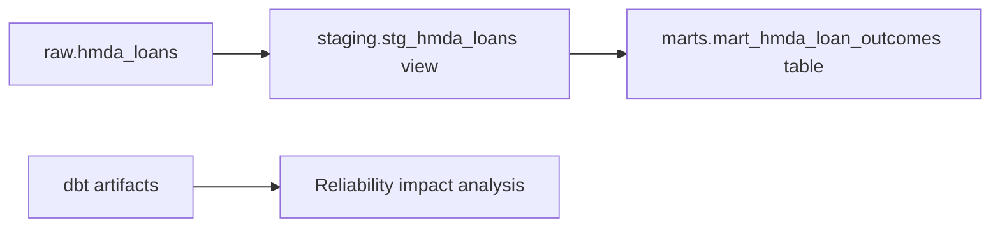

# Data Platform Domain Guide

## Summary

`data_platform`은 DuckDB와 dbt를 통해 Bronze 데이터를 분석 가능한 Silver·Gold 계약으로 바꾸는 도메인이다. 핵심은 **Python helper는 database 안전성과 metadata를, dbt는 데이터 변환과 품질 계약을** 맡는다는 분리다.

분석 column, grain, metric이 문제라면 dbt model을 본다. 파일 발견이나 `dbt build` subprocess의 실패 처리는 이 도메인이 아니라 각각 `hmda_data`, `data_operations`의 책임이다.

## Overview

| Layer | Schema | Materialization | 역할 |
| --- | --- | --- | --- |
| Bronze | `raw` | ingestion-owned table | 원천 보존과 provenance |
| Staging | `staging` | view | 분석 타입으로 명시적 변환 |
| Mart | `marts` | table | 정해진 grain의 집계 metric |

코드는 `src/project_pivot/data_platform/`, dbt project는 `dbt/`에 있다. package `__init__.py`는 re-export registry가 아니므로, 이 도메인을 이해할 때는 실제 module과 dbt model부터 읽는 편이 빠르다.

## Mental Model

이 도메인은 “데이터를 읽는 helper”와 “데이터 의미를 정의하는 dbt contract”로 구성된다.

| Component | 책임 | 비책임 |
| --- | --- | --- |
| `duckdb.py` | 연결 수명, schema 생성, table metadata | HMDA file load |
| `sql.py` | identifier 및 literal의 안전한 SQL 구성 | 임의 SQL 실행 정책 |
| `dbt/models/sources.yml` | Bronze source와 source test 선언 | raw table 생성 |
| staging model | 분석용 cast, null 보존 | 집계 metric |
| mart model | grain과 metric 정의 | subprocess 실행 |

DuckDB의 identifier는 parameter binding할 수 없기 때문에 `quote_identifier`, `qualify_table_name`을 쓴다. 일반 값은 여전히 parameter binding이 우선이다. helper의 존재가 문자열 SQL 조립을 기본 방식으로 바꾸지는 않는다.

## Core Contracts

### DuckDB connection and metadata

`DuckDBConnectionManager`는 context manager로 연결을 열고 반드시 닫는다. path가 없으면 in-memory DB를 쓰고, file DB는 상위 directory를 만든다. `cleanup_on_close=True`는 test용 database와 `.wal` 정리에 유용하다.

`ensure_schema`, `table_row_count`, `table_columns`는 raw·test·reliability가 DuckDB 상태를 확인하는 최소 API다. metadata query가 결과를 주지 않으면 정상값을 추측하지 않고 `DuckDBMetadataError`로 실패한다.

### Staging contract

`stg_hmda_loans`는 모든 raw 행을 유지한다. 분석에 쓰이는 정수 field는 `INTEGER`로, 금액과 income은 `try_cast(... AS DOUBLE)`로 변환한다. 숫자 형식 오류는 제거하지 않고 null로 드러낸다.

이 설계는 Bronze의 fidelity와 분석의 타입 안정성을 함께 확보한다. 형식 오류를 staging에서 제외하면 row count 변화가 품질 문제인지 필터링 효과인지 구분하기 어렵다.

### Mart contract

`mart_hmda_loan_outcomes`의 grain은 `activity_year + state_code + loan_purpose`다. 이 세 값이 모두 있는 staging row만 집계하며, `mart_grain_key`에 `not_null`과 `unique` test가 적용된다.

| Metric | 의미 |
| --- | --- |
| `application_count` | grain의 전체 application 수 |
| `approval_count` | `action_taken`이 `1`, `2`인 수 |
| `denial_count` | `action_taken`이 `3`, `7`인 수 |
| `approval_rate` | approval count / application count, 여섯 자리 반올림 |
| `average_loan_amount` | loan amount 평균 |
| `average_income` | income 평균 |

## Usage Guide

| 상황 | 먼저 볼 곳 | 판단 기준 |
| --- | --- | --- |
| DuckDB file·schema 문제 | `src/project_pivot/data_platform/duckdb.py` | connection lifecycle과 `raw` schema 보장이 맞는가? |
| 동적 table·column SQL 필요 | `sql.py` | identifier를 quote하고 value는 parameter binding하는가? |
| raw와 staging row 수 차이 | `dbt/models/staging/stg_hmda_loans.sql` | view가 filtering 없이 type conversion만 하는가? |
| metric이 달라짐 | mart SQL과 `marts/schema.yml` | grain과 action code 정의가 유지되는가? |
| dbt lineage 테스트 실패 | `tests/dbt/test_analytics_foundation.py` | source, model dependency, test contract가 함께 맞는가? |

`PROJECT_PIVOT_DUCKDB_PATH`는 기본 DuckDB 위치를 바꾸는 configuration boundary다. DB path를 model SQL이나 여러 실행 위치에 하드코딩하지 않는다.

## Boundaries

`hmda_data`가 `raw.hmda_loans`를 만든다. `data_operations.run_dbt_build()`가 artifact 제거, `dbt build`, 종료 코드와 `manifest.json`·`run_results.json`의 존재를 검증한다.

`reliability`는 dbt artifact를 읽어 incident의 downstream 영향만 계산한다. dbt model 구현이나 build 실행을 신뢰성 도메인에 넣으면 data contract와 control-plane logic이 얽힌다.

## Pitfalls

- raw null을 staging에서 “정리”하면 원천의 결측 의미와 incident evidence가 달라진다.
- mart grain 변경은 metric 계산만의 수정이 아니라 key uniqueness와 모든 downstream 소비자의 계약 변경이다.
- SQL helper로 value interpolation까지 허용하면 quoting과 injection 방어 경계가 흐려진다.
- `dbt build` 성공 exit code만 보고 artifact를 신뢰하면 오래된 artifact를 읽을 수 있다. 이 검증은 `data_operations`에 있다.

## Reading Path

1. `src/project_pivot/data_platform/duckdb.py`
1. `src/project_pivot/data_platform/sql.py`
1. `dbt/models/sources.yml`
1. `dbt/models/staging/stg_hmda_loans.sql`
1. `dbt/models/marts/mart_hmda_loan_outcomes.sql`와 `dbt/models/marts/schema.yml`
1. `tests/data_platform/`, `tests/dbt/test_analytics_foundation.py`

## Project Evidence

- `docs/domains/data-platform.md`
- `docs/ARCHITECTURE.md`
- `tests/data_platform/`
- `tests/dbt/test_analytics_foundation.py`
