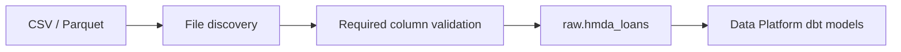

# HMDA Data Domain Guide

## Summary

`hmda_data`는 외부 HMDA 원천을 프로젝트의 Bronze 경계인 `raw.hmda_loans`로 안전하게 옮기는 도메인이다. 이 도메인을 이해하는 핵심은 **원천의 의미를 바꾸지 않고**, 파일 발견·형식 검증·적재 이력만 추가한다는 점이다.

데이터 분석 결과가 이상하면 먼저 이 도메인에서 원천 파일과 Bronze 적재가 올바른지 확인한다. mart 집계나 incident 판단을 고치는 위치는 아니다.

## Overview

이 도메인은 시스템의 가장 앞단에 있다.

주요 package는 `src/project_pivot/hmda_data/`이며, 실제 운영 경계는 다음 세 영역으로 나뉜다.

| Area | 책임 | 주로 열 파일 |
| --- | --- | --- |
| EDA | CSV의 초기 탐색과 요약 | `eda.py` |
| Ingestion | 파일 발견, 검증, Bronze 적재 | `ingestion/` |
| Synthetic | reliability 검증용 결함 파일 생성 | `synthetic/` |

## Mental Model

Bronze는 “깨끗한 분석 데이터”가 아니라 **추적 가능한 원천 사본**이다. 따라서 이 도메인은 `state_code`, `county_code`의 null이나 수치 형식 오류를 정제하지 않는다. 원천에 있던 값은 보존하고, 어느 파일에서 왔는지를 나타내는 field만 덧붙인다.

| 입력 | 처리 | 출력 |
| --- | --- | --- |
| `data/raw/hmda`의 `.csv`, `.parquet` | 파일명 오름차순 발견, 필수 column 검증 | `raw.hmda_loans` |
| 원천 행 | 값 보존 + provenance field 추가 | `source_file`, `source_file_name`, `source_year`, `ingested_at` |
| 원천 파일 | 결정론적 변형 | synthetic Parquet case |

분석에 적합한 타입 변환과 결측 처리 해석은 다음 단계인 `data_platform`의 staging model 책임이다.

## Core Contracts

### Source discovery

`discover_hmda_files(raw_dir)`는 `.csv`와 `.parquet`만 발견하고 파일명 기준으로 정렬한다. 원천 directory가 없거나 지원 파일이 없으면 `HMDADataLoadError`다. 지원하지 않는 파일은 적재를 실패시키지 않지만 진단 로그에는 남긴다.

이 규칙은 실행 재현성을 위한 것이다. directory 순회 결과에 의존하면 같은 원천이라도 적재 순서가 환경별로 달라질 수 있다.

### Full and partition load

`load_hmda_loans(connection, source_paths)`는 전체 Bronze table을 `CREATE OR REPLACE TABLE`로 만든다. 같은 입력으로 재실행해도 누적 중복이 생기지 않는 것이 기대 동작이다.

`load_hmda_loans_partition(connection, source_paths, source_year, source_file=None)`는 범위를 좁혀 갱신한다. 새 입력을 임시 table에서 검증한 다음, 대상 partition의 기존 행 삭제와 새 행 삽입을 하나의 transaction으로 수행한다. 대상 행이 없거나 `source_file`가 비어 있으면 기존 partition을 바꾸기 전에 실패해야 한다.

### Validation boundary

필수 column은 다음과 같다.

- `activity_year`
- `state_code`
- `county_code`
- `loan_purpose`
- `action_taken`
- `loan_amount`
- `income`

누락은 `HMDADataValidationError`다. CSV parse 실패와 DuckDB 오류는 호출자가 처리할 수 있도록 `HMDADataLoadError`로 변환된다.

### Synthetic cases

`row_count_drop`, `null_spike`, `schema_drift`, `freshness_delay`는 원본을 수정하지 않고 output root 아래에 synthetic Parquet를 만든다. reliability 도메인의 detector와 recovery flow를 검증하기 위한 입력 생성기이며, incident를 판정하지는 않는다.

## Usage Guide

| 상황 | 먼저 볼 곳 | 확인할 질문 |
| --- | --- | --- |
| raw 적재 실패 | `ingestion/`, `tests/hmda_data` | 지원 파일을 찾았는가? 필수 column이 있는가? |
| 특정 연도만 갱신 | `load_hmda_loans_partition` | `source_year`와 선택 `source_file` 범위가 정확한가? |
| mart row count가 이상함 | Bronze table과 source file | 원천과 `raw.hmda_loans`의 행 수가 일치하는가? |
| detection test 입력 필요 | `synthetic/` | 원하는 결함이 row count, null, schema, freshness 중 무엇인가? |
| 초기 데이터 탐색 | `eda.py` | ingestion 전에 파일 구조와 분포를 이해했는가? |

## Boundaries

`data_operations`가 실행 request, 호출 순서, 결과 모델을 조합한다. `hmda_data`가 실행 흐름을 소유하기 시작하면 같은 적재가 CLI, Dagster, 테스트에서 서로 다른 방식으로 굳어질 위험이 있다.

`data_platform`은 Bronze 이후의 dbt source와 model을 소유한다. `reliability`는 synthetic 파일 또는 raw table에서 품질 이상을 계산한다. `orchestration`은 이 도메인의 public API를 Dagster asset에서 호출할 뿐 파싱 규칙을 갖지 않는다.

## Pitfalls

- Bronze에서 코드값을 정규화하거나 null 행을 제외하면 원천 계약이 깨지고 downstream 검증 근거가 사라진다.
- 전체 적재와 partition 적재의 의도를 섞으면 기대보다 넓은 데이터를 교체할 수 있다.
- `source_year`는 데이터 column이 아니라 파일명에서 추출한 provenance다. 값의 `activity_year`와 항상 같다고 가정하지 않는다.
- synthetic output은 test fixture다. 이를 실제 raw source directory에 두면 discovery 대상이 될 수 있다.

## Reading Path

1. `src/project_pivot/hmda_data/__init__.py`에서 public API를 훑는다.
1. `src/project_pivot/hmda_data/ingestion/__init__.py`와 구현 file에서 적재 경계를 읽는다.
1. `tests/hmda_data/`에서 정상·실패·partition 사례를 확인한다.
1. Bronze 이후의 변화가 궁금할 때만 `dbt/models/sources.yml`, `dbt/models/staging/stg_hmda_loans.sql`로 넘어간다.

## Project Evidence

- `docs/domains/hmda-data.md`
- `docs/ARCHITECTURE.md`
- `tests/hmda_data/`
