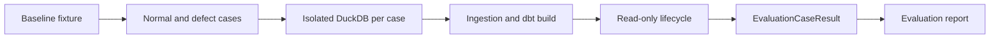

# Next Project Priorities 이해 가이드

## Summary

이 research는 Project Pivot의 다음 구현 우선순위를 결정하는 문서다. 결론은 새 detection rule이나 Dagster 기능을 늘리기보다, 이미 존재하는 synthetic defect 생성, ingestion, dbt build, incident lifecycle, remediation draft, evaluation report를 하나의 반복 가능한 실행으로 연결해야 한다는 것이다.

권장 순서는 다음과 같다.

1. **P0**: synthetic incident end-to-end evaluation harness
1. **P1**: isolated dbt remediation validation
1. **P2**: Dagster approval and audit integration

핵심 mental model은 **기능의 존재와 기능 간 연결이 검증되었다는 증거는 다르다**는 점이다. 현재는 각 부품이 존재하지만, synthetic incident가 입력부터 report까지 올바르게 처리되는지를 production API로 반복 검증할 수 없다.

## Overview

이 문서는 roadmap의 할 일 목록이 아니라, 다음 OpenSpec change를 고르기 위한 evidence 기반 우선순위 결정 기록이다. 기준은 프로젝트 비전 기여도뿐 아니라 재사용, 불확실성 감소, 운영 위험, architecture scope 적합성이다.

현재 architecture에서 reliability lifecycle은 read-only이고, recovery와 evaluation은 별도 API로 분리된다. 따라서 이 research의 P0는 lifecycle 또는 `pipeline_job`의 책임을 키우지 않고, 이들을 조합하는 별도 evaluation API를 추가하려 한다.

읽는 목적은 다음 두 질문에 답하는 것이다.

- 왜 “새 기능”보다 end-to-end evaluation이 먼저인가?
- 왜 dbt validation과 approval/audit integration은 후순위인가?

## Document Map

| Section | 읽을 때 답할 질문 | 핵심 역할 |
| --- | --- | --- |
| `Conclusion` | 다음 change는 무엇인가? | P0/P1/P2 우선순위를 선언한다. |
| `Decision Basis` | 무엇을 기준으로 비교했는가? | 점수표의 판단 기준을 정의한다. |
| `Current Capability Map` | 무엇이 이미 있고 어디가 비어 있는가? | 부품과 연결 공백을 보여 준다. |
| `Primary Gap` | P0가 해결할 정확한 문제는 무엇인가? | production runner 부재를 특정한다. |
| `Candidate Comparison` | 다른 후보보다 P0가 나은 이유는 무엇인가? | 기준별 상대 우선순위를 비교한다. |
| `P0`, `P1`, `P2` | 각 단계의 최소 scope와 성공 조건은 무엇인가? | change 경계와 acceptance signal을 제시한다. |
| `Not Recommended Next` | 지금 하지 않을 일은 무엇인가? | scope creep을 막는다. |
| `Risks And Open Questions` | 구현 전에 무엇을 확인해야 하는가? | research spike가 필요한 불확실성을 보존한다. |

## Key Concepts

### Capability gap

문서에서 말하는 gap은 detection 기능이 없다는 뜻이 아니다. 다음 부품은 이미 있다.

- synthetic defect file 생성
- DuckDB Bronze 적재와 dbt 모델
- read-only incident detection, impact analysis, remediation draft
- approved recovery
- evaluation result 집계와 Markdown report

하지만 `EvaluationCaseResult`를 실제 synthetic case 실행 결과에서 만드는 production 호출 경로가 없다. 현재 결과 객체는 test에서 직접 조립된다. 따라서 report가 집계 자체는 올바르게 해도, 실제 lifecycle이 올바른 결과를 만들었는지는 증명하지 못한다.

### End-to-end evaluation harness

harness는 여러 기존 API를 호출해 정해진 scenario를 반복 실행하고, 기대값과 실제 결과를 비교하는 실행 장치다. 여기서는 다음 흐름을 담당한다.

이 harness는 detection rule을 새로 만들지 않는다. 기존 부품을 실제 순서로 연결하고, 결과를 `EvaluationCaseResult`라는 evaluation contract로 변환한다.

### Isolation and determinism

case별 database 또는 schema 격리는 한 case의 데이터 변경이 다른 case 결과에 영향을 주지 않도록 한다. 결정성(determinism)은 같은 fixture와 고정된 시간 입력으로 두 번 실행했을 때 같은 결과를 얻는 성질이다.

특히 freshness detection은 현재 시각에 영향을 받을 수 있으므로 `observed_at` 같은 시간을 고정해야 한다. 그렇지 않으면 코드가 바뀌지 않아도 결과가 달라져 evaluation signal의 신뢰도가 떨어진다.

### Detection match vs remediation success

P0의 action 성공은 remediation draft의 제안 action이 기대 action과 일치한다는 뜻이다. 실제 dbt 변경이 유효하고 build를 통과했다는 뜻은 아니다.

이 구분이 P1의 이유다. P1은 draft를 자동 적용하지 않고, 격리된 target 또는 임시 dbt project에서 후보 변경을 compile/build하여 validation evidence를 반환한다. approval은 여전히 별도다.

## Why This Priority Order

### Recommendation: P0 first

P0는 이미 구현된 부품을 최대한 재사용하면서 가장 큰 불확실성을 줄인다. normal case와 4개 defect case(`volume_drop`, `null_spike`, `schema_drift`, `freshness_delay`)가 실제 lifecycle을 통과할 때 다음을 동시에 확인할 수 있다.

- expected incident type 탐지 여부
- expected remediation action 제안 여부
- normal case의 false positive 부재
- report의 성공률이 실제 실행 결과를 반영하는지
- ingestion 뒤에도 defect가 보존되는지

이 evidence가 없으면 P1에서 어떤 remediation validation을 측정해야 하는지, P2에서 어떤 운영 workflow를 신뢰할 수 있는지 판단하기 어렵다.

### Trade-off: P1 later

P1은 가치가 높지만 dbt target, compilation, build failure evidence, 운영 데이터 보호를 함께 다룬다. P0가 먼저 있어야 null spike와 schema drift 같은 실제 input으로 P1 결과를 반복 평가할 수 있다.

### Trade-off: P2 last

P2는 외부 approval, duplicate event, retry, idempotency, audit persistence처럼 외부 상태를 포함한다. 운영 위험이 크고 결정해야 할 정책도 많다. P0/P1로 lifecycle과 validation signal을 만든 뒤 도입하는 편이 변경 범위와 실패 원인을 통제하기 쉽다.

## Usage Guide

이 문서는 새 change를 제안하거나 review할 때 다음 순서로 사용한다.

1. `Conclusion`과 `Proposed OpenSpec Changes`에서 현재 권장 change의 이름과 non-goal을 확인한다.
1. `Primary Gap`을 기준으로 problem statement를 작성한다. 문제는 “report가 없다”가 아니라 “실제 case 실행 결과를 evaluation contract로 바꾸는 runner가 없다”이다.
1. P0 acceptance signal을 task와 test의 완료 조건으로 사용한다. 특히 5개 case, isolation, expected detection/action match, 100% report rate, 두 번 실행한 동일 결과를 유지한다.
1. `Risks And Open Questions`를 구현 전 spike 또는 설계 결정 항목으로 옮긴다. 확정되지 않은 baseline, dbt build 필요성, schema drift ingestion 가능성을 요구사항처럼 단정하지 않는다.
1. P0 완료 evidence를 얻은 뒤에만 P1 proposal을 만든다. P2는 P1 결과와 approval/audit semantics를 결정한 후 다룬다.

## Architecture Boundaries To Preserve

| Boundary | P0에서의 의미 |
| --- | --- |
| Reliability lifecycle is read-only | evaluation runner는 lifecycle에 write 책임을 넣지 않는다. |
| Recovery is a separate API after approval | P0는 backfill을 실행하거나 approval을 생성하지 않는다. |
| Evaluation is separate from report writing | case 실행/결과 변환과 report 출력의 책임을 분리한다. |
| Dagster `pipeline_job` runs Bronze and dbt only | P0를 `pipeline_job`에 등록하지 않는다. |
| Local scope | cloud, long-term monitoring, human approval UI로 확장하지 않는다. |

## Pitfalls

- **“각 모듈 test가 있으니 end-to-end도 검증됐다”라는 오해**: unit 또는 component test는 모듈 계약만 증명한다. 실제 adapter와 실행 순서의 결함은 남을 수 있다.
- **schema drift를 lifecycle rule 문제로만 보는 것**: ingestion에서 먼저 실패하면 lifecycle까지 도달하지 못한다. fixture 한 건을 임시 database에서 먼저 검증해야 한다.
- **P0에서 실제 remediation 성공까지 주장하는 것**: P0는 draft action match까지만 측정한다. dbt compile/build 성공은 P1의 책임이다.
- **Dagster에 곧바로 연결하는 것**: 실행 편의와 orchestration 책임 확대를 혼동하면 기존 `pipeline_job` boundary를 깨뜨릴 수 있다.
- **현재 시각에 의존하는 fixture**: freshness 결과가 실행 시점에 따라 달라져 반복 가능성이 사라진다.

## Reading Path

처음 읽을 때는 다음 순서가 가장 빠르다.

1. [research.md](../../../../openspec/research/next-project-priorities/research.md)의 `Conclusion`
1. 같은 문서의 `Current Capability Map`과 `Primary Gap`
1. `P0: Synthetic End-to-End Evaluation Harness`의 acceptance signal
1. [ARCHITECTURE.md](../../../../docs/ARCHITECTURE.md)의 `Boundaries`
1. P1/P2와 `Risks And Open Questions`

## Footnotes

이 가이드는 [research.md](../../../../openspec/research/next-project-priorities/research.md), [ARCHITECTURE.md](../../../../docs/ARCHITECTURE.md), [DEVELOPMENT.md](../../../../docs/DEVELOPMENT.md)를 근거로 작성했다. P1/P2의 Dagster 및 dbt 세부 설계는 문서에 적힌 대로 해당 change를 제안할 시점에 최신 공식 문서로 다시 검증해야 한다.
