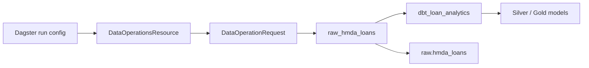

# Orchestration Domain Guide

## Summary

`orchestration`은 Dagster graph에 데이터 실행 순서와 configuration conversion을 등록하는 adapter 도메인이다. 이 layer의 책임은 Bronze 적재 후 dbt 분석을 실행하게 만드는 것이며, data logic이나 reliability control plane을 graph에 끌어들이지 않는다.

핵심 규칙은 `pipeline_job`이 **`raw_hmda_loans -> dbt_loan_analytics` 두 asset만** 포함한다는 것이다. lifecycle 분석, approval, backfill, evaluation은 의도적으로 graph 밖에 있다.

## Overview

| Area | 책임 | 실제 위치 |
| --- | --- | --- |
| Entry point | `Definitions` 등록 | `definitions.py` |
| Asset graph | asset dependency와 metadata | `defs/assets.py` |
| Resource | Dagster config를 request로 변환 | `defs/resource.py` |
| Execution logic | delegated public API | `data_operations` |

`src/project_pivot/orchestration/__init__.py`는 re-export surface가 거의 없으므로, 실제 진입점은 `definitions.py`다.

## Mental Model

Dagster는 이 프로젝트의 **유일한 data-pipeline orchestrator**다. orchestration 코드가 data를 파싱하거나 SQL을 실행하는 곳이 아니라, 이미 정의된 application API를 Dagster lifecycle에 맞게 호출하는 곳이라고 보면 된다.

| Asset | 의미 | 위임 대상 |
| --- | --- | --- |
| `raw_hmda_loans` | HMDA 원천을 Bronze로 materialize | `load_raw_data()` |
| `dbt_loan_analytics` | Bronze 이후 dbt 모델을 build | `run_dbt_build()` |

`dbt_loan_analytics`의 dependency가 `raw_hmda_loans`에 연결되어 있어 Dagster가 실행 순서를 보장한다. 의존성을 함수 호출 순서로 숨기지 않고 asset graph에 표현하는 것이 중요하다.

## Core Contracts

### Definitions and pipeline selection

`definitions.py`의 `defs`는 두 asset, `pipeline_job`, `data_operations` resource를 등록한다. `pipeline_job` selection에는 정확히 `raw_hmda_loans`, `dbt_loan_analytics`만 들어간다.

이 selection이 좁은 이유는 pipeline의 목적이 Bronze-to-Gold data plane이기 때문이다. schedule, sensor, asset check, CLI runner를 추가하지 않는 현재 scope도 이 경계의 일부다.

### Resource conversion

`DataOperationsResource`는 Dagster configuration을 `DataOperationRequest`로 바꾼다.

| Field | 기본값 | 의미 |
| --- | --- | --- |
| `database_path` | `data/project_pivot.duckdb` | DuckDB file |
| `source_root` | `data/raw/hmda` | HMDA 원천 directory |
| `source_year` | `2025` | 적재할 partition |
| `source_file` | `None` | 선택 원천 파일명 |
| `run_dbt_build` | `true` | dbt asset 실행 여부 |

resource는 값을 검증 가능한 request model로 옮길 뿐이다. 파일 발견, partition overwrite, subprocess 실행, 오류 변환을 resource에 구현하면 `data_operations`의 application boundary가 무너진다.

### Materialization metadata

`raw_hmda_loans`는 database path, source root, file count, source year, HMDA row count 같은 실행 evidence를 metadata로 남긴다.

`dbt_loan_analytics`는 success, skipped, return code, manifest path, run results path를 남긴다. `run_dbt_build=false`이면 dbt 실행을 건너뛰지만, 이 상태는 `skipped=true`, `succeeded=false`, reason=`run_dbt_build=false`로 기록한다. 실행하지 않은 일을 성공이라고 표시하지 않는 계약이다.

## Usage Guide

| 상황 | 먼저 볼 곳 | 확인할 질문 |
| --- | --- | --- |
| Dagster가 asset을 찾지 못함 | `definitions.py` | asset·job·resource가 `defs`에 등록됐는가? |
| 실행 순서가 이상함 | `defs/assets.py` | `dbt_loan_analytics`가 `raw_hmda_loans`에 의존하는가? |
| run config가 반영되지 않음 | `defs/resource.py` | config field가 `DataOperationRequest`로 정확히 변환되는가? |
| dbt skip 상태가 혼동됨 | dbt asset metadata와 tests | skipped와 succeeded를 구분하는가? |
| lifecycle을 Dagster에서 돌리고 싶음 | `docs/domains/orchestration.md` | data plane boundary를 의도적으로 넓혀야 하는 별도 요구인가? |

## Boundaries

| 도메인 | Orchestration과의 관계 |
| --- | --- |
| `data_operations` | asset이 호출하는 실행 boundary |
| `hmda_data` | raw asset을 통해 간접 호출되는 ingestion implementation |
| `data_platform` | dbt asset이 build하는 model contract |
| `reliability` | pipeline graph 밖의 control plane |

특히 `run_incident_lifecycle()`, `execute_approved_backfill()`, evaluation report write를 `pipeline_job`에 넣지 않는다. lifecycle은 read-only지만 data pipeline의 산출물이 아니고, recovery/evaluation은 approval·file write 같은 별도 side effect를 가진다.

## Pitfalls

- Dagster asset 안에서 ingestion 또는 dbt subprocess를 직접 구현하면 application layer의 오류·결과 계약을 우회한다.
- pipeline selection을 넓혀 reliability까지 넣으면 data transformation과 control plane의 책임이 섞인다.
- dbt skip을 성공으로 기록하면 materialization history가 실제 실행과 달라진다.
- resource에 business validation을 넣으면 다른 caller와 validation 규칙이 분기된다.
- asset dependency를 누락하면 Bronze가 준비되기 전에 dbt build가 실행될 수 있다.

## Reading Path

1. `src/project_pivot/orchestration/definitions.py`
1. `src/project_pivot/orchestration/defs/assets.py`
1. `src/project_pivot/orchestration/defs/resource.py`
1. `src/project_pivot/data_operations/request.py`
1. `src/project_pivot/data_operations/runner.py`
1. `tests/orchestration/test_dagster_definitions.py`
1. `tests/orchestration/test_pipeline_materialization.py`

## Project Evidence

- `docs/domains/orchestration.md`
- `docs/ARCHITECTURE.md`
- `tests/orchestration/`
