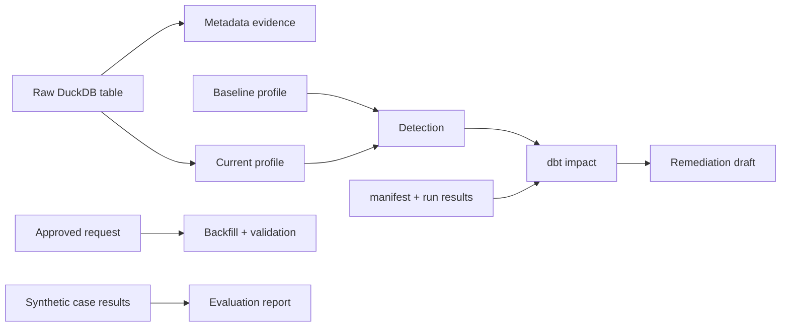

# Reliability Domain Guide

## Summary

`reliability`는 raw DuckDB table과 dbt artifact를 읽어 품질 incident, downstream impact, remediation draft를 계산하는 control-plane 도메인이다. 가장 중요한 규칙은 **lifecycle은 read-only이고, 실제 backfill과 report write는 명시적인 별도 API**라는 것이다.

이 구분을 지키면 탐지 실행이 데이터나 보고서를 뜻하지 않게 바꾸지 않는다. 신뢰성 분석의 결과는 “실행할 작업”이 아니라 사람의 approval이 필요한 evidence와 draft다.

## Overview

| Capability | 목적 | Side effect |
| --- | --- | --- |
| Metadata and profiling | 현재 table 상태를 evidence로 만든다 | 없음 |
| Detection | baseline과 current의 차이를 incident로 만든다 | 없음 |
| Impact and remediation | dbt lineage와 권장 조치를 계산한다 | 없음 |
| Recovery | 승인된 partition backfill을 실행·검증한다 | DuckDB 변경 |
| Evaluation | synthetic case 결과를 집계·render한다 | write API에서만 file 생성 |

## Mental Model

`reliability`는 “데이터를 고치는 자동화”가 아니라 **판단을 위한 증거 파이프라인**이다.

1. profile은 특정 asset·partition의 측정값이다.
1. detector는 baseline과 current가 호환되는지 먼저 확인한 뒤 임계값을 적용한다.
1. impact analyzer는 incident가 어떤 dbt downstream asset에 닿는지 artifact로 증명한다.
1. remediation draft는 권장 조치와 validation 계획을 정하지만 실행하지 않는다.
1. recovery는 명시적 approval이 있어야 source를 읽고 partition을 바꾼다.

이 흐름은 “탐지”와 “변경 권한”을 분리한다. incident가 발생했다는 사실과 데이터를 덮어써도 된다는 권한은 서로 다른 계약이다.

## Core Contracts

### Contract models

`reliability/contracts/`의 Pydantic 모델은 변경 불가이며 알 수 없는 field를 거부한다. 주된 공유 vocabulary는 `ProfileSnapshot`, `Incident`, `Evidence`, `LineageEvidence`, `Approval`이다.

baseline과 current profile은 같은 asset과 partition이어야 비교할 수 있다. 이 호환성은 단순 row count 비교보다 먼저 확인해야 한다. 서로 다른 대상의 수치 차이를 incident로 만들면 정상적인 partition 차이를 장애로 오인한다.

### Detection

`detect_basic_incidents(DetectionRequest)`는 다음 기본 incident를 계산한다.

| Incident | 기본 조건 | Evidence |
| --- | --- | --- |
| `volume_drop` | row count 감소 비율 $\geq 0.5$ | baseline/current count, drop ratio |
| `null_spike` | null rate 증가량 $\geq 0.1$ | column, baseline/current null rate |
| `schema_drift` | schema hash 변경 | 두 hash |
| `freshness_delay` | 지연 $\geq 60$분 | delay, threshold |

`DetectionThresholds`는 환경이나 평가 case에 맞춰 threshold를 교체할 수 있다. threshold를 변경할 때는 incident type의 의미와 test fixture의 기대값도 함께 점검한다.

### Impact and remediation

`analyze_dbt_impact(ImpactAnalysisRequest)`는 `manifest.json`의 source/model dependency와 `run_results.json`을 사용해 downstream asset을 계산한다. artifact가 없거나 형식이 유효하지 않으면 추측하지 않고 `ImpactAnalysisError`다.

`create_remediation_draft(RemediationDraftRequest)`는 evidence와 lineage evidence로 recommendation, backfill action, validation action, dbt test 제안을 결정론적으로 만든다. draft는 실행 command가 아니라 human review 대상이다.

### Recovery and evaluation

`execute_approved_backfill(connection, request)`는 approval 상태와 필수 action을 먼저 검증한다. 검증이 실패하면 source file을 읽기 전 `ApprovalGateError`로 멈춰야 한다. 성공 시 partition overwrite와 새 profile 생성을 수행하고, ingested row count와 profile row count의 일치를 `BackfillValidationResult`로 반환한다.

`build_evaluation_report(cases)`는 결과를 집계한다. `render_evaluation_report_markdown(report)`는 문자열만 만들고, `write_evaluation_report(report, output_path)`만 Markdown file을 쓴다.

## Usage Guide

| 상황 | 먼저 열 곳 | 핵심 질문 |
| --- | --- | --- |
| quality 이상을 탐지 | `detection/`과 detection tests | profile 비교 대상과 threshold가 호환되는가? |
| downstream 영향이 비어 있음 | `impact/`과 dbt artifact | 새 manifest/run results가 있으며 dependency가 선언됐는가? |
| 권장 조치가 부정확 | `remediation/` | incident evidence와 lineage evidence를 모두 받는가? |
| backfill이 거부됨 | `recovery/` | approval과 필수 action이 모두 승인됐는가? |
| synthetic test 결과를 문서화 | `evaluation/` | build, render, write 단계를 분리했는가? |
| 전체 흐름을 실행 | `data_operations/incident_lifecycle.py` | lifecycle이 read-only 경계를 지키는가? |

## Boundaries

`data_operations`만 reliability API를 application lifecycle로 조합한다. `orchestration.pipeline_job`은 data plane만 실행하므로 reliability lifecycle, recovery, evaluation은 Dagster graph에 들어가지 않는다.

`hmda_data`는 raw source와 synthetic defect file을 만들지만 incident를 판정하지 않는다. `data_platform`은 dbt lineage를 만들고, reliability는 생성된 artifact를 읽는다. source를 수정하거나 `dbt build`를 실행하는 책임은 reliability에 없다.

## Pitfalls

- lifecycle에 backfill을 넣으면 탐지가 저장된 데이터를 바꾸는 위험한 operation이 된다.
- approval 확인 전에 source file을 열면 gate가 side effect 경계를 지키지 못한다.
- baseline과 current의 asset·partition 호환성을 무시하면 false positive가 생긴다.
- 새 dbt artifact 검증 없이 impact를 계산하면 이전 실행의 lineage를 evidence로 쓸 수 있다.
- report rendering과 file write를 섞으면 평가를 test하기 어렵고 원치 않는 file write가 생긴다.

## Reading Path

1. `src/project_pivot/reliability/__init__.py`에서 public surface를 파악한다.
1. `contracts/`에서 shared model과 validation 규칙을 읽는다.
1. `profiling/`, `metadata/`, `detection/` 순서로 evidence 생성과 판단을 읽는다.
1. `impact/`, `remediation/`에서 downstream 분석과 draft 생성을 읽는다.
1. `recovery/`, `evaluation/`은 side-effect boundary를 중심으로 읽는다.
1. `tests/reliability/`에서 detection, impact, approval backfill, evaluation 사례를 확인한다.

## Project Evidence

- `docs/domains/reliability.md`
- `docs/ARCHITECTURE.md`
- `tests/reliability/`
