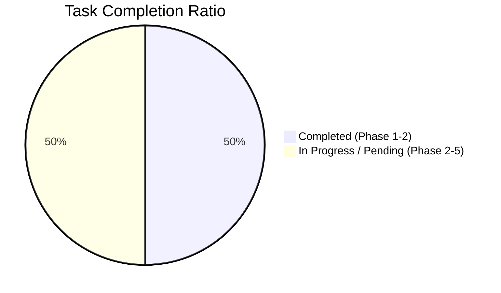

# HMDA Foundation EDA Extension Status Report

## Summary

HMDA Foundation EDA Extension (`openspec/changes/hmda-eda-foundation-extension`) 작업은 **MVP Reliability 개발에 필요한 원천 데이터 분석 능력과 Evidence Contract 확장을 진행 중**입니다.
핵심 EDA 엔진(`analyze_hmda_csv`) 구현, 백엔드 집계 로직, 패키지 리팩토링(`project_pivot.hmda_data.eda`), 기초 유닛 테스트(52개 통과[^1])는 완료되었습니다.

> [!NOTE]
>
> - **현재 상태**: 🟡 IN-PROGRESS (기능 구현 완료 / 픽스처·노트북·문서화 대기)
> - **전체 진행률**: 50% (총 18개 세부 Task 중 9개 완료)
> - **다음 목표**: Task 2.1 (픽스처 Expected Value 보강) → Task 3 (Marimo Notebook 연동) → Task 4 (문서화)

---

## Overall Task Progress

| Phase | Task Group | Total | Done | Progress | Status |
| :--- | :--- | :---: | :---: | :---: | :---: |
| **Phase 1** | EDA Evidence Contract | 5 | 5 | 100% | 🟢 COMPLETED |
| **Phase 2** | Deterministic Tests & Fixtures | 3 | 2 | 67% | 🟡 IN-PROGRESS |
| **Phase 3** | Notebook & Runtime Validation | 3 | 0 | 0% | 🔴 NOT-STARTED |
| **Phase 4** | Documentation & Foundation Evidence | 3 | 0 | 0% | 🔴 NOT-STARTED |
| **Phase 5** | Focused Validation | 4 | 0 | 0% | 🔴 NOT-STARTED |
| **Total** | **전체** | **18** | **9** | **50%** | 🟡 **IN-PROGRESS** |

### Phase Status Overview

---

## Workstream Breakdown & Detailed Status

### 1. EDA Evidence Contract 🟢

- [x] **1.0 Subpackage 리팩토링**: `analyze_hmda_csv`, `fixture`, `memory` 헬퍼 모듈을 `project_pivot.hmda_data.eda` subpackage로 이관하고 기존 하위 호환성(`project_pivot.hmda_data`) 제공.
- [x] **1.1 Code Distribution Evidence**: `action_taken`, `loan_purpose`, `state_code`, `county_code` 관찰값별 Count/Share 집계 기능 추가.
- [x] **1.2 Numeric Summary Evidence**: `loan_amount`, `income`에 대한 Non-null count, Five-number summary(Min, P25, Median, P75, Max) 및 이상치 범위 조건(`income < 0`, `loan_amount <= 0`) 집계.
- [x] **1.3 Mart Grain Aggregate**: `activity_year + state_code + loan_purpose` Grain 결합 기준의 Distinct group 수, Null key 수 및 Coverage rate 측정.
- [x] **1.4 Anomaly Observation 직렬화**: 수치 이상치 및 Unknown code를 원천 데이터 변경 없이 JSON 직렬화 가능한 Anomaly 레코드 구조로 변환.

### 2. Deterministic Tests & Fixtures 🟡

- [ ] **2.1 Small Fixture Expected Values**: Code distribution, Numeric summary, Anomaly, Grain 기준의 소형 HMDA 픽스처 단동 예상값 보강 작업 대기.
- [x] **2.2 EDA Contract Tests**: Valid, Unknown-code, Suspicious-numeric, Missing-column 시나리오 입력별 단위 검증 수행.
- [x] **2.3 Data Preservation & Resource Management**: Raw 데이터 변형 방지, Connection leak 방지(close), Partial evidence 미생성 검증.

### 3. Notebook & Runtime Validation 🔴

- [ ] **3.1 Notebook UI Rendering**: `notebooks/eda_mo.py` Marimo 노터북에 추가된 Distribution, Numeric summary, Anomaly, Grain 시각화 추가.
- [ ] **3.2 Notebook Smoke Test**: Valid/Malformed 픽스처 기반 노터북 Runtime 실행 스모크 테스트 구현.
- [ ] **3.3 Representative Resource Check**: 대용량 EDA 자원 사용량 측정(메모리/임시 디렉토리) 검증.

### 4. Documentation & Foundation Evidence 🔴

- [ ] **4.1 Reference Doc Update**: `docs/references/hmda_eda.md`에 새로운 Evidence key, 지표 정의, 이상치 경계 명시.
- [ ] **4.2 Foundation Readiness 연결**: Foundation 기준 문서에 MVP 데이터 관찰 capability 연결.
- [ ] **4.3 Raw → Staging → Mart Alignment**: Grain 정합성 및 EDA 해석 가이드 문서화.

### 5. Focused Validation 🔴

- [ ] **5.1 Test Execution**: 전체 EDA 유닛 및 통합 테스트 실행.
- [ ] **5.2 Lint & Formatting**: `ruff check`, `ruff format`, `marimo check` 검증.
- [ ] **5.3 Regression Testing**: Reliability/Profile 및 dbt Analytics 전체 기본 테스트 회귀 검증.
- [ ] **5.4 Actual Source Report**: 실제 원천 파일 관찰 리포트 아티팩트 생성.

---

## Evidence & Verification Summary

> [!TIP]
> **Unit Test Execution Result** (2026-08-03)  
> `uv run pytest tests/hmda_data/` 실행 결과: **52 PASSED** (0 failed, 0 error)

| Test Module | Passed Tests | Status |
| :--- | :---: | :---: |
| `tests/hmda_data/eda/test_eda.py` | 11 | 🟢 PASSED |
| `tests/hmda_data/eda/test_eda_fixture.py` | 14 | 🟢 PASSED |
| `tests/hmda_data/eda/test_eda_memory.py` | 6 | 🟢 PASSED |
| `tests/hmda_data/eda/test_eda_memory_helpers.py` | 6 | 🟢 PASSED |
| `tests/hmda_data/test_ingestion.py` | 7 | 🟢 PASSED |
| `tests/hmda_data/test_ingestion_partition.py` | 5 | 🟢 PASSED |
| `tests/hmda_data/test_synthetic.py` | 3 | 🟢 PASSED |

---

## Risk Analysis & Next Actions

1. **Task 2.1 (픽스처 단정문 보강)**: `tests/hmda_data/eda/test_eda_fixture.py` 등에 확충된 Evidence Key 단정문 확충.
1. **Task 3.1~3.2 (노트북 연동)**: `notebooks/eda_mo.py` Marimo 셀 업데이트 및 스모크 테스트 수행.
1. **Task 4.1~4.3 (문서화)**: `docs/references/hmda_eda.md` 명세 문서 갱신.
1. **Task 5.1~5.4 (최종 검증)**: 코드 포맷팅, 린트 및 E2E 테스트 검증 후 마감.

[^1]: `uv run pytest tests/hmda_data/` 실행 결과 총 52개의 유닛 테스트가 모두 통과되었습니다.
