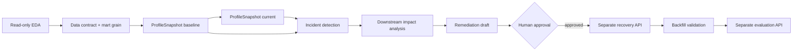

# EDA 이후 Reliability 실행 계획

## Summary

HMDA EDA의 다음 목표는 데이터를 바로 수정하는 것이 아니라, **EDA 결과를 reliability 판단의 입력으로 정리하는 것**이다. 현재 EDA 계산과 관련 테스트는 통과했지만, deterministic fixture invariant, notebook smoke, 실제 source observation report가 남아 있어 아직 `ready`로 볼 수 없다.

> [!IMPORTANT]
> 다음 구현 순서는 `Data contract → ProfileSnapshot → Incident detection → Impact analysis → Remediation draft`다. `Recovery`와 `Evaluation`은 사람의 승인 뒤 별도 실행 경계에서 진행한다.

## 현재 근거

| 항목 | 현재 상태 | 근거 |
| --- | --- | --- |
| EDA core calculation | ✅ 통과 | `tests/hmda_data/eda/` |
| EDA regression | ✅ 통과 | valid, unknown-code, suspicious-numeric, missing-column test |
| Bronze ingestion | ✅ 통과 | `tests/hmda_data/test_ingestion.py`, `test_ingestion_partition.py` |
| Silver / Gold | ✅ 통과 | `dbt test --project-dir dbt`, 18 tests |
| Reliability contracts | ✅ 통과 | `tests/reliability/contracts/` |
| Detection / impact / remediation | ✅ 통과 | `tests/reliability/test_basic_incident_detection.py`, `test_impact_analysis.py`, `test_remediation_draft.py` |
| Recovery / evaluation | ✅ 통과 | `test_approval_backfill_validation.py`, `test_evaluation_report.py` |
| Notebook smoke | ⚠️ 미완료 | OpenSpec task 3.1, 3.2 |
| Actual source report | ⚠️ 미완료 | OpenSpec task 5.4 |
| Foundation readiness 기준 | ⚠️ 미확정 | [readiness dashboard](../../../docs/development/foundation/readiness.md) |

## 실행 흐름



## 단계별 다음 작업

### 1. EDA evidence를 닫는다

먼저 현재 OpenSpec의 남은 EDA task를 마친다.

- deterministic fixture에 distribution, numeric summary, anomaly, grain expected value를 고정한다.
- notebook에 새 EDA evidence를 표시한다.
- valid fixture와 malformed fixture의 notebook runtime smoke command를 고정한다.
- 실제 HMDA source를 읽기 전용으로 실행하고 source path, 실행 시각, 주요 결과와 known anomaly를 기록한다.

완료 조건은 **fixture 결과, notebook 결과, actual source observation이 서로 다른 evidence로 재현 가능하게 남는 것**이다.

### 2. Data contract와 mart grain을 확정한다

EDA에서 관찰한 내용을 실행 contract로 승격할 범위를 결정한다.

- required column과 타입
- 허용 code와 unknown code의 observation 방식
- numeric anomaly를 삭제하지 않고 기록하는 방식
- `activity_year + state_code + loan_purpose` mart grain
- approval·denial 집계 기준
- Bronze·Silver·Gold 각 layer의 책임

EDA가 발견한 이상값을 곧바로 정제 규칙으로 바꾸지 않는다. raw row는 보존하고, 해석이 필요한 값은 observation으로 남긴다.

### 3. ProfileSnapshot baseline과 current를 만든다

Data contract가 정해지면 detector가 비교할 상태를 구조화한다.

| Snapshot | 역할 |
| --- | --- |
| Baseline | 정상 상태로 비교할 기준 |
| Current | 현재 partition에서 관찰한 상태 |

각 snapshot에는 asset, partition, row count, null rates, schema hash, freshness와 주요 metric이 필요하다. EDA evidence와 ProfileSnapshot은 같은 것이 아니다. EDA는 descriptive context를, ProfileSnapshot은 detector 입력을 담당한다.

### 4. Incident를 판정한다

Baseline과 current를 비교해 다음 기본 incident를 계산한다.

- `volume_drop`
- `null_spike`
- `schema_drift`
- `freshness_delay`

이 단계는 raw table, dbt model과 source file을 변경하지 않는다. Incident는 문제가 관찰되었다는 기록이며, 해결을 실행하는 명령이 아니다.

### 5. Downstream impact와 remediation draft를 만든다

Incident가 있으면 dbt `manifest.json`과 `run_results.json`으로 영향 범위를 확인한다.

1. 영향을 받은 downstream asset과 partition을 찾는다.
1. `LineageEvidence`에 upstream·downstream 연결과 artifact 경로를 남긴다.
1. remediation draft에 권장 조치, backfill 조치, validation 조치와 dbt test 제안을 담는다.
1. draft를 사람이 검토할 수 있는 상태로 둔다.

이 단계도 read-only다. draft는 실행 지시가 아니라 승인 대상이다.

### 6. 승인 뒤 Recovery와 Evaluation을 실행한다

사람의 approval 없이는 recovery를 실행하지 않는다.

- 승인된 partition overwrite 또는 backfill
- 적재 행 수와 새 ProfileSnapshot 비교
- validation 결과 반환
- synthetic case 기반 evaluation report 작성

Recovery와 Evaluation은 lifecycle에 다시 결합하지 않는다. Recovery는 side effect를 담당하고, Evaluation은 결과를 별도로 평가한다.

## 권장 우선순위

| 우선순위 | 작업 | 완료 조건 |
| --- | --- | --- |
| P1 | EDA fixture invariant | exact expected values가 test로 고정됨 |
| P1 | Notebook smoke | valid·malformed fixture 실행 command와 결과가 확인됨 |
| P1 | Actual source observation | source path·시각·결과·known anomaly가 report에 기록됨 |
| P1 | Data contract / mart grain decision | canonical source에 grain과 집계 규칙이 고정됨 |
| P2 | ProfileSnapshot baseline/current 운영 경로 | 같은 asset·partition을 비교할 수 있음 |
| P2 | Incident → impact → remediation 연결 | read-only lifecycle 결과가 하나의 요청으로 재현됨 |
| P3 | Approved recovery / evaluation workflow | approval gate와 별도 API 결과가 확인됨 |

## 하지 않을 것

- EDA에서 이상 row를 자동 삭제하거나 clipping하지 않는다.
- EDA가 incident를 직접 생성하지 않는다.
- lifecycle 안에서 approval, backfill, validation, evaluation을 실행하지 않는다.
- Foundation 완료 조건에 production dashboard, cloud deployment, human approval UI를 추가하지 않는다.

## Validation Commands

```bash
uv run pytest tests/hmda_data/ tests/reliability/ tests/dbt/ tests/orchestration/
uv run dbt test --project-dir dbt
uv run ruff check src tests
uv run rumdl check docs/development/foundation
```

현재 실행된 focused test는 pytest 95/95, dbt test는 18/18이다. Notebook smoke와 actual source observation은 아직 실행 evidence가 없어 다음 snapshot에서 별도로 기록해야 한다.
