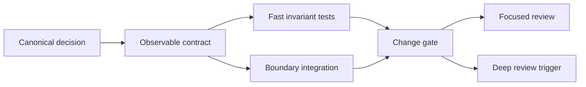

# Foundation Assessment

## Thesis

Foundation은 기능 수가 적은 초기판이 아니다. 상위 기능이 기대할 수 있는 **안정된 하부 구조**다.

`data_platform`에서 foundation이 완료되었다고 말하려면 다음 질문에 추측 없이 답할 수 있어야 한다.

- 어떤 DuckDB 파일이 현재 실행의 authoritative resource인가?
- 누가 그 파일을 만들고 삭제할 수 있는가?
- raw에서 staging, mart로 이동하면서 무엇이 보존되고 무엇이 변하는가?
- 각 metric은 어떤 HMDA record population을 의미하는가?
- 변경이 계약을 깨뜨렸는지 어떤 빠른 check가 판정하는가?
- 자동 검증으로 판정할 수 없는 위험은 무엇이며 언제 인간 review가 필요한가?

현재 repository는 이 질문의 일부에는 강하지만, resource identity·ownership·metric semantics에서 중요한 빈틈이 있다.

## Current Strengths

### Clear ownership boundary

`docs/domains/data-platform.md`는 DuckDB helper와 dbt model contract를 `data_platform`의 책임으로 한정하고, ingestion과 dbt subprocess 실행을 다른 domain에 둔다. 이는 모든 동작을 한 package에 흡수하는 것보다 변경 영향과 review scope를 좁힌다.

### Existing specification path

`openspec/specs/dbt-analytics-foundation/spec.md`에는 staging model, mart grain, artifact, lineage와 idempotency 요구사항이 존재한다. 테스트가 구현에서 역으로 계약을 추론할 필요가 없는 기반이다.

### Deterministic local integration

`tests/dbt/test_analytics_foundation.py`는 임시 DuckDB와 작은 CSV를 사용해 실제 dbt build, lineage와 mart idempotency를 검증한다. 실제 boundary를 연결하면서 외부 service에 의존하지 않는 좋은 출발점이다.

### General test discipline

`docs/development/test-design-and-implementation.md`는 requirement → observable contract → risk → scenario → oracle → test level 연결을 이미 요구한다. 새로운 전사적 testing philosophy보다 도메인 적용이 필요하다.

### Focused helper tests

SQL quoting은 property-based test에 적합하고, DuckDB helper는 local file component test로 검증할 수 있다. 도메인 특성과 기존 marker 체계가 충돌하지 않는다.

## Structural Gaps

### Resource identity is implicit

`DataOperationRequest.database_path`는 상대 경로를 허용하고, Python과 dbt adapter는 상대 경로를 서로 다른 기준에서 해석할 수 있다. 동일 문자열이 동일 resource를 의미한다는 전제가 코드 경계를 통과하며 깨진다.

이 문제는 path 문자열 비교로 해결되지 않는다. **subprocess 경계에 들어가기 전에 하나의 absolute identity로 정규화**되어야 한다.

### Destructive ownership is not modeled

`cleanup_on_close=True`는 “이 connection 종료 후 파일을 삭제한다”는 동작만 표현하고 “이 manager가 파일을 소유한다”는 전제는 표현하지 않는다.

파괴적 동작의 foundation contract는 다음이어야 한다.

```text
delete permission = explicit ownership + valid lifecycle state
```

boolean flag 하나만으로 caller 소유 resource를 삭제할 수 있으면 helper는 편리하지만 안전한 기반은 아니다.

### Transformation semantics stop at column names

Staging의 row와 Null 보존은 domain 문서에 있지만 직접 oracle이 없다. Mart는 grain과 metric column을 정의하지만 action code population과 denominator를 canonical spec에 고정하지 않는다.

이 상태에서는 SQL이 실행되고 값이 나와도 **그 값이 맞는 의미인지 판정할 수 없다**.

### Integration test is broad but incomplete

현재 통합 test 하나가 build, artifact, lineage, metric, idempotency를 함께 검증한다. 넓은 연결은 유용하지만 다음 문제가 있다.

- 기본 상대 path를 사용하지 않아 resource identity defect를 놓친다.
- Null row fixture가 있어도 staging 보존을 직접 조회하지 않는다.
- metric fixture가 action code `1, 2, 3, 7`만 포함해 전체 분류 경계를 설명하지 않는다.
- 실패 시 어느 contract가 깨졌는지 진단 비용이 커진다.

통합 test를 없애는 것이 아니라, 싼 unit·component oracle을 앞에 두고 통합 test를 핵심 wiring 확인으로 축소해야 한다.

### Review has become the missing oracle

현재 심층 review가 다음을 매번 사람이 다시 추론한다.

- path가 어디에서 resolve되는가
- cleanup이 무엇을 삭제하는가
- staging에서 row가 사라지는가
- metric 분모가 무엇인가
- integration fixture가 위험을 실제로 관찰하는가

반복 추론이 필요한 이유는 문제가 어렵기 때문만이 아니라, 이전 판단이 executable artifact로 충분히 이전되지 않았기 때문이다.

## Target Foundation



### Foundation properties

| Property | Completion signal |
| --- | --- |
| Stable identity | 모든 DB consumer가 같은 resolved path를 사용하고 default flow test가 증명한다. |
| Safe ownership | 기존 DB와 read-only resource는 cleanup으로 삭제되지 않는다. |
| Preserved data | staging row count, Null과 cast behavior를 직접 검증한다. |
| Defined semantics | mart metric별 population, numerator와 denominator가 spec에 있다. |
| Independent oracle | 작은 fixture의 expected result를 사람이 계산할 수 있다. |
| Layered validation | unit/component/dbt/integration이 서로 다른 failure를 판정한다. |
| Review economy | routine 변경과 semantic/high-risk 변경의 review 경로가 다르다. |

## Non-Goals

Foundation을 이유로 다음을 먼저 만들지 않는다.

- 모든 SQL을 Python test로 복제
- manifest 전체 snapshot
- 모든 DuckDB 내부 동작의 wrapper
- 매 commit full-data EDA 또는 memory test
- 모든 변화에 OpenSpec change와 deep review를 기계적으로 요구
- future-proofing을 위한 추상 factory와 generic repository layer

Foundation은 확장 가능성을 위해 현재 위험을 정확히 고정해야 한다. 미래의 모든 가능성을 미리 구현하는 것이 아니다.

## Assessment

현재 상태는 **구조와 문서가 있는 foundation candidate**다. 그러나 resource identity와 destructive ownership은 안전성 gate를 통과하지 못하며, metric semantics는 검증 가능한 canonical contract가 아니다.

권장 순서는 다음과 같다.

1. resource identity와 cleanup ownership을 먼저 안전하게 만든다.
1. mart 의미 결정을 canonical spec에 반영한다.
1. 각 결정을 가장 싼 regression test로 고정한다.
1. integration test를 default flow와 wiring 중심으로 재구성한다.
1. 이후 review policy를 risk-triggered 방식으로 전환한다.
