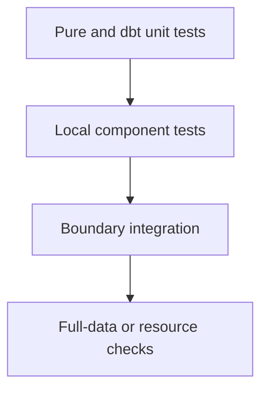

# Test Architecture

## Objective

목표는 높은 test count가 아니라 다음 세 속성이다.

- **신뢰성**: 실패가 실제 contract violation을 의미한다.
- **진단성**: 어느 계층이 깨졌는지 좁게 알 수 있다.
- **경제성**: routine 변경에서 전체 pipeline과 심층 review를 반복하지 않는다.

## Layer Model



| Layer | Owns | Typical duration | Default gate |
| --- | --- | ---: | --- |
| Python unit | quoting, validation, path policy pure rules | sub-second | Always |
| dbt unit | staging cast, action mapping, metric arithmetic | seconds | Model changes |
| Component | real DuckDB file, lifecycle, ownership, metadata | seconds | Data platform changes |
| Integration | Python load → dbt → artifact/lineage/mart | tens of seconds | Cross-boundary changes |
| Memory/stress | full-data resource envelope | minutes+ | Explicit only |

Duration은 목표 budget이며 실제 측정 후 조정한다. budget을 달성하려고 test를 skip하거나 oracle을 약화하지 않는다.

## Recommended Test Layout

기존 domain directory를 유지하되 behavior별로 분리한다.

```text
tests/data_platform/
├── test_sql.py
├── test_duckdb_connection.py
├── test_duckdb_cleanup.py
├── test_duckdb_metadata.py
└── test_database_identity.py

tests/dbt/
├── test_analytics_foundation.py
└── test_analytics_foundation.design.md

dbt/models/staging/
├── schema.yml
└── unit_tests.yml

dbt/models/marts/
├── schema.yml
└── unit_tests.yml
```

파일명은 구현 시 기존 conventions와 실제 변경 범위에 맞게 조정한다. 중요한 것은 package별 분리보다 failure ownership이다.

## Why dbt Unit Tests

Mart의 `CASE WHEN`과 denominator 정책은 작은 static input으로 SQL logic을 직접 검증하기 적합하다. dbt unit test는 full model materialization 전에 SQL model을 fixture input으로 실행할 수 있다.

다음은 dbt unit test로 둔다.

- action code mapping
- zero denominator
- Null and malformed numeric cast
- Null grain filtering 결과
- refactor 전후 exact model output

다음은 unit test로 복제하지 않는다.

- `avg`, `count` 자체의 warehouse 구현
- manifest generation
- materialization idempotency
- source/staging/mart 실제 wiring

## dbt Data Tests

Data test는 materialized relation이 지속적으로 지켜야 하는 성질을 확인한다.

### Existing

- source/staging required column `not_null`
- mart grain key `not_null`, `unique`

### Recommended

- count metric non-negative
- `approval_count <= decision_count`
- `denial_count <= decision_count`
- rate range `0 <= approval_rate <= 1`
- 필요 시 accepted action codes
- staging-to-raw row conservation은 실행 context가 필요하므로 custom test 또는 integration assertion 중 더 단순한 쪽을 선택

Data test가 metric 의미를 결정해서는 안 된다. 의미는 spec과 dbt unit fixture가 소유하고, data test는 보편 invariant를 확인한다.

## Python Component Tests

### Connection lifecycle

실제 tmp file을 사용한다.

- context 정상 종료 후 lock이 해제된다.
- body exception 후에도 재연결할 수 있다.
- read-only는 기존 DB를 읽고 mutation을 거부한다.
- read-only와 in-memory 또는 non-existing file 조합의 정책을 명시적으로 검증한다.

### Cleanup ownership

`tmp_path` 자체가 ownership 증거는 아니다. test가 사전 존재 상태를 분명히 만든다.

```text
pre-existing file → cleanup request → reject or preserve
manager-created owned temp → cleanup → remove
read-only file → cleanup request → reject
```

### Metadata helpers

`ensure_schema`, `table_row_count`, `table_columns`를 실제 DuckDB에서 검증한다.

- quoted schema/table
- empty table
- missing relation failure
- expected return type
- metadata error가 DuckDB exception을 무조건 숨기지 않는지

## Integration Design

현재 하나의 integration test가 여러 contract를 연결한다. 전체 flow test는 유지하되 목적을 두 개로 분리하는 것이 좋다.

### Default execution contract

**Question:** 실제 application default로 load와 dbt build가 같은 DB를 사용하는가?

- relative default를 그대로 시작점으로 사용
- test가 controlled working directory 또는 project root contract를 명시
- raw, staging, mart가 하나의 resolved file에 존재하는지 확인
- dbt subprocess environment와 artifact path를 실제 boundary에서 확인

### Analytics contract

**Question:** known raw fixture가 staging과 mart에서 의도된 상태가 되는가?

- absolute tmp DB 사용
- staging row/type/Null/cast assertion
- mart exact output
- second build idempotency
- manifest lineage와 run result status

한 test에서 모든 assertion을 제거할 필요는 없다. 하지만 failure message와 helper 이름이 contract를 구분해야 한다.

## Fixture Strategy

### One canonical minimal fixture

기본 fixture는 다음을 포함한다.

| Case | Purpose |
| --- | --- |
| action codes 1–8 | metric population |
| Null state/county | staging preservation, mart exclusion |
| malformed amount/income | tolerant cast |
| two grains | grouping and unique key |
| repeated values | count and average |
| zero-decision grain | denominator policy |

Fixture를 Python CSV writer와 dbt unit YAML에 각각 복사하면 drift가 생긴다. 그러나 하나의 범용 fixture abstraction을 먼저 만들 필요도 없다.

권장 방식:

- dbt unit fixture는 SQL logic에 필요한 최소 column만 inline 유지
- integration CSV는 cross-boundary schema를 대표하도록 별도 유지
- 두 fixture의 목적과 차이를 `test_analytics_foundation.design.md`에 기록
- exact expected output을 literal로 두고 production SQL을 test helper에서 재구현하지 않음

## False-Green Controls

다음 패턴을 금지한다.

- artifact path 존재만 확인하고 current run status를 보지 않음
- source code 문자열이 output에 포함됐는지 검사
- `or` 조건으로 서로 다른 성공 기준을 허용
- broad exception을 정상 결과로 취급
- environment가 없을 때 unconditional skip
- production calculation을 test helper에서 복제
- absolute test path만 사용해 default relative-path contract를 우회

## Command Portfolio

실제 command는 repository testing guide를 따른다. 권장 gate는 다음과 같다.

| Change | Focused | Broaden |
| --- | --- | --- |
| SQL quote/helper | `tests/data_platform/test_sql.py` 또는 해당 module | `tests/data_platform` |
| Connection/cleanup | 해당 component module | `tests/data_platform` |
| Staging SQL | dbt unit test selector | dbt analytics integration |
| Mart metric SQL | metric unit test selector | dbt build + integration |
| Request/runner path | database identity integration | `tests/data_operations` + dbt integration |
| dbt project/profile/artifact | dbt debug/build integration | full relevant suite |

## Evidence Contract

PR에는 pass count보다 다음을 남긴다.

- 변경한 contract
- 추가·수정한 scenario와 oracle
- 실제 실행한 focused command
- 넓힌 suite와 결과
- 실행하지 않은 validation
- 남은 semantic 또는 environment risk

## Success Criteria

Test architecture가 작동한다고 보는 기준은 coverage percentage가 아니다.

- 과거 F1–F4가 각각 하나 이상의 deterministic regression check로 보호된다.
- metric 변경은 full integration 전에 dbt unit test에서 실패한다.
- default path defect는 working-directory 독립 test에서 실패한다.
- cleanup data-loss regression은 component test에서 실패한다.
- routine SQL 변경은 deep review 없이 focused gate로 판정 가능하다.
