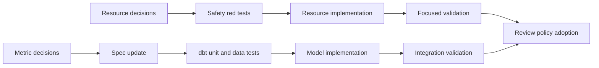

# Delivery Roadmap

## Strategy

한 번에 “test 강화” change를 만들지 않는다. 의미 결정과 안전성 수정이 섞이면 review가 다시 넓어진다.

권장 작업 축은 두 개다.

1. **Database resource safety**: path identity, connection lifecycle, cleanup ownership
1. **Analytics contract hardening**: staging preservation, metric semantics, dbt test portfolio

Test는 독립 목적의 사후 작업이 아니라 각 change의 acceptance evidence로 포함한다.

## Workstream A: Database Resource Safety

### Goal

Python, dbt와 test가 하나의 DuckDB identity를 사용하고, helper가 caller data를 삭제하지 못하게 한다.

### Decision Gate

- relative path 기준점을 application root로 고정할지
- `DataOperationRequest`에 resolved path를 저장할지 runner에서만 정규화할지
- cleanup boolean을 제거·제한·대체할지
- temporary DB ownership을 어떤 API가 표현할지

### Red Evidence

먼저 다음 test가 현재 behavior에서 실패하거나 위험을 재현해야 한다.

- default request load/build가 한 DB를 사용한다.
- 다른 working directory에서도 identity가 같다.
- pre-existing DB는 cleanup으로 삭제되지 않는다.
- read-only + cleanup 조합은 생성 전에 실패한다.
- body exception 후 DB lock이 남지 않는다.

### Change Boundary

예상 owning artifacts:

- `src/project_pivot/data_operations/request.py`
- `src/project_pivot/data_operations/runner.py`
- `src/project_pivot/data_platform/duckdb.py`
- `docs/domains/data-platform.md`
- `docs/domains/data-operations.md`
- 관련 OpenSpec artifact
- `tests/data_platform/`, `tests/data_operations/`, 필요한 integration test

### Completion Gate

- path는 subprocess 전에 absolute identity가 된다.
- default flow가 실제 동일 DB를 증명한다.
- pre-existing DB deletion path가 불가능하다.
- connection failure와 cleanup failure semantics가 문서와 test에 있다.
- focused와 관련 domain suite 결과가 기록된다.

## Workstream B: Analytics Contract Hardening

### Goal

Staging과 mart가 실행 가능할 뿐 아니라 의미와 보존 계약을 독립적으로 검증할 수 있게 한다.

### Decision Gate

- `application_count` population
- approval·denial action mapping
- preapproval의 포함·분리 여부
- purchased loan의 metric 처리
- approval rate denominator와 zero policy
- 기존 mart column 호환성 유지 여부

### Spec First

결정은 먼저 `dbt-analytics-foundation` canonical spec에 반영한다.

최소 요구사항:

- metric별 population과 action code
- numerator와 denominator
- Null grain exclusion
- staging row·Null·cast preservation
- 대표 scenario의 expected result

### Red Evidence

- action codes 1–8 exact output dbt unit test
- malformed numeric staging unit test
- raw/staging row conservation assertion
- Null grain row가 staging에 남고 mart에서 제외되는 integration assertion
- metric arithmetic data tests

### Completion Gate

- SQL을 읽지 않고 spec만으로 expected output을 계산할 수 있다.
- dbt unit test가 metric logic을 빠르게 판정한다.
- data test가 materialized invariant를 판정한다.
- integration test는 wiring, artifact, lineage와 idempotency를 판정한다.
- test 간 책임 중복과 blind spot이 design 문서에 설명된다.

## Workstream C: Review Economy

이 workstream은 별도 대형 구현 change가 아니다. A와 B가 완료되며 운영 규칙으로 반영한다.

### Deliverables

- routine/deep review trigger
- PR evidence checklist
- finding-to-test feedback rule
- review artifact 삭제 또는 handoff 조건

### Completion Gate

- 기존 invariant 내부의 refactor는 focused review 경로를 사용한다.
- semantic, ownership 또는 destructive change만 deep review를 요구한다.
- 동일 유형 finding이 다시 나오면 review 문서가 아니라 missing test 또는 missing decision으로 분류한다.

## Recommended Sequence

A와 B의 decision research는 병행할 수 있다. 구현 branch와 PR은 독립적으로 검토·되돌릴 수 있도록 분리하는 편이 안전하다.

## Suggested OpenSpec Split

| Change | Purpose | Do not include |
| --- | --- | --- |
| `data-platform-database-resource-contracts` | path identity, connection lifecycle, cleanup ownership | mart metric redesign |
| `dbt-analytics-contract-hardening` | staging preservation, metric semantics, dbt tests | generic runner refactor |

현재 review bundle이나 inbox lifecycle 변경은 두 change에 포함하지 않는다.

## Migration Considerations

### Backward compatibility

- 기존 caller가 `cleanup_on_close=True`를 사용하는지 repository 전체에서 확인한다.
- mart column을 변경하거나 추가하면 downstream reliability, notebook, documentation과 fixture 참조를 검색한다.
- path normalization이 반환 model의 `database_path` 표현을 바꾸는지 확인한다.
- artifact path와 database path를 같은 문제로 섞지 않는다.

### Existing data

Metric semantics가 바뀌면 현재 mart table을 재build해야 한다. Foundation은 append-only migration을 요구하지 않지만, 기존 결과와 새 결과의 차이를 review evidence로 남겨야 한다.

### Test runtime

Integration test를 늘리기 전에 dbt unit test로 logic case를 옮긴다. integration은 wiring별 최소 scenario를 유지한다.

## Exit Criteria

다음이 모두 성립하면 이번 범위의 foundation 개선이 완료된 것으로 본다.

- P0 resource invariant가 executable check로 보호된다.
- mart metric semantics가 canonical하다.
- staging preservation이 직접 검증된다.
- dbt unit/data/integration test 책임이 분리된다.
- default path를 우회하지 않는 end-to-end test가 있다.
- routine change review 경로가 정의된다.
- 실행하지 않은 validation과 remaining risk가 PR에 기록된다.

“관련 test가 많아졌다” 또는 “deep review에서 finding이 없었다”는 completion criterion이 아니다.
