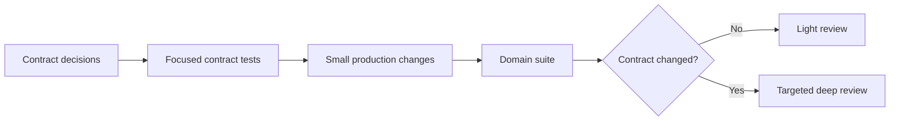

# Data Operations Test Foundation

> [!IMPORTANT]
> 여기서 Foundation은 초안이나 임시 구현이 아니다. 이후 변경이 안전하게 올라갈 수 있도록 경계, 하중 조건, 실패 감지 장치를 먼저 설치하는 **기초 공사**다.

## Summary

현재 `data_operations`는 stage API와 read-only lifecycle 경계는 잘 분리되어 있지만, 중요한 contract 일부가 문서와 인간 리뷰에만 존재한다. 이 때문에 작은 변경도 전체 경계를 다시 추론해야 한다.

해결 방향은 리뷰를 없애는 것이 아니라 역할을 분리하는 것이다.

```text
known contract와 known failure mode
→ 빠른 executable test가 지속 검증

새 contract, 모호한 결정, 새 dependency와 cross-boundary change
→ 인간의 집중 리뷰
```

가장 먼저 고정할 대상은 다음 네 가지다.

1. dbt artifact 설정과 실제 출력 위치의 일치
1. public stage의 안정적인 error boundary
1. Dagster materialization과 실제 dbt 실행의 의미 일치
1. result metadata와 immutability의 정확한 의미

## Bundle

| Artifact | Purpose |
| --- | --- |
| [`foundation-research.md`](foundation-research.md) | 반복 리뷰 비용의 원인과 test foundation의 원칙 |
| [`review-synthesis.md`](review-synthesis.md) | 기존 domain review를 root cause와 우선순위 중심으로 재구성 |
| [`failure-model.md`](failure-model.md) | 변경이 깨뜨릴 수 있는 실패 경로와 관찰 가능한 결과 |
| [`test-architecture.md`](test-architecture.md) | unit·component·integration 경계와 reusable test harness 설계 |
| [`contract-test-matrix.md`](contract-test-matrix.md) | requirement, risk, scenario, oracle와 test level 매핑 |
| [`change-gates-and-delivery.md`](change-gates-and-delivery.md) | 심층 리뷰가 필요한 변경과 test만으로 충분한 변경의 gate, 전달 순서 |

## Recommended Decision

단일 대형 개선으로 처리하지 않는다. 먼저 contract를 결정하고 characterization 또는 red test로 고정한 뒤 production change를 분리한다.



## Expected Outcome

이 bundle의 성공은 test 수가 늘어나는 것이 아니다.

- 알려진 regression은 focused suite가 즉시 차단한다.
- 리뷰어는 이미 test가 증명하는 사실을 반복 검증하지 않는다.
- 변경자가 어떤 contract를 건드렸는지 빠르게 식별한다.
- 심층 리뷰는 새로운 결정과 architecture risk에 집중한다.
- `data_operations`가 다른 domain의 세부 구현을 숨기는 안정적인 application boundary가 된다.

## Status

- Reviewed revision: `f08c2fb7a71aecd6659b77dcab5d0026e5d9ee93`
- Source review: `reviews/data-operations-domain-review.md`
- Validation: static inspection only
- Canonical status: non-canonical inbox artifact
