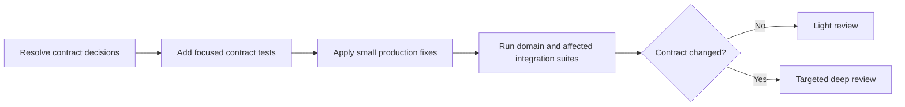

# Data Operations Test Foundation

> [!IMPORTANT]
> Foundation은 초안이 아니라 이후 변경의 하중을 견디는 기초 공사다. 목표는 test 수를 늘리는 것이 아니라, 이미 합의한 contract를 사람이 반복해서 재검증하지 않게 만드는 것이다.

## Summary

Stage 분리와 read-only lifecycle은 적절하다. 비용이 반복되는 이유는 configuration, error, result와 Dagster event의 의미가 실행 가능한 검증으로 닫히지 않았기 때문이다.

```text
합의된 contract + reachable risk
→ focused contract test

새 contract + architecture decision
→ targeted deep review
```

첫 foundation cycle은 다음 경계만 다룬다.

1. dbt artifact 설정과 실제 출력 위치
1. public stage의 error boundary
1. Dagster materialization과 실제 실행의 일치
1. result와 metadata의 불변·정확성

## Bundle Map

| Artifact | Owns |
| --- | --- |
| [`foundation-research.md`](foundation-research.md) | 반복 리뷰 비용의 원인과 해결 원칙 |
| [`review-synthesis.md`](review-synthesis.md) | 검증된 finding, 우선순위와 decision gap |
| [`failure-model.md`](failure-model.md) | 방지할 실패와 invariant |
| [`test-architecture.md`](test-architecture.md) | test layer, harness와 oracle |
| [`contract-test-matrix.md`](contract-test-matrix.md) | contract-to-scenario coverage |
| [`change-gates-and-delivery.md`](change-gates-and-delivery.md) | 변경 분류, 결정과 전달 순서 |

각 내용은 위 문서 한 곳에서만 소유한다. 다른 문서는 필요한 경우 링크만 사용한다.

## Recommended Route



## Success Criteria

- known regression은 focused suite가 차단한다.
- 일반 변경은 전체 domain을 다시 추론하지 않는다.
- deep review는 새 contract와 architecture risk에만 사용한다.
- test가 미결정 behavior를 임의로 확정하지 않는다.
- 실행하지 않은 validation은 통과로 기록하지 않는다.

## Status

- Reviewed revision: `f08c2fb7a71aecd6659b77dcab5d0026e5d9ee93`
- Source review: `reviews/data-operations-domain-review.md`
- Validation: static inspection only
- Canonical status: non-canonical inbox artifact
