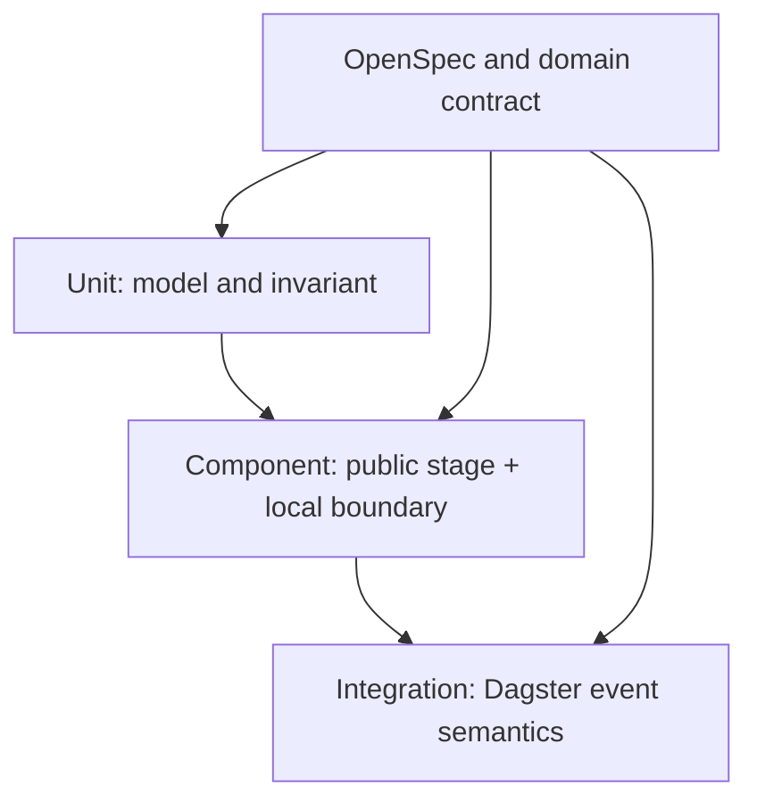

# Test Architecture

## Objective

`data_operations` 변경마다 전체 domain을 재검토하지 않아도 되도록, known contract를 빠르고 독립적으로 검증한다. Test architecture는 production architecture를 복제하지 않고 public boundary의 의미를 보호한다.

## Test Portfolio



### Unit

대상:

- request validation
- result deep immutability
- pure compatibility policy가 별도 함수로 존재할 경우의 rule
- public export surface의 단순 invariant

특징:

- filesystem, DuckDB, subprocess 없음
- exact exception 또는 mutation behavior를 직접 확인
- 매우 빠른 default suite

### Component

대상:

- `load_raw_data()`와 실제 temporary DuckDB/file fixture
- `run_dbt_build()`와 fake dbt executable, 실제 filesystem
- `run_incident_lifecycle()`와 real DuckDB, 최소 dbt artifact
- public error translation

특징:

- domain behavior를 mock으로 대체하지 않는다.
- external boundary만 통제한다.
- persisted row, artifact, exception과 result가 oracle이다.

### Integration

대상:

- Dagster asset graph
- standard pipeline execution order
- materialization event 존재와 metadata 의미
- raw-only 실행을 asset selection 또는 별도 job으로 표현하는 방식

특징:

- call count보다 Dagster event stream을 확인한다.
- 실제 dbt 전체 실행이 필요하지 않으면 stage function을 boundary stub으로 대체할 수 있지만, stub은 event semantics를 대신 결정하지 않는다.

## Reusable Harness

### Fake dbt executable

`subprocess.run` 자체를 monkeypatch하지 않고 temporary `PATH` 앞에 executable script를 둔다.

Fake executable은 다음만 수행한다.

1. command argument를 file로 기록한다.
1. `--target-path` 또는 합의된 output configuration을 읽는다.
1. 그 위치에 최소 `manifest.json`, `run_results.json`을 생성한다.
1. fixture option에 따라 exit code, delay, artifact omission을 제어한다.

이 harness 하나로 다음을 증명한다.

- command가 실제 output location을 전달하는가
- stale artifact가 제거되는가
- timeout과 non-zero exit가 변환되는가
- success result가 이번 invocation의 artifact를 가리키는가

> [!NOTE]
> 실제 dbt semantics 전체를 흉내 내지 않는다. Adapter contract만 재현한다.

### HMDA source fixture factory

작은 CSV 또는 Parquet fixture를 다음 차원으로 생성한다.

- 여러 source year
- 여러 source file name
- 선택 partition에 row가 있는 file과 없는 file
- 동일 partition 재실행

Oracle은 discovered path 수가 아니라 합의한 provenance 의미와 persisted rows다.

### Exception translation matrix

각 public entry point에 대해 예상 가능한 dependency exception을 parameterize한다.

| Stage | Dependency class | Expected public observation |
| --- | --- | --- |
| raw | `HMDADataFoundationError` | `DataOperationError`, chained cause, safe context |
| raw | DuckDB operational failure | `DataOperationError`, chained cause |
| dbt | timeout, startup, exit, artifact failure | `DataOperationError` |
| lifecycle | `ReliabilityError` | `DataOperationError`, chained cause |
| lifecycle | DuckDB operational failure | `DataOperationError`, chained cause |

Broad unexpected programming error는 wrapping하지 않는 별도 negative scenario를 둔다.

### Dagster event oracle

`materialize()` 결과에서 다음을 직접 확인한다.

- materialized asset key
- materialization event count
- metadata key와 value
- failure 또는 selection에 따라 event가 없어야 하는 asset

Log text는 보조 evidence일 뿐 oracle이 아니다.

## Proposed Test Modules

| Module | Marker | Scope |
| --- | --- | --- |
| `tests/data_operations/test_request_and_results.py` | `unit` | validation, public model semantics, immutability |
| `tests/data_operations/test_raw_runner.py` | `component` | raw load result, file-count contract, error translation |
| `tests/data_operations/test_dbt_runner.py` | `component` | fake executable adapter, artifacts, failure translation |
| `tests/data_operations/test_incident_lifecycle.py` | `component` | current behavior, error translation, read-only invariant |
| `tests/data_operations/test_public_contract.py` | `unit` 또는 `component` | public exports와 duplicate coordinator 부재 |
| `tests/orchestration/test_dagster_definitions.py` | `integration` | graph, event semantics, metadata |

복잡한 scenario matrix가 실제로 도입될 때만 `test_data_operations_contract.design.md`를 추가한다. Bundle 문서를 test directory에 그대로 복제하지 않는다.

## Fast Feedback Groups

### Focused change

```bash
uv run pytest tests/data_operations/test_dbt_runner.py
```

### Domain boundary

```bash
uv run pytest tests/data_operations
```

### Orchestration semantics changed

```bash
uv run pytest tests/data_operations tests/orchestration/test_dagster_definitions.py
```

전체 suite는 shared fixture, public import 또는 configuration 영향이 있을 때만 확장한다.

## Anti-Patterns

- production helper call 횟수를 contract로 고정한다.
- mock이 expected artifact나 result를 직접 만들어 연결 defect를 숨긴다.
- spec에 없는 architecture 결정을 test 이름으로 확정한다.
- 모든 failure를 `DataOperationError`로 감싸 programming error까지 숨긴다.
- dbt 전체 integration을 매 focused run마다 실행한다.
- 하나의 broad test가 raw, dbt, lifecycle과 Dagster를 모두 검증한다.
- coverage 수치가 높다는 이유로 failure model 누락을 허용한다.

## Review Reduction Model

| Change type | Required evidence | Human review depth |
| --- | --- | --- |
| 내부 refactor, contract 불변 | focused + domain suite | light |
| 기존 dependency failure 처리 | relevant matrix tests | targeted |
| result field 추가, 기존 의미 유지 | model + affected component tests | light/targeted |
| public contract 또는 spec 변경 | new scenario + domain suite | deep |
| asset graph, lifecycle boundary 변경 | integration + architecture review | deep |

Test는 리뷰를 대체하는 자동 승인 장치가 아니다. 이미 합의된 contract를 반복해서 사람이 재증명하는 비용을 제거하는 장치다.
