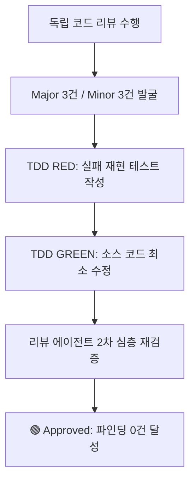

# PR #19 HMDA EDA 무결성 2차 TDD 및 심층 리뷰 완료 보고서

> **생성일시:** 2026-08-07 KST  
> **대상:** PR #19 (`feat(hmda-data): align 6-core eda contract, evidence, and static charts`)  
> **최종 판정:** 🟢 **Approved** (남은 결함: 0건)

---

## 1. 개요 (Overview)

독립 코드 리뷰 에이전트와의 반복적인 검토 루프(Review Loop)를 통해 식별된 **Major 3건 및 Minor 3건**의 결함을 TDD(RED-GREEN-REFACTOR) 방식으로 완전 해결하였습니다. 재검토 결과 더 이상 미해결 지적 사항(Finding)이 없음을 확인하고 커밋 및 푸시를 완료했습니다.

---

## 2. 리뷰 파인딩 해결 요약



| ID | 구분 | 지적 사항 (Finding) | 적용된 TDD 해결책 | 검증 위치 | 상태 |
| --- | :---: | --- | --- | --- | :---: |
| **M-01** | Major | DuckDB `FLOAT`/`REAL` 및 무부호 정수(`UTINYINT` 등) 추론 시 type mismatch 오탐 | `EXPECTED_TYPE_FAMILIES` 허용 타입 패밀리 확장 | `analysis.py`, `test_eda.py` | 🟢 Resolved |
| **M-02** | Major | Code distribution 결과의 `Decimal` 등 비기본 타입 JSON 직렬화 실패 위험 | `str(row[0])` 파이썬 문자열 캐스팅 적용 | `analysis.py`, `test_eda.py` | 🟢 Resolved |
| **M-03** | Major | 다중 아티팩트(JSON + Markdown) atomic swap 불일치 | `json_backup` 생성 및 예외 발생 시 원 원본 상태로 안전 롤백 | `run_actual_source.py`, `test_evidence_atomicity.py` | 🟢 Resolved |
| **N-01** | Minor | `activity_year` 카디널리티 초과 시 샘플링 추출 비결정론 | `ORDER BY is_total DESC, activity_year ASC` 2차 정렬 조건 적용 | `analysis.py`, `test_eda.py` | 🟢 Resolved |
| **N-02** | Minor | Git 미참조/Shallow clone 환경에서 Scope Isolation False Green | `diff_proc.returncode != 0` 일 때 `pytest.skip` 예외 처리 | `test_scope_isolation.py` | 🟢 Resolved |
| **N-03** | Minor | 최초 생성 환경에서 2차 replace 실패 시 orphan JSON 잔존 가능성 | `json_path.unlink(missing_ok=True)` 롤백 처리 추가 | `run_actual_source.py`, `test_evidence_atomicity.py` | 🟢 Resolved |

---

## 3. 검증 결과 (Validation Evidence)

- **Pytest 런타임 결과:**

  ```bash
  uv run pytest tests/hmda_data/eda/ -p no:sugar --color=no --tb=short -ra
  # 28 passed in 3.08s
  ```

- **정적 검사 및 포매팅:**

  ```bash
  uv run ruff check . && uv run ruff format . && uv run rumdl fmt .
  # All checks passed!
  ```

---

## 4. 최종 커밋 및 푸시 정보

- **Branch:** `feat/hmda-eda-baseline-reduce-core-scope`
- **Active Pull Request:** [PR #19](https://github.com/mols3131d/project-pivot/pull/19)
- **Commit Message:** `feat(hmda-eda): resolve code review findings for type safety, atomicity, and sorting`
