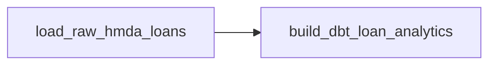

# Apache Airflow 마이그레이션 결정

## 결정

Project Pivot의 data-plane orchestrator를 **Apache Airflow 3.3.x로 교체한다.**

변경 범위는 orchestration adapter와 vendor-specific integration surface로 제한한다. Data Operations와 Reliability가 소유하는 domain contract와 safety boundary는 유지한다.

다음 public behavior는 migration 전후에 동일한 owner가 계속 소유한다.

- `DataOperationRequest`
- `load_raw_data()`
- `run_dbt_build()`
- `promote_dbt_artifacts()`
- HMDA ingestion과 DuckDB write semantics
- dbt artifact candidate/current projection boundary
- read-only incident lifecycle
- approval-bound recovery
- evaluation과 LLMOps control-plane responsibility

## 기술적 근거

현재 `src/project_pivot/orchestration/**`은 domain logic을 직접 구현하지 않고 `data_operations` public API에 위임하는 얇은 adapter다. 따라서 orchestrator 교체를 ingestion, dbt, reliability 또는 recovery 재설계로 확장할 필요가 없다.

Migration은 이 경계를 유지하면서 orchestration-specific runtime, configuration adapter, execution evidence를 Airflow semantics에 맞게 교체한다.

## Invariants

1. Airflow task는 domain API를 호출하는 thin adapter다.
2. `load_raw_data()` → `run_dbt_build()` → `promote_dbt_artifacts()`의 책임과 순서를 유지한다.
3. successful dbt build와 current artifact promotion을 동일 사건으로 취급하지 않는다.
4. final runtime configuration validation은 `DataOperationRequest`가 담당한다.
5. reliability lifecycle, approval, recovery, evaluation은 data-plane DAG 밖에 둔다.
6. task execution state와 data asset update evidence를 구분한다.
7. migration 자체를 이유로 scheduling, retry, distributed execution 또는 control-plane orchestration을 추가하지 않는다.

## 핵심 설계 결정

| 항목 | 결정 |
| --- | --- |
| Runtime | Apache Airflow 3.3.x |
| Python | 현재 Python 3.13 유지 |
| Public authoring API | `airflow.sdk` |
| Workflow | 단일 data-plane DAG |
| Task | raw load → dbt analytics |
| Schedule | `None` |
| Catchup | `False` |
| Retry | migration 단계에서는 `0` |
| Concurrency | `max_active_runs=1` |
| Domain config authority | `DataOperationRequest` |
| Task간 domain object transport | XCom 사용하지 않음 |
| Reliability lifecycle | DAG 밖에 유지 |
| Recovery | DAG 밖에 유지 |
| LLMOps | DAG에 편입하지 않음 |

## Target topology



DAG ID는 `project_pivot_data_plane`을 기준으로 한다.

## Asset semantics

Dagster `@asset`을 Airflow `@asset`으로 기계적으로 1:1 치환하지 않는다.

실행 ownership은 하나의 DAG와 두 task가 갖고, 데이터 identity/evidence가 필요할 경우 Airflow `Asset` outlet을 사용한다.

```text
Task state = 실행 결과
Asset event = 실제 데이터 갱신 증거
```

따라서 `run_dbt_build=False`이면 다음으로 표현한다.

```text
raw task = success
dbt task = skipped
analytics asset event = 없음
DAG run = success
```

실행되지 않은 analytics stage를 asset update로 기록하지 않는다.

## Reliability contract decoupling

현재 Reliability `EvidenceSource`의 `DAGSTER`는 orchestrator vendor가 domain contract로 누출된 상태다.

Migration에서는 이를 `AIRFLOW`로 바꾸지 않고 vendor-neutral한 `ORCHESTRATION` source로 일반화한다.

```text
EvidenceSource.DAGSTER
        ↓
EvidenceSource.ORCHESTRATION
```

Reliability contract는 evidence가 orchestration execution에서 왔다는 사실만 표현하고 구체 vendor는 소유하지 않는다.

## Non-goals

이번 migration에서 다음은 추가하지 않는다.

- Airflow schedule
- sensor / AssetWatcher
- automatic retry
- dynamic task mapping
- TaskGroup
- custom Operator / Plugin / Executor
- CeleryExecutor / KubernetesExecutor
- production metadata DB
- cloud deployment
- OpenLineage
- reliability DAG
- recovery DAG
- LLM task orchestration

## Cleanup boundary

최종 stale reference 검사는 active surface만 대상으로 한다.

- active runtime
- active tests
- canonical Specs
- durable docs
- active project/agent configuration

`openspec/changes/archive/**`, 과거 inbox artifact와 Git history는 active cleanup scope에 포함하지 않는다.

## Acceptance

Migration 완료 상태에서는 다음이 모두 사실이어야 한다.

- Airflow가 유일한 full data-plane orchestration owner다.
- ingestion, dbt execution과 artifact promotion은 기존 Data Operations API가 계속 소유한다.
- reliability와 recovery contract는 orchestration framework 교체 때문에 재설계되지 않는다.
- Airflow는 execution plane으로 한정된다.
- task failure/skip과 asset update evidence가 서로 모순되지 않는다.
- active Reliability contract가 특정 orchestrator vendor에 종속되지 않는다.
