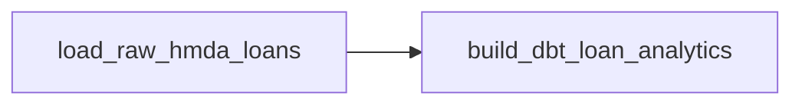

# Apache Airflow 마이그레이션 결정

## 결정

Project Pivot의 data-plane orchestrator를 **Dagster에서 Apache Airflow 3.3.x로 교체한다.**

이번 변경은 orchestration framework 재설계가 아니라 **기존 domain contract와 reliability boundary를 유지한 bounded migration**으로 수행한다.

```text
Dagster adapter
      ↓
Airflow adapter
```

다음은 그대로 유지한다.

- `DataOperationRequest`
- `load_raw_data()`
- `run_dbt_build()`
- `promote_dbt_artifacts()`
- HMDA ingestion과 DuckDB write semantics
- dbt artifact candidate/current projection boundary
- read-only incident lifecycle
- approval-bound recovery
- evaluation과 LLMOps의 독립적인 control-plane 책임

## 이유

### 채용 시장 신호

Project Pivot은 취업용 Data Engineering 포트폴리오이므로 orchestration layer는 국내 채용시장에서 높은 인지도를 가진 Airflow를 사용하는 편이 유리하다.

### 현재 구조가 migration에 적합함

현재 `src/project_pivot/orchestration/**`은 실제 domain logic을 구현하지 않고 `data_operations` public API에 위임하는 얇은 adapter다. 따라서 orchestrator 교체가 ingestion, dbt, reliability 또는 recovery 재작성으로 번질 필요가 없다.

### Architecture 검증 기회

이 migration의 성공은 단순히 Airflow가 실행되는지가 아니라 **orchestrator를 바꿔도 domain behavior가 유지되는가**로 판단한다. 즉 기존 boundary가 실제로 framework-independent한지 검증하는 작업이다.

## 핵심 설계 결정

| 항목 | 결정 |
| --- | --- |
| Runtime | Apache Airflow 3.3.x |
| Python | 현재 Python 3.13 유지 |
| Public authoring API | `airflow.sdk` |
| Workflow | 단일 data-plane DAG |
| Task | raw load → dbt analytics |
| Schedule | `None` |
| Catchup | `False` |
| Retry | migration 단계에서는 `0` |
| Concurrency | `max_active_runs=1` |
| Domain config authority | `DataOperationRequest` |
| Task간 domain object transport | XCom 사용하지 않음 |
| Reliability lifecycle | DAG 밖에 유지 |
| Recovery | DAG 밖에 유지 |
| LLMOps | DAG에 편입하지 않음 |

## Airflow target topology



DAG ID는 `project_pivot_data_plane`을 기준으로 한다.

## Asset semantics

Dagster `@asset`을 Airflow `@asset`으로 기계적으로 1:1 치환하지 않는다.

실행 ownership은 하나의 DAG와 두 Task가 갖고, 데이터 identity/evidence가 필요할 경우 Airflow `Asset` outlet을 사용한다.

```text
Task state = 실행 결과
Asset event = 실제 데이터 갱신 증거
```

따라서 `run_dbt_build=False`이면:

```text
raw task = success
dbt task = skipped
analytics asset event = 없음
DAG run = success
```

으로 표현한다.

## Reliability contract decoupling

현재 Reliability `EvidenceSource`에 `DAGSTER`가 존재한다. Migration에서는 이를 `AIRFLOW`로 단순 변경하지 않고 vendor-neutral한 `ORCHESTRATION` source로 일반화한다.

```text
EvidenceSource.DAGSTER
        ↓
EvidenceSource.ORCHESTRATION
```

Reliability domain이 특정 orchestrator vendor를 소유하지 않게 하는 것이 목적이다.

## 변경하지 않는 것

이번 migration에서 다음은 추가하지 않는다.

- Airflow schedule
- sensor / AssetWatcher
- automatic retry
- dynamic task mapping
- TaskGroup
- custom Operator / Plugin / Executor
- CeleryExecutor / KubernetesExecutor
- production metadata DB
- cloud deployment
- OpenLineage
- reliability DAG
- recovery DAG
- LLM task orchestration

Airflow가 지원한다고 해서 이번 변경에서 쓸 이유는 없다.

## Historical artifacts

과거 Dagster를 실제 사용했으므로 다음은 migration cleanup 대상이 아니다.

- `openspec/changes/archive/**`
- 과거 `inbox/**` 보고서
- Git history

최종 stale reference 검사는 active runtime, active tests, canonical Specs, durable docs와 active configuration만 대상으로 한다.

## 성공 정의

최종적으로 다음 문장이 사실이어야 한다.

> Project Pivot은 orchestration framework를 Dagster에서 Airflow로 교체했지만 ingestion, dbt execution, artifact promotion, reliability와 recovery contract를 재작성하지 않았다. Airflow는 execution plane으로 한정되고 domain behavior는 기존 application/domain boundary가 계속 소유한다.
