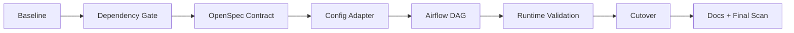

# Apache Airflow 마이그레이션 실행 계획

관련 결정: [`20-58-decision-orchestration-apache-airflow-migration.md`](20-58-decision-orchestration-apache-airflow-migration.md)

## 목표

Airflow가 Project Pivot의 유일한 full data-plane orchestrator가 되도록 교체하되, 기존 domain behavior와 reliability safety boundary는 유지한다.



## Migration invariants

1. Airflow task는 domain API를 호출하는 얇은 adapter로 유지한다.
2. `load_raw_data()` → `run_dbt_build()` → `promote_dbt_artifacts()` 의미를 바꾸지 않는다.
3. successful dbt build와 current artifact promotion을 동일 사건으로 취급하지 않는다.
4. reliability lifecycle, approval, recovery, evaluation은 DAG 밖에 둔다.
5. migration 중 scheduling, retry, distributed executor 같은 새 기능을 추가하지 않는다.
6. 최종 configuration validation은 `DataOperationRequest`가 담당한다.
7. archive와 historical artifact는 active cleanup scope와 분리한다.

# Phase 0. Baseline capture

## 조사 대상

- `src/project_pivot/orchestration/**`
- `tests/orchestration/**`
- `src/project_pivot/data_operations/**`
- `src/project_pivot/reliability/contracts/evidence.py`
- `openspec/specs/orchestration-pipeline/spec.md`
- `openspec/specs/reliability-data-contracts/spec.md`
- `pyproject.toml`
- `uv.lock`
- active docs와 orchestration-specific agent instruction

## 보존할 observable behavior

| Behavior | Baseline |
| --- | --- |
| 실행 순서 | raw load 성공 뒤 dbt build |
| config precedence | explicit override > environment > request default |
| config validation | 최종 `DataOperationRequest` validation |
| raw evidence | source scope, year, file count, row count |
| dbt evidence | status, artifact path, projection identity |
| promotion | successful candidate만 current projection으로 승격 |
| dbt disabled | 실행하지 않음이 명시적으로 관찰 가능 |
| control plane | lifecycle, approval, recovery, evaluation 자동 실행 금지 |
| orchestration owner | 별도 full-pipeline runner 없음 |

## Exit gate

- 보존 behavior와 의도적 semantic delta가 분리되어 있다.
- orchestration vendor-specific active surface inventory가 확정되어 있다.

# Phase 1. Dependency feasibility gate

## 작업

1. Apache Airflow 3.3.x와 Python 3.13 compatibility를 lock 단계에서 검증한다.
2. Airflow official constraints를 기준으로 dependency resolution을 수행한다.
3. `uv.lock` delta를 검토한다.
4. 기존 핵심 runtime import와 pytest collection을 확인한다.

## 특히 확인할 dependency

- Pydantic
- SQLAlchemy
- dbt Core
- dbt-duckdb
- DuckDB
- LangGraph
- PyArrow

## Gate command 범주

```text
uv lock / resolution
uv sync --locked
import airflow
airflow version
import project_pivot
dbt --version
pytest collection
```

## Stop condition

기존 핵심 dependency가 위험하게 downgrade되거나 incompatible하면 Airflow implementation을 시작하지 않는다. 먼저 dependency 문제를 해결한다.

# Phase 2. OpenSpec contract migration

## Change

권장 Change ID:

```text
orchestration-pipeline-migrate-airflow
```

## Affected capability

- `orchestration-pipeline`
- `reliability-data-contracts`

새 capability를 만들지 않는다.

## Proposal

다음만 합의한다.

- active data-plane runtime을 Airflow로 교체
- existing data-plane behavior 유지
- vendor-specific orchestration evidence 제거
- non-goal 명시

## Specs

`orchestration-pipeline`은 implementation method보다 observable behavior 중심으로 정리한다.

주요 requirement 후보:

- data-plane workflow graph
- ordered stage execution
- execution evidence
- domain delegation
- runtime configuration conversion
- single pipeline owner
- control-plane exclusion

`reliability-data-contracts`에서는 `DAGSTER` source를 vendor-neutral `ORCHESTRATION`으로 변경한다.

## Design

최소한 다음을 결정한다.

- Airflow 3.3.x
- `airflow.sdk`
- single DAG
- two TaskFlow tasks
- Asset outlets
- logical asset identity
- config adapter
- `schedule=None`
- `catchup=False`
- `max_active_runs=1`
- `retries=0`
- local-only Airflow runtime

## Exit gate

구현자가 기존 orchestration implementation을 역추적하지 않아도 target behavior와 failure semantics를 이해할 수 있어야 한다.

# Phase 3. Runtime configuration adapter

## 목표

현재 orchestration resource에 섞인 generic precedence logic을 framework-independent adapter로 분리한다.

권장 위치:

```text
src/project_pivot/orchestration/config.py
```

개념 surface:

```python
def data_operation_request_from_runtime(
    overrides: Mapping[str, object],
    environment: Mapping[str, str] | None = None,
) -> DataOperationRequest:
    ...
```

## 지원 override

- `database_path`
- `source_root`
- `source_year`
- `source_file`
- `run_dbt_build`

Airflow UI에 `DataOperationRequest`의 모든 field를 노출하지 않는다.

## Required tests

- no override
- environment only
- explicit only
- explicit overrides same environment field
- invalid environment masked by valid explicit field
- invalid explicit year
- empty path
- empty `source_file`

## Exit gate

adapter 자체가 Airflow dependency 없이 unit test 가능해야 한다.

# Phase 4. Airflow DAG skeleton

## Target layout

```text
src/project_pivot/orchestration/
├── __init__.py
├── config.py
└── dags/
    ├── __init__.py
    └── project_pivot_data_plane.py
```

root `dags/`를 새로 만들지 않는 것을 기본으로 한다. 기존 orchestration domain, test selection, type-check path와 agent rule scope를 재사용한다.

## DAG

```text
dag_id = project_pivot_data_plane
schedule = None
catchup = False
max_active_runs = 1
retries = 0
```

## Tasks

```text
load_raw_hmda_loans
        ↓
build_dbt_loan_analytics
```

## Public API rule

새 Airflow authoring code는 `airflow.sdk` public interface를 우선한다. legacy internal import path를 새 코드에 도입하지 않는다.

## Parse-time rule

DAG top-level에서 다음을 실행하지 않는다.

- DuckDB connection
- source discovery
- file scan
- dbt process
- runtime validation
- network I/O

## Exit gate

Airflow parser가 정확히 1 DAG, 2 tasks, 1 dependency를 인식한다.

# Phase 5. Raw stage migration

## Task behavior

```text
runtime config
    ↓
DataOperationRequest
    ↓
load_raw_data()
```

새 ingestion logic을 orchestration layer에 작성하지 않는다.

## Raw evidence

최소 다음을 Airflow에서 확인 가능하게 한다.

- `database_path`
- `source_root`
- `source_file_count`
- `source_year`
- `hmda_loans_row_count`

## Failure rule

raw load가 실패하면 analytics task가 실행되지 않아야 한다.

# Phase 6. Analytics stage migration

## Task behavior

```text
DataOperationRequest
    ↓
run_dbt_build()
    ↓ success
promote_dbt_artifacts()
    ↓ success
analytics update evidence
```

## Success evidence

- `return_code`
- `manifest_path`
- `run_results_path`
- `projection_id`

## Failure rules

### dbt build failure

- promotion 호출 금지
- analytics asset event 없음
- task failed

### promotion failure

- task failed
- analytics asset event 없음
- current projection 성공으로 오인 금지

# Phase 7. Skip semantics

`run_dbt_build=False`는 Airflow-native state로 표현한다.

```text
raw = SUCCESS
dbt = SKIPPED
analytics asset event = 없음
DAG = SUCCESS
```

실행하지 않은 analytics stage를 asset update로 기록하지 않는다.

이 semantic delta는 Spec과 test에서 명시적으로 고정한다.

# Phase 8. Reliability decoupling

## 변경

```text
EvidenceSource.DAGSTER
        ↓
EvidenceSource.ORCHESTRATION
```

## 범위

- contract enum
- related serialization/test
- canonical `reliability-data-contracts` Spec
- active reliability guide

## 금지

`EvidenceSource.AIRFLOW`로 바꾸지 않는다. Reliability contract가 새 vendor에 다시 결합되는 결과를 피한다.

# Phase 9. Test migration

권장 구조:

```text
tests/orchestration/
├── test_config.py
├── test_airflow_dag.py
└── test_pipeline_execution.py
```

구조는 실제 test responsibility에 따라 더 단순하게 합칠 수 있다.

## DAG structure contract

- load 가능
- expected dag id
- task count 2
- expected task IDs
- raw → dbt dependency
- no schedule
- no catchup
- one active run
- no retry
- expected asset outlets

## Runtime matrix

| Scenario | Raw | Analytics | Analytics update | DAG |
| --- | --- | --- | --- | --- |
| 정상 | success | success | yes | success |
| raw failure | failed | upstream failed | no | failed |
| dbt disabled | success | skipped | no | success |
| dbt failure | success | failed | no | failed |
| promotion failure | success | failed | no | failed |
| invalid request | failed | upstream failed | no | failed |

# Phase 10. Airflow-native validation

Validation ladder:

1. Python DAG module import
2. Airflow DAG import-error check
3. focused pytest orchestration tests
4. `dag.test()` 수준 simulated execution
5. local Airflow runtime에서 manual DAG run
6. sample HMDA → Bronze → dbt → current artifacts 확인

실행하지 않은 검증을 성공으로 기록하지 않는다.

# Phase 11. Cutover

Airflow behavior가 acceptance를 충족한 뒤에만 기존 orchestrator runtime을 제거한다.

## Removal

`pyproject.toml`:

- `dagster`
- `dagster-dg-cli`
- `dagster-webserver`
- `[tool.dg]`
- `[tool.dg.project]`

runtime:

- Dagster definitions
- Dagster assets
- Dagster resource
- Dagster-specific imports

Tests:

- Dagster API를 검증하는 old tests

## Lock cleanup

Dagster direct dependency뿐 아니라 stale transitive dependency가 `uv.lock`에 남지 않는지 확인한다.

# Phase 12. Active documentation alignment

갱신 후보:

- `README.md`
- `DEVELOPMENT.md`
- `docs/mvp.md`
- `docs/ARCHITECTURE.md`
- `docs/domains/OVERVIEW.md`
- `docs/domains/orchestration.md`
- `docs/domains/reliability.md`
- `openspec/config.yaml`
- active orchestration agent instruction

`docs/VISION.md`처럼 vendor choice와 무관한 문서는 migration을 이유로 불필요하게 수정하지 않는다.

# Phase 13. Final active-surface scan

다음 scope에서 stale active vendor reference를 찾는다.

- `src/**`
- `tests/**`
- canonical `openspec/specs/**`
- active docs
- `pyproject.toml`
- current agent/rule configuration

Archive, 과거 inbox artifact와 Git history는 active-surface failure로 간주하지 않는다.

# Delivery boundary

기본 delivery unit은 현재 migration branch 하나와 coherent Draft PR 하나다.

Implementation 과정의 commit 구조는 이 계획에서 규정하지 않는다. dependency feasibility가 독립적인 위험으로 분리되어야 할 때만 별도 PR을 고려한다.

# Rollback

production dual-run infrastructure는 만들지 않는다.

rollback unit은 migration branch의 검증된 commit이다.

다음이 발생하면 기존 orchestrator removal 전에 중단한다.

- dependency incompatibility
- 기존 domain behavior regression
- Airflow runtime에서 pipeline 재현 실패
- promotion safety regression
- required execution evidence 손실

# 완료 정의

다음이 모두 사실일 때 migration이 완료된다.

1. Airflow가 유일한 data-plane orchestration owner다.
2. raw → dbt → promotion contract가 유지된다.
3. control plane은 DAG 밖에 있다.
4. domain logic duplication이 없다.
5. failure/skip semantics가 테스트로 고정되어 있다.
6. reliability contract가 orchestrator vendor에 종속되지 않는다.
7. active Dagster runtime/dependency/configuration이 제거됐다.
8. active docs와 canonical Specs가 Airflow 상태와 일치한다.
