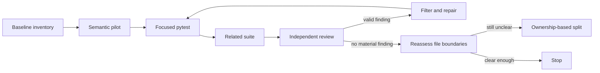

# Reliability 테스트 Oracle 리팩터링 실행 계획

관련 제안: [`05-12-proposal-reliability-test-refactor.md`](05-12-proposal-reliability-test-refactor.md)

## Objective

긴 테스트 파일을 무조건 분할하지 않고, runtime 실행 단계를 더 잘 복원할 수 있도록 fault injection과 failure oracle을 의미 기반으로 정리한다. 이 계획은 test-only refactor이며, production contract와 reliability safety policy를 변경하지 않는다.



## Success Profile

| Area | Current Risk | Target State | Proof |
| --- | --- | --- | --- |
| path preflight | unrelated `ValueError`를 path rejection으로 오인할 수 있음 | validation family와 side-effect boundary가 분명함 | exact message fragment와 no-call sentinel |
| target overwrite race | ordinal load count가 candidate staging과 target replacement를 혼동할 수 있음 | staged candidate와 target mutation을 request attributes로 구분 | call journal과 `expected_identity` selector |
| replay failure | 동일 argument의 반복 호출이 ordinal count에만 의존함 | sequence가 contract임을 명시하고 fault 위치를 검증 | ordered journal, sequence length, replay outcome |
| file boundary | 긴 파일을 이유로 기계적 분할할 위험 | ownership과 execution flow가 분리될 때만 이동 | split decision record |

## Invariants

1. production source와 canonical spec은 수정하지 않는다.
1. 테스트 assertion을 약화하거나 unconditional skip을 추가하지 않는다.
1. 테스트가 검증하는 observable behavior, marker와 side-effect 보호를 유지한다.
1. counter 제거 자체를 목표로 삼지 않고, counter가 실제 의미적 단계를 충분히 식별하는지 확인한다.
1. 공통 helper는 실제 contract가 같을 때만 공유한다.
1. 각 substantive edit 직후 가장 좁은 executable validation을 실행한다.
1. 독립 리뷰의 finding은 실제 영향과 reachability를 확인한 뒤 반영하고, 스타일 선호나 범위 밖 제안은 드롭한다.

## Test Boundary Map

| Test Family | Production Boundary | Expected Outcome | Preferred Oracle |
| --- | --- | --- | --- |
| existing path or dangling symlink | `_ensure_disposable_database_paths()` | direct `ValueError` before workspace mutation | `새 path여야 합니다`, no-call sentinel |
| physical path alias | `_ensure_disposable_database_paths()` | direct `ValueError` before workspace mutation | `서로 달라야 합니다`, no-call sentinel |
| compare-and-replace race | `_replace_approved_partition()` | `HMDAStalePartitionError` becomes `ApprovalGateError` | staged source versus target replacement call journal |
| replay profile or lifecycle failure | post-recovery replay flow | structured failure evidence preserves first recovery | explicit ordered replay journal and result assertions |

이 표는 production contract를 새로 정의하지 않는다. 현재 구현이 이미 드러내는 실행 경계를 test oracle에 투영하기 위한 기준이다.

## Phase 0. Baseline Capture

### Phase 0 대상

- `tests/reliability/test_null_spike_evaluation.py`
- `tests/reliability/test_approval_backfill_validation.py`
- `tests/reliability/conftest.py`
- 직접 사용되는 reliability executor/evaluator production surface는 읽기 전용으로 확인

### 작업

1. `load_count`, `snapshot_count`, `lifecycle_count`, `recovery_count` 사용 지점을 목록화한다.
1. 각 selector를 `semantic`, `explicit sequence`, `observation only` 중 하나로 분류한다.
1. selector마다 target production boundary, fault injection 조건, preserved outcome, required proof를 기록한다.
1. `try/except ValueError`와 예상 failure를 `pytest.fail`로 처리하는 지점을 목록화한다.
1. 기존 test name, docstring, side-effect assertion과 실제 contract를 대조한다.
1. 현재 focused test command를 확인한다.

### Baseline Inventory Format

| Test | Selector Classification | Current Trigger | Semantic Alternative | Required Proof |
| --- | --- | --- | --- | --- |
| existing evaluation database | no selector | any `ValueError` | direct preflight error | message + no database/load/synthetic/callback call + file preservation |
| aliased evaluation paths | no selector | any `ValueError` | request target path aliases internal clean or candidate path | `서로 달라야 합니다` + no external boundary |
| compare-and-replace race | semantic | second load | `expected_identity` on target replacement | target call journal entry + typed gate error |
| replay profile failure | explicit sequence | second profile snapshot | replay is second approved execution | ordered snapshot journal + recovery evidence |

### Exit Gate

- pilot으로 전환할 alias/path rejection 테스트 1개와 recovery race/failure 테스트 1개가 선택된다.
- 각 pilot의 보존할 observable contract, expected error family, fault stage와 required call proof가 명시된다.
- counter가 유지되는 경우에는 의미적 대체가 불가능한 이유가 기록된다.

## Phase 1. Path Validation Oracle Pilot

### Phase 1 대상

다음 path preflight tests를 한 묶음으로 전환한다.

- `test_null_spike_vertical_slice_rejects_existing_evaluation_database`
- `test_null_spike_vertical_slice_rejects_aliased_evaluation_database_paths`
- `test_null_spike_vertical_slice_rejects_dangling_database_symlink`

### Phase 1 변경

- existing path와 dangling symlink는 `pytest.raises(ValueError, match="새 path여야 합니다")`로 좁힌다.
- target-clean 및 target-candidate alias는 `pytest.raises(ValueError, match="서로 달라야 합니다")`로 좁힌다. evaluator가 clean/candidate path를 내부에서 고정 생성하므로, request input으로 구성할 수 없는 clean-candidate alias는 이 public-boundary test에서 제거한다.
- existing-path test에 `DuckDBConnectionManager`, source load, synthetic generation/materialization, callback의 fail-fast sentinel을 추가한다. alias와 dangling-symlink test의 동등한 boundary sentinel은 유지한다.
- 모든 path family에서 database open, source load, synthetic materialization, callback 호출 부재와 파일 상태 보존 assertion을 확인한다.
- custom side-effect exception은 실제로 필요한 경우에만 남긴다.
- `violations` accumulator는 failure location을 흐리면 독립 assertion으로 풀되, source/artifact/workspace preservation contract를 축소하지 않는다.

### Phase 1 Validation

```bash
uv run pytest tests/reliability/test_null_spike_evaluation.py -k "existing_evaluation_database or aliased_evaluation_database_paths or dangling_database_symlink"
uv run ruff check tests/reliability/test_null_spike_evaluation.py
uv run ruff format --check tests/reliability/test_null_spike_evaluation.py
```

### Phase 1 Review Gate

- 예외가 정확한 validation boundary에서 발생하는지 확인한다.
- unrelated `ValueError`가 통과할 가능성이 제거됐는지 확인한다.
- workspace 생성과 `DuckDBConnectionManager`, source load, synthetic materialization, callbacks 중 어느 것도 발생하지 않았는지 확인한다.
- 리뷰의 optional assertion 강화나 단순 스타일 선호는 필터링한다.

### Phase 1 Exit Gate

- 각 path family가 자기 message fragment와 no-side-effect contract를 직접 검증한다.
- dangling symlink의 symlink text와 unrelated target 부재가 보존된다.
- invalid path와 unrelated validation error를 구별하지 못하는 broad catch가 남지 않는다.

## Phase 2. Semantic Fault Selector Pilot

### Phase 2 대상

먼저 `test_recovery_classifies_compare_and_replace_race_as_stale_approval`을 전환한다. replay failure tests는 이 pilot의 결과 뒤에 별도 selector 분류를 적용한다.

### 변경

#### Phase 2A. Compare-And-Replace Race

1. patched `load_hmda_loans_partition()`이 call journal을 남기게 한다.
1. journal에는 source path, `source_year`, `table_name`, `expected_identity`, source metadata preservation 여부를 포함한다.
1. `expected_identity == proposal.approved_before_identity`인 staged-source target replacement에만 `HMDAStalePartitionError`를 주입한다.
1. candidate staging load는 `expected_identity is None`임을 assertion해 target overwrite와 구분한다.
1. 결과가 `ApprovalGateError`이고 `새 validation과 approval` contract를 유지하는지 확인한다.

#### Phase 2B. Replay-Only Sequence Review

`test_null_spike_replay_profile_failure_preserves_first_recovery`와 post-recovery lifecycle tests는 같은 input으로 first recovery와 replay를 수행할 수 있다. 이 경우 counter 제거를 성공 기준으로 삼지 않는다.

1. `execute_approved_backfill()` wrapper가 outer approved execution journal을 남기고, 각 execution에 동일 request fingerprint와 ordered attempt를 기록하게 한다.
1. profile hook은 active outer execution에 귀속된 inner journal을 남긴다. replay profile fault는 second outer approved execution에서만 활성화하고, 첫 execution의 completed mutation evidence와 두 execution의 동일 request fingerprint를 assertion한다.
1. hook input에 없는 phase label을 합성하지 않는다. replay가 second approved execution이라는 sequence contract와 expected outer/inner journal length를 명시한다.
1. post-recovery lifecycle hook은 target database의 observed partition identity를 journal에 기록한다. fault는 defect target lifecycle이 아니라 recovered identity를 관찰한 target lifecycle에만 주입한다.
1. fault 발생 뒤 first recovery evidence와 replay 또는 post-recovery failure evidence가 함께 보존되는지 확인한다.

### Phase 2 Validation

```bash
uv run pytest tests/reliability/test_approval_backfill_validation.py -k "compare_and_replace_race"
uv run pytest tests/reliability/test_null_spike_evaluation.py -k "replay_profile_failure or post_recovery_lifecycle_failure"
uv run ruff check tests/reliability/test_null_spike_evaluation.py tests/reliability/test_approval_backfill_validation.py
uv run ruff format --check tests/reliability/test_null_spike_evaluation.py tests/reliability/test_approval_backfill_validation.py
```

### Phase 2 Review Gate

- fault가 다른 호출에 잘못 주입될 수 있는지 적대적으로 확인한다.
- production 호출 순서가 한 번 바뀌었을 때 테스트가 contract 변화와 내부 구현 변화를 구분할 수 있는지 확인한다.
- target replacement race와 replay sequence contract를 같은 selector policy로 강제하지 않았는지 확인한다.
- 테스트가 production algorithm을 복제하는 새 helper를 만들지 않았는지 확인한다.

### Phase 2 Exit Gate

- compare-and-replace race fault가 target overwrite journal entry에만 발생한다.
- candidate staging과 target replacement가 같은 loader call로 오인되지 않는다.
- replay counter가 남아 있으면 second approved execution이 replay인 이유, expected outer/inner journal과 fault 귀속이 test에 남는다.
- post-recovery lifecycle fault journal이 defect target identity와 recovered target identity를 구분한다.

## Phase 3. Failure Evidence Oracle 정리

### Phase 3 대상

recovery/replay failure 테스트 중 `failure_stage`, `mutation_state`, `reconciliation_action`, evidence context를 검증하는 시나리오.

### Phase 3 변경

각 scenario를 failure contract matrix에 매핑하고 다음처럼 최소 oracle을 명시한다.

| Scenario | Required Assertion |
| --- | --- |
| pre-target gate | `failure_stage`, `target_mutated`, reconciliation action |
| post-target profile failure | mutation state, expected/actual identity context, profile error |
| post-recovery lifecycle failure | recovery/replay state, projection evidence, typed error evidence |
| replay validation failure | preserved first recovery, replay result or failure case, reconciliation action |

- 공통 helper는 동일한 contract를 반복할 때만 사용한다.
- 원래 exception type/message가 결과 또는 context에 보존되어야 하는 경우 그 계약을 직접 assertion한다.
- 테스트마다 필요하지 않은 전체 payload나 대형 object representation은 남기지 않는다.
- single field assertion을 늘리는 것이 scenario의 핵심 outcome을 더 잘 설명하지 않으면 추가하지 않는다.

### Phase 3 Validation

```bash
uv run pytest tests/reliability/test_null_spike_evaluation.py tests/reliability/test_approval_backfill_validation.py -q
uv run pytest tests/reliability -q
```

### Phase 3 Exit Gate

- failure stage와 runtime evidence를 읽는 사람이 테스트 이름과 assertion만으로 복원할 수 있다.
- failure oracle을 공통 helper에 과도하게 숨기지 않는다.
- outcome assertion이 implementation call count보다 우선한다.

## Phase 4. 파일 경계 재평가

Phase 1부터 Phase 3까지 완료한 뒤에만 수행한다.

### Split Decision Record

각 후보 split은 다음 표를 완성한 뒤에만 수행한다.

| Candidate Area | Different Owner or Fixture? | Different Execution Flow? | Separate Focused Command? | Decision |
| --- | --- | --- | --- | --- |
| path preflight | No; same evaluator and scenario fixture | Yes; it stops before workspace mutation | Yes; path-rejection selection is narrow | Keep colocated through Phase 1; reconsider only if preflight scenarios acquire a distinct fixture lifecycle |
| recovery and replay evidence | No; both consume the same evaluator and recovery result | Yes; replay follows completed recovery | Yes; recovery/replay selection is narrow | Defer; remove selector ambiguity before deciding whether reading flow justifies a split |
| approval backfill freshness | No; same approved-backfill executor contract | Yes; freshness adds temporal binding | Yes; freshness selection is narrow | Keep in the current executor suite unless fixture and validation ownership diverge |

### 판단 기준

파일을 분할하려면 다음 중 하나가 확인되어야 한다.

- 서로 다른 owner가 각 테스트 집합을 변경한다.
- 하나의 파일 안에서 서로 다른 실행 흐름을 읽기 위해 많은 관련 없는 setup을 건너뛰어야 한다.
- fixture, marker 또는 validation command가 실제로 달라 독립된 test area가 더 명확하다.
- 파일 분할 후 scenario의 시작점과 failure evidence 연결이 더 쉬워진다.

단순히 1,000줄을 넘는다는 이유만으로 분할하지 않는다.

### 가능한 분할 방향

```text
tests/reliability/
├── test_null_spike_evaluation.py
├── test_null_spike_path_validation.py       # ownership이 실제로 분리될 때만
├── test_null_spike_recovery_replay.py       # ownership이 실제로 분리될 때만
└── test_approval_backfill_validation.py
```

분할을 선택하면 테스트를 기계적으로 이동하지 말고, 각 파일의 module docstring과 focused command가 소유하는 contract를 함께 갱신한다.

## Final Validation

변경 파일이 확정된 뒤 다음 순서로 실행한다.

```bash
uv run pytest tests/reliability/test_null_spike_evaluation.py tests/reliability/test_approval_backfill_validation.py -q
uv run pytest tests/reliability -q
uv run ruff check tests/reliability
uv run ruff format --check tests/reliability
uv run rumdl check inbox/2026-08-30/05-12-proposal-reliability-test-refactor.md inbox/2026-08-30/05-12-plan-reliability-test-refactor.md
```

Biome은 현재 repository configuration에서 Markdown을 처리하지 않으므로 이 artifact의 validation owner가 아니다. 전체 suite는 shared fixture, import 또는 configuration을 바꾼 경우에만 추가한다. 실패는 test defect, production defect, specification gap, environment failure, unrelated baseline failure로 분류한다.

## Review Loop

각 phase는 다음 loop를 완료한 뒤에만 다음 phase로 이동한다.

1. 작업
1. focused executable validation
1. independent `review-lead` review
1. finding 분류
1. material finding이면 해당 phase만 수정 후 동일 validation 재실행
1. 이미 현재 oracle로 보호되거나 style-only인 finding, 범위 밖 redesign은 드롭하고 근거를 기록
1. material finding이 없으면 다음 phase 또는 종료 판단

## Stop Conditions

- 의미 기반 selector로 바꾸었지만 테스트가 production 내부 algorithm을 더 많이 복제하게 되면 중단하고 대안을 재검토한다.
- 기대 error boundary를 확인할 안정적인 message/context가 없으면 production contract 변경으로 확대하지 않고 specification gap으로 기록한다.
- replay stage를 semantic input으로 구분할 수 없으면 artificial phase parameter를 만들지 않고 explicit sequence selector를 유지한다.
- 파일 분할 후 focused validation과 ownership이 명확해진다는 근거가 없으면 분할하지 않는다.
- 독립 리뷰가 `clear`이고 관련 suite가 통과하면 추가적인 cosmetic cleanup을 하지 않는다.

## Deliverables

- 변경된 test files와 유지된 assertions
- phase별 focused pytest 결과
- 독립 리뷰 결과와 드롭한 finding 기록
- 파일 분할 여부와 근거
- 필요할 경우 후속 OpenSpec change로 승격할 unresolved contract gap
