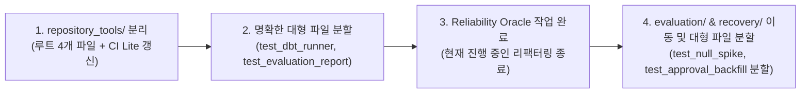

> [!NOTE]
> **핵심 결론:** 최상위 8개 도메인 디렉터리는 현재 소스 패키지 및 CI Lite 선택 규칙과 일치하므로 유지합니다. 리팩터링은 **(1) 루트 스크립트 테스트의 `repository_tools/` 격리**, **(2) 400줄 초과 대형 파일 중 책임 경계가 명확한 모듈(`test_evaluation_report`, `test_dbt_runner`)의 즉시 분할**, **(3) `reliability/` 내부의 `evaluation/`·`recovery/` 점진적 그룹화** 순으로 진행합니다. 현재 수정 중인 테스트는 oracle 리팩터링 완료 후 안전하게 이동·분할합니다.

## Question

`tests/`의 파일명과 디렉터리 구조를 어떻게 정리해야 domain ownership, focused validation과 CI 범위 선택을 더 명확히 하면서 pytest 수집과 기존 검증 계약을 유지할 수 있는가? 특히 **400줄을 초과하는 대형 테스트 파일 11개**의 분할 타당성과 기준은 무엇인가?

### Scope

| 구분 | 대상 |
| --- | --- |
| **In Scope** | `tests/` 전체 트리, pytest 수집 설정, marker 분포, CI Lite (`ci-lite.yml`) 타깃 선택 규칙, **400줄 초과 11개 대형 테스트 모듈** 전수 분석 |
| **Out of Scope** | 프로덕션 소스 코드, OpenSpec 규격, 테스트 assertion 로직, marker 정의 변경 |

### Stop Condition

현재 구조의 유지할 경계, 400줄 초과 파일 분할 기준, 실제로 분리할 후보, 파일 이동에 필요한 CI·문서·검증 변경을 근거와 함께 제시하면 조사를 종료한다.

## Findings

### F1. Top-Level Domains Already Match the Project Boundary

`tests/`는 `data_operations`, `data_platform`, `dbt`, `hmda_data`, `orchestration`, `reliability`, `review_ai`, `runtime_ai`의 여덟 domain을 최상위 directory로 사용한다. 이는 application package와 Architecture의 domain ownership 분류에 대응하고, CI Lite도 이 여덟 이름을 기준으로 test target과 reverse-dependency closure를 선택한다.[^test-tree][^architecture][^ci-domain]

따라서 source module tree를 더 깊게 기계적으로 복제하는 방식은 권장하지 않는다. `tests/AGENTS.md`도 새 test area는 기존 분류에 배치할 수 없을 때만 만들고, source 구조를 기계적으로 mirror하지 말도록 정한다.[^test-guidance]

### F2. Large Test File Decomposition Analysis (>400 Lines)

저장소 내 400줄을 초과하는 테스트 파일은 총 11개(전체 테스트 라인의 60% 이상 차지)입니다. 단순 라인 수 기준의 기계적 분할을 지양하고, **(a) 책임의 혼재 여부**, **(b) 픽스처 생명주기 분리 가능성**, **(c) 독립적인 focused command 유무**를 기준으로 전수 분석했습니다.[^module-count][^module-size]

| 모듈 경로 | 라인 수 | 테스트 수 | 검증 책임 및 분할 타당성 분석 | 분할 권장 분류 |
| --- | ---: | ---: | --- | --- |
| `tests/reliability/test_null_spike_evaluation.py` | 1,790 | 22 | preflight 거부, vertical slice 정상 흐름, replay 실패 시 first recovery 보존, post-recovery lifecycle 등 여러 시나리오 혼재[^reliability-proposal] | `⏳ Defer` (oracle 개선 후 3개 분할) |
| `tests/reliability/test_approval_backfill_validation.py` | 976 | 22 | approval 기본 게이트, freshness 시간 기반 복구, compare-and-replace race condition 등 서로 다른 복구 축 혼재[^reliability-plan] | `⏳ Defer` (oracle 개선 후 3개 분할) |
| `tests/reliability/test_evaluation_report.py` | 896 | 12 | generic report 집계/내보내기(4개)와 volume-drop vertical slice(8개)의 검증 경계가 완전히 다름[^large-modules] | `✅ Immediate Split` (`test_report` + `test_volume_drop`) |
| `tests/data_operations/test_dbt_runner.py` | 742 | 25 | request 생성/검증(7개), dbt build 프로세스 실행/타임아웃(9개), artifact promotion 및 동시성 락(9개) 등 3개 책임 혼재 | `✅ Immediate Split` (`test_dbt_request` + `test_dbt_runner` + `test_dbt_promotion`) |
| `tests/hmda_data/eda/test_eda.py` | 685 | 20 | CSV 파싱 계약, 코드 분포/범주형 분석, 수치 요약 통계 등 20개 규칙 집중 | `🟡 Optional Split` (`test_eda_contracts` + `test_eda_distributions`) |
| `tests/reliability/test_schema_recovery_executor.py` | 638 | 8 | exact table schema 복구 실행기에 대한 단일 책임 심층 테스트 (셋업 복잡도 위주) | `🟢 Keep Single File` |
| `tests/reliability/test_schema_drift_evaluation.py` | 608 | 9 | schema drift vertical slice 평가 시나리오 집중 (단일 평가 흐름) | `🟢 Keep Single File` |
| `tests/reliability/test_freshness_delay_evaluation.py` | 590 | 13 | freshness delay vertical slice 평가 시나리오 집중 (단일 평가 흐름) | `🟢 Keep Single File` |
| `tests/review_ai/test_service.py` | 477 | 9 | ReviewAIService 단일 진입점 오케스트레이션 및 경계 검증 (단일 책임) | `🟢 Keep Single File` |
| `tests/hmda_data/test_synthetic.py` | 451 | 11 | 결함 합성 생성기(null_spike, volume_drop 등) 지표 검증 | `🟢 Keep Single File` |
| `tests/hmda_data/test_ingestion_partition.py` | 425 | 13 | 파티션 적재 멱등성 및 동시성 락 검증 (단일 책임) | `🟢 Keep Single File` |

#### 분할 기준 및 원칙

1. **즉시 분할 권장 (2개):** `test_evaluation_report.py`와 `test_dbt_runner.py`는 파일 내에서 서로 다른 컴포넌트/기능을 검증하며, 분할 시 각 파일이 200~300줄 내외로 명확해집니다.
1. **오라클 개선 후 분할 권장 (2개):** `test_null_spike_evaluation.py`와 `test_approval_backfill_validation.py`는 현재 진행 중인 오라클 리팩터링(호출 순서 결합 해소)이 완료된 후 시나리오별로 분할합니다.
1. **단일 파일 유지 (7개):** 400~600줄 수준이지만 단일 클래스/평가 흐름을 검증하는 모듈은 기계적으로 쪼갤 경우 오히려 픽스처 공유 비용과 파일 탐색 비용이 증가하므로 단일 모듈로 유지합니다.

### F3. Root Tests Are Cross-Cutting Repository Tooling

루트에 위치한 4개 모듈은 비즈니스 도메인이 아닌 공통 스크립트 및 도구를 검증한다.[^root-tests]

- **스크립트 검증:** `test_generate_agent_routes.py`, `test_generate_docs_indexes.py` (`scripts/` 대상)
- **공통 도구/로깅 검증:** `test_log_agent_event.py`, `test_pytest_opentelemetry.py` (전역 유틸리티 대상)

이 파일들은 `repository_tools/` 폴더로 모으는 것이 적절하며, 이동 시 `.github/workflows/ci-lite.yml`의 경로 선택 규칙을 함께 갱신해야 한다.[^ci-root]

### F4. Pytest Collection Does Not Require the Current File Locations

pytest 설정은 `testpaths = ["tests"]`만 지정하고, 현재 `uv run pytest --collect-only -q`는 454개 test를 수집했다. 즉 `tests/` 내부의 이동은 naming convention을 유지하는 한 discovery 관점에서 안전하다.[^pytest-config][^collection]

반면 path는 사람이 실행하는 focused command, CI Lite target 및 몇몇 current guide에서 의미를 가진다. `tests/reliability` 아래에서의 하위 folder 이동은 CI의 top-level `reliability` 선택을 유지하므로 상대적으로 낮은 위험이다. `tests/repository_tools` 같은 새 top-level folder는 CI case를 추가해야 scope가 의도대로 유지된다.[^testing-guide][^ci-domain]

### F5. Naming Should Let the Directory Carry the Shared Context

상위 디렉터리가 컨텍스트를 소유하면 파일명의 불필요한 중복 수식어를 줄여 가독성을 높인다.

| 현재 경로 | 권장 변경 경로 | 개선점 |
| --- | --- | --- |
| `tests/reliability/test_null_spike_evaluation.py` | `tests/reliability/evaluation/test_null_spike.py` | `evaluation` 중복 제거 |
| `tests/reliability/test_schema_recovery_executor.py` | `tests/reliability/recovery/test_schema_executor.py` | `recovery` 중복 제거 |
| `tests/reliability/test_freshness_delay_evaluation.py` | `tests/reliability/evaluation/test_freshness_delay.py` | 간결한 식별자 유지 |

## Proposed Structure

단계적 리팩터링 후 완성될 목표 구조는 다음과 같다.

```text
tests/
├── data_operations/
│   ├── test_dbt_request.py                # [분할] request 파싱 및 설정 검증 (~100줄)
│   ├── test_dbt_runner.py                 # [분할] dbt build 프로세스 실행 및 격리 (~300줄)
│   ├── test_dbt_promotion.py              # [분할] 아티팩트 승인/동시성/백업 락 (~350줄)
│   └── test_incident_lifecycle.py
├── data_platform/
├── dbt/
├── hmda_data/
├── orchestration/
├── reliability/
│   ├── contracts/                         # [유지] Pydantic 계약 검증 (8개 모듈)
│   ├── evaluation/                        # [신규] 평가 및 수직 슬라이스 검증
│   │   ├── test_freshness_delay.py
│   │   ├── test_freshness_delay.design.md
│   │   ├── test_null_spike.py             # [후속 분할] preflight/vertical_slice/replay
│   │   ├── test_report.py                 # [분할] generic report 검증 (~200줄)
│   │   ├── test_schema_drift.py
│   │   └── test_volume_drop.py            # [분할] volume-drop vertical slice (~700줄)
│   ├── recovery/                          # [신규] 복구 및 실행 검증
│   │   ├── test_approval_backfill.py      # [후속 분할] gate/freshness/race
│   │   ├── test_runtime_evidence.py
│   │   ├── test_schema_candidate.py
│   │   └── test_schema_executor.py
│   ├── test_basic_incident_detection.py   # [유지] 단일 파일 단위 기능군
│   ├── test_impact_analysis.py
│   ├── test_profile_snapshots.py
│   ├── test_remediation_draft.py
│   ├── test_table_metadata_evidence.py
│   └── test_table_state_identity.py
├── repository_tools/                      # [신규] 저장소 관리 도구 및 스크립트 검증
│   ├── test_generate_agent_routes.py
│   ├── test_generate_docs_indexes.py
│   ├── test_log_agent_event.py
│   └── test_pytest_opentelemetry.py
├── review_ai/
└── runtime_ai/
```

## Migration Decisions

| 영역 | 결정 | 사유 | 동반 변경 필요 사항 |
| --- | --- | --- | --- |
| **Top-level product domains** | `🟢 Keep` | 소스 ownership, 도메인 가이드, CI selector가 이미 일치 | 없음 |
| **Root cross-cutting tests** | `🟡 Move` (`repository_tools/`) | 스크립트·로거·pytest 지원 코드를 도메인 테스트와 분리 | CI Lite 경로 분기 및 로거 타깃 갱신 |
| **`data_operations/test_dbt_runner.py` (742줄)** | `🟡 Split` (3개 모듈) | request 생성, build 실행, artifact promotion 책임이 명확히 구분됨 | focused pytest 확인 |
| **`reliability/test_evaluation_report.py` (896줄)** | `🟡 Split` (2개 모듈) | generic report 집계와 volume-drop vertical slice의 경계가 완전히 다름 | focused pytest 확인 |
| **`reliability/contracts/`** | `🟢 Keep` | 8개 소형 계약 테스트가 동일한 모델 검증 영역 공유 | 없음 |
| **`reliability/evaluation/`** | `🟡 Introduce` | null-spike, freshness, schema drift 등 평가 진입점 통일 | `test_*.design.md` 쌍 함께 이동 |
| **`reliability/recovery/`** | `⏳ Defer` (oracle 개선 후) | approval-backfill 등의 현재 작업 및 오라클 개선 선행 필요 | reliability 리팩터링 plan 통과 |
| **단일 책임 유지 7개 모듈** | `🟢 Keep Single File` | 셋업 응집도가 높고 분할 이점이 적음 | 향후 파일 확장 시 재평가 |

## Options

| 비교 기준 | Option 1: 최소 리팩터링 | Option 2: 대형 파일 분할 + 단계적 리팩터링 (권장) | Option 3: 소스 구조 완전 복제 |
| --- | --- | --- | --- |
| **변경 내용** | 루트 4개 테스트만 `repository_tools/`로 이동 | 루트 도구 분리 + 400줄 초과 대형 파일 분할 + `reliability` 그룹화 | `src/`의 모든 하위 패키지를 1:1 복제 |
| **책임 명확성** | 루트 모호성만 해소 | 400줄 초과 모듈의 다중 책임 해소 및 대형 도메인 혼재 구조 해결 | 디렉터리가 과도하게 세분화됨 |
| **CI 영향도** | 신규 타깃 1개 추가 | 신규 타깃 1개 추가 (기존 타깃 유지) | 다수의 경로 및 문서 일괄 수정 필요 |
| **현재 작업 충돌** | 없음 | oracle 작업 완료 후 이동/분할로 안전 | 현재 수정 중인 파일과 즉시 충돌 |
| **최종 판단** | 보조 대안 | **✅ 채택** | ❌ 기각 |

## Execution Order



1. **Step 1 (`repository_tools/` 격리):**
   - 루트 4개 파일 이동
   - CI Lite(`ci-lite.yml`)에서 `tests/repository_tools/*` 타깃 규칙 추가
   - 검증: `uv run pytest tests/repository_tools -q`
1. **Step 2 (책임 분리 대형 파일 즉시 분할):**
   - `tests/data_operations/test_dbt_runner.py` (742줄) → `test_dbt_request.py`, `test_dbt_runner.py`, `test_dbt_promotion.py`로 분할
   - `tests/reliability/test_evaluation_report.py` (896줄) → `evaluation/test_report.py`, `evaluation/test_volume_drop.py`로 분할
   - 검증: `uv run pytest tests/data_operations tests/reliability -q`
1. **Step 3 (신뢰성 오라클 리팩터링 완료 대기):**
   - `test_null_spike_evaluation.py` 및 `test_approval_backfill_validation.py`의 oracle refactor 선행 완료
1. **Step 4 (`evaluation/`, `recovery/` 이동 및 대형 신뢰성 모듈 분할):**
   - `test_null_spike_evaluation.py` (1,790줄) → preflight, vertical slice, failure recovery로 분할 이동
   - `test_approval_backfill_validation.py` (976줄) → gate, freshness, race로 분할 이동
   - schema candidate/executor, runtime evidence를 `recovery/`로 이동
   - freshness delay, schema drift를 `evaluation/`으로 이동
   - 검증: `uv run pytest tests/reliability -q` 및 전체 수집 수(454건) 확인

## Validation Matrix

| 변경 단계 | Focused Validation | Broader Validation |
| --- | --- | --- |
| **`repository_tools/` 이동** | `uv run pytest tests/repository_tools -q` | `uv run pytest --collect-only -q` |
| **`test_dbt_runner.py` 분할** | `uv run pytest tests/data_operations -q` | `uv run pytest --collect-only -q` |
| **`evaluation/` 분할 및 이동** | `uv run pytest tests/reliability/evaluation -q` | `uv run pytest tests/reliability -q` |
| **`recovery/` 이동** | `uv run pytest tests/reliability/recovery -q` | `uv run pytest tests/reliability -q` |
| **CI selector 갱신** | changed-path 분류 shell 로직 정적 대조 | PR CI Lite 실행 확인 |
| **문서 아티팩트 검증** | `uv run rumdl check <file-path>` | 해당 없음 |

## Conclusion

가장 안전하고 명확한 리팩터링 방향은 **도메인 루트 유지, 도구 테스트 격리(`repository_tools/`), 400줄 초과 대형 모듈의 책임별 분할(`test_dbt_runner`, `test_evaluation_report`), 신뢰성 테스트의 점진적 그룹화(`evaluation/`, `recovery/`)**입니다.

현재 작업 트리에 uncommitted 상태로 남아 있는 신뢰성 테스트 모듈들은 본 조사 보고서에서 변경하지 않았으며, 향후 오라클 리팩터링 검증이 완료된 시점에 별도 단위 작업으로 이동 및 분할을 진행해야 합니다.[^working-tree]

### Next Step

1. `repository_tools/` 생성 및 루트 4개 파일 이동 (CI Lite 타깃 선택 분기 동반 수정)
1. `test_dbt_runner.py` (742줄) 및 `test_evaluation_report.py` (896줄) 1차 분할
1. 진행 중인 reliability oracle refactor 완료 후 `test_null_spike_evaluation.py` (1,790줄) 및 `test_approval_backfill_validation.py` (976줄) 분할 및 `evaluation/`, `recovery/` 디렉터리 배치 완성

[^test-tree]: `rg --files tests` 결과. 여덟 domain directory, `reliability/contracts/`, 네 root test를 확인했다.
[^architecture]: [`docs/ARCHITECTURE.md`](../../docs/ARCHITECTURE.md). Domain Ownership Guides가 여덟 application domain을 정의한다.
[^ci-domain]: [`.github/workflows/ci-lite.yml`](../../.github/workflows/ci-lite.yml). `add_domain_closure()`와 `tests/*/*` 분기가 최상위 domain directory를 CI target으로 사용한다.
[^test-guidance]: [`tests/AGENTS.md`](../../tests/AGENTS.md). 기존 test area 우선, source tree의 기계적 mirroring 금지 규칙.
[^module-count]: `rg --files tests -g 'test_*.py'`를 top-level directory별로 집계한 결과: `reliability` 23, `review_ai` 9, `hmda_data` 6, 나머지는 1~4 module.
[^module-size]: `rg --files tests -g 'test_*.py' | xargs wc -l | sort -nr` 결과. `test_null_spike_evaluation.py` 1,790줄, `test_approval_backfill_validation.py` 976줄, `test_evaluation_report.py` 896줄.
[^reliability-proposal]: [`05-12-proposal-reliability-test-refactor.md`](05-12-proposal-reliability-test-refactor.md). File split은 ownership·fixture·execution flow가 실제로 갈릴 때만 검토하도록 정한다.
[^reliability-plan]: [`05-12-plan-reliability-test-refactor.md`](05-12-plan-reliability-test-refactor.md). null-spike와 approval-backfill의 oracle refactor 및 split decision gate를 정의한다.
[^large-modules]: [`tests/reliability/test_null_spike_evaluation.py`](../../tests/reliability/test_null_spike_evaluation.py), [`tests/reliability/test_approval_backfill_validation.py`](../../tests/reliability/test_approval_backfill_validation.py), [`tests/reliability/test_evaluation_report.py`](../../tests/reliability/test_evaluation_report.py). Module docstring, imports, test function names을 비교했다.
[^root-tests]: [`tests/test_generate_agent_routes.py`](../../tests/test_generate_agent_routes.py), [`tests/test_generate_docs_indexes.py`](../../tests/test_generate_docs_indexes.py), [`tests/test_log_agent_event.py`](../../tests/test_log_agent_event.py), [`tests/test_pytest_opentelemetry.py`](../../tests/test_pytest_opentelemetry.py). 첫 두 test의 `scripts` import와 root test surface를 확인했다.
[^ci-root]: [`.github/workflows/ci-lite.yml`](../../.github/workflows/ci-lite.yml). `src/hmda_reliability/logger.py`, `tests/test_log_agent_event.py`, `tests/test_pytest_opentelemetry.py`의 special target case를 확인했다.
[^pytest-config]: [`pyproject.toml`](../../pyproject.toml). pytest `testpaths = ["tests"]`, marker와 `pythonpath` 설정.
[^collection]: 2026-08-30 07:30 KST에 실행한 `uv run pytest --collect-only -q` 결과: `454 tests collected in 6.02s`.
[^testing-guide]: [`docs/development/testing.md`](../../docs/development/testing.md). focused test에서 related package suite로 넓히는 validation 순서와 directory command convention.
[^working-tree]: 2026-08-30 조사 중 `git status --short` 결과. `tests/reliability/test_approval_backfill_validation.py`, `tests/reliability/test_null_spike_evaluation.py`, `tests/reliability/test_recovery_runtime_evidence.py`, `tests/runtime_ai/test_provider.py`가 수정 상태였다.
