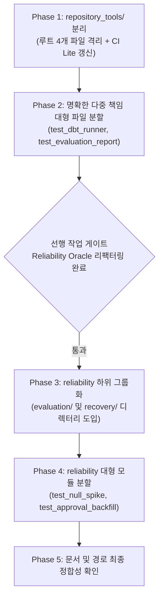

# Test Directory Structure Refactoring Plan

> [!NOTE]
> **목표:** 테스트 디렉터리의 도메인 경계를 명확히 하고, 400줄을 초과하는 대형 테스트 파일의 책임을 분리하며, 루트 도구 테스트를 격리합니다.
>
> **인계 원칙:** 각 단계(Phase)는 독립적으로 커밋 및 검증 가능한 원자적 단위로 설계되어, 세션이 도중에 끊기더라도 다음 작업자가 체크리스트와 검증 명령어를 통해 즉시 작업을 이어받을 수 있습니다.

**연관 조사 보고서:** [`07-30-research-testing-directory-structure-refactor.md`](07-30-research-testing-directory-structure-refactor.md)

---

## 1. Execution Overview and Dependencies



| Phase | 위험도 | 작업 성격 | 선행 조건 | 복구 용이성 |
| --- | :---: | --- | --- | :---: |
| **Phase 1** | 낮음 | 루트 파일 이동 및 CI 설정 갱신 | 없음 (즉시 시작 가능) | 높음 (단순 revert) |
| **Phase 2** | 중간 | `test_dbt_runner`, `test_evaluation_report` 분할 | Phase 1 완료 | 높음 |
| **Phase 3** | 낮음~중간 | `reliability/` 파일 디렉터리 이동 | Phase 2 및 Oracle 리팩터링 완료 | 높음 |
| **Phase 4** | 중간~높음 | 1,790줄 및 976줄 대형 신뢰성 파일 분할 | Phase 3 완료 | 중간 |
| **Phase 5** | 낮음 | 가이드 문서 링크 및 CI selector 점검 | Phase 4 완료 | 높음 |

---

## 2. Phase 1: Repository Tools Isolation

### Phase 1 Objective

루트 디렉터리에 산재된 4개 도구/스크립트 테스트를 `tests/repository_tools/`로 모으고, CI Lite 경로 분류를 동기화합니다.

### Phase 1 Checklist

- [ ] `tests/repository_tools/__init__.py` 파일 생성
- [ ] 파일 이동:
  - `tests/test_generate_agent_routes.py` → `tests/repository_tools/test_generate_agent_routes.py`
  - `tests/test_generate_docs_indexes.py` → `tests/repository_tools/test_generate_docs_indexes.py`
  - `tests/test_log_agent_event.py` → `tests/repository_tools/test_log_agent_event.py`
  - `tests/test_pytest_opentelemetry.py` → `tests/repository_tools/test_pytest_opentelemetry.py`
- [ ] `.github/workflows/ci-lite.yml` 갱신:
  - `src/hmda_reliability/logger.py` 변경 시 `tests/repository_tools/test_log_agent_event.py` 지정
  - `tests/repository_tools/*` 변경 시 `tests/repository_tools` 타깃 추가
- [ ] 단위 검증 실행 및 통과 확인

### Phase 1 Verification Commands

```bash
# 1. 이동된 테스트 집중 실행
uv run pytest tests/repository_tools -v

# 2. 전체 pytest 수집 유지 확인 (454 tests collected)
uv run pytest --collect-only -q

# 3. 린트 및 포맷 확인
uv run ruff check tests/repository_tools .github/workflows/ci-lite.yml
uv run ruff format --check tests/repository_tools
```

### Phase 1 Handoff Criteria

- `tests/repository_tools` 아래 4개 파일이 모두 통과하고, 전체 pytest 수집 건수가 454개를 유지하면 Phase 1 완료 커밋 가능.

---

## 3. Phase 2: Multi-Responsibility File Split

### Phase 2 Objective

400줄 초과 모듈 중 검증 책임이 명확히 분리되는 `test_dbt_runner.py` (742줄)와 `test_evaluation_report.py` (896줄)를 분할합니다.

### Phase 2 Checklist

- [ ] `test_dbt_runner.py` (742줄) 3분할:
  - `tests/data_operations/test_dbt_request.py` (~100줄): request 파싱, 환경 변수 오버라이드, 기본값 및 필수 경로 검증 테스트 이동
  - `tests/data_operations/test_dbt_runner.py` (~300줄): `run_dbt_build` 실행, 타임아웃, 프로세스 격리 및 stderr 캡처 테스트 유지
  - `tests/data_operations/test_dbt_promotion.py` (~350줄): candidate 미승인, artifact promotion 락, 동시성 충돌, 롤백 및 백업 검증 테스트 이동
- [ ] `test_evaluation_report.py` (896줄) 2분할:
  - `tests/reliability/test_evaluation_report.py` (~200줄): public API export, generic report 집계 및 Markdown 리포트 생성 테스트 유지
  - `tests/reliability/test_volume_drop_evaluation.py` (~700줄): volume-drop vertical slice, pre-mutation safety, replay profile/dbt failure 검증 테스트 이동
- [ ] data_operations 및 reliability 단위 검증 확인

### Phase 2 Verification Commands

```bash
# data_operations 및 분할된 reliability 테스트 실행
uv run pytest tests/data_operations tests/reliability/test_evaluation_report.py tests/reliability/test_volume_drop_evaluation.py -v

# 전체 수집 수 확인
uv run pytest --collect-only -q

# 린트 및 포맷 확인
uv run ruff check tests/data_operations tests/reliability
uv run ruff format --check tests/data_operations tests/reliability
```

### Phase 2 Handoff Criteria

- 분할된 5개 모듈이 기존과 동일한 테스트 케이스 수를 보장하며 통과할 것.

---

## 4. Phase 3: Reliability Grouping

### Phase 3 Objective

신뢰성 도메인 내부를 `contracts/` (기존), `evaluation/` (신규), `recovery/` (신규)로 그룹화하여 파일명 중복을 줄이고 디렉터리가 책임을 소유하게 합니다.

### Phase 3 Prerequisites

- 현재 작업 중인 reliability oracle refactor (`05-12-plan-reliability-test-refactor.md`)가 완료되어 uncommitted 변경 사항이 해소되어야 함.

### Phase 3 Checklist

- [ ] 디렉터리 생성: `tests/reliability/evaluation/`, `tests/reliability/recovery/`
- [ ] `evaluation/` 이동 및 명명 간결화:
  - `tests/reliability/test_freshness_delay_evaluation.py` → `tests/reliability/evaluation/test_freshness_delay.py`
  - `tests/reliability/test_freshness_delay_evaluation.design.md` → `tests/reliability/evaluation/test_freshness_delay.design.md`
  - `tests/reliability/test_schema_drift_evaluation.py` → `tests/reliability/evaluation/test_schema_drift.py`
  - `tests/reliability/test_evaluation_report.py` → `tests/reliability/evaluation/test_report.py`
  - `tests/reliability/test_volume_drop_evaluation.py` → `tests/reliability/evaluation/test_volume_drop.py`
- [ ] `recovery/` 이동 및 명명 간결화:
  - `tests/reliability/test_schema_recovery_candidate.py` → `tests/reliability/recovery/test_schema_candidate.py`
  - `tests/reliability/test_schema_recovery_executor.py` → `tests/reliability/recovery/test_schema_executor.py`
  - `tests/reliability/test_recovery_runtime_evidence.py` → `tests/reliability/recovery/test_runtime_evidence.py`
- [ ] 단일 기능 파일 유지:
  - `test_basic_incident_detection.py`, `test_impact_analysis.py`, `test_profile_snapshots.py`, `test_remediation_draft.py`, `test_table_metadata_evidence.py`, `test_table_state_identity.py`
- [ ] 검증 실행 및 conftest 임포트 확인

### Phase 3 Verification Commands

```bash
# evaluation 및 recovery 하위 그룹 실행
uv run pytest tests/reliability/evaluation tests/reliability/recovery -v

# reliability 도메인 전체 실행
uv run pytest tests/reliability -q
```

---

## 5. Phase 4: Reliability Large File Decomposition

### Phase 4 Objective

1,790줄 및 976줄에 달하는 2대 대형 신뢰성 테스트 모듈을 세부 검증 단계별로 분할합니다.

### Phase 4 Checklist

- [ ] `test_null_spike_evaluation.py` (1,790줄) 분할:
  - `tests/reliability/evaluation/test_null_spike_preflight.py` (~450줄): existing database, aliased paths, dangling symlink 등 진입 전 거부 검증
  - `tests/reliability/evaluation/test_null_spike.py` (~650줄): vertical slice 정상 복구, null rate 지표 보존, controlled defect 검증
  - `tests/reliability/evaluation/test_null_spike_failure_recovery.py` (~700줄): replay profile failure, post-recovery lifecycle/lock failure, dbt build failure 및 evidence 보존 검증
- [ ] `test_approval_backfill_validation.py` (976줄) 분할:
  - `tests/reliability/recovery/test_approval_gate.py` (~250줄): pending approval 차단, 빈 액션 거부, 불변성, model copy 재검증
  - `tests/reliability/recovery/test_freshness_recovery.py` (~350줄): 시간 기반 stale state 변경, timestamp 불일치, temporal race gate 검증
  - `tests/reliability/recovery/test_approval_backfill.py` (~400줄): compare-and-replace race, staging failure, staged source 활용 검증

### Phase 4 Verification Commands

```bash
uv run pytest tests/reliability/evaluation tests/reliability/recovery -v
uv run pytest --collect-only -q
```

---

## 6. Phase 5: Documentation and Final Alignment

### Phase 5 Checklist

- [ ] `docs/development/testing.md` 내 예시 경로 갱신
- [ ] `docs/domains/` 내 테스트 경로 참조 링크 갱신
- [ ] `tests/AGENTS.md` 지침과 실제 디렉터리 구조 일치 확인
- [ ] 최종 포맷 및 전체 스위트 검증

### Phase 5 Verification Commands

```bash
# 전체 테스트 수집 및 실행
uv run pytest --collect-only -q
uv run pytest -m "not memory and not stress" -q

# 린트 및 포맷 검증
uv run ruff check tests/ .github/
uv run ruff format --check tests/ .github/
uv run rumdl check docs/ inbox/
```

---

## 7. Session Handoff and Rollback Guide

### Handoff Protocol

1. `git status`로 현재 작업 중이던 파일 확인.
1. 완료된 Phase의 체크리스트 항목(`[x]`)을 이 계획서에 표시하고 커밋.
1. 다음 작업자는 미완료된 Phase의 Verification Commands를 실행하여 실패 여부 확인 후 작업 재개.

### Rollback Plan

- 디렉터리 이동이나 파일 분할 중 import 오류나 수집 실패가 발생하고 해결이 지연될 경우:

  ```bash
  git restore --staged .
  git restore .
  git clean -fd tests/
  ```

- 각 Phase 단위로 커밋을 생성하므로, 특정 Phase에서 문제가 발생하면 해당 Phase 커밋만 `git revert` 가능.
