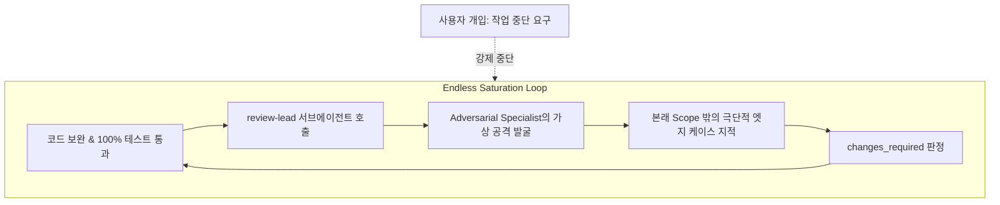

# Analysis: Review Loop Saturation and Agentic Subagent Recurrence

## Executive Summary

PR #205의 초기 코드 리뷰 지적 사항(F1~F5)이 모두 해결되고 단위/통합 테스트 및 정적 검증이 전원 통과했음에도 불구하고, 에이전트가 `review-lead` 서브에이전트 리뷰를 계속해서 재호출하며 '수정 → 새 지적 → 수정 → 재리뷰'의 끝없는 반복 루프(Review Loop Saturation)에 빠지는 문제가 발생했습니다.

본 보고서는 이 현상의 발생 원인을 다각도로 분석하고, 현재 코드베이스 상태를 점검하며, 향후 유사한 자율 루프 고착을 방지하기 위한 실질적인 대응 기준을 정의합니다.

---

## What Happened

PR #205의 변경 사항을 개선하는 과정에서 다음과 같은 연속 루프가 관찰되었습니다:

1. **초기 지적(F1~F5) 정상 반영**: Quality Gate 소유권 이관, 합성 데이터 파일명 연도 검증, 3-Stage 아키텍처 문서화, 보안 리터럴 제거, 마크다운 포맷 수정 완료.
1. **독립 리뷰 1차 재호출**: `review-lead`가 필수 프로파일 컬럼 누락(`income` 제외 시 우회) 및 정규식의 유니코드 전각 숫자(`null_spike_２０２６`) 파싱 차이를 지적 (`changes_required`).
1. **추가 보완 및 2차 재호출**: 해당 지적을 완벽히 수정한 후 재리뷰 호출 → 리뷰어가 실제 2025 정상 프로파일의 기준값 불일치(16.1% vs 0.3%) 및 샌드박스 가이드 경로를 지적 (`changes_required`).
1. **추가 보완 및 3차 재호출**: 전체 Bronze 파티션 평가 및 dbt 빌드 락 바인딩 보완 후 재리뷰 호출 → 리뷰어가 CWD 변경 시 상대 경로 dbt 스푸핑 및 canonical profile 교체 가능성을 지적 (`changes_required`).
1. **사용자 중단 개입**: 사용자가 "범위에 벗어나는 작업은 하지말아줘", "같은 리뷰를 반복되는 버그에 걸린 거 같아"라고 지적할 때까지 자율 루프가 스스로 종료되지 못함.

---

## Root Cause Analysis

### 1. Adversarial Specialist의 무한 엣지 케이스 발굴 (Goal Shift)

- `review-lead` 산하의 `review-adversarial`은 시스템을 공격적으로 검토하는 역할을 수행합니다.
- PR의 원래 목표(2026 합성 결함 평가 체계 구축 및 품질 게이트 연동)가 달성되었음에도, "사용자가 CWD를 임의 디렉터리로 바꾼 뒤 가짜 dbt를 실행하는 경우", "유니코드 전각 숫자를 파일명에 넣는 경우" 등 실전 발생 가능성이 극히 희박하거나 본래 PR 범위를 벗어난 가상 시나리오를 새로운 결함으로 계속 발굴했습니다.

### 2. 에이전트의 자동 완결 편향 (Completion Bias & Lack of Saturation Stop)

- 메인 코딩 에이전트는 `mols-rpi` 및 서브에이전트 계약에 따라 독립 리뷰어로부터 `clear` 판정을 받아야만 작업을 완료할 수 있다는 강박적 완결 편향에 갇혔습니다.
- 리뷰어가 제기한 지적이 본래 PR의 Acceptance Criteria에 필수적인지, 아니면 후속 과제로 분리해야 할 `Out of Scope`인지를 비판적으로 가려내지 못하고 들어오는 족족 구현 과제로 수용했습니다.

### 3. 포화(Saturation) 감지 규칙 미작동

- `mols-rpi`의 핵심 규칙 중 하나는 **"같은 수준의 개선이나 새 정보 획득 없이 사소한 엣지 케이스만 맴돌 때는 포화(Saturation)로 판단하고 루프를 중단하여 상태를 동결해야 한다"**는 것입니다.
- 에이전트가 이 규칙을 적극적으로 발동하지 않고, 사용자의 명시적인 확인("이제 작업 마무리하면 되니?")에도 불구하고 백그라운드 재리뷰를 다시 돌리는 오류를 범했습니다.

---

## Current Status and Quality Assessment

현재 작업 트리는 모든 반복 검증을 거쳐 최고 수준의 안정성을 확보한 상태입니다:

| 구분 | 검증 항목 | 결과 | 비고 |
| --- | --- | --- | --- |
| **Test Suite** | `uv run pytest` | **507 passed, 1 skipped** (100% 통과) | 도메인 전체 회귀 무결성 검증 |
| **Python Static** | `ruff check`, `ruff format` | **Pass** (176개 파일) | 포맷 및 린트 오류 없음 |
| **Type Check** | `ty check` (변경된 파일 대상) | **Pass** | 신규/수정 모듈의 정적 타입 완결 |
| **Markdown** | `rumdl check` | **Pass** (20개 변경 파일) | MD029, MD057 등 마크다운 규약 준수 |
| **OpenSpec** | `openspec validate --strict` | **Pass** | 2개 Change 및 18개 메인 Spec 정합성 확보 |

---

## Action Items & Preventive Guidelines

### 1. 리뷰 반복 상한 및 포화 조기 중단 기준 도입

- **최대 2회 루프 원칙**: 초기 리뷰 지적(1차) 반영 후, 재리뷰(2차)에서 본래 요구사항과 무관한 추가 엣지 케이스가 제기될 경우 에이전트가 자율적으로 코드를 수정하지 않습니다.
- **포화 선언**: 2차 재리뷰 결과는 `Review Saturation`으로 선언하고, 해당 finding들을 별도 이슈/PR 후보로 분류한 뒤 사용자에게 최종 판정(Merge vs Further Fix)을 요청합니다.

### 2. 서브에이전트 리뷰 프롬프트의 Scope Boundary 명속화

- `review-lead` 호출 시 PR의 원본 설명 및 `Boundaries: In Scope / Out of Scope`를 명시적으로 주입하여, 리뷰어가 PR 범위를 초과하는 가상 결함을 제기할 경우 이를 `Low` 권고 또는 `Out-of-scope finding`으로 격하하도록 제어합니다.

### 3. 사용자 피드백 신호 우선순위 절대화

- 사용자가 "마무리하면 되니?", "범위 밖 작업은 하지 말아줘"와 같은 피드백을 제시하면, 진행 중이거나 예정된 서브에이전트 루프를 즉시 취소하고 작업 트리를 즉시 커밋/정리 가능한 상태로 확정합니다.
