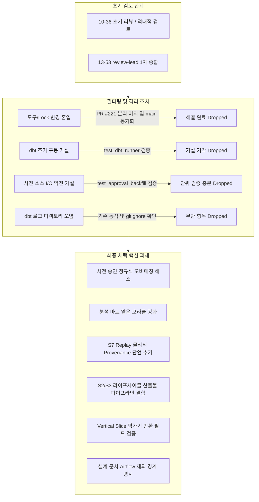

# PR #220 Deterministic System Recovery E2E Final Review Report

> [!IMPORTANT]
> **Executive Summary & Verdict: Revise (Ready for Implementation).**
> PR #220에 대한 복수의 선행 검토(일반 리뷰, 적대적 리뷰, review-lead 통합 검토)를 종합 분석한 결과, (1) 무관한 Rulesync 및 의존성 변경은 PR #221 머지 및 `main` 동기화를 통해 완전히 해소(Resolved)되었으며, (2) 코드베이스 검증을 통해 유효하지 않은 공격 가설(dbt 조기 구동, 사전 소스 I/O 역전 등)은 기각·드랍(Dropped)했습니다.
> 최종적으로 남은 핵심 과제는 [tests/data_operations/test_system_recovery_e2e.py](../../tests/data_operations/test_system_recovery_e2e.py) 내 False Green을 유발하는 5건의 오라클 방어력 결함 및 설계 문서 경계 명시 1건이며, 본 보고서는 이를 즉시 구현 가능한 실행 계획으로 승화하여 확정합니다.

## Review Evolution & Decision Summary

금일 진행된 리뷰의 발전 과정과 최종 필터링 결과는 다음과 같습니다.



## Dropped & Resolved Items

선행 리뷰에서 제기되었으나, 조치 완료되었거나 타당성이 부족하여 최종 과제에서 제외(드랍)한 항목들입니다.

| Category | Item | Disposition | Rationale & Evidence |
| --- | --- | --- | --- |
| **Resolved** | Rulesync 및 [uv.lock](../../uv.lock) 변경 혼입 | `resolved` | `agent/chore/sync-agent-skills-tooling` 브랜치로 분리하여 PR #221로 `main`에 머지 완료. `agent/test/system-recovery-e2e`에 `main`을 병합하여 diff에서 6개 도구 파일 완전 제거 완료. |
| **Dropped** | dbt subprocess 조기 구동 가설 | `rejected` | 품질 게이트 실패 시 dbt subprocess가 시작될 수 있다는 가설은 [tests/data_operations/test_dbt_runner.py](../../tests/data_operations/test_dbt_runner.py)의 기존 가드 및 프로덕션 러너 검증을 통해 이미 방어되고 있음을 확인하여 기각. |
| **Dropped** | 승인 전 소스 파일 I/O 선행 역전 가설 | `rejected` | 프로덕션 [src/hmda_reliability/reliability/recovery/executor.py](../../src/hmda_reliability/reliability/recovery/executor.py#L80-L84)가 `_ensure_approved()`를 `_stage_approved_candidate_source()`보다 먼저 호출하고 있고, 컴포넌트 스위트([tests/reliability/test_approval_backfill_validation.py](../../tests/reliability/test_approval_backfill_validation.py))에서 `missing.csv`로 이를 엄격히 증명하고 있으므로 E2E 테스트에서의 중복 픽스처 복잡화 방지를 위해 제외. |
| **Dropped** | [dbt/logs/](../../dbt/logs/) 로그 디렉토리 오염 | `unrelated` | [src/hmda_reliability/data_operations/runner.py](../../src/hmda_reliability/data_operations/runner.py)의 기존 동작이며 이미 `.gitignore` 처리되어 있어, 본 PR의 테스트 코드 변경 범위와 인과관계가 없으므로 제외. |

## Retained Actionable Findings

실제 시스템 복구 및 안전 보장 로직에 회귀가 발생했을 때 테스트가 거짓 양성(False Green)으로 통과하는 것을 방지하기 위해 반드시 유지·수정해야 할 핵심 결함입니다.

### F1. Pre-Approval Safety Test Regex Overmatching & Exception Masking

- **Severity** - Major
- **Disposition** - `current_required` (`explicit_target`)
- **Location** - [tests/data_operations/test_system_recovery_e2e.py](../../tests/data_operations/test_system_recovery_e2e.py#L527), [tests/data_operations/test_system_recovery_e2e.py](../../tests/data_operations/test_system_recovery_e2e.py#L564)
- **Confirmed Problem** - [tests/data_operations/test_system_recovery_e2e.py](../../tests/data_operations/test_system_recovery_e2e.py#L527)의 `expected_error_match="diverged|일치"`에서 `"|일치"`가 너무 포괄적이어서, 타깃 파티션 상태 불일치뿐 아니라 상위 제안/소스 불일치 에러까지 모두 허용합니다. 또한 [tests/data_operations/test_system_recovery_e2e.py](../../tests/data_operations/test_system_recovery_e2e.py#L564)의 `expected_error_match="action"` 역시 단순 부분 매칭으로 구체적 누락 액션 계약을 검증하지 않습니다.
- **Impact** - 복구 타깃 상태 발산 방어선이 무력화되거나 엉뚱한 단계에서 예외가 터져도 테스트가 정상 통과(False Green)합니다.
- **Required Change** - 패턴을 `expected_error_match=r"diverged state입니다"` 및 `expected_error_match=r"backfill 승인에 필요한 action이 없습니다"`로 엄격히 한정합니다.

### F2. Shallow Oracle in Analytics Outputs Helper

- **Severity** - Major
- **Disposition** - `current_required` (`explicit_target`)
- **Location** - [tests/data_operations/test_system_recovery_e2e.py](../../tests/data_operations/test_system_recovery_e2e.py#L121-L134), [tests/data_operations/test_system_recovery_e2e.py](../../tests/data_operations/test_system_recovery_e2e.py#L386-L393)
- **Confirmed Problem** - `_assert_analytics_outputs`는 `mart_count > 0`만 단언합니다. S0 단계에서 dbt build로 생성된 마트 테이블(2건)이 DuckDB에 그대로 남으므로, S6(복구 후 재검증)에서 dbt build가 마트 모델 갱신에 실패하더라도 항상 통과합니다. 또한 결함 주입 대상이었던 `income` 컬럼의 null 복구 여부를 확인하지 않습니다.
- **Impact** - 복구 파이프라인 이후 다운스트림 분석 마트가 실제로 정상 복원되었는지 독립적으로 증명하지 못합니다.
- **Required Change** - `mart_count[0] == 2`를 엄격히 단언하고, staging 뷰의 `SELECT count(*) FROM staging.stg_hmda_loans WHERE income IS NULL` 건수가 0임을 직접 확인하는 단언을 추가합니다.

### F3. Missing Physical Provenance Invariance Oracle in S7 Replay

- **Severity** - Major
- **Disposition** - `current_required` (`explicit_target`)
- **Location** - [tests/data_operations/test_system_recovery_e2e.py](../../tests/data_operations/test_system_recovery_e2e.py#L395-L404), [tests/data_operations/test_system_recovery_e2e.design.md](../../tests/data_operations/test_system_recovery_e2e.design.md#L18)
- **Confirmed Problem** - [src/hmda_reliability/hmda_data/ingestion/identity.py](../../src/hmda_reliability/hmda_data/ingestion/identity.py)에서 `ingested_at`은 논리 해시에서 제외됩니다. S7에서 executor 자체 보고값(`mutation_state == "already_recovered"`)과 논리 identity만 검사하므로, 구현체에서 Replay 시 파티션을 불필요하게 `DELETE`/`INSERT`로 다시 덮어써도 논리 데이터가 같으면 통과합니다.
- **Impact** - [openspec/specs/reliability-recovery-backfill/spec.md](../../openspec/specs/reliability-recovery-backfill/spec.md)의 복구 조정 규약(중복 파티션 재작성 방지) 회귀를 검출할 수 없습니다.
- **Required Change** - S7 실행 직전 대상 DB 파티션의 `partition_max_ingested_at`을 기록하고, S7 실행 후 타임스탬프가 엄격히 동일함을 비교하는 독립 단언을 추가합니다.

### F4. Unlinked Incident Lifecycle Output in Proposal Binding

- **Severity** - Minor
- **Disposition** - `current_required` (`explicit_target`)
- **Location** - [tests/data_operations/test_system_recovery_e2e.py](../../tests/data_operations/test_system_recovery_e2e.py#L330-L366)
- **Confirmed Problem** - [src/hmda_reliability/data_operations/incident_lifecycle.py](../../src/hmda_reliability/data_operations/incident_lifecycle.py)는 복구 제안 바인딩을 위해 `target_content_identity`를 수집·반환하지만, S2에서 `assert lifecycle_result.target_content_identity == dirty_identity` 단언이 누락되었습니다. 또한 S3에서 `_build_proposal` 호출 시 라이프사이클 반환값 대신 S1의 로컬 변수 `dirty_identity`를 직접 전달했습니다.
- **Impact** - 인시던트 수명주기 탐지와 복구 제안 생성 간의 실제 런타임 데이터 파이프라인 결합 계약 검증이 우회됩니다.
- **Required Change** - S2에 `lifecycle_result.target_content_identity == dirty_identity` 단언을 추가하고, S3의 `_build_proposal`에 `approved_before_identity=lifecycle_result.target_content_identity`로 전달하도록 수정합니다.

### F5. Missing Assertions on Vertical Slice Result Fields

- **Severity** - Minor
- **Disposition** - `current_required` (`explicit_target`)
- **Location** - [tests/data_operations/test_system_recovery_e2e.py](../../tests/data_operations/test_system_recovery_e2e.py#L450-L460)
- **Confirmed Problem** - `evaluate_null_spike_vertical_slice` 평가는 내부에서 replay를 수행하고 그 결과를 `result.replay`에 담으며, dbt 에러 상태를 `result.target_dbt_failure`로 반환합니다. 그러나 `test_null_spike_evaluator_real_dbt_e2e`는 이 핵심 반환 필드 검증을 생략했습니다.
- **Impact** - 수직 슬라이스 평가기의 Replay 단계 누락 또는 dbt 에러 잔존 결함을 검출하지 못합니다.
- **Required Change** - `assert result.replay is not None`, `assert result.replay.mutation_state == "already_recovered"`, `assert result.target_dbt_failure is None` 단언을 추가합니다.

### D1. Documentation: Execution Boundary Clarification in Design Document

- **Severity** - Minor
- **Disposition** - `follow_up` (`explicit_target`)
- **Location** - [tests/data_operations/test_system_recovery_e2e.design.md](../../tests/data_operations/test_system_recovery_e2e.design.md#L3-L5)
- **Confirmed Problem** - 설계 문서의 "complete loop across the Data Plane" 표현이 Airflow 오케스트레이션 런타임까지 포함하는 것으로 오해될 소지가 있습니다.
- **Impact** - MVP의 오케스트레이션 검증 경계와 본 테스트의 직접 Python API 통합 경계가 혼동될 위험이 있습니다.
- **Required Change** - Airflow 스케줄러/DAG 런타임을 배제한 "Data Operations ↔ Reliability 결정론적 통합 E2E 코어"임을 Contract에 명시합니다.

## Implementation Action Plan

위 확정 과제들을 반영하기 위한 파일별 구체적 코드 변경 지침입니다.

### 1. [tests/data_operations/test_system_recovery_e2e.py](../../tests/data_operations/test_system_recovery_e2e.py) 수정 지침

1. **`_assert_analytics_outputs` 헬퍼 개선 (`F2`)**:
   - `assert int(mart_count[0]) == 2`로 변경.
   - staging 뷰 쿼리에 `income IS NULL` 건수 확인 추가:

     ```python
     null_income_count = con.execute(
         "SELECT count(*) FROM staging.stg_hmda_loans WHERE income IS NULL"
     ).fetchone()
     assert null_income_count is not None and int(null_income_count[0]) == 0
     ```

1. **S2/S3 파이프라인 결합 (`F4`)**:
   - S2 마지막에 `assert lifecycle_result.target_content_identity == dirty_identity` 추가.
   - S3의 `_build_proposal` 호출부에서 `approved_before_identity=lifecycle_result.target_content_identity`로 변경.
1. **S7 Replay 물리적 Provenance 단언 (`F3`)**:
   - S7 실행 직전:

     ```python
     before_replay_max_ingested = partition_max_ingested_at(
         db_path=target_db_path,
         table_name="hmda_loans",
         partition_date="2026-08-30",
     )
     ```

   - S7 실행 직후:

     ```python
     assert partition_max_ingested_at(
         db_path=target_db_path,
         table_name="hmda_loans",
         partition_date="2026-08-30",
     ) == before_replay_max_ingested
     ```

1. **Vertical Slice 평가기 테스트 단언 보강 (`F5`)**:
   - `test_null_spike_evaluator_real_dbt_e2e`에 다음 단언 추가:

     ```python
     assert result.replay is not None
     assert result.replay.mutation_state == "already_recovered"
     assert result.target_dbt_failure is None
     ```

1. **사전 승인 안전 테스트 정규식 패턴 한정 (`F1`)**:
   - `test_pre_approval_safety_mismatched_identity_zero_mutation`: `expected_error_match=r"diverged state입니다"`
   - `test_pre_approval_safety_mismatched_actions_zero_mutation`: `expected_error_match=r"backfill 승인에 필요한 action이 없습니다"`

### 2. [tests/data_operations/test_system_recovery_e2e.design.md](../../tests/data_operations/test_system_recovery_e2e.design.md) 수정 지침 (`D1`)

1. 서두 및 Contract 절에 "Airflow 오케스트레이션 런타임을 배제하고 Data Operations와 Reliability 계층의 핵심 함수들을 직접 순차 실행하는 결정론적 통합 E2E 코어(Deterministic Integration E2E Core)"임을 명시.

## Sign-off & Verification Expectations

- **품질(Quality) 관점**: 분석 마트 및 스테이징 뷰 정합성 오라클, 파이프라인 컴포넌트 간 객체 결합이 엄격해져 false-green 없이 런타임 회귀를 확실히 포착함.
- **적대적(Adversarial) 관점**: `ingested_at` 변조를 허용하던 S7 replay 오라클의 구멍이 물리적 타임스탬프 불변성 검증으로 완벽히 차단됨.
- **실행 목표**: 모든 수정 적용 후 `uv run pytest tests/data_operations/test_system_recovery_e2e.py` 5개 테스트 전체 통과 및 ruff/ty/rumdl 정적 검사 통과.
