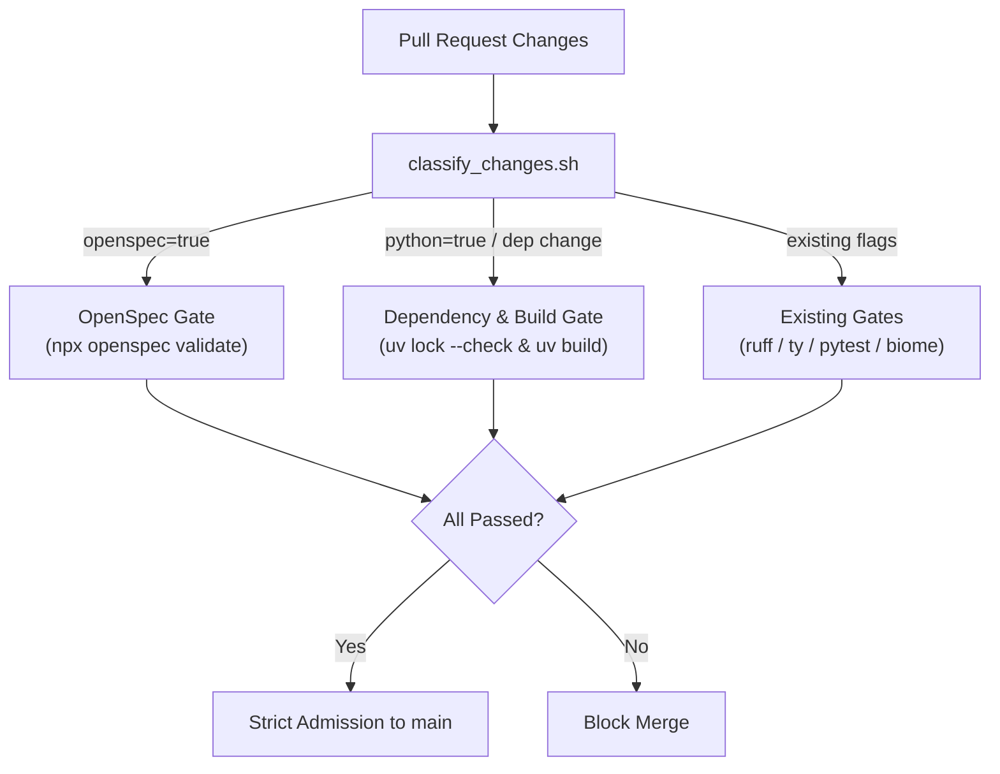

# CI Admission Reinforcement Work Plan (PR #228)

> [!NOTE]
> **작업 개요:** 본 번들은 GitHub Pull Request [#228](https://github.com/mols3131d/hmda-data-reliability/pull/228) (`agent/ci/openspec-and-dependency-admission`)에서 진행되는 **(1) OpenSpec CI Admission 차단 게이트 구축**과 **(2) Dependency/Runtime CI 정합성 보강**의 설계, 작업 계획, 구현 산출물 및 검증 증거를 관리하는 전용 작업 공간입니다.

## Navigation

- [01-openspec-ci-admission.md](01-openspec-ci-admission.md): OpenSpec 변경 감지 및 CI Lite 차단 게이트 설계 규격
- [02-dependency-runtime-ci.md](02-dependency-runtime-ci.md): 의존성 락파일 드리프트 방지 및 런타임 패키징 무결성 검증 설계 규격
- [tasks.md](tasks.md): 단계별 구현 태스크 체크리스트 및 진행 현황
- [10-20-research-ci-openspec-admission.md](../10-20-research-ci-openspec-admission.md): 선행 수행된 OpenSpec CI admission 조사 보고서

## Context and Goals

### Target Boundary

- **대상 브랜치:** `agent/ci/openspec-and-dependency-admission`
- **통합 경계 (Admission Branch):** `main`
- **핵심 원칙 ([docs/development/ci.md](../../../docs/development/ci.md)):**
  1. `main`에 들어가면 안 되는 문제(깨진 스펙, 락파일 드리프트, 빌드 불가능한 패키지)는 병합 전에 blocking 검증으로 차단한다.
  1. 무관한 변경(일반 문서, 순수 파이썬 수정 등)에 불필요한 비용이나 지연을 유발하지 않도록 최소 비용의 Fail-Safe Impact Routing을 유지한다.
  1. 가장 싼 충분한 검증을 선택하여 CI 전체 수행 시간을 낭비하지 않는다.

### Problem Statement

1. **OpenSpec 검증 전무:** 현행 CI Lite([.github/workflows/ci-lite.yml](../../../.github/workflows/ci-lite.yml))는 [openspec/](../../../openspec/README.md) 트리의 어떤 파일이 변경되어도 검증을 수행하지 않아, 잘못된 규격이나 스키마 위반이 `main`으로 유입될 수 있습니다.
1. **의존성 락파일 드리프트 방어 취약:** [pyproject.toml](../../../pyproject.toml)만 수정되고 [uv.lock](../../../uv.lock) 갱신이 누락된 경우, 명시적인 `uv lock --check` 게이트가 없어 락파일 드리프트가 발생할 수 있습니다.
1. **패키지 빌드 무결성 미검증:** [pyproject.toml](../../../pyproject.toml)의 `[build-system]` (`uv_build`) 설정이나 패키지 메타데이터 오류를 조기 검출하는 빌드 검증이 CI 단계에 없습니다.

## Architecture and Changes Overview

## Workstreams

1. **Workstream 1: OpenSpec CI Admission**
   - [.github/workflows/classify_changes.sh](../../../.github/workflows/classify_changes.sh)에 `openspec` 및 `openspec_archived` 감지 추가
   - [.github/workflows/ci-lite.yml](../../../.github/workflows/ci-lite.yml)에 `Validate OpenSpec` 단계 추가
   - [tests/test_ci_classifier.py](../../../tests/test_ci_classifier.py) 회귀 테스트 추가
   - [lefthook.yml](../../../lefthook.yml) pre-push 연계
1. **Workstream 2: Dependency / Runtime CI**
   - `uv lock --check`를 통한 락파일 드리프트 차단 게이트 추가
   - `uv build --wheel`을 통한 패키징 메타데이터 무결성 검증 추가
1. **Workstream 3: Verification & Integration**
   - 변경된 분류기 회귀 테스트 전수 실행
   - 로컬 pre-push 훅 검증
   - PR [#228](https://github.com/mols3131d/hmda-data-reliability/pull/228) 업데이트 및 prospective merge CI 통과 증명
