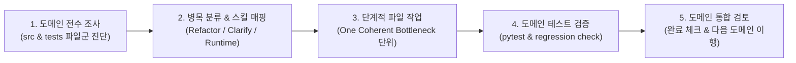

# Domain-by-Domain Code Comprehension and Clarification Plan

## Objective

이 계획은 저장소의 모든 도메인에 걸쳐 `src/` 및 `tests/` 코드를 전수 조사하고, 아래 3대 스킬을 유기적으로 연계하여 caller, maintainer, reviewer가 겪는 이해 비용(comprehension cost)과 런타임 복원 부채를 단계적으로 해소하는 것을 목표로 한다.

- `mols-clarify-code`: 실행 코드를 바꾸지 않고 코드 인접 설명(docstring, comment, local invariant, caller contract)을 정밀하게 보강
- `mols-clarify-runtime`: 기존 테스트와 실행 관찰을 통해 런타임 의사결정 경로, 상태 전이, 실패 원인을 복원하고 최소 증적을 검증
- `mols-code-comprehension-refactor`: 동작과 계약을 100% 보존하면서 불투명한 표현(익명 튜플, 매직 문자열), 복잡한 제어 흐름 시뮬레이션 및 분산된 상태 추적 부담을 단일 일관 병목(One Coherent Bottleneck) 단위로 리팩터링

## Work Principles

1. **Domain-by-Domain Execution**: 한 번에 모든 도메인을 처리하지 않고, 도메인 단위로 전수 조사 → 개별 파일 작업 → 도메인 통합 검토 및 테스트 검증 순으로 완결한다.
1. **Preservation before Transformation**: 실행 코드 리팩터링 전 반드시 관찰 가능한 계약, 예외 규격, 성능 특성 및 기존 테스트를 확인하고 보존한다.
1. **Skill Separation of Concerns**:
   - 구조나 표현의 문제: `mols-code-comprehension-refactor`
   - 불명확한 계약·불변식 설명: `mols-clarify-code`
   - 런타임 실행 경로 및 결정 복원: `mols-clarify-runtime`
1. **No-Regression Validation**: 각 파일 또는 도메인 작업 완료 시 해당 도메인의 pytest를 즉시 실행하여 검증한다.

## Non-Goals & Boundaries (하지 않는 것 / 금지 경계)

이 작업의 유일한 목적은 **이해 비용(Comprehension Cost)의 절감**이며, 아래 항목들은 엄격히 작업 범위에서 제외한다.

1. **기능 추가 및 동작(Behavior) 변경 절대 금지**:
   - 기존의 모든 입출력, 반환값, 부수 효과(side effects)의 순서, 멱등성 및 예외 발생 조건을 100% 동일하게 보존한다.
   - "더 나은 기능"이나 "새로운 동작"을 가독성 명목으로 추가하거나 바꾸지 않는다.
1. **버그 수정(Correctness Defect Fix) 혼합 금지**:
   - 조사 또는 리팩터링 과정에서 기존 코드의 잠재적 버그나 엣지 케이스 오류를 발견하더라도, 리팩터링과 함께 임의로 수정하여 새 계약으로 고정하지 않는다.
   - 발견된 결함은 수정하지 않고 별도의 이슈/관찰 사항으로 명확히 분리하여 보고한다.
1. **성능 최적화(Performance Optimization) 목적의 변경 금지**:
   - 수행 속도 향상이나 메모리 절약만을 목적으로 코드를 재작성하지 않는다. (단, 기존 성능 특성이 심각하게 저하되지 않도록 유지한다.)
1. **시스템 아키텍처 및 공용 API 재설계 금지**:
   - 패키지 간 도메인 경계 이동, 프레임워크 호출 규약 변경, public API의 파괴적 재설계는 이 작업의 범위를 벗어난다.
1. **테스트 완화(Relaxing Tests) 및 기존 실패 은폐 금지**:
   - 리팩터링의 정당성을 증명하기 위해 기존 단위 테스트의 검증 조건을 약화하거나 단언문을 수정하지 않는다.
1. **불필요한 설명 노이즈(Prose Noise) 추가 금지**:
   - 코드가 이미 자체적으로 명확하게 드러내는 내용을 주석으로 단순 번역하듯 반복하지 않으며, 확인되지 않은 추측성 설명을 추가하지 않는다.

## Out-of-Scope Issue Protocol (범위 외 이슈 격리 및 기록)

조사나 리팩터링 도중 본 작업 범위(코드 이해 비용 절감)를 벗어나는 **중요한 문제나 잠재적 결함, 아키텍처 부채, 스펙 불일치**를 발견할 경우 아래 프로토콜에 따라 처리한다.

1. **임의 수정 금지 및 작업 격리**:
   - 발견된 문제를 현재 리팩터링 작업에 섞어서 임의로 수정하지 않는다. (동작 보존 및 회귀 방지 원칙 준수)
1. **인박스 전용 아티팩트에 기록**:
   - 발견 즉시 [inbox/2026-09-12-refactor-code-comprehension-clarification/01-note-out-of-scope-issues.md](inbox/2026-09-12-refactor-code-comprehension-clarification/01-note-out-of-scope-issues.md)에 체계적으로 기록한다.
1. **기록 필수 항목**:
   - **발견 위치**: 대상 파일 및 코드 라인 링크
   - **이슈 분류**: 잠재적 버그(Bug), 데이터 무결성/안전성 위험(Safety), 아키텍처/의존성 부채(Architecture Debt), 계약/스펙 불일치(Contract Mismatch)
   - **현상 및 영향도**: 실제 도달 가능한 실패 경로(Reachable failure) 또는 잠재적 영향
   - **격리 이유 및 권장 후속 조치**: 현재 리팩터링에서 제외한 이유와 추후 별도 브랜치/이슈/PR로 해결하기 위한 권고
1. **사용자 공유**:
   - 해당 도메인 작업 완료 및 검토 시 인박스에 기록된 이슈 요약을 함께 보고하여 후속 의사결정을 돕는다.

## Standard Domain Cycle

각 도메인 작업은 아래 5단계 표준 사이클을 거친다.

## Domain Execution Roadmap

작업 순서는 기반 데이터 플랫폼부터 상위 오케스트레이션, 비즈니스 신뢰성 엔진, AI 연동 계층 순으로 진행한다.

| 순서 | 도메인 | 주요 대상 디렉토리 | 핵심 책임 및 주요 관찰 포인트 |
| --- | --- | --- | --- |
| 1 | `data_platform` | `src/hmda_reliability/data_platform/` `tests/data_platform/` | DuckDB 연결 관리, SQL 쿼팅, 아티팩트 프로젝션 락 및 동시성 제어 |
| 2 | `hmda_data` | `src/hmda_reliability/hmda_data/` `tests/hmda_data/` | 원천 데이터 수집(ingestion), 합성 결함 생성(synthetic), EDA 탐색기 |
| 3 | `orchestration` | `src/hmda_reliability/orchestration/` `tests/orchestration/` | Airflow DAG 정의, 파이프라인 설정 및 데이터 플레인 오케스트레이션 |
| 4 | `data_operations` | `src/hmda_reliability/data_operations/` `tests/data_operations/` | 원천 적재 실행, 품질 게이트 평가, dbt 빌드/프로모션 러너, 인시던트 라이프사이클 |
| 5 | `reliability` | `src/hmda_reliability/reliability/` `tests/reliability/` | 프로파일링, 인시던트 감지, dbt 영향 분석, 조치 초안, 복구 실행, 회귀 평가 |
| 6 | `runtime_ai` | `src/hmda_reliability/runtime_ai/` `tests/runtime_ai/` | LLM 프로바이더 어댑터, 런타임 설정, 재시도/타임아웃/오류 정규화 |
| 7 | `review_ai` | `src/hmda_reliability/review_ai/` `tests/review_ai/` | 결정론적 검증기(validator), 프롬프트 렌더링, 증적 저장소, 리뷰 서비스 |
| 8 | `scripts` & shared | `scripts/` `tests/scripts/` `src/hmda_reliability/logger.py` | 규칙 동기화(rulesync), 에셋 관리, 문서 인덱스 생성, 공유 로거/유틸 |

---

## Detailed Checklist by Domain

### Domain 1: `data_platform`

- [x] **조사**: [src/hmda_reliability/data_platform/](src/hmda_reliability/data_platform/) 및 [tests/data_platform/](tests/data_platform/) 전수 조사
  - [x] `duckdb.py`: 커넥션 매니저 및 뮤테이션 락 획득/해제 제어 흐름 진단
  - [x] `sql.py`: SQL 식별자 및 리터럴 quoting 불변식 계약 진단
  - [x] `artifacts.py`: 프로젝션 락 및 파일 해시 프로젝션 계산 진단
  - [x] `test_duckdb.py`, `test_artifacts.py`: 테스트 시나리오 가독성 및 런타임 경로 복원성 진단
- [x] **작업**: 식별된 병목 대상 파일별 리팩터링 및 설명 보강
- [x] **검증**: `uv run pytest tests/data_platform/` 실행 및 전반 검토

### Domain 2: `hmda_data`

- [x] **조사**: [src/hmda_reliability/hmda_data/](src/hmda_reliability/hmda_data/) 및 [tests/hmda_data/](tests/hmda_data/) 전수 조사
  - [x] `ingestion/`: `full_load.py`, `partition.py`, `identity.py`, `discovery.py` 원천 적재 제어 흐름 및 중복 방지 계약 진단
  - [x] `synthetic/`: `cases.py` (null_spike, row_count_drop, schema_drift), `_source.py`, `_writer.py` 쿼리 조립 및 파라미터 매핑 진단
  - [x] `eda/`: `analysis.py`, `explorer.py` 탐색 분석 로직 및 데이터 검증 진단
  - [x] `tests/hmda_data/`: 합성 결함 테스트, 적재 테스트 가독성 진단
- [x] **작업**: 식별된 병목 대상 파일별 리팩터링 및 설명 보강
- [x] **검증**: `uv run pytest tests/hmda_data/` 실행 및 전반 검토

### Domain 3: `orchestration`

- [x] **조사**: [src/hmda_reliability/orchestration/](src/hmda_reliability/orchestration/) 및 [tests/orchestration/](tests/orchestration/) 전수 조사
  - [x] `config.py`: 환경 변수 및 설정 해석 로직 진단
  - [x] `dags/hmda_data_plane.py`: Airflow DAG 태스크 의존성 및 게이트 분기 진단
  - [x] `tests/orchestration/`: DAG 무결성 및 설정 테스트 진단
- [x] **작업**: 식별된 병목 대상 파일별 리팩터링 및 설명 보강
- [x] **검증**: `uv run pytest tests/orchestration/` 실행 및 전반 검토

---

## Domain 1~3 Review & Completion

- [x] **Scope Isolation**: 다른 세션(도메인 4~8)과의 충돌 방지를 위해 도메인 1~3 대상 파일만 엄격히 격리 완료
- [x] **Zero Regression Testing**: `uv run pytest tests/data_platform tests/hmda_data tests/orchestration` 119개 테스트 100% 통과
- [x] **Lint & Format Validation**: `uv run ruff check` 및 `uv run ruff format --check` 43개 파일 100% 통과
- [x] **Independent Review Artifact**: [02-review-domains-1-to-3-code-comprehension.md](02-review-domains-1-to-3-code-comprehension.md) 작성 완료 (품질 및 적대적 평가 APPROVED)

---

### Domain 4: `data_operations`

- [x] **조사**: [src/hmda_reliability/data_operations/](src/hmda_reliability/data_operations/) 및 [tests/data_operations/](tests/data_operations/) 전수 조사
  - [x] `runner.py`: `run_dbt_build`, `promote_dbt_artifacts`의 다단계 파일 교체/롤백 상태 추적 진단
  - [x] `quality_gate.py`: 게이트 판정 및 차단 로직 진단
  - [x] `incident_lifecycle.py`: 프로파일 비교, 감지, 영향 분석, 초안 조립 평탄화 및 락 중첩 진단
  - [x] `tests/data_operations/`: E2E 시스템 복구 및 dbt 러너 테스트 진단
- [x] **작업**: 식별된 병목 대상 파일별 리팩터링 및 설명 보강
- [x] **검증**: `uv run pytest tests/data_operations/` 실행 및 전반 검토

### Domain 5: `reliability`

- [x] **조사**: [src/hmda_reliability/reliability/](src/hmda_reliability/reliability/) 및 [tests/reliability/](tests/reliability/) 전수 조사
  - [x] `contracts/`: Pydantic 모델 불변식 및 상태 바인딩 계약 진단
  - [x] `profiling/`: `profile_snapshot_builder.py`, `table_state_builder.py` 스키마 해시 및 메트릭 집계 진단
  - [x] `detection/`: `detector.py`, `thresholds.py` 인시던트 감지 규칙 진단
  - [x] `impact/`: `analyzer.py`, `manifest.py` dbt 계통 그래프 BFS 및 하류 자산 추적 진단
  - [x] `remediation/`: `workflow.py`, `draft.py` 상태 그래프 및 초안 구성 진단
  - [x] `recovery/`: `executor.py` (`ApprovalBackfillValidator`), `schema_executor.py`의 복구 상태 조정(익명 튜플 해소) 및 트랜잭션 게이트 진단
  - [x] `evaluation/`: `null_spike.py`, `volume_drop.py`, `schema_drift.py`, `freshness_delay.py`, `reporter.py` 수직 슬라이스 평가 오케스트레이션 진단
  - [x] `tests/reliability/`: 18개 테스트 파일의 검증 시나리오 및 런타임 복원성 진단
- [x] **작업**: 식별된 병목 대상 파일별 리팩터링 및 설명 보강
- [x] **검증**: `uv run pytest tests/reliability/` 실행 및 전반 검토

### Domain 6: `runtime_ai`

- [x] **조사**: [src/hmda_reliability/runtime_ai/](src/hmda_reliability/runtime_ai/) 및 [tests/runtime_ai/](tests/runtime_ai/) 전수 조사
  - [x] `provider.py`: OpenAI 호환 프로바이더 어댑터, 타임아웃, 예외 매핑 진단
  - [x] `contracts.py`, `settings.py`: 메시지 및 응답 규격 진단
  - [x] `tests/runtime_ai/`: 모의 프로바이더 및 실패 복원 테스트 진단
- [x] **작업**: 식별된 병목 대상 파일별 리팩터링 및 설명 보강
- [x] **검증**: `uv run pytest tests/runtime_ai/` 실행 및 전반 검토

### Domain 7: `review_ai`

- [x] **조사**: [src/hmda_reliability/review_ai/](src/hmda_reliability/review_ai/) 및 [tests/review_ai/](tests/review_ai/) 전수 조사
  - [x] `validator.py`: 3대 결정론적 무결성 검증 규칙 진단
  - [x] `prompt.py`: 프롬프트 렌더링 및 바이트 상한 검증 진단
  - [x] `store.py`: 인보케이션 증적 파일 영속화 및 검증 진단
  - [x] `service.py`: `_ReviewSession` 오케스트레이션 및 상태 전이 진단
  - [x] `tests/review_ai/`: 결정론적 가드 및 리뷰 라이프사이클 테스트 진단
- [x] **작업**: 식별된 병목 대상 파일별 리팩터링 및 설명 보강
- [x] **검증**: `uv run pytest tests/review_ai/` 실행 및 전반 검토

### Domain 8: `scripts` & Shared Utilities

- [x] **조사**: [scripts/](scripts/) 및 [tests/scripts/](tests/scripts/) 전수 조사
  - [x] `rulesync.py`: 브리지 파일 생성 및 검증 로직 진단
  - [x] `agent_assets.py`, `generate_docs_indexes.py`: 유틸리티 스크립트 가독성 진단
  - [x] `logger.py`: 공통 로거 포맷 및 컨텍스트 바인딩 진단
  - [x] `tests/scripts/`: 스크립트 회귀 테스트 진단
- [x] **작업**: 식별된 병목 대상 파일별 리팩터링 및 설명 보강
- [x] **검증**: `uv run pytest tests/scripts/` 실행 및 전반 검토

---

## Next Steps

1. Domain 1 (`data_platform`)의 [src/hmda_reliability/data_platform/](src/hmda_reliability/data_platform/) 및 [tests/data_platform/](tests/data_platform/) 파일 전수 조사 착수
1. 발견된 이해 병목 보고 및 개별 파일별 작업(리팩터링/명확화) 계획 확정 후 순차 수정
1. 도메인 단위 테스트 및 전반 검토 수행 후 Domain 2 (`hmda_data`)로 전진
