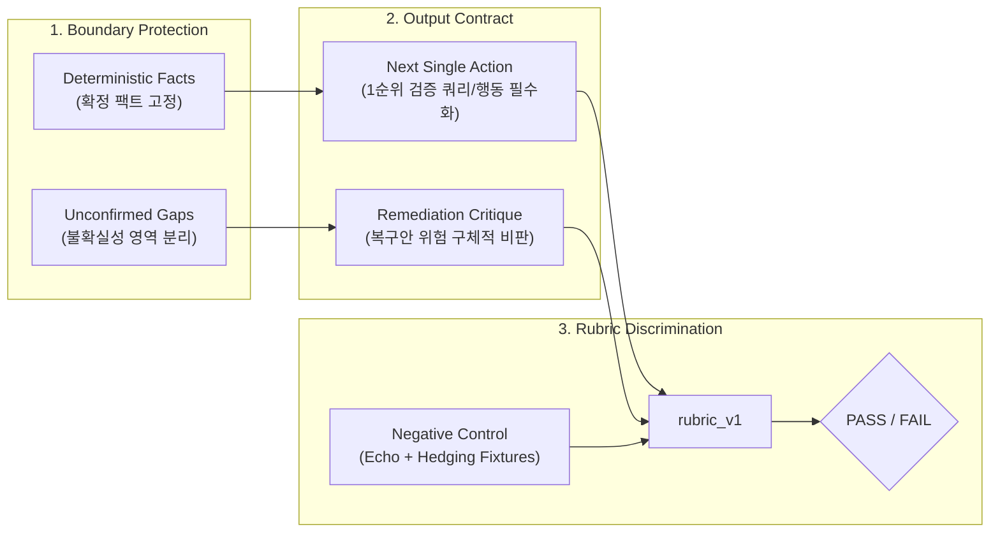

# Review AI Over-defensive Hedging Prevention and Spec Alignment Plan

## Executive Summary

- **결론:** Review AI의 과도한 방어성(모든 가능성을 열어두고 책임을 회피하는 면책형 출력)은 환각만큼이나 사람의 조사·복구 판단 비용을 줄여주지 못하므로 반드시 시스템 차원의 방지 장치가 필요합니다. 이를 위해 코드나 프롬프트를 임의로 고치기 전에 [docs/mvp.md](../../docs/mvp.md)와 [OpenSpec Delta Spec](../../openspec/changes/review-ai-utility-evaluation/specs/reliability-agentic-review/spec.md) 정본에 명확한 실패 기준과 판별 시나리오를 먼저 정의해야 합니다.
- **근거:** 현재 시스템의 핵심 불변식은 "Useful, not merely valid"입니다. 문법적 안전성과 환각 방지만을 과도하게 추구하면 실행 가능성(`actionability`) 점수가 0점이 되는 면책성 출력으로 귀결됩니다. 현재 `rubric_v1`과 control discrimination 명세에는 단순 사실 복창(`echo`)만 negative control로 정의되어 있어, 극단적 회피형 답변을 걸러내는 정본 차원의 계약이 누락되어 있습니다.
- **행동:** 1) OpenSpec delta spec에 '과도한 면책형(non-committal/hedging)' 출력을 negative control 실패 시나리오로 명시하고, 2) `rubric_v1`의 `actionability` 평가를 필수 관문으로 강화하며, 3) 이를 검증하는 테스트 픽스처와 판별 로직을 단계적으로 구현합니다.

## Recent Context and Trigger

`agent/feat/review-ai-utility-evaluation` (PR #245) 브랜치 작업 과정에서 다음 활동과 논의가 진행되었습니다.

1. **ELI5 스킬 도입**:
   - 외부 스킬([DreambigOu/ELI5](https://github.com/DreambigOu/ELI5))을 선언적 에셋 도구 체계(Rulesync)로 안전하게 도입하고, [inbox/github-245-review-ai-utility-evaluation/05-brief-review-ai-utility-evaluation.md](05-brief-review-ai-utility-evaluation.md)에 직관적인 비유와 구조화된 개요 섹션을 보강했습니다.
1. **방어적 출력 방지 질문 제기**:
   - "너무 방어적인 LLM의 아웃풋이 나오게끔 하는 경향을 방지하는 방법도 필요할까? 우선 기획이나 설계 문서 정본을 보고 거기에 명시해야 할까?"라는 핵심 질문이 제기되었습니다.
   - 이에 따라 에이전트의 유용성(Utility) 본질을 해치는 과도한 방어성을 통제하기 위한 기획·설계 정본 반영 계획을 본 문서로 수립합니다.

## Problem Definition: The Risk of Over-defensive LLM Output

LLM이 데이터 파이프라인의 이상 징후를 검토할 때, 틀릴 위험을 회피하려는 프롬프트나 정렬(alignment)로 인해 다음과 같은 **면책형 출력(Hedging / Non-committal Output)**이 발생하기 쉽습니다.

- **유형 1: 전수 조사 회피형**
  - "네트워크 지연, 상류 소스 결함, 스키마 변경 등 다양한 원인이 있을 수 있으니 모든 테이블과 로그를 전수 조사해야 합니다."
- **유형 2: 가짜 불확실성형**
  - 이미 시스템이 `null_count=150`을 확정 팩트(`deterministic_facts`)로 제공했음에도 "결측치가 증가했을 가능성이 의심되나 확실하지 않다"며 사실 자체를 흐리는 경우.
- **유형 3: 우선순위 부재형**
  - 발생 가능한 모든 리스크를 나열만 하고, 지금 당장 엔지니어가 취해야 할 1순위 행동을 제시하지 못하는 경우.

이러한 출력은 문법적으로 안전하고 명시적인 거짓말(환각)은 하지 않지만, **사람이 처음부터 끝까지 직접 조사해야 하는 상황과 비용이 동일하여 AI 도입의 효용이 0(Zero Actionability)**에 수렴합니다.

## Canonical Specification Alignment Strategy

저장소의 **근거 우선(Evidence-First)** 및 **명세 기반(Spec-Driven)** 원칙에 따라, 정본 문서를 우선 개정하고 코드를 따라오게 합니다.

### 1. High-Level Invariant Alignment: docs/mvp.md

[docs/mvp.md](../../docs/mvp.md)의 [System Invariants](../../docs/mvp.md#L80)와 [Utility Proofs](../../docs/mvp.md#L145)에 명시된 원칙을 재확인합니다.

- **원칙:** "Useful, not merely valid" — 단순히 유효성 검사를 통과하거나 환각이 없다는 사실만으로 성공으로 보지 않으며, 사람의 다음 판단을 개선하는 실질적 가치를 증명해야 합니다.
- **반영점:** `Quality evaluation proof` 설명에 "단순 재진술뿐만 아니라, 구체적 조치 제안 없이 책임을 회피하는 과도한 방어적 출력 역시 품질 미달(FAIL)로 판별한다"는 문맥을 확실히 세웁니다.

### 2. Normative Specification Delta: OpenSpec spec.md

[openspec/changes/review-ai-utility-evaluation/specs/reliability-agentic-review/spec.md](../../openspec/changes/review-ai-utility-evaluation/specs/reliability-agentic-review/spec.md)의 `Requirement: Versioned human rubric and control discrimination`에 새로운 시나리오를 추가합니다.

- **기존 계약:**
  - Positive control: `PASS`
  - Negative control (단순 사실/초안 재진술): `FAIL`
- **추가할 계약 (Proposed Delta):**
  - Negative control (과도한 면책/방어형): `FAIL`
  - 시나리오: "제공된 Bounded Context 내에서 입증 가능한 deterministic facts가 존재함에도, 구체적인 검증 가설이나 실행 행동 없이 포괄적인 불확실성만을 주장하는 면책형 출력은 `actionability` 및 `prioritization` 기준에서 과락(`score=0`)하여 최종 `FAIL`로 판별되어야 한다(SHALL)."

## Actionable Prevention Mechanics

설계와 코드 레벨에서 적용할 3대 통제 장치입니다.

1. **경계 격리 (Deterministic Facts vs Context Gaps):**
   - 시스템이 이미 확인한 팩트는 LLM이 의심하거나 흐리지 못하도록 프롬프트 컨텍스트에서 명시적으로 고정합니다.
   - 불확실성(`material_uncertainty`)은 '현재 증적 밖에서 확인이 필요한 구체적 미확인 항목'으로만 한정합니다.
1. **계약 수준의 'Next Action' 필수화:**
   - [src/hmda_reliability/review_ai/contracts.py](../../src/hmda_reliability/review_ai/contracts.py)의 `investigation_priority` 항목에 "엔지니어가 가설 검증을 위해 즉시 실행할 수 있는 최소 1개의 구체적 조치(쿼리, 로그 확인 위치 등)"가 포함되도록 스키마 검증을 강화합니다.
1. **Negative Control 픽스처 다변화:**
   - [tests/review_ai/test_utility_evaluation.py](../../tests/review_ai/test_utility_evaluation.py)에 기존 `negative_control` 외에 `negative_control_hedging` 픽스처를 추가하여, 루브릭 평가기가 과도한 면책형 답변을 결정론적으로 탈락시키는지 회귀 테스트를 구축합니다.

## Next Implementation Steps

1. **Step 1: OpenSpec Delta 명세 개정**
   - [openspec/changes/review-ai-utility-evaluation/specs/reliability-agentic-review/spec.md](../../openspec/changes/review-ai-utility-evaluation/specs/reliability-agentic-review/spec.md)에 과도한 면책형 답변 방지 및 control discrimination 확장 시나리오 반영.
1. **Step 2: PR #245 기존 잔여 과제(F1, F2)와의 정합성 검토**
   - F2(Same-case Attribution 바인딩 강화)와 함께 `deterministic_facts`를 baseline/candidate 간에 엄격히 묶음으로써 가짜 불확실성 발생을 차단.
1. **Step 3: 테스트 픽스처 및 루브릭 판별 로직 추가**
   - `negative_control_hedging` 픽스처 작성 및 단위 테스트 실행(`uv run pytest`).
1. **Step 4: Formal Review 수행**
   - `review-lead` 에이전트를 통한 dual-perspective 독립 리뷰 진행 및 Draft 상태 해제.
