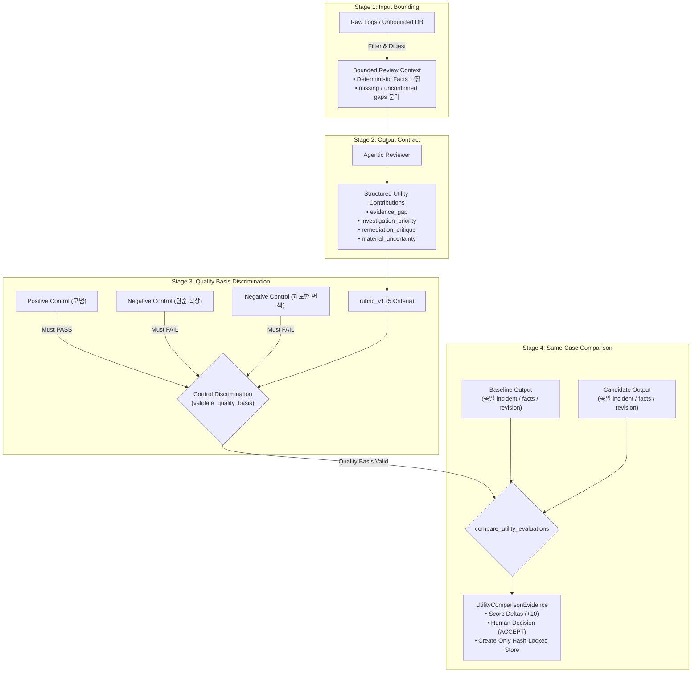

# Review AI Subjective Utility Verification Methodology

## Executive Summary

- **결론:** AI가 생성하는 텍스트의 '유용함(Utility)'은 본질적으로 사람의 업무 맥락과 인지에 의존하는 주관적 개념입니다. 이 프로젝트의 4단계 프레임워크는 유용성을 수학 공식처럼 100% 자동 검증하는 것이 아니라, **1) 입력 맥락 격리, 2) 출력 형태 계약 강제, 3) 엉터리·회피 답안을 걸러내는 대조군 시험, 4) 동일 조건 전후 비교 증적 불변 보존**을 통해 주관적 판단을 **'통제되고 재현 가능한 공학적 대리 지표(Controlled Proxy Metric)'**로 묶어두는 최소 안전망입니다.
- **근거:** [docs/mvp.md](../../docs/mvp.md)의 "Useful, not merely valid" 불변식과 [docs/VISION.md](../../docs/VISION.md)의 "Evidence-Bound AI" 원칙에 따라, 유용함은 '문법적 무결성이나 환각 부재'가 아니라 **'데이터 엔지니어의 다음 조사 및 복구 판단 비용을 실질적으로 단축시키는 구체적 행동 유발'**로 조작적 정의(Operational Definition)됩니다. 그러나 오프라인 루브릭 점수는 실제 운영 효용(MTTR 단축 등)을 대신하는 실험실 대리 지표이므로, 평가자 주관성 잔존과 대리 지표의 한계를 명시적으로 인정해야 합니다.
- **행동:** 모델이나 프롬프트의 변경이 발생할 때마다, 동일한 사건 팩트(`deterministic_facts`)와 버전화된 루브릭(`rubric_v1`) 하에서 대조군 판별(`validate_quality_basis`)을 거쳐 baseline 대비 candidate의 점수 델타와 인간 결정(`HumanDecision.ACCEPT`)을 불변 증적(`UtilityComparisonEvidence`)으로 기록하여 배포 전 **품질 퇴보(Regression)를 방지하는 최소 방어선**으로 활용합니다.

## The Problem: Why Is "Utility" Difficult to Verify?

소프트웨어 시스템에서 LLM 출력을 검증할 때 흔히 빠지는 함정과 착시는 다음과 같습니다.

1. **유창함의 착시 (Fluency Trap):**
   - 문장이 매끄럽고 그럴듯하게 설명되면 유용하다고 착각하기 쉽습니다. 하지만 이미 감지된 장애 팩트를 화려한 수식어로 재진술(Echo)하는 것은 사람에게 아무런 새 정보를 주지 못합니다.
1. **환각 방지의 역설 (The Hedging Paradox):**
   - 환각(Hallucination)을 막기 위해 안전장치를 강화하면, LLM은 "네트워크, 코드, 데이터 등 모든 가능성이 있으니 전수 조사해야 합니다" 식의 과도한 면책형(Hedging) 출력을 내놓습니다. 환각은 없지만 실행성(`actionability`)이 0이 되어 AI 도입 효용이 사라집니다.
1. **블랙박스 판사의 악순환 (LLM-as-a-judge Trap):**
   - 사람이 평가하기 번거롭다는 이유로 외부의 더 큰 LLM에게 "이 답변이 유용한가?"를 묻는 방식은, 하나의 주관을 또 다른 통제 불가능한 블랙박스 주관으로 대체하는 것에 불과합니다. 모델 버전 변경에 따라 채점 기준이 흔들리며 재현성이 깨집니다.
1. **주관성의 잔존 (Persistence of Subjectivity):**
   - 평가 기준표(루브릭)를 아무리 정교하게 설계하더라도, 결국 점수와 최종 승인(`ACCEPT`)을 누르는 주체는 사람입니다. 평가자가 관대하면 높은 점수를 주고 엄격하면 낮은 점수를 줍니다. 루브릭은 주관성을 제거하는 마법이 아닙니다.

따라서 '유용함'을 검증하기 위해서는 **인간의 판단 기준을 엄격한 인터페이스로 감싸되, 그 평가가 가지는 대리 지표로서의 한계를 투명하게 드러내는 공학적 장치**가 필수적입니다.

## The 4-Stage Verification Framework

시스템이 주관적 유용성을 객관적 증적으로 승격시키는 4단계 파이프라인입니다.

### 1. Stage 1: Input Bounding (Review Context Proof)

유용성은 '어떤 맥락이 주어졌는가'에 절대적으로 의존합니다.

- **원칙:** 전체 로그나 수백 개의 테이블을 통째로 주면 모델의 출력이 매번 달라지고 판단 근거를 추적할 수 없습니다.
- **장치 ([src/hmda_reliability/review_ai/context.py](../../src/hmda_reliability/review_ai/context.py)):**
  - incident와 직접 관련된 파티션 메타데이터, 연관 테이블, 탐지 팩트만을 불변 슬라이스로 투영하는 `BoundedReviewContext` 생성.
  - 확정 사실(`deterministic_facts`)과 현재 데이터만으로는 알 수 없는 공백(`missing_evidence`, `unconfirmed_context`)을 명시적으로 분리.
  - 컨텍스트 해시 다이제스트(`context.digest`)를 발급하여 재현성 보장.

### 2. Stage 2: Output Contract Enforcement (Agentic Utility Proof)

자연어 줄글 출력을 허용하면 유용성을 기계적으로 측정할 수 없습니다.

- **원칙:** 단순 사실 재진술이나 포괄적 훈수를 스키마 레벨에서 거부합니다.
- **장치 ([src/hmda_reliability/review_ai/contracts.py](../../src/hmda_reliability/review_ai/contracts.py)):**
  - 출력 스키마(`AgenticReviewOutput`)에 다음 4대 기여 항목을 구조화된 필드로 필수화:
    1. `evidence_gap`: 추가 확인이 필요한 상류/하류 증적 식별.
    1. `investigation_priority`: 엔지니어가 지금 즉시 실행해야 할 1순위 구체적 조치.
    1. `remediation_critique`: 자동 생성된 복구 초안(`RemediationDraft`)의 잠재 부작용/누락 비판.
    1. `material_uncertainty`: 현재 증적만으로는 단정할 수 없는 핵심 리스크 한정.
  - 제공되지 않은 가짜 증적을 참조하는 환각을 즉시 차단하는 `Deterministic Reference Guard` 결합.

### 3. Stage 3: Control Discrimination via Rubric (Quality Evaluation Proof)

평가 기준표(루브릭)의 신뢰성을 먼저 증명하지 않으면 어떤 채점 결과도 믿을 수 없습니다.

- **원칙:** 평가 도구 자체가 엉터리 답안을 걸러낼 수 있는 판별력(Discrimination)을 가졌는지 먼저 시험합니다.
- **장치 ([src/hmda_reliability/review_ai/evaluation.py](../../src/hmda_reliability/review_ai/evaluation.py)):**
  - **5대 핵심 차원 고정 (`rubric_v1`):**
    - `added_value`: 단순 사실 재진술을 넘어선 가치 (0~2점)
    - `actionability`: 즉시 실행 가능한 구체적 조치 제시 여부 (0~2점)
    - `evidence_awareness`: 제공된 증적의 한계와 공백 인지 (0~2점)
    - `uncertainty_handling`: 거짓 확신이나 비겁한 회피 없는 리스크 한정 (0~2점)
    - `prioritization`: 우선순위 단일화 여부 (0~2점)
  - **대조군 통제 검증 (`validate_quality_basis`):**
    - **Positive Control:** 4대 기여를 온전히 수행한 출력 $\rightarrow$ 반드시 `PASS`.
    - **Negative Control 1 (Echo):** 탐지 팩트만 반복한 출력 $\rightarrow$ 반드시 `FAIL`.
    - **Negative Control 2 (Hedging):** 구체적 행동 없이 "전수 조사가 필요하다"며 책임을 회피하는 출력 $\rightarrow$ `actionability` 과락(0점)으로 반드시 `FAIL`.
    - 대조군 판별에서 단 하나라도 어긋나면 품질 기반(`QualityBasisValidation`) 자체가 `valid=False`가 되어 후속 비교가 차단됩니다.

### 4. Stage 4: Same-Case Comparison & Immutable Evidence (Change Comparison Proof)

개선 여부는 오직 '동일한 시험지에서의 1:1 비교'로만 입증됩니다.

- **원칙:** 작년 시험지와 올해 시험지를 비교해 성적이 올랐다고 주장하는 오류(Attribution Drift)를 차단합니다.
- **장치 ([src/hmda_reliability/review_ai/evaluation.py](../../src/hmda_reliability/review_ai/evaluation.py)):**
  - baseline과 candidate가 **완벽히 동일한 incident 파티션, 동일한 `target_column`, 동일한 `deterministic_facts`, 동일한 코드 리비전(`project_revision`)**에서 평가되었는지 비교 진입 시 검사.
  - 불일치 시 `same_case_fact_mismatch` 또는 `quality_basis_revision_mismatch` 코드로 fail-closed 차단.
  - 비교가 승인되면 5개 기준별 점수 델타, 사람의 최종 승인 결정(`HumanDecision.ACCEPT`), 심사 근거(rationale)를 묶어 디스크에 덮어쓰기가 불가능한(`create-only`) JSON 아티팩트로 영구 보존.

## Limitations and The Proxy Gap

이 방식이 "유용함을 완벽히 보증하는 만능 기계"라는 오해를 경계해야 합니다. 공학적 실체는 다음과 같은 명확한 한계를 갖습니다.

### 1. Subjectivity Persists: 주관성은 제거되지 않고 인터페이스만 통일됩니다

- 루브릭을 5개 차원(`added_value`, `actionability` 등)으로 세분화하더라도, 점수(0~2점)와 승인 결정(`ACCEPT`)을 내리는 최종 판단은 사람의 주관에 의존합니다.
- 평가자가 너그러우면 2점을 주고 엄격하면 0점을 줍니다. 따라서 루브릭의 본질은 **"주관성을 객관화한 것"이 아니라, "평가자가 판단할 때 살펴봐야 할 질문 항목과 분해능을 강제하여 편차를 줄인 것"**에 불과합니다.

### 2. Controls Are Necessary, Not Sufficient: 대조군은 필터일 뿐 보증서가 아닙니다

- `validate_quality_basis`에서 대조군(Control)을 통과했다는 것은, **"단순 팩트 복창이나 무책임한 면책 회피 같은 명백한 엉터리 답안을 탈락시킬 수 있는 최소한의 상식(Sanity Check)을 갖추었다"**는 필요조건입니다.
- 엉터리 답변을 걸러냈다고 해서, 합격한 Candidate 출력이 실제 현장 엔지니어에게 100% 유용하다는 충분조건(Sufficient Condition)이 성립하지는 않습니다.

### 3. The Proxy Gap: 오프라인 대리 지표와 실제 운영 효용 간의 간극

- 오프라인 러너에서 산출되는 `total_delta: +10`과 `ACCEPT`는 CI 파이프라인에서 배포 전 회귀를 막기 위해 설계된 **실험실 대리 지표(Proxy Metric)**입니다.
- **진짜 유용함(Operational Utility)**은 모델이 프로덕션에 투입된 후 다음의 실제 운영 텔레메트리로만 최종 증명될 수 있습니다:
  - **행동 채택률 (Action Acceptance Rate):** AI가 제안한 `investigation_priority`를 엔지니어가 실제로 클릭하거나 쿼리로 실행했는가?
  - **평균 복구 시간 단축 (MTTR Reduction):** AI의 리뷰를 확인한 장애 건이 미확인 건보다 복구 시간이 유의미하게 짧았는가?
  - **2차 장애 예방 (Defect Prevention):** `remediation_critique`가 지적한 위험 덕분에 잘못된 롤백이나 배포를 사전에 방지했는가?

## Summary of True Guarantees

| 환상 (Overstatement) | 공학적 실체 (True Guarantee) |
| --- | --- |
| "AI의 유용함이 수학적으로 100% 증명된다." | 배포 전 CI 단계에서 **명백한 쓰레기/회피 출력으로 퇴보(Regression)하는 것을 차단**한다. |
| "루브릭 평가로 주관성이 완전히 사라졌다." | 주관적 감상을 5개 축으로 분해하여 **평가 질문과 기록의 인터페이스를 표준화**했다. |
| "대조군을 통과했으니 무조건 유용한 모델이다." | 단순 복창이나 전수조사 회피를 걸러내는 **최소 자격 시험(Filter)을 통과**했다. |
| "오프라인 증적만으로 MVP 수용이 끝난다." | 오프라인 픽스처 검증은 **계약 테스트**이며, 궁극적 유용성은 **실제 엔지니어의 운영 데이터**로 증명해야 한다. |

## Conclusion

유용함이라는 주관적 가치를 다루는 가장 정직한 엔지니어링 태도는 "우리가 주관성을 완전히 없앴다"고 주장하는 것이 아닙니다.

오히려 **"유용함의 최종 판단은 인간에게 맡겨져 있으며, 오프라인 시스템은 단지 1) 입력 증적을 닫고, 2) 출력 형태를 계약으로 묶고, 3) 엉터리 답변을 대조군으로 걸러내며, 4) 동일 사건 하에서의 전후 비교 기록을 위변조 불가능하게 디스크에 남겨 사후 감사(Audit)를 가능하게 하는 최소 안전망을 제공할 뿐이다"**라고 한계를 투명하게 인정하는 데서 출발해야 합니다.
