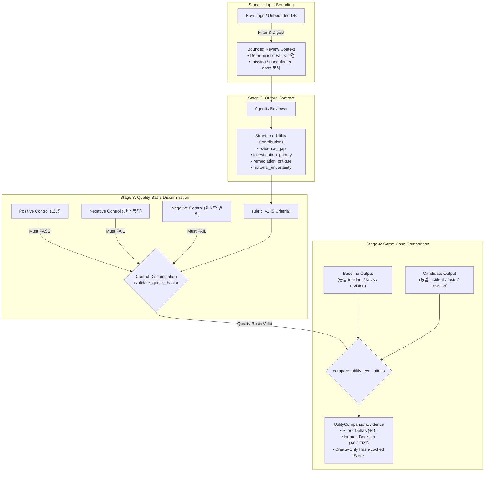

# Review AI Subjective Utility Verification Methodology

## Executive Summary

- **결론:** AI가 생성하는 텍스트의 '유용함(Utility)'은 본질적으로 사람의 업무 맥락과 인지에 의존하는 주관적 개념입니다. 그러나 이를 주관적인 감상이나 블랙박스형 자동 판사(LLM-as-a-judge)에 맡기면 소프트웨어 공학적 회귀(regression)를 탐지할 수 없습니다. 이 프로젝트는 **1) 입력 바운딩, 2) 출력 기여 계약, 3) 대조군 기반 루브릭 판별력 검증, 4) 동일 조건 전후 비교 증적 불변 보존**의 4단계 장치를 통해 주관적 가치를 결정론적이고 재현 가능한 엔지니어링 증적으로 전환합니다.
- **근거:** [docs/mvp.md](../../docs/mvp.md)의 "Useful, not merely valid" 불변식과 [docs/VISION.md](../../docs/VISION.md)의 "Evidence-Bound AI" 원칙에 따라, 유용함은 '문법적 무결성이나 환각 부재'가 아니라 **'데이터 엔지니어의 다음 조사 및 복구 판단 비용을 실질적으로 단축시키는 구체적 행동 유발'**로 조작적 정의(Operational Definition)됩니다.
- **행동:** 모델이나 프롬프트의 변경이 발생할 때마다, 동일한 사건 팩트(`deterministic_facts`)와 버전화된 루브릭(`rubric_v1`) 하에서 대조군 판별(`validate_quality_basis`)을 거쳐 baseline 대비 candidate의 점수 델타와 인간 결정(`HumanDecision.ACCEPT`)을 불변 증적(`UtilityComparisonEvidence`)으로 기록하여 배포 여부를 판단합니다.

## The Problem: Why Is "Utility" Difficult to Verify?

소프트웨어 시스템에서 LLM 출력을 검증할 때 흔히 빠지는 함정은 다음과 같습니다.

1. **유창함의 착시 (Fluency Trap):**
   - 문장이 매끄럽고 그럴듯하게 설명되면 유용하다고 착각하기 쉽습니다. 하지만 이미 감지된 장애 팩트를 화려한 수식어로 재진술(Echo)하는 것은 사람에게 아무런 새 정보를 주지 못합니다.
1. **환각 방지의 역설 (The Hedging Paradox):**
   - 환각(Hallucination)을 막기 위해 안전장치를 강화하면, LLM은 "네트워크, 코드, 데이터 등 모든 가능성이 있으니 전수 조사해야 합니다" 식의 과도한 면책형(Hedging) 출력을 내놓습니다. 환각은 없지만 실행성(`actionability`)이 0이 되어 AI 도입 효용이 사라집니다.
1. **블랙박스 판사의 악순환 (LLM-as-a-judge Trap):**
   - 사람이 평가하기 번거롭다는 이유로 외부의 더 큰 LLM에게 "이 답변이 유용한가?"를 묻는 방식은, 하나의 주관을 또 다른 통제 불가능한 블랙박스 주관으로 대체하는 것에 불과합니다. 모델 버전 변경에 따라 채점 기준이 흔들리며 재현성이 깨집니다.

따라서 '유용함'을 검증하기 위해서는 **인간의 판단 기준을 엄격한 인터페이스와 결정론적 테스트 체계로 감싸는(Wrap) 공학적 장치**가 필수적입니다.

## The 4-Stage Verification Framework

시스템이 주관적 유용성을 객관적 증적으로 승격시키는 4단계 파이프라인입니다.

### 1. Stage 1: Input Bounding (Review Context Proof)

유용성은 '어떤 맥락이 주어졌는가'에 절대적으로 의존합니다.

- **원칙:** 전체 로그나 수백 개의 테이블을 통째로 주면 모델의 출력이 매번 달라지고 판단 근거를 추적할 수 없습니다.
- **장치 ([src/hmda_reliability/review_ai/context.py](../../src/hmda_reliability/review_ai/context.py)):**
  - incident와 직접 관련된 파티션 메타데이터, 연관 테이블, 탐지 팩트만을 불변 슬라이스로 투영하는 `BoundedReviewContext` 생성.
  - 확정 사실(`deterministic_facts`)과 현재 데이터만으로는 알 수 없는 공백(`missing_evidence`, `unconfirmed_context`)을 명시적으로 분리.
  - 컨텍스트 해시 다이제스트(`context.digest`)를 발급하여 재현성 보장.

### 2. Stage 2: Output Contract Enforcement (Agentic Utility Proof)

자연어 줄글 출력을 허용하면 유용성을 기계적으로 측정할 수 없습니다.

- **원칙:** 단순 사실 재진술이나 포괄적 훈수를 스키마 레벨에서 거부합니다.
- **장치 ([src/hmda_reliability/review_ai/contracts.py](../../src/hmda_reliability/review_ai/contracts.py)):**
  - 출력 스키마(`AgenticReviewOutput`)에 다음 4대 기여 항목을 구조화된 필드로 필수화:
    1. `evidence_gap`: 추가 확인이 필요한 상류/하류 증적 식별.
    1. `investigation_priority`: 엔지니어가 지금 즉시 실행해야 할 1순위 구체적 조치.
    1. `remediation_critique`: 자동 생성된 복구 초안(`RemediationDraft`)의 잠재 부작용/누락 비판.
    1. `material_uncertainty`: 현재 증적만으로는 단정할 수 없는 핵심 리스크 한정.
  - 제공되지 않은 가짜 증적을 참조하는 환각을 즉시 차단하는 `Deterministic Reference Guard` 결합.

### 3. Stage 3: Control Discrimination via Rubric (Quality Evaluation Proof)

평가 기준표(루브릭)의 신뢰성을 먼저 증명하지 않으면 어떤 채점 결과도 믿을 수 없습니다.

- **원칙:** 평가 도구 자체가 엉터리 답안을 걸러낼 수 있는 판별력(Discrimination)을 가졌는지 먼저 시험합니다.
- **장치 ([src/hmda_reliability/review_ai/evaluation.py](../../src/hmda_reliability/review_ai/evaluation.py)):**
  - **5대 핵심 차원 고정 (`rubric_v1`):**
    - `added_value`: 단순 사실 재진술을 넘어선 가치 (0~2점)
    - `actionability`: 즉시 실행 가능한 구체적 조치 제시 여부 (0~2점)
    - `evidence_awareness`: 제공된 증적의 한계와 공백 인지 (0~2점)
    - `uncertainty_handling`: 거짓 확신이나 비겁한 회피 없는 리스크 한정 (0~2점)
    - `prioritization`: 우선순위 단일화 여부 (0~2점)
  - **대조군 통제 검증 (`validate_quality_basis`):**
    - **Positive Control:** 4대 기여를 온전히 수행한 출력 $\rightarrow$ 반드시 `PASS`.
    - **Negative Control 1 (Echo):** 탐지 팩트만 반복한 출력 $\rightarrow$ 반드시 `FAIL`.
    - **Negative Control 2 (Hedging):** 구체적 행동 없이 "전수 조사가 필요하다"며 책임을 회피하는 출력 $\rightarrow$ `actionability` 과락(0점)으로 반드시 `FAIL`.
    - 대조군 판별에서 단 하나라도 어긋나면 품질 기반(`QualityBasisValidation`) 자체가 `valid=False`가 되어 후속 비교가 차단됩니다.

### 4. Stage 4: Same-Case Comparison & Immutable Evidence (Change Comparison Proof)

개선 여부는 오직 '동일한 시험지에서의 1:1 비교'로만 입증됩니다.

- **원칙:** 작년 시험지와 올해 시험지를 비교해 성적이 올랐다고 주장하는 오류(Attribution Drift)를 차단합니다.
- **장치 ([src/hmda_reliability/review_ai/evaluation.py](../../src/hmda_reliability/review_ai/evaluation.py)):**
  - baseline과 candidate가 **완벽히 동일한 incident 파티션, 동일한 `target_column`, 동일한 `deterministic_facts`, 동일한 코드 리비전(`project_revision`)**에서 평가되었는지 비교 진입 시 검사.
  - 불일치 시 `same_case_fact_mismatch` 또는 `quality_basis_revision_mismatch` 코드로 fail-closed 차단.
  - 비교가 승인되면 5개 기준별 점수 델타, 사람의 최종 승인 결정(`HumanDecision.ACCEPT`), 심사 근거(rationale)를 묶어 디스크에 덮어쓰기가 불가능한(`create-only`) JSON 아티팩트로 영구 보존.

## Summary of Guarantees

| 질문 | 전통적인 접근 (위험) | 이 프로젝트의 공학적 해법 (안전) |
| --- | --- | --- |
| "무엇을 보고 판단하는가?" | 전체 DB 로그를 무제한 주입 | Bounded Context로 증적과 미확인 공백을 엄격히 고정 |
| "어떤 출력을 유용하다고 보는가?" | 자연어 요약문이 그럴듯함 | 4대 기여 필드(`investigation_priority` 등)를 스키마로 강제 |
| "평가 기준은 객관적인가?" | 외부 LLM 판사에게 주관적 질의 | 5대 기준의 `rubric_v1`과 Echo/Hedging 네거티브 대조군으로 판별력 사전 검증 |
| "진짜 좋아졌는지 어떻게 아는가?" | 서로 다른 시점의 답변 감상 | 동일 사건 팩트 하에서 Baseline 대비 점수 델타와 불변 증적 비교 |

## Conclusion

유용함이라는 주관적 가치는 감상이나 평가자의 자의에 맡겨서는 검증할 수 없습니다.
입력 맥락을 닫아두고, 출력 형태를 계약으로 강제하며, 엉터리 및 회피 답변을 걸러내는 대조군 시험을 거치고, 동일 조건 하에서의 점수 델타를 불변 증적으로 잠그는 **'통제된 비교 체계'**를 구축함으로써 비로소 주관적인 유용성을 객관적인 데이터 신뢰성 근거로 증명할 수 있습니다.
