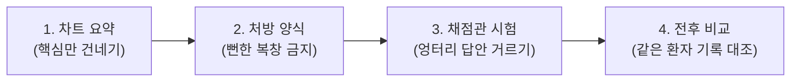

# Review AI Subjective Utility Verification Methodology

## Executive Summary

- **결론:** AI의 '유용함(Utility)'은 사람마다 느끼는 주관적 가치입니다. 이를 감상이나 블랙박스형 AI 판사(LLM-as-a-judge)에 맡기면 모델이 슬그머니 퇴보해도 알아챌 수 없습니다. 이 프로젝트는 유용성을 수학 공식으로 자동 채점하는 것이 아니라, **1) 꼭 필요한 증적만 간추려 주기, 2) 뻔한 소리 금지 양식 강제, 3) 엉터리 답안 낙제 시험, 4) 동일 시험지 1:1 비교 보존**이라는 4단계 공학적 안전망을 통해 **배포 전 품질 퇴보를 막는 대리 지표(Proxy Metric)**를 구축합니다.
- **근거:** [docs/mvp.md](../../docs/mvp.md)의 핵심 원칙은 **"말만 번지르르한 AI가 아니라, 엔지니어의 장애 복구 시간을 실제로 줄여주는 AI"**입니다. 하지만 오프라인 테스트 점수(+10점)는 '실험실 성적표'일 뿐이며, 진짜 유용함은 현장 엔지니어의 실제 행동(MTTR 단축 등)으로만 증명된다는 한계를 투명하게 인정합니다.
- **행동:** 프롬프트나 모델을 바꿀 때마다 동일한 사건 팩트와 루브릭 기준표 하에서 전후 비교를 수행하여, 명백한 엉터리 출력이 배포되는 것을 차단하는 최소 방어선으로 활용합니다.

## ELI5: Understanding the 4 Stages via Analogy

복잡한 엔지니어링 용어 대신 **"응급실 수석 의사와 신입 인턴 조수"** 비유로 이해하면 직관적입니다.



| 단계 | 응급실 비유 | 시스템이 실제로 하는 일 |
| --- | --- | --- |
| **1. Input Bounding** | **핵심 차트만 요약해 주기**<br/>환자의 10년 치 진료기록 전체를 던지지 않고, 방금 나온 혈액 검사표와 아직 안 나온 CT 검사 목록만 깔끔하게 추려줍니다. | 전체 DB나 수만 줄의 로그를 주지 않고, incident와 연관된 메타데이터 및 미확인 공백(`missing_evidence`)만 불변 컨텍스트로 잘라냅니다. |
| **2. Output Contract** | **뻔한 말 복창 금지 처방전**<br/>"환자 혈압이 높습니다" 같은 당연한 소리만 하지 말고, "지금 투약할 1순위 약"과 "주의할 부작용"을 지정된 칸에 적게 합니다. | 이미 감지된 팩트 재진술(Echo)을 금지하고, 1순위 조치(`investigation_priority`), 복구안 위험 비판(`remediation_critique`) 등 4대 기여 필드를 강제합니다. |
| **3. Control Discrimination** | **채점관 자격 시험**<br/>"모든 병이 의심되니 전신 검사하자"며 책임을 회피하는 인턴 답안을 채점관이 칼같이 0점으로 낙제시키는지 시험 문제로 먼저 검증합니다. | 5대 기준(`rubric_v1`) 하에서 단순 복창과 과도한 면책 회피(Hedging) 답안을 평가기가 `FAIL`로 걸러내는지 사전 시험(`validate_quality_basis`)합니다. |
| **4. Same-Case Comparison** | **같은 환자 차트로 1:1 비교**<br/>어제 환자와 오늘 환자를 섞어서 비교하지 않고, 정확히 똑같은 환자 기록을 보고 새 인턴이 이전 인턴보다 나아졌는지 비교해 금고에 넣습니다. | baseline과 candidate가 동일한 incident, 동일한 팩트, 동일한 코드 리비전에서 평가되었는지 검증하고 점수 차이와 인간 승인 도장을 불변 파일로 영구 보관합니다. |

## The Problem: Traps in AI Verification

AI 출력을 검증할 때 흔히 빠지는 4가지 착시입니다.

1. **유창함의 착시 (Fluency Trap):**
   - 문장이 매끄럽다고 유용한 것이 아닙니다. 이미 감지된 장애 사실을 화려하게 다시 말하는 것(Echo)은 사람에게 아무런 새 가치를 주지 못합니다.
1. **환각 방지의 역설 (The Hedging Paradox):**
   - 틀리지 않으려고 몸을 사리면, "모든 원인이 가능하니 전수 조사하십시오"라는 극단적 회피형 답변이 나옵니다. 거짓말은 없지만 엔지니어가 취할 수 있는 행동(`actionability`)이 0이 됩니다.
1. **블랙박스 판사의 함정 (LLM-as-a-judge Trap):**
   - 다른 LLM에게 "이거 유용해?"라고 묻는 것은 주관을 또 다른 블랙박스 주관으로 덮는 것에 불과하며, 모델이 업데이트될 때마다 채점 기준이 흔들립니다.
1. **주관성의 잔존 (Persistence of Subjectivity):**
   - 루브릭 표를 아무리 세분화해도 점수(0~2점)와 승인 버튼을 누르는 것은 결국 사람입니다. 평가자가 너그러우면 2점, 까다로우면 0점이 나옵니다. 루브릭은 주관성을 완전히 없애지 못합니다.

## The 4-Stage Verification Mechanics

구체적인 코드 및 데이터 레벨에서의 동작 방식입니다.

### 1. Stage 1: Input Bounding (Review Context Proof)

- **파일:** [src/hmda_reliability/review_ai/context.py](../../src/hmda_reliability/review_ai/context.py)
- **핵심:** 무제한 입력을 차단하고 재현 가능한 입력 다이제스트(`context.digest`) 생성.
- **구분:** 확정된 사실(`deterministic_facts`)과 데이터 부족으로 확인 불가능한 공백(`missing_evidence`, `unconfirmed_context`)을 분리하여 모델에 전달.

### 2. Stage 2: Output Contract Enforcement (Agentic Utility Proof)

- **파일:** [src/hmda_reliability/review_ai/contracts.py](../../src/hmda_reliability/review_ai/contracts.py)
- **핵심:** 자연어 줄글 대신 4대 구조화 필드를 스키마 레벨에서 필수화.
  - `evidence_gap`: 추가 확인이 필요한 상류/하류 증적
  - `investigation_priority`: 엔지니어가 지금 즉시 실행할 1순위 구체적 행동
  - `remediation_critique`: 자동 복구 초안의 숨겨진 부작용/위험
  - `material_uncertainty`: 현재 증적만으로는 단정할 수 없는 핵심 불확실성
- **가드:** 제공되지 않은 증적을 참조하는 환각을 즉시 거부하는 레퍼런스 가드 결합.

### 3. Stage 3: Control Discrimination via Rubric (Quality Evaluation Proof)

- **파일:** [src/hmda_reliability/review_ai/evaluation.py](../../src/hmda_reliability/review_ai/evaluation.py)
- **핵심:** 채점 도구 자체의 판별력을 대조군(Control)으로 먼저 시험.
  - **5대 평가 기준:** `added_value`, `actionability`, `evidence_awareness`, `uncertainty_handling`, `prioritization`
  - **대조군 판별 시험:**
    - 모범 답안 (Positive Control) $\rightarrow$ `PASS`
    - 단순 복창 답안 (Negative Echo) $\rightarrow$ `FAIL`
    - 과도한 면책 답안 (Negative Hedging) $\rightarrow$ 행동/우선순위 0점으로 `FAIL`
  - 대조군에서 하나라도 기대 결과와 다르면 품질 기반 자체가 `valid=False`가 되어 비교를 즉시 중단.

### 4. Stage 4: Same-Case Comparison & Immutable Evidence (Change Comparison Proof)

- **파일:** [src/hmda_reliability/review_ai/evaluation.py](../../src/hmda_reliability/review_ai/evaluation.py)
- **핵심:** 완전히 똑같은 시험지를 풀었을 때만 1:1 비교를 허용.
  - 사건 ID, 대상 컬럼, 확정 팩트, 프로젝트 리비전이 하나라도 다르면 `same_case_fact_mismatch`로 fail-closed 차단.
  - 비교 통과 시 점수 차이(+10 delta), 인간 결정(`HumanDecision.ACCEPT`), 근거를 묶어 덮어쓰기 불가능한(`create-only`) JSON 파일로 영구 보관.

## Limitations and The Proxy Gap (한계와 착시 위험)

이 시스템을 과신하지 않기 위해 엔지니어가 반드시 알아야 할 3가지 한계입니다.

```mermaid
flowchart LR
    A["실험실 대리 지표 (Proxy)<br/>• 루브릭 5개 항목 (+10점)<br/>• 오프라인 픽스처 통과<br/>• 대조군 거름망"] -.->|간극 (Gap)| B["진짜 운영 효용 (Reality)<br/>• 장애 복구 시간(MTTR) 단축<br/>• 엔지니어의 실제 제안 채택<br/>• 2차 운영 장애 사전 예방"]
```

1. **주관성은 사라지지 않습니다:**
   - 루브릭은 주관성을 객관화한 마법이 아니라, 평가자가 무엇을 보고 판단할지 **질문의 인터페이스를 통일**한 것에 불과합니다.
1. **대조군은 필터일 뿐 보증서가 아닙니다:**
   - 엉터리 답안(복창, 회피)을 걸러냈다는 것은 **최소한의 상식 시험을 통과**했다는 뜻이지, 합격한 답안이 무조건 현장에서 도움이 된다는 충분조건이 아닙니다.
1. **실험실 점수와 현장 효용의 간극 (The Proxy Gap):**
   - 오프라인에서 +10점을 받고 합격 도장을 찍은 것은 **실험실 대리 지표**입니다. 진짜 유용함은 실제 운영 현장에서 **엔지니어의 복구 시간(MTTR)이 줄어들고 제안된 행동을 실제로 실행했는가**로만 최종 증명됩니다.

## Summary of True Guarantees

| 과장된 환상 (Illusion) | 솔직한 공학적 실체 (True Guarantee) |
| --- | --- |
| "AI의 유용함이 100% 자동 검증된다." | 배포 전 CI 단계에서 **명백한 쓰레기/회피 답안으로 퇴보(Regression)하는 것을 차단**한다. |
| "루브릭 평가로 주관성이 완전히 사라졌다." | 주관적 감상을 5개 축으로 분해하여 **평가 질문과 심사 기록을 표준화**했다. |
| "대조군을 통과했으니 무조건 유용한 모델이다." | 단순 복창이나 전수조사 회피를 걸러내는 **최소 자격 시험(Filter)을 통과**했다. |
| "오프라인 증적만으로 MVP 수용이 끝난다." | 오프라인 픽스처는 **계약 무결성 검증**이며, 최종 유용성은 **실제 엔지니어의 운영 데이터**로 증명해야 한다. |

## Conclusion

유용함이라는 주관적 가치를 대하는 정직한 태도는 "우리가 주관성을 완전히 없앴다"고 과장하지 않는 것입니다.

오히려 **"유용함의 최종 판단은 결국 사람의 몫이며, 시스템은 단지 1) 필요한 증적만 추리고, 2) 뻔한 소리를 막는 양식을 강제하며, 3) 엉터리 답안을 대조군으로 걸러내고, 4) 전후 비교 기록을 위변조 없이 디스크에 남겨 사후 감사를 가능하게 하는 최소한의 안전망이다"**라고 한계를 투명하게 밝히는 것이 신뢰할 수 있는 엔지니어링의 시작입니다.
