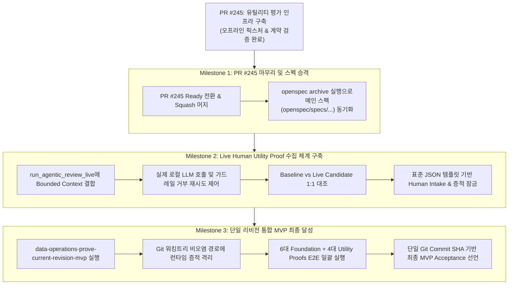

# Review AI Next Milestones and MVP Completion Proposal

## Executive Summary

- **결론:** [PR #245](https://github.com/mols3131d/hmda-data-reliability/pull/245)는 4대 Utility Proofs를 검증할 수 있는 공학적 인프라(계약, 스키마, 루브릭 판별기, 동일 팩트 바인딩)를 완벽히 구축하여 머지 준비가 완료되었습니다. 다음 작업으로는 **1) PR #245 머지 및 OpenSpec 스펙 승격, 2) 대조군(Baseline) 및 가드레일 제어가 규정된 실제 인간 유용성 증적(Live Human Proof) 수집 체계 구축, 3) 해시 순환 없는 단일 Git 리비전 10대 Proof 통합 MVP 완결**의 3단계 마일스톤을 제안합니다.
- **근거:** [docs/mvp.md](../../docs/mvp.md)의 최종 수용 조건은 오프라인 픽스처 통과에 그치지 않고, 동일한 리비전에서 **6대 Foundation Proofs**와 **4대 Utility Proofs**가 모두 성립해야 합니다. 현재 저장소에는 라이브 호출 러너([scripts/run_agentic_review_live.py](../../scripts/run_agentic_review_live.py))와 통합 증명 변경 계획([openspec/changes/data-operations-prove-current-revision-mvp/proposal.md](../../openspec/changes/data-operations-prove-current-revision-mvp/proposal.md))이 이미 존재하므로, 최소 비용과 격리된 스코프로 다음 단계에 진입할 수 있습니다.
- **행동:** 본 제안서 검토 후 PR #245를 Ready for Review로 전환하여 머지하고, 마일스톤 2를 위한 새로운 OpenSpec Change(`review-ai-live-utility-proof`) 설계를 시작합니다.

## Background and Current Milestone Status

[PR #243](https://github.com/mols3131d/hmda-data-reliability/pull/243)에서 정의된 신규 MVP 수용 기준에 따라, [PR #245](https://github.com/mols3131d/hmda-data-reliability/pull/245) (`feat(review-ai): prove MVP utility evaluation`)에서 진행된 작업 결과는 다음과 같습니다.

| 평가 영역 | PR #245 달성 결과 | 상태 |
| --- | --- | --- |
| **Review Context Proof** | `BoundedReviewContext`를 통해 핵심 팩트와 미확인 공백(`missing_evidence`) 분리 | ✅ 완료 |
| **Agentic Utility Proof** | 단순 복창(Echo) 금지 및 1순위 조치(`investigation_priority`) 등 4대 기여 필드 강제 | ✅ 완료 |
| **Quality Evaluation Proof** | `rubric_v1` 기반 대조군 판별기 구축 (Echo 및 Hedging 회피 답변 `FAIL` 차단) | ✅ 완료 |
| **Change Comparison Proof** | 동일 사건(`incident_id`, `deterministic_facts`, 리비전) 비교 강제 및 불변 증적 보존 | ✅ 완료 |
| **검증 및 리뷰 (F1, F2, G1)** | 픽스처 성격 명문화, 동일 팩트 차단(6개 네거티브 테스트), `review-lead` 공식 검토 통과 | ✅ 완료 (113 passed) |

PR #245는 '시험장과 채점 기준표'라는 인프라를 완성했으므로, 이제 '실제 시험을 치르고 진짜 증적을 채우는' 후속 단계가 필요합니다.

## The 3-Stage Milestone Roadmap



---

### Milestone 1: PR #245 Finalization and Canonical Spec Sync (즉시 작업)

- **목적:** 현재 브랜치의 인프라 구현을 `main`에 안전하게 병합하고 OpenSpec 정본 체계를 일치시킵니다.
- **주요 작업:**
  1. **PR Ready 전환 및 머지:** `gh pr ready 245` 실행 후 Squash 머지.
  1. **OpenSpec Change 아카이브:**

     ```bash
     openspec archive review-ai-utility-evaluation
     ```

     `reliability-agentic-review` delta spec이 메인 스펙([openspec/specs/reliability-agentic-review/spec.md](../../openspec/specs/reliability-agentic-review/spec.md))으로 자동 승격되고 완료 브랜치가 정리됩니다.

---

### Milestone 2: Live Human Utility Proof Pipeline (신규 Change 제안)

- **목적:** 오프라인 합성 픽스처를 넘어, **"실제 라이브 모델 호출 $\rightarrow$ 실제 인간 엔지니어 평가 $\rightarrow$ 불변 증적 보존"**의 End-to-End 수용 증적을 확보합니다.
- **필요성:** [07-report](07-report-review-ai-subjective-utility-verification.md)에서 지적했듯 오프라인 점수표(+10점)는 '실험실 대리 지표'일 뿐이며, [docs/mvp.md](../../docs/mvp.md#L110)의 `Live Agentic proof` 및 `Quality evaluation proof`를 온전히 닫기 위해서는 실제 사람의 평가 데이터 주입이 필수적입니다.
- **주요 설계 및 구현 상세:**
  1. **대조군 Baseline 및 Candidate 명확화:**
     - **Baseline:** `utility_contributions=()`인 레거시 출력 아티팩트(동일한 `incident_id`, 동일한 `deterministic_facts`). 기여 항목이 없거나 단순 복창에 머무는 기준 출력을 고정 비교 대상으로 설정.
     - **Candidate:** 신규 프롬프트 및 `BoundedReviewContext` 하에서 실제 로컬 LLM이 생성한 4대 기여 항목 포함 출력.
     - [src/hmda_reliability/review_ai/evaluation.py](../../src/hmda_reliability/review_ai/evaluation.py)의 `compare_utility_evaluations()`에 두 출력을 동일 팩트로 주입하여 점수 델타를 도출.
  1. **라이브 러너 확장 및 가드레일 거부 대응:**
     - [scripts/run_agentic_review_live.py](../../scripts/run_agentic_review_live.py)가 단순 줄글이 아닌 `BoundedReviewContext` 기반으로 동작하도록 결합.
     - **비결정론적 실패 대비:** 로컬 LLM(Ollama 등)이 Pydantic 스키마를 위반하거나 미제공 증적을 인용하여 `ReferenceGuard`에서 거부(`validation_status=rejected`)될 경우에 대비해 `max_retries=3` 재시도 및 실패 원인 로깅을 지원.
  1. **경량 Human Intake 포맷 (Out-of-Scope 준수):**
     - [docs/mvp.md](../../docs/mvp.md#L140)의 "approval UI 및 evaluation platform 배제" 원칙에 따라 별도 대화형 UI를 구축하지 않음.
     - 엔지니어가 생성된 Candidate 아티팩트를 확인하고 5대 기준(`rubric_v1`)에 따라 점수와 판정 사유(Rationale)를 기입할 수 있는 **사전 정의된 표준 JSON 템플릿 파일 또는 1회성 CLI 인자(`--score`, `--rationale`) 기반 최소 Intake 스크립트**로 범위 한정.
  1. **실제 증적 잠금:**
     - 사람의 승인 결정(`HumanDecision.ACCEPT`)이 담긴 실제 평가 결과를 [src/hmda_reliability/review_ai/evaluation_store.py](../../src/hmda_reliability/review_ai/evaluation_store.py)에 영구 저장(`UtilityComparisonEvidence`).

---

### Milestone 3: Single-Revision E2E MVP Proof (최종 MVP 완결)

- **목적:** [docs/mvp.md](../../docs/mvp.md#L103)에 명시된 불변식인 **"단 하나의 Git Commit SHA에서 모든 증명이 동시에 성립해야 한다"**를 달성합니다.
- **기반 Change:** 이미 제안되어 있는 `openspec/changes/data-operations-prove-current-revision-mvp` 활용.
- **해시 순환 방지 (Hash-Safe Provenance):**
  - M2에서 런타임에 수집되는 증적 파일(`AgenticInvocationEvidence`, `UtilityComparisonEvidence`)이 Git 트래킹 대상 디렉터리에 기록되면 새로운 커밋이 발생해 Commit SHA가 무효화되는 순환 의존성(Chicken-and-egg)이 발생합니다.
  - 따라서 런타임 증적은 Git 워킹 트리를 더럽히지 않는 비추적 경로(예: `.local/artifacts/` 또는 untracked runtime store)에 보존하고, 검증 스크립트는 해당 아티팩트의 SHA-256 다이제스트와 실행 시점 Git HEAD SHA를 엄격히 일치시킵니다.
- **10대 통합 수용 게이트 검증 대상:**
  1. **6대 Foundation Proofs:**
     - Data Lake Proof (Source $\rightarrow$ Bronze $\rightarrow$ dbt staging/mart)
     - Reliability Proof (결정론적 인시던트 탐지 및 복구 후 재검증)
     - Agentic Contract Proof (구조화 검증 및 레퍼런스 가드)
     - Live Agentic Proof (실제 모델 호출 프로비넌스 증적)
     - Safety Proof (AI 권한 없는 변경 불변식 유지)
     - Reproducibility Proof (재현성 및 다이제스트 일치)
  1. **4대 Utility Proofs:**
     - Review Context Proof (바운디드 컨텍스트 및 공백 분리)
     - Agentic Utility Proof (4대 기여 항목 존재)
     - Quality Evaluation Proof (대조군 판별 통과)
     - Change Comparison Proof (동일 사건 팩트 하 전후 비교 및 인간 승인 증적)
- **최종 산출물:**
  - 단일 Git 리비전 해시로 잠긴 통합 실행 보고서 생성 및 MVP 완료 선언.

## Decision Matrix: How to Proceed

| 옵션 | 장점 | 고려사항 | 권장 여부 |
| --- | --- | --- | --- |
| **안 A: 마일스톤 1 $\rightarrow$ 2 $\rightarrow$ 3 순차 진행 (권장)** | PR 단위가 작고 명확하며, 각 단계마다 스펙과 코드가 원자적으로 동기화됨. Blast radius 최소화. | 머지 및 브랜치 전환 과정이 2~3회 수반됨. | **강력 권장** |
| **안 B: 현재 브랜치에 마일스톤 2까지 합쳐서 진행** | PR 개수를 줄일 수 있음. | PR #245의 diff가 비대해지고, 인프라 변경과 운영 데이터 수집이 섞여 리뷰가 지연됨. | 비권장 |

## Next Actions

1. 사용자 승인 시 **Milestone 1** 즉시 착수:
   - `gh pr ready 245` 실행 및 PR 머지 승인.
   - `openspec archive review-ai-utility-evaluation`으로 메인 스펙 싱크.
1. 머지 완료 후 `agent/feat/review-ai-live-utility-proof` 브랜치를 생성하여 **Milestone 2** 설계 및 구현 개시.
