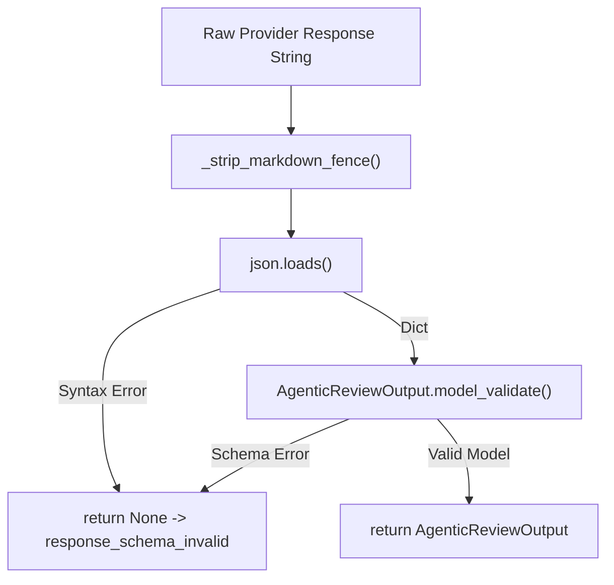

# Review AI Output Parser Markdown Fence Sanitization Plan

## Executive Summary

- **결론:** 로컬 LLM(예: `qwen2.5-coder:7b`)이 JSON 스키마를 준수하여 답변을 작성했음에도 불구하고, 관습적으로 붙이는 마크다운 코드 블록(```` ```json ... ``` ````)으로 인해 전체 응답이 `response_schema_invalid`로 일괄 탈락하는 문제를 **파이썬 파서 코드 레벨의 결정론적 정제(Sanitization) 함수 추가**로 해결합니다.
- **근거:** 실측 아티팩트인 `.local/artifacts/agentic-review/invocations/ar-20260921-35d06c89229c.json`에서 모델이 519토큰의 정상 분량을 생성했음에도 파이썬 `json.loads()`의 문법 제약으로 인해 `parsed_output: null`로 차단되었습니다. 이를 해결하기 위해 LLM을 2차 호출하는 방식은 지연시간(16초 추가)과 비용이 2배로 들고 수치 왜곡(2차 환각) 위험이 발생하므로, 0.001초 만에 무료로 동작하는 결정론적 코드 정제가 최선입니다.
- **행동:** [src/hmda_reliability/review_ai/service.py](../../src/hmda_reliability/review_ai/service.py)의 `_parse_output()` 함수에 순수 마크다운 펜스 제거 전처리를 도입하고, 이를 검증하는 단위 테스트를 추가합니다.

## Problem Definition

현재 라이브 러너 실행 시 다음과 같은 실패가 관측되었습니다.

```text
실행 명령: uv run --env-file .env python scripts/run_agentic_review_live.py
사용 모델: qwen2.5-coder:7b (Ollama local)
소요 시간: 16,605 ms (약 16.6초)
토큰 소모: 프롬프트 1,046 토큰, 응답 519 토큰
결과 상태: status="validation_failed", failure_code="response_schema_invalid"
```

### Root Cause Analysis

1. **시스템 프롬프트의 지시:**
   시스템 프롬프트는 "Return exactly one JSON object with these fields..."라고 지시합니다.
1. **로컬 LLM의 출력 특성:**
   대부분의 경량 인스트럭트/코딩 모델은 JSON 객체 응답을 요청받았을 때, 가독성을 위한 마크다운 코드 블록(```` ```json\n{...}\n``` ````)으로 본문을 감싸서 반환하는 사전 학습 편향을 갖습니다.
1. **파이썬 내장 파서의 한계:**
   [src/hmda_reliability/review_ai/service.py](../../src/hmda_reliability/review_ai/service.py)의 `_parse_output(content: str)`은 `json.loads(content)`를 그대로 호출합니다. 첫 문자가 `{`가 아니고 ```` ``` ```` 기호이면 즉시 `json.decoder.JSONDecodeError`가 발생하여 `None`을 반환합니다.
1. **결과:**
   내부 JSON 내용물(Incident ID, Facts, 4대 기여 필드 등)이 모두 올바르게 작성되었더라도, 겉포장(마크다운 펜스) 때문에 출력이 완전히 버려집니다.

## Alternative Comparison

| 평가 축 | 대안 A: 파이썬 코드 레벨 마크다운 펜스 정제 (채택) | 대안 B: LLM 2차 호출을 통한 JSON 수리 (배제) | 대안 C: 대형 상용 모델 강제 (배제) |
| --- | --- | --- | --- |
| **추가 지연시간** | **0.001초 미만** (CPU 메모리 문자열 슬라이싱) | **+15~20초 추가** (네트워크 및 모델 추론 지연) | 외부 네트워크 지연 발생 (수초) |
| **추가 비용/토큰** | **0원** | **토큰 비용 2배** 발생 | 상용 API 과금 발생 |
| **사실 왜곡 위험** | **0%** (순수 껍질 기호만 제거, 알맹이 불변) | **높음** (2차 변환 중 수치 반올림, 증적 ID 변조 등 2차 환각 발생) | 모델에 따라 상이 |
| **아키텍처 부합성** | [docs/VISION.md](../../docs/VISION.md)의 **Deterministic Truth First** 원칙에 완벽 부합 | 결정론적 문제를 비결정론적 LLM에 전가하는 안티패턴 | 로컬 프라이빗 실행 목표와 충돌 |

따라서 **대안 A(코드 레벨 정제)**가 가장 신뢰할 수 있고 경제적인 유일한 공학적 해법입니다.

## Detailed Design

### 1. Markdown Fence Sanitization Logic

[src/hmda_reliability/review_ai/service.py](../../src/hmda_reliability/review_ai/service.py) 내부에 다음 전처리 함수를 추가하거나 `_parse_output()`에 통합합니다.

```python
def _strip_markdown_fence(content: str) -> str:
    """문자열 앞뒤의 마크다운 코드 블록 기호(``` 또는 ```json)를 결정론적으로 제거한다."""
    text = content.strip()
    if not text.startswith("```"):
        return text

    lines = text.splitlines()
    # 시작 라인이 ``` 또는 ```json 등으로 시작하는 경우 제외
    if lines and lines[0].strip().startswith("```"):
        lines = lines[1:]
    # 종료 라인이 ```로 끝나는 경우 제외
    if lines and lines[-1].strip() == "```":
        lines = lines[:-1]

    return "\n".join(lines).strip()
```

### 2. Output Parser Flow



### 3. Preserved Invariants

- **Pydantic 스키마 계약 불변:** 알맹이 필드가 빠지거나 타입이 틀린 비정상 JSON은 여전히 Pydantic 유효성 검사 단계에서 엄격하게 걸러져 `None`을 반환합니다.
- **결정론적 사실 가드 불변:** 파싱에 성공한 후에도 [src/hmda_reliability/review_ai/validator.py](../../src/hmda_reliability/review_ai/validator.py)의 `validate_agentic_review()`가 증적 위조 및 수치 왜곡을 2차로 철저히 검증합니다.
- **OpenSpec 불변:** [openspec/specs/reliability-agentic-review/spec.md](../../openspec/specs/reliability-agentic-review/spec.md)의 "Provider가 HTTP 성공을 반환했지만 JSON/스키마로 검증할 수 없는 경우 validation_failed 반환" 계약을 정확히 유지합니다.

## Implementation and Verification Steps

1. **구현:**
   - [src/hmda_reliability/review_ai/service.py](../../src/hmda_reliability/review_ai/service.py)의 `_parse_output()`에 마크다운 펜스 제거 로직 반영.
1. **단위 테스트 추가:**
   - [tests/review_ai/test_service.py](../../tests/review_ai/test_service.py)에 다양한 형태의 마크다운 펜스 응답 파싱 테스트 케이스 추가.
     - 표준 펜스: ```` ```json\n{...}\n``` ````
     - 언어 식별자 없는 펜스: ```` ```\n{...}\n``` ````
     - 앞뒤 공백 및 빈 줄이 포함된 펜스
     - 펜스가 없는 순수 JSON (기존 정상 케이스 회귀 방지)
     - 펜스 안에 유효하지 않은 JSON이 들어있는 경우의 정상 거부(`None`)
1. **전체 스위트 검증:**
   - `uv run pytest tests/review_ai tests/runtime_ai`
   - `uv run ruff check src/hmda_reliability/ tests/`
   - `uv run mypy src/hmda_reliability/review_ai/service.py`
1. **라이브 러너 실제 검증:**
   - `uv run --env-file .env python scripts/run_agentic_review_live.py` 재실행하여 실제 `qwen2.5-coder:7b` 모델의 출력이 `accepted`로 전환되는지 직접 관측.

## Next Action

본 기획서 검토 후, 즉시 [src/hmda_reliability/review_ai/service.py](../../src/hmda_reliability/review_ai/service.py) 수정 및 단위 테스트 작성 단계로 착수합니다.
