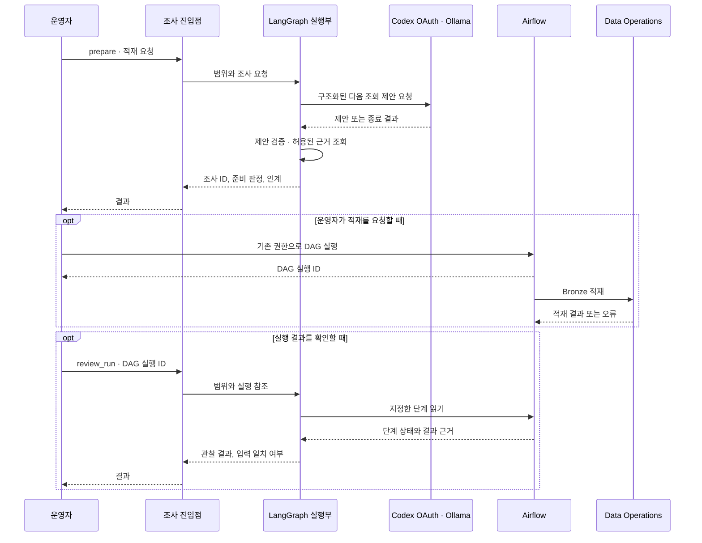
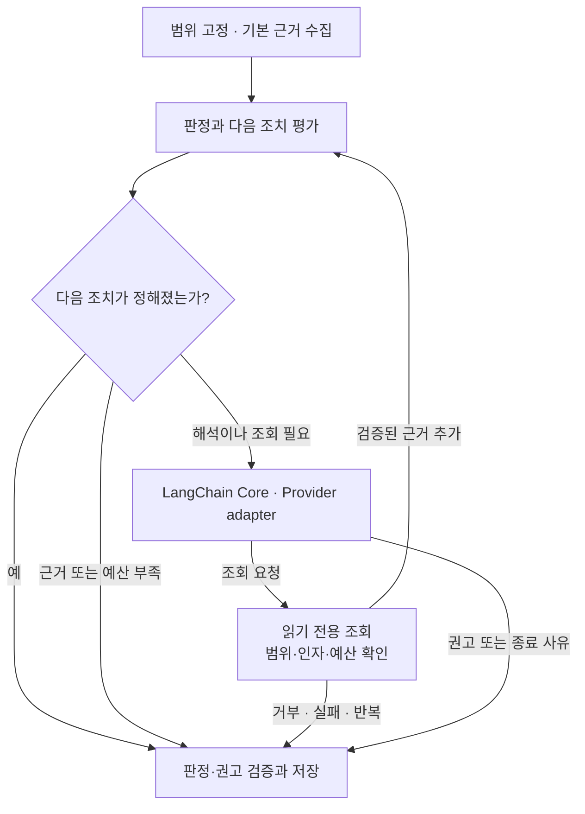

# Ingestion LLMOps Architecture and Adoption Plan

## System Workflow

첫 진입점은 신뢰된 운영자가 호출하는 로컬 Python 함수 `investigate_ingestion`으로 제안한다. 이 함수는 기존 Python 조사 루프의 확장이 아니라 새 Reliability AI LangGraph 실행부의 진입점이다. `prepare`는 기존 `DataOperationRequest`를 받아 준비 판정과 인계를 반환한다. `review_run`은 허용된 `hmda_data_plane` 실행 ID를 받아 실제 상태를 읽는다. 준비 조사 ID가 제공되면 앞서 관찰한 근거와 연결한다. Airflow는 Bronze 적재 → 품질 검사 → 통과 시 선택적 dbt 빌드를 실행한다. [실행 요청](../../../src/hmda_reliability/data_operations/request.py), [현재 DAG](../../../src/hmda_reliability/orchestration/dags/hmda_data_plane.py)

인계에 담긴 범위·입력 버전은 조사 시점의 기록이다. 운영자는 같은 범위의 요청을 기존 적재 경로에 제출하고, 그 실행의 권한과 데이터 변경은 기존 서비스가 판단한다. 사후 조사는 실제로 연결할 수 있는 근거에 맞춰 보고의 확신 수준을 정한다. [인계 결과](decision-contract.md#result-contract), [실행 근거](evidence-tool-schemas.md#airflow-evidence)

## Investigation Workflow

준비 조사는 요청 범위와 원천 목록을 고정한 뒤 코드가 필수 검사를 수행한다. 사후 조사는 지정 실행의 적재 단계 상태부터 읽는다. 그래프는 판정과 다음 조치를 평가한다. 모델을 호출할 때는 범위·검사 상태·근거 요약을 먼저 주고, 세부 근거는 필요한 조회로 얻는다. `blocked`처럼 판정이 확정된 경우에도 다음 조치가 여러 가지면 모델에 해석을 맡길 수 있다. [분기 계약](decision-contract.md#delegation), [필수 검사](evidence-tool-schemas.md#evidence-and-failure)

LangChain Core는 모델 입력과 구조화된 제안 계약을 제공자 adapter에 전달한다. 첫 로컬 adapter는 ChatGPT 구독 OAuth를 사용하는 Codex App Server다. Ollama는 같은 제안 계약을 반환하는 별도 adapter로 연결한다. 제공자 응답은 LangGraph가 검증하고, 그래프가 허용된 조회를 실행할지 권고를 반환할지 결정한다. 기존 OpenAI-compatible Runtime AI 루프는 새 조사 경로가 호출하지 않는다. [LangChain 도구](https://docs.langchain.com/oss/python/langchain/tools), [Codex 제공자 설계](../04-design-runtime-ai-codex-oauth-provider.md)

## State and Recovery

| 동작 | 처리 계약 |
| --- | --- |
| 진행 중 | `investigation_id`, 요청 범위·입력 버전, 그래프·정책 버전, 근거 참조, 호출 수와 기한을 보존한다. 호출 전에 ID·시작 시각·사용한 예산을 기록하고, 반환 시 응답·종료 시각을 같은 ID에 연결한다. |
| 예산 소진 | 그래프가 조사 기한과 모델 턴·도구 호출을 제한한다. Adapter별 요청 시간 한도와 실제 호출 시도를 같은 조사 ID에 기록한다. Codex 호출 기한이 지나면 중단을 요청한다. 늦게 반환된 응답은 로컬에 보존한 뒤 새 조회나 판정에 반영하지 않고 종료한다. |
| 프로세스 중단 | 완료 기록이 없는 조사에서 마지막으로 저장한 진행 내용을 확인한다. 다시 조사할 때는 새 ID를 사용하고 이전 조사 ID를 남긴다. 새 입력의 범위·버전을 다시 확인한다. |
| 오프라인 재현 | 기존 조사 ID를 참조하는 새 재현 ID에 저장된 입력·버전·호출 결과와 시각을 공급한다. 같은 그래프·규칙 버전과 기록된 시간으로 판정·인계·종료 사유를 다시 계산한다. 필수 기록이나 버전이 없으면 누락 사유를 반환한다. |

첫 구현에서 복구의 기본 단위는 **저장된 조사의 재현**이다. 그래프 체크포인트로 동일 ID를 프로세스 재시작 뒤 이어가는 기능은 중단 복구 수요가 생기면 검토한다. 도입 시 단일 실행자만 재개하며, 같은 범위·그래프·정책·프롬프트·모델 설정과 남은 예산을 확인한다. 완료 응답은 재사용하고 결과가 없는 시도도 기존 예산에 포함한다. [LangGraph 체크포인트](https://docs.langchain.com/oss/python/langgraph/persistence)

## Observability

모델을 처음 호출할 때 Langfuse에서 프롬프트 버전을 확보하고 조사 끝까지 고정한다. 조회할 수 없으면 기존 근거와 종료 사유로 인계를 구성한다. 로컬 기록에 입력·그래프·정책·제공자·프롬프트 버전, 호출 지연·사용량, 종료 이유를 연결한다. Langfuse에는 모델 입력과 결과 중 허용된 합성 사례의 필드만 보낸다. 전송 오류는 로컬에 기록하고 이미 계산한 결과를 반환한다. [현재 관측·평가 절차](../../../docs/development/review-ai-evaluation.md)
