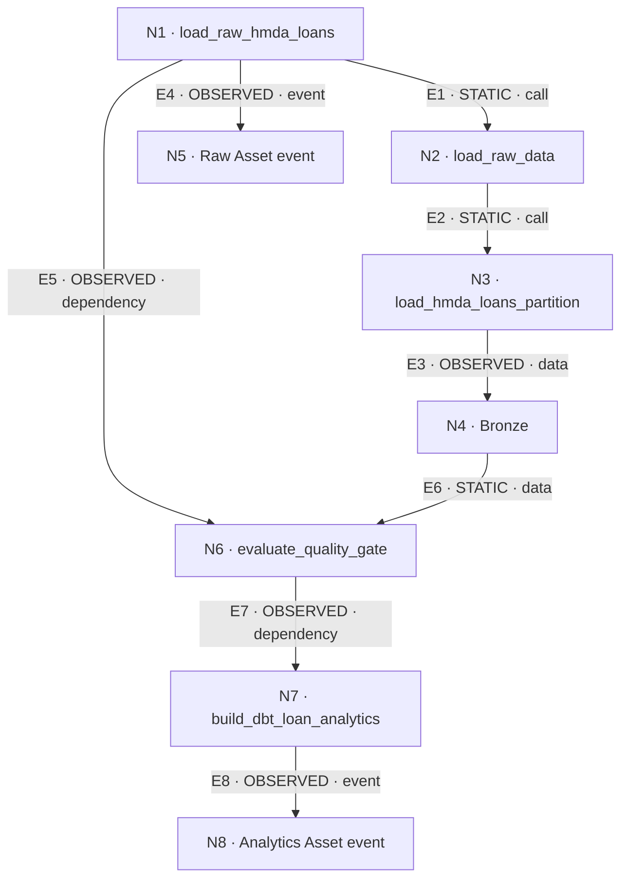

# HMDA Ingestion Code Flow

**Bronze 적재 성공과 DAG 전체 성공은 별도로 확인할 수 있다.** 격리 실행에서 Bronze 적재 뒤 품질 게이트가 실패해도 Raw Asset 이벤트는 남았다. 현재 DAG의 실패 분기는 기존 사고 조사를 자동으로 호출하지 않는다. Raw Asset 이벤트에는 원천 버전이 없어 사전 조사에서 확인한 입력과 실제 적재 입력의 일치 여부를 이 기록만으로 판정할 수 없다.

| Field | Value |
| --- | --- |
| Repository | `hmda-data-reliability` |
| Inspected revision | 로컬 `90bbbe668313baf35470416581d5c8642e9c6996`. 추적한 소스와 테스트는 이 커밋과 일치했다. `prepare`와 `review_run`의 설계는 작업 트리의 미추적 OpenSpec Change를 참고했다. |
| Question | 적재 성공과 단계 실패는 어디에 기록되며, 어떤 근거를 사후 조사에 연결할 수 있는가? |
| Entry point | Airflow DAG `hmda_data_plane` |
| Scope | PR #291의 적재 조사 설계를 지원하기 위해 현재 DAG, Bronze 적재기, 품질 게이트, 성공한 dbt 산출물 승격 및 기존 사고 조사 진입 경계를 추적했다. |
| Runtime evidence | 2026-11-19 KST, 합성 CSV와 임시 SQLite·DuckDB를 사용한 `airflow dags test` 시나리오 T1–T4 |

## Flow Overview



실선은 소스에서 확인한 `STATIC` 관계 또는 명시된 시나리오에서 관찰한 `OBSERVED` 관계를 뜻한다. `dependency`는 Airflow의 실행 의존성을 나타낸다. `CONTRADICTED`와 `UNRESOLVED`는 흐름도 아래에 근거와 함께 기록했다.

## Edge Evidence

| ID | From → To | Relation | Status | Evidence |
| --- | --- | --- | --- | --- |
| [E1](#e1-e3) | N1 → N2 | call | STATIC | Raw 태스크가 검증된 `DataOperationRequest`를 만들어 직접 호출한다. [DAG 56–66](../../src/hmda_reliability/orchestration/dags/hmda_data_plane.py#L56-L66) |
| [E2](#e1-e3) | N2 → N3 | call | STATIC | 실행 시점에 찾은 경로 전부와 요청 연도·선택 파일을 적재기에 넘긴다. [runner.py 68–82](../../src/hmda_reliability/data_operations/runner.py#L68-L82) |
| [E3](#e1-e3) | N3 → N4 | data | OBSERVED | T4에서 Bronze 테이블을 직접 읽어 합성 입력 1,000행을 확인했다. 파티션 교체의 커밋과 롤백 경로는 소스에서 확인했다. [partition.py 374–383](../../src/hmda_reliability/hmda_data/ingestion/partition.py#L374-L383), [DAG 실행 테스트 375–378](../../tests/orchestration/test_airflow_dagrun.py#L375-L378) |
| [E4](#e4-e6) | N1 → N5 | event | OBSERVED | T1·T3·T4에서 Raw 태스크와 실행 ID에 연결된 이벤트가 남았다. T2에서는 이벤트가 없었다. [DAG 49–78](../../src/hmda_reliability/orchestration/dags/hmda_data_plane.py#L49-L78), [이벤트 조회 115–133](../../tests/orchestration/test_airflow_dagrun.py#L115-L133) |
| [E5](#e4-e6) | N1 → N6 | dependency | OBSERVED | T2에서 Raw 실패가 게이트를 `upstream_failed`로 차단했다. T4에서 Raw 종료가 게이트 시작보다 앞서거나 같았다. [DAG 163–169](../../src/hmda_reliability/orchestration/dags/hmda_data_plane.py#L163-L169), [T2 278–293](../../tests/orchestration/test_airflow_dagrun.py#L278-L293), [T4 332–343](../../tests/orchestration/test_airflow_dagrun.py#L332-L343) |
| [E6](#e4-e6) | N4 → N6 | data | STATIC | 게이트는 DuckDB를 읽기 전용으로 열고 기존 Bronze 파티션과 요청 연도를 검사 대상으로 삼는다. 검사에서 오류가 발생하면 중단한다. [Data Operations quality_gate.py 23–82](../../src/hmda_reliability/data_operations/quality_gate.py#L23-L82) |
| [E7](#e7-e8) | N6 → N7 | dependency | OBSERVED | T3에서 게이트 실패가 분석 태스크를 `upstream_failed`로 차단했다. T1에서는 게이트가 통과한 뒤 `run_dbt_build=false`로 분석을 건너뛰었다. T4에서 게이트 종료는 분석 시작보다 앞서거나 같았다. [DAG 115–123](../../src/hmda_reliability/orchestration/dags/hmda_data_plane.py#L115-L123), [DAG 163–166](../../src/hmda_reliability/orchestration/dags/hmda_data_plane.py#L163-L166), [T3 296–317](../../tests/orchestration/test_airflow_dagrun.py#L296-L317), [T1 262–275](../../tests/orchestration/test_airflow_dagrun.py#L262-L275), [T4 332–343](../../tests/orchestration/test_airflow_dagrun.py#L332-L343) |
| [E8](#e7-e8) | N7 → N8 | event | OBSERVED | T4에서 분석 이벤트의 산출물과 `projection_id`가 확인됐고 candidate와 current 파일의 바이트가 일치했다. 소스에서 승격 호출 뒤 이벤트 필드를 채우는 순서를 확인했다. [DAG 120–136](../../src/hmda_reliability/orchestration/dags/hmda_data_plane.py#L120-L136), [T4 344–365](../../tests/orchestration/test_airflow_dagrun.py#L344-L365) |
| [E9](#e9-e10) | 게이트 실패 → `investigate_incident` 자동 호출 | call | CONTRADICTED | 실패 분기는 `AirflowException`을 일으킨다. 확인한 DAG에는 사고 조사 태스크나 실패 콜백이 없다. [DAG 86–103, 139–169](../../src/hmda_reliability/orchestration/dags/hmda_data_plane.py#L86-L169), [Architecture 90–94](../../docs/ARCHITECTURE.md#L90-L94) |
| [E10](#e9-e10) | `prepare`의 원천 버전 → 실제 적재 버전과 비교 | data | UNRESOLVED | Raw Asset 이벤트의 필드로는 실제 읽은 파일의 버전과 정확한 시도를 검증할 수 없다. 이 비교는 현재 작업 트리의 설계와 명세 초안에 정의돼 있다. [DAG 67–78](../../src/hmda_reliability/orchestration/dags/hmda_data_plane.py#L67-L78), [OpenSpec design 24–27](../../openspec/changes/reliability-ai-investigate-hmda-ingestion/design.md#L24-L27), [delta spec 69–81](../../openspec/changes/reliability-ai-investigate-hmda-ingestion/specs/reliability-ai-ingestion-investigation/spec.md#L69-L81) |

## Detailed Evidence

<a id="e1-e3"></a>
<details>
<summary><strong>E1–E3 · Request, source files, and Bronze commit</strong></summary>

- 세 태스크는 각각 Airflow의 지정 파라미터와 환경값을 합쳐 요청을 만든다. 명시한 파라미터가 우선한다. [DAG 28–46, 65–66, 94–96, 115–121](../../src/hmda_reliability/orchestration/dags/hmda_data_plane.py#L28-L121), [config.py 29–57](../../src/hmda_reliability/orchestration/config.py#L29-L57)
- 파일 발견 뒤 임시 테이블에서 연도와 선택 파일로 행을 고른다. 파일별 필수 열 검사는 발견한 파일 전체에 적용한다. 그 뒤 파티션 교체를 커밋하고 범위에 해당하는 행 수를 읽는다. [행 선택 239–283](../../src/hmda_reliability/hmda_data/ingestion/partition.py#L239-L283), [파일별 검사 30–54](../../src/hmda_reliability/hmda_data/ingestion/_common.py#L30-L54), [검사와 교체 호출 175–198](../../src/hmda_reliability/hmda_data/ingestion/partition.py#L175-L198), [커밋 374–383](../../src/hmda_reliability/hmda_data/ingestion/partition.py#L374-L383), [행 수 83–98](../../src/hmda_reliability/hmda_data/ingestion/partition.py#L83-L98)
- T2의 빈 원천은 파일 발견에서 실패한다. 다른 실패 시점에는 타깃 스키마나 테이블 초기화가 이미 수행됐을 수 있다. [discovery.py 20–45](../../src/hmda_reliability/hmda_data/ingestion/discovery.py#L20-L45), [partition.py 76–92, 136–159](../../src/hmda_reliability/hmda_data/ingestion/partition.py#L76-L159)

```py
request = data_operation_request_from_runtime(_runtime_overrides())
result = load_raw_data(request)
```

</details>

<a id="e4-e6"></a>
<details>
<summary><strong>E4–E6 · Raw event and quality failure</strong></summary>

- Raw 이벤트는 `data_update`, 실행 단계, DB 경로, 원천 루트, 발견 파일 수, 연도와 적재 행 수를 기록한다. `source_file_count`는 발견한 전체 경로 수다. `RawLoadResult.source_file`은 Asset 이벤트에 포함되지 않는다. [runner.py 91–98](../../src/hmda_reliability/data_operations/runner.py#L91-L98), [DAG 67–78](../../src/hmda_reliability/orchestration/dags/hmda_data_plane.py#L67-L78)
- 게이트는 Bronze를 다시 읽는다. 세 태스크 모두 `do_xcom_push=False`이며, T1–T4의 Airflow DB에서 XCom 행이 없음을 확인했다. [DAG 56–61, 86–90, 106–111](../../src/hmda_reliability/orchestration/dags/hmda_data_plane.py#L56-L111), [Data Operations quality_gate.py 31–47](../../src/hmda_reliability/data_operations/quality_gate.py#L31-L47), [테스트 105–113](../../tests/orchestration/test_airflow_dagrun.py#L105-L113)
- T3에서 `null_spike(income)`이 Airflow 실패 로그에 남았고, 해당 실행의 Raw Asset 이벤트는 유지됐다. 이 테스트의 관찰 범위는 태스크 상태, 로그, Asset 이벤트다. [DAG 91–103](../../src/hmda_reliability/orchestration/dags/hmda_data_plane.py#L91-L103), [T3 296–317](../../tests/orchestration/test_airflow_dagrun.py#L296-L317)

</details>

<a id="e7-e8"></a>
<details>
<summary><strong>E7–E8 · Analytics recheck and promotion</strong></summary>

- `run_dbt_build=true`이면 분석 태스크는 DB 변경 락 안에서 게이트를 재검사하고 같은 락 안에서 dbt를 실행한다. 성공한 산출물은 별도 승격 호출을 거친 뒤 이벤트에 연결된다. [runner.py 118–127, 162–173, 222–247](../../src/hmda_reliability/data_operations/runner.py#L118-L247), [DAG 115–136](../../src/hmda_reliability/orchestration/dags/hmda_data_plane.py#L115-L136)
- T4는 앞선 Airflow 태스크의 실행 순서와 성공한 dbt 산출물을 확인했다. 분석 태스크 안의 재검사와 락 경계는 소스에서 확인했다. [T4 328–374](../../tests/orchestration/test_airflow_dagrun.py#L328-L374)

</details>

<a id="e9-e10"></a>
<details>
<summary><strong>E9–E10 · Investigation boundary</strong></summary>

- 기존 `investigate_incident`의 입력은 `AgenticReviewInput`이다. 이 계약에는 서로 일치하는 `null_spike` 사건, 근거, 복구 초안과 프로젝트 리비전이 필요하다. 예를 들어 위임 실행 서비스는 검증한 입력을 명시적으로 넘긴다. [조사 진입점 49–61](../../src/hmda_reliability/reliability_ai/investigation/service.py#L49-L61), [입력 계약 23–33, 61–106](../../src/hmda_reliability/reliability_ai/contracts.py#L23-L106), [위임 호출 120–138](../../src/hmda_reliability/reliability_ai/execution/service.py#L120-L138)
- 현재 테스트는 `dag_id`·`run_id`·`task_id`로 이벤트가 실행에 귀속되는 것을 확인한다. 같은 시도까지 귀속되는지, 준비 단계와 실제 적재의 원천 버전이 같은지는 미확인이다. OpenSpec 초안은 같은 시도의 증거가 없으면 갱신 상태를, 입력 비교에 필요한 값이 없으면 일치 여부를 `unknown`으로 보고하도록 정의한다. [테스트 115–133](../../tests/orchestration/test_airflow_dagrun.py#L115-L133), [delta spec 69–81](../../openspec/changes/reliability-ai-investigate-hmda-ingestion/specs/reliability-ai-ingestion-investigation/spec.md#L69-L81), [미구현 작업 22–24](../../openspec/changes/reliability-ai-investigate-hmda-ingestion/tasks.md#L22-L24)

</details>

## Observed Runs

| ID | Fixture | DAG state | Raw → Gate → Analytics | Persisted evidence |
| --- | --- | --- | --- | --- |
| T1 | 정상 CSV, dbt 비활성화 | `success` | `success → success → skipped` | Raw Asset만 기록됐다. [테스트 262–275](../../tests/orchestration/test_airflow_dagrun.py#L262-L275) |
| T2 | 빈 원천 디렉터리 | `failed` | `failed → upstream_failed → upstream_failed` | Asset 이벤트가 없었다. [테스트 278–293](../../tests/orchestration/test_airflow_dagrun.py#L278-L293) |
| T3 | 합성 `income` 결측 급증 | `failed` | `success → failed → upstream_failed` | Raw Asset과 `null_spike(income)` 실패 로그가 남았다. [테스트 296–317](../../tests/orchestration/test_airflow_dagrun.py#L296-L317) |
| T4 | 정상 CSV, dbt 활성화 | `success` | `success → success → success` | Raw·Analytics Asset, Bronze 1,000행, dbt 산출물 승격을 확인했다. [테스트 320–388](../../tests/orchestration/test_airflow_dagrun.py#L320-L388) |

<details>
<summary><strong>Reproduction Command</strong></summary>

```bash
uv run --no-sync pytest -q -p no:cacheprovider \
    tests/orchestration/test_airflow_dagrun.py \
    -k 'disabled_analytics or raw_failure or quality_gate_blocks or success_promotes'
```

</details>

## Verification and Limits

| Check | Result |
| --- | --- |
| 소스 근거 | 표시한 호출 지점, 데이터 전달, 태스크 의존성과 파일의 줄 범위를 확인했다. |
| 격리 실행 | `4 passed, 1 deselected` (70.00초). 제외된 항목은 dbt 실패 뒤 current 산출물 보존 시나리오다. |
| Markdown·Mermaid | Inbox 규칙, Markdown lint, 파일·줄 범위 링크를 검증했다. Mermaid CLI로 흐름도를 렌더링하고 이미지에서 8개 연결을 확인했다. Markdown 뷰어에서 전체 문서의 미리보기는 수행하지 않았다. |
| 검증 범위 | 운영 Airflow scheduler·REST, 재시도에서의 이벤트 귀속, 외부 호출자, AI 모델 실행은 관찰 범위 밖이다. [격리 실행 구성 161–224](../../tests/orchestration/test_airflow_dagrun.py#L161-L224) |
