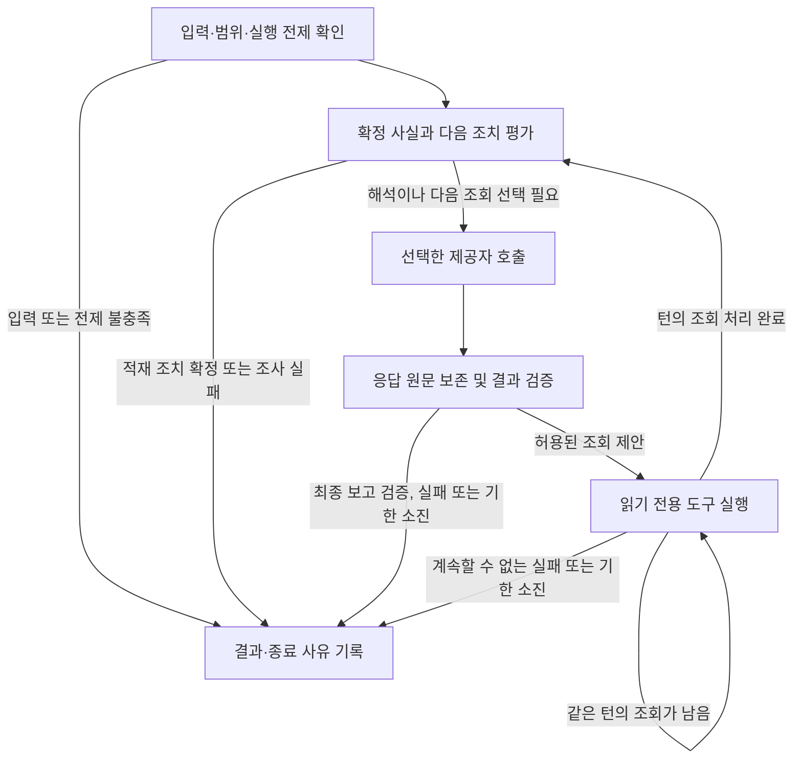

# Reliability AI Investigation Architecture

## Responsibilities

| 책임 | 설계 |
| --- | --- |
| `reliability_ai` | LangGraph 상태와 분기를 소유한다. 조사 유형이 허용하는 근거·도구를 등록하고 판정과 보고 형식을 정한다. |
| `runtime_ai` | 선택된 제공자에 연결하고 요청, 완료, 사용량, 실패, 중단을 공통 형태로 돌려준다. LangChain Core는 이 연결에서 사용하는 메시지와 도구 스키마를 구성한다. |
| `reliability` | 사건·프로필과 복구 제안의 사실을 확정한다. 실행기가 대상 상태와 외부 승인을 대조한 뒤 복구와 재검증을 수행한다. |
| HMDA Data · Data Operations · Airflow | 원천 검사와 적재, DAG 실행을 소유한다. 적재 조사는 호출자가 허용한 원천 스냅샷과 지정 실행 기록을 읽는다. |

## Investigation Workflow

공용 그래프는 턴·조회 위치·누적 조회 수·다음 단계를 관리한다. 입력, 도구 범위, 기한과 기록은 각 조사 서비스가 관리한다. 도메인 코드에서 사건의 사실과 적재 준비 판정을 얻고, 모델을 호출할 때 native Prompt를 한 버전으로 고정한다. Prompt 조회에 실패하면 `prompt_unavailable`을 반환한다. [구현 설계](../../../openspec/changes/reliability-ai-replace-investigation-runtime/design.md#d1-investigation-graph)

- **사고 조사**는 `AgenticReviewInput`의 사실과 근거를 사용한다. 기존 사건 조회, 프로필 비교, 지정된 dbt 산출물 조회를 도구로 연결한다. 추가 조회가 필요 없어도 `completed`가 되려면 실제 모델이 작성한 보고서의 구조 검증과 필수 로컬 저장을 마쳐야 한다. 확정 사실과 모델의 발견·가설·불확실성을 구분한다. [현재 결과 계약](../../../openspec/specs/reliability-agentic-review/spec.md#requirement-typed-review-result-boundary)
- **적재 조사**는 원천 버전과 준비 판정 또는 지정한 Airflow 실행의 상태부터 확보한다. 규칙이 판정과 다음 조치를 모두 확정하면 모델 호출 없이 반환한다. 모델이 조회를 제안하면 그래프가 허용 범위와 인자를 검증한 뒤 읽는다. [적재 준비와 실행 조회](../02-proposal-ingestion-llmops/architecture-plan.md)
- **호출과 종료**는 모델 턴과 도구 호출의 한도를 각각 적용한다. 같은 턴의 요청을 순서대로 꺼낼 때마다 범위·기한·잔여 횟수·중복을 검사한다. 남은 요청이 한도를 넘으면 앞선 관찰값을 보존하고 `budget_exhausted`로 종료한다. 배치를 모두 처리하고 도구 잔여 횟수가 0이면 남은 시간과 턴 한도 안에서 도구 없는 최종 보고를 요청할 수 있다. 모델 턴 한도 소진과 반복 요청은 각각 `max_turns_exceeded`와 `tool_cycle_detected`로 구별한다. [현재 예산 처리](../../../src/hmda_reliability/reliability_ai/investigation/service.py#L499)

## Delegated Recovery

`execute_delegated_task`는 사고·대상·입력 스냅샷과 요청 권한을 대조한다. Task와 호출자 모두 허용한 도구만 사용하고 두 설정의 도구·시간 한도 중 작은 값을 적용한다. 승인된 백필에 DB 연결이 빠진 경우에는 조사 전에 `blocked`를 반환한다. 스키마 복구는 해당 실행기의 연결 계약을 따른다.

복구는 조사 그래프가 결과를 반환한 뒤 호출한다. 위임 경로에서는 조사가 `completed`이고 별도로 승인된 요청이 있을 때만 해당 실행기로 진행한다. 실행기가 실제 상태를 다시 검증하고 그 결과를 `ReportEnvelope`에 담는다. [위임 실행](../../../src/hmda_reliability/reliability_ai/execution/service.py), [조사 실패 시 복구 차단](../../../openspec/specs/reliability-agentic-review/spec.md#scenario-failed-investigation-prevents-recovery)
