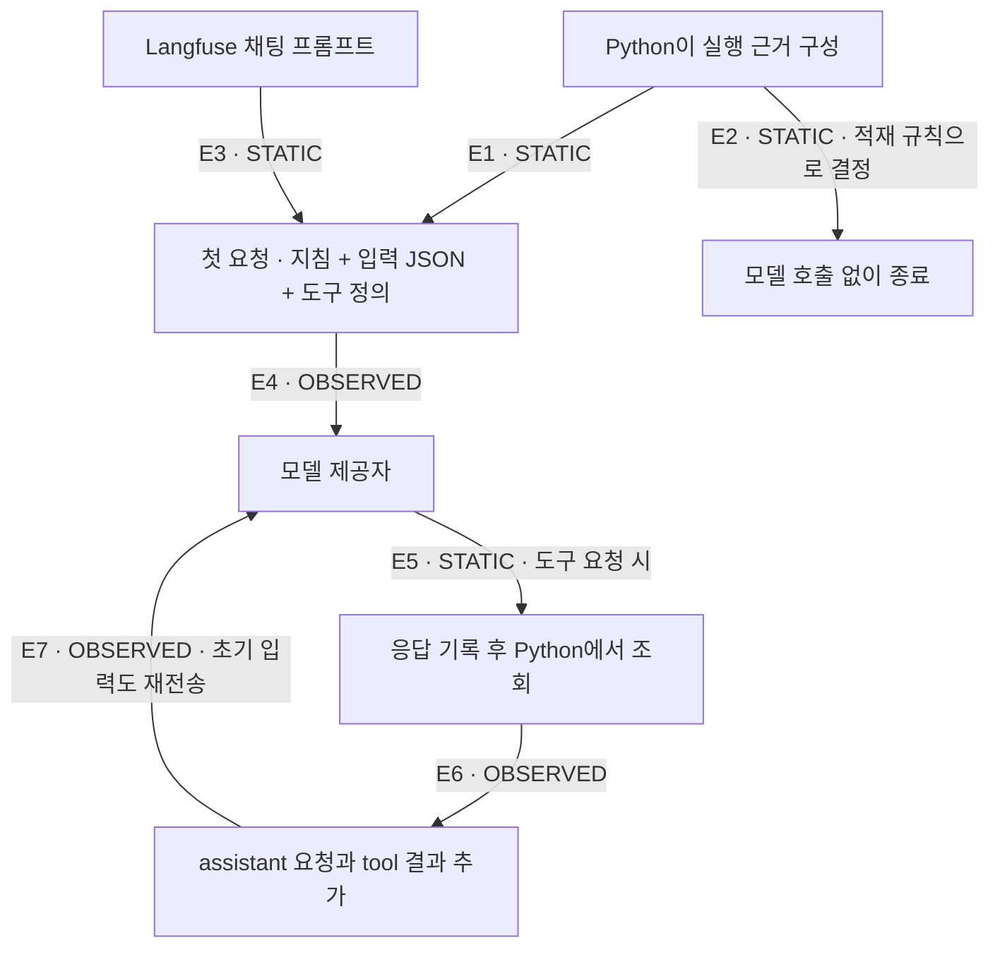

# Reliability AI Context Injection

PR #291의 조사 서비스가 **Langfuse 지침, 실행별 입력 JSON, 허용된 조회 도구**를 묶어 모델에 보낸다. 모델이 추가 근거를 요청하면 Python이 조회하고, 요청과 결과를 같은 호출 ID로 연결해 다음 모델 호출에 붙인다. HMDA 적재 조사는 규칙으로 후속 조치를 결정할 수 있으면 모델 호출 없이 끝난다.

확인 기준은 PR 코드 `a53d434165a9bd67b664b211793937aed0ff5856`이다. 진입점은 `investigate_incident`와 `investigate_ingestion`이다.

## First Model Request

| 항목 | 사고 조사 | HMDA 적재 조사 |
| --- | --- | --- |
| 언제 모델을 호출하나 | 사건 입력을 검증하고 Langfuse 채팅 프롬프트를 가져온 뒤 호출한다. | Python이 원천 파일 또는 지정된 Airflow 실행을 먼저 검사한다. 현재 규칙에서 모델이 필요한 경우는 여러 원천의 필수 컬럼 누락과 Airflow 단계의 `failed`·`upstream_failed`다. |
| `system` 지침 | `hmda-reliability-ai/investigation`이 조사·수치·근거·언어·권한 지침의 각 버전을 참조한다. | `hmda-reliability-ai/ingestion`이 준비·사후 조사 지침을 제공한다. |
| `user` 입력 JSON | 사건, 선택된 근거, 복구 초안, 결정론적 사실, 근거 누락과 출처를 담은 `review_context`를 보낸다. | `mode`, `evidence_id` (`initial`), `status`, `reason`, 원천 ID 목록, Airflow 단계와 상태를 보낸다. |
| 함께 주는 조회 도구 | `get_incident_evidence`, `compare_profiles`. 호출자가 dbt 산출물 경로 쌍을 제공하면 `inspect_dbt_impact`도 제공할 수 있다. | 준비에는 `list_sources`, `inspect_input_partition`, `inspect_source`. 사후 조사에는 `read_stage_result`. |

프롬프트는 기본 `production` 라벨로 고른다. `prompt_version`을 지정하면 해당 버전을 쓰고, 실행 중에는 가져온 프롬프트를 고정한다. 저장소 Markdown은 Langfuse 등록에 쓰인다. 실행 시 사용할 채팅 프롬프트를 가져오지 못하면 `prompt_unavailable`로 끝난다. [프롬프트 등록](../../src/hmda_reliability/reliability_ai/evaluation/setup.py), [기본 설정](../../src/hmda_reliability/reliability_ai/settings.py)

## Follow-up Requests

`STATIC`은 코드로 확인한 연결이다. `OBSERVED`는 저장된 Codex 실행 또는 대체 제공자로 실행한 테스트에서 확인한 연결이다.

| 연결 | 유형 | 근거 |
| --- | --- | --- |
| E1 | 데이터 | 사고 입력을 허용 필드로 투영하고, 적재 입력은 조사 결과에서 요약을 만든다. [사고 입력 구성](../../src/hmda_reliability/reliability_ai/prompt/__init__.py) 48–110행, [적재 요약](../../src/hmda_reliability/reliability_ai/ingestion/service.py) 117–131행 |
| E2 | 분기 | 규칙으로 정한 조치가 있으면 `assess`에서 종료한다. [판정 규칙](../../src/hmda_reliability/reliability_ai/ingestion/policy.py) 12–31행, [적재 서비스](../../src/hmda_reliability/reliability_ai/ingestion/service.py) 138–143행 |
| E3 | 데이터 | 사고는 턴마다 같은 프롬프트에 `canonical_input`과 `history`를 넣는다. 적재는 첫 턴에 지침과 요약을 한 번 렌더링하고 후속 이력을 붙인다. [사고 서비스](../../src/hmda_reliability/reliability_ai/investigation/service.py) 475–491, 510–532행, [적재 서비스](../../src/hmda_reliability/reliability_ai/ingestion/service.py) 145–198행 |
| E4 | 호출 | 조립한 메시지와 도구 정의를 제공자에 전달한다. [사고 모델 호출](../../src/hmda_reliability/reliability_ai/investigation/service.py) 584–595행, [적재 모델 호출](../../src/hmda_reliability/reliability_ai/ingestion/service.py) 216–255행 |
| E5 | 호출 | 그래프가 응답을 기록하는 `retain`을 거쳐 `read`를 실행한다. [공유 그래프](../../src/hmda_reliability/reliability_ai/investigation/graph.py) 58–96행 |
| E6 | 데이터 | 요청과 결과가 일치하고 기록에 성공하면 결과를 `tool` 메시지로 추가한다. [사고 조회](../../src/hmda_reliability/reliability_ai/investigation/service.py) 783–833행, [적재 조회](../../src/hmda_reliability/reliability_ai/ingestion/service.py) 290–323행 |
| E7 | 데이터 | 다음 턴에 처음의 지침·입력과 지금까지의 `assistant` 도구 요청·`tool` 결과를 함께 보낸다. [사고 요청 조립](../../src/hmda_reliability/reliability_ai/investigation/service.py) 515–532, 727–736행, [적재 요청 조립](../../src/hmda_reliability/reliability_ai/ingestion/service.py) 185–199, 277–286행 |

## Context Boundaries

- **근거 범위** · 사고의 `compare_profiles`는 사건에 고정된 수치와 출처를 읽는다. `inspect_dbt_impact`는 지정된 현재 dbt 산출물을 읽고 별도 출처를 붙인다. 적재 도구는 수집된 근거 안에서 원천 ID, 누락 컬럼, 행 수, 단계 결과 등을 반환한다. 원천 파일명과 경로는 로컬 기록에 남기고, 모델은 원천 ID로 조회한다. `review_run`의 `previous_id`는 준비 조사와 현재 적재의 범위·원천 버전 비교에 쓰인다. [사고 도구](../../src/hmda_reliability/reliability_ai/investigation/tools.py) 143–233행, [적재 도구](../../src/hmda_reliability/reliability_ai/ingestion/policy.py) 34–101행, [입력 일치 판정](../../src/hmda_reliability/reliability_ai/ingestion/airflow.py) 134–161행
- **입력 크기** · 사고는 기본 근거 8개를 코드의 우선순위로 선택하고 `review_context`를 16 KiB로 제한한다. 선택 근거는 `evidence`와 `review_context.selected_evidence`에 모두 들어간다. 턴별 요청의 기본 상한은 64 KiB이고, 누적 이력으로 이를 넘으면 `prompt_too_large`로 종료한다. 조회는 기본 5회다. 한도에 도달하면 다음 요청의 도구 목록을 비우고, 사고 조사에는 현재 근거로 최종 JSON을 작성하라는 `user` 메시지를 추가한다. [근거 선택](../../src/hmda_reliability/reliability_ai/context.py) 149–213행, [입력 필드](../../src/hmda_reliability/reliability_ai/prompt/__init__.py) 61–109행, [설정](../../src/hmda_reliability/reliability_ai/settings.py) 24–29행, [사고 조회 한도 처리](../../src/hmda_reliability/reliability_ai/investigation/service.py) 829–845행
- **LangGraph와 이력** · LangGraph 상태는 턴, 배치 내 도구 위치, 호출 수, 다음 경로를 유지한다. 실행별 콜백은 `Runtime.context`로 받고, 메시지 이력은 사고 서비스의 `self.history`와 적재 서비스의 `history`에 쌓인다. [그래프 상태와 콜백](../../src/hmda_reliability/reliability_ai/investigation/graph.py) 24–46, 124–144행
- **Codex 전송** · 구독 OAuth 제공자는 매 턴 격리된 새 스레드를 시작하고 `messages`와 `tools`를 하나의 JSON 텍스트로 전달한다. 저장소 지침·스킬·메모리 로딩은 격리 설정으로 차단한다. 도구는 호스트가 실행할 제안으로 답한다. Ollama 등 호환 제공자는 같은 메시지와 도구 정의를 Chat Completions 필드로 받는다. [Codex 전송](../../src/hmda_reliability/runtime_ai/codex.py) 94–108, 258–283행, [격리 설정](../../src/hmda_reliability/runtime_ai/codex_isolation.py) 11–41, 155–195행, [호환 제공자 전송](../../src/hmda_reliability/runtime_ai/provider.py) 322–352행

## Evidence And Replay

사고 조사의 로컬 기록은 조립된 요청을 복원할 수 있는 메시지 참조, 입력 해시·크기, 프롬프트 버전, 응답과 조회 결과를 연결한다. 적재의 `event-*.json`에는 프롬프트·턴별 입력 식별값·응답·조회 결과가 순서대로 저장된다. Langfuse 관측의 기본 범위는 모델·프롬프트 버전·턴 등 메타데이터다. 지정된 관측 플래그로 정제된 입출력을 제공할 수 있다. [사고 기록](../../src/hmda_reliability/reliability_ai/investigation/records.py), [적재 기록](../../src/hmda_reliability/reliability_ai/ingestion/evidence.py), [관측 투영](../../src/hmda_reliability/reliability_ai/investigation/observations.py) 24–79행

Recorded Codex Request

이전 실제 구독 실행 `inv-6a85377047f941dca356aa6a262d0f11`의 기록에는 코드 `f1b67d0af37a646393817d0baff77926427bd935`, 모델 `gpt-6-luna`, 조사 Prompt v1이 남아 있다. 이 기록을 현재 조사 코드에서 열어 요청을 복원하고 `replayed / completed`를 확인했다. [실행 이력](10-report-implementation-progress.md)

| 요청 | 메시지 순서 | Codex 입력 바이트 (`input` + `outputSchema`) |
| --- | --- | --- |
| 첫 턴 | `system → user` | 8,581 bytes |
| 다음 턴 | `system → user → assistant → tool` | 12,315 bytes |

두 턴은 서로 다른 Codex 스레드를 사용했다. 다음 요청의 `tool_call_id`는 앞선 `compare_profiles` 요청의 ID와 일치했다.

현재 코드에서 관련 테스트 7건을 실행했다. 적재의 모델 생략, 준비·사후 조사의 조회 결과 연결과 재현, 다른 호출 ID 거부, 사고의 조회 루프와 크기 제한, Codex 입력 크기 계산을 확인했다. [적재 테스트](../../tests/reliability_ai/test_ingestion_workflow.py), [사고 테스트](../../tests/reliability_ai/test_investigation_agent.py), [Codex 어댑터 테스트](../../tests/runtime_ai/test_codex_adapter.py)

Mermaid 그림은 문법 검사까지 확인했다. 확인 범위는 애플리케이션이 조립한 요청과 기록된 결과까지다. 현재 Langfuse `production`의 실제 문구와 제공자 서버 내부의 최종 프롬프트는 확인 범위 밖이다.
