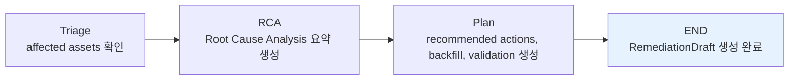

# Reliability Remediation 도메인 아키텍처

이 도메인은 감지된 incident에 대한 `RemediationDraft` (조치 제안 초안)을 생성합니다. LangGraph 기반 workflow로 구현되어 있으며, triage → RCA → Plan 순으로 처리합니다.

## 주요 클래스 및 컴포넌트

### 1. `RemediationDraft` (draft.py)

- **역할**: Remediation draft 출력 계약 (Pydantic Model)
- **주요 필드**:
  - `incident_id`, `incident_type`, `asset_name`, `partition`
  - `rca_summary` (Root Cause Analysis 요약)
  - `evidence_refs`, `affected_assets`
  - `recommended_actions`, `dbt_test_suggestions`, `backfill_actions`, `validation_actions`
  - `requires_approval`

### 2. `RemediationDraftRequest` (request.py)

- **역할**: Workflow 입력 모델 (Pydantic Model)
- **주요 필드**:
  - `incident`: `Incident` contract
  - `evidence`: `Evidence`
  - `lineage_evidence`: Optional lineage 정보
  - `operator`: 기본값 `data-platform`

### 3. `RemediationState` (workflow.py)

- **역할**: LangGraph workflow state (TypedDict)
- **주요 상태**:
  - `request`, `affected_assets`, `rca_summary`, `recommended_actions`, `draft` (최종 output)

### Workflow Graph

### 주요 함수

- `create_remediation_draft(request)`: 최상위 workflow runner
- `_build_graph()`: LangGraph StateGraph 정의
- `_triage_node`, `_rca_node`, `_plan_node`: 개별 노드 로직

이 workflow는 read-only lifecycle이며, approval 이후 별도 recovery/evaluation API에서 처리됩니다.
