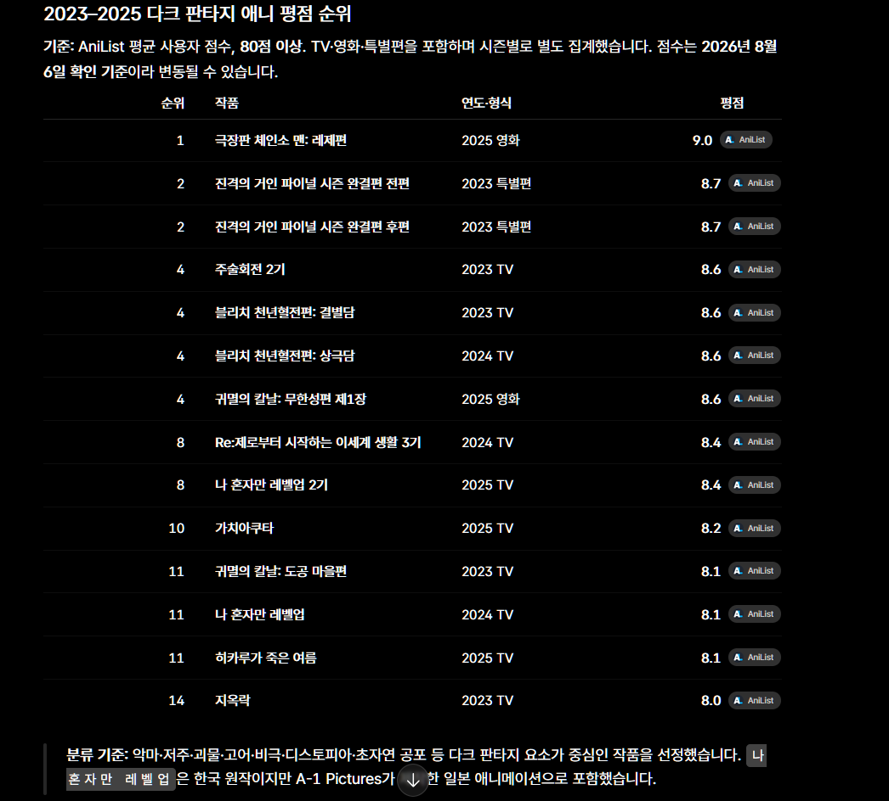

> [!NOTE]
> 먼저 6-core contract와 complete-key grain의 failing regression을 고정하고 runtime을 정렬한다. 그 다음 Notebook semantic rendering과 evidence/readiness를 한 controlled source로 연결한다.

## Tasks

### 1. Runtime contract reconciliation

- [x] 1.1 **RED** — `county_code`가 없는 6-core source의 성공, null grain key exclusion, duration 범위를 검증하는 component tests를 추가한다.
  - **Covers:** `HMDA required schema baseline`, `MVP grain alignment`, `Reusable EDA computation boundary`
  - **Done when:** 현재 runtime이 `county_code` validation 또는 null-key group count 때문에 의도한 이유로 실패한다.

- [x] 1.2 **GREEN** — EDA validation/null baseline을 6-core로 축소하고, distinct grain count를 complete-key rows로 제한하며, duration을 모든 retained aggregate 뒤에 측정한다.
  - **Done when:** 새 component tests가 통과하고 freshness query가 남지 않는다.

- [x] 1.3 **REFACTOR** — core column과 grain population 계산에서 중복을 제거하고 반환 evidence를 JSON-serializable하게 유지한다.
  - **Done when:** EDA component suite가 통과하며 query의 population semantics가 한 곳에서 읽힌다.

### 2. Agent-friendly Python & YAML EDA with Static Visualizations

- [x] 2.1 **RED** — Python EDA API에서 결과를 YAML(`yml`) 형식으로 반환하고 정적 이미지(PNG) 또는 HTML 시각화 파일을 내보내는 기능의 component tests를 작성한다.
  - **Covers:** `Agent-friendly Python and YAML EDA exploration`
  - **Done when:** 현재 YAML 직렬화 모듈 및 정적 차트 내보내기 함수가 존재하지 않아 테스트가 실패한다.

- [x] 2.2 **GREEN** — Marimo 노트북(`notebooks/eda_mo.py`) 및 Marimo 관련 테스트(`tests/hmda_data/eda/test_eda_notebook.py`)를 완전 삭제하고, EDA 결과를 YAML로 직렬화하여 반환하는 함수 및 정적 시각화(PNG/HTML) 파일 내보내기 기능을 구현한다.
  - **Done when:** Marimo 파일들이 삭제되고, YAML 에비던스 반환 및 정적 시각화 파일 생성 테스트가 통과한다.

- [x] 2.3 **REFACTOR** — YAML 에비던스 구조와 시각화 생성 모듈을 깔끔하게 정돈하고 불필요한 Marimo 의존성을 전면 정리한다.
  - **Done when:** EDA component suite가 통과하며 Marimo 관련 코드 및 테스트 잔재가 남지 않는다.

### 3. Controlled evidence and readiness

- [x] 3.1 **RED** — actual-source evidence의 portable metadata와 Markdown/JSON key metric invariant를 검증하는 test를 추가한다.
  - **Covers:** `Actual-source observation`
  - **Done when:** 기존 hand-maintained Markdown/JSON artifact가 불일치로 실패한다.

- [x] 3.2 **GREEN** — one-time actual-source script가 하나의 evidence object에서 portable JSON과 Markdown summary를 생성하고 source fingerprint, revision, timestamp, total duration을 기록하도록 한다.
  - **Done when:** generated artifact invariant가 통과하며 absolute local path와 temp directory가 canonical evidence에 없다.

- [x] 3.3 **REFACTOR** — stale reference artifact를 controlled evidence로 교체하고 EDA readiness YAML과 Markdown을 같은 상태로 정렬한다.
  - **Done when:** controlled actual-source run 전에는 blocked/unverified이며, 검증 뒤 두 readiness artifact가 같은 상태를 보인다.

### 4. Canonical alignment and validation

- [x] 4.1 canonical `hmda-eda-baseline` spec과 test guide의 제거된 freshness/memory contract를 6-core scope로 정렬한다.
  - **Done when:** canonical spec, active change spec 및 runtime contract가 같은 retained behavior를 설명한다.

- [x] 4.2 focused component·evidence tests와 ruff, Markdown check를 실행한다.
  - **Done when:** Marimo가 제거된 현재 scope에서 실행한 command와 결과가 current source에서 passing이다.

## Self-Review

- [x] 모든 관련 Requirement와 Scenario가 구현 및 테스트에 반영되었는지 확인한다.
- [x] Design의 Decision과 Boundary를 지키면서 중복과 불필요한 복잡성을 제거한다.
- [x] 관련 테스트, 실패 경로와 정적 검사가 통과하는지 확인한다.
- [x] 필요한 문서, 설정과 운영 절차를 갱신한다.
- [x] 알려진 제약과 후속 작업을 명시한다.
