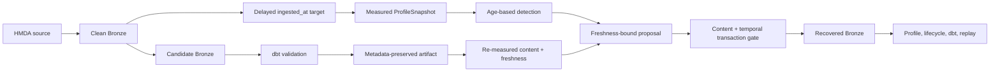

> [!NOTE]
> Existing profile/detection과 partition recovery 경계를 유지하되 freshness를 nullable measurement와 별도 approval binding으로 표현한다. Freshness recovery는 같은 content의 stale/fresh state를 exact `max(ingested_at)`으로 구분하고 transaction 안에서 content와 temporal state를 함께 확인한다.

## Context

- **Current State:** `ProfileSnapshot`은 measurement가 없어도 `observed_at`을 `freshness_at`으로 기록하고 detector는 baseline-current timestamp 차이를 사용한다. `PartitionContentIdentity`는 `ingested_at`을 제외하므로 freshness-only before/after identity가 같고 recovery executor는 stale target을 `already_recovered`로 분기할 수 있다.
- **Constraints:** HMDA source download와 publication timestamp는 범위 밖이다. Lifecycle은 read-only이고 approval 결정, recovery와 evaluation은 외부 API에 남아야 한다. Existing volume-drop/null-spike content recovery semantics를 보존해야 한다. 완료된 volume-drop MVP의 scope, milestone과 status는 변경하지 않는다.
- **Dependencies:** Existing Bronze `ingested_at`, `ProfileSnapshotRequest.observed_at`, `DetectionThresholds`, immutable `RecoveryProposal`, metadata-preserving partition load와 disposable evaluation path preflight를 재사용한다.

## Goals / Non-Goals

| Goals | Non-Goals |
| --- | --- |
| 측정됨과 unavailable freshness를 구분한다. | Upstream HMDA publication freshness를 추정한다. |
| Current observation age로 freshness incident를 판정한다. | Scheduler delay, polling cadence와 alert를 구현한다. |
| Content가 같아도 stale/fresh target을 approval과 replay에서 구분한다. | Generic temporal recovery framework를 만든다. |
| Deterministic local recovery/replay evidence를 만든다. | Existing operational database 또는 actual-source cadence를 평가한다. |
| Freshness를 post-MVP capability로 분리한다. | Current volume-drop MVP scope를 확장하거나 다시 연다. |

## Architecture



### Components

| Component | Responsibility | Change |
| --- | --- | --- |
| Profile contracts/builder | Partition metrics와 serialization | Nullable `freshness_at`, `FreshnessMeasurementStatus`, future timestamp rejection |
| Detector/lifecycle | Incident rule와 application composition | Current age formula, renamed max-age threshold, explicit threshold forwarding |
| HMDA ingestion | Atomic partition replacement | Optional expected `max(ingested_at)` gate와 provenance-preserving candidate validation |
| Recovery contracts/executor | Exact approval, mutation과 reconciliation | Incident type, freshness binding, compound state branch와 separate validation evidence |
| Freshness evaluator | Controlled case와 end-to-end evidence | Explicit clock, isolated DBs, temporal defect, candidate export, recovery/replay composition |

### Boundaries

| Boundary | Owns | Does Not Own |
| --- | --- | --- |
| `hmda_data` | Bronze provenance 보존과 atomic content/temporal compare-and-replace | Freshness incident 판정과 approval |
| `reliability` profile/detection | Measurement status, age 계산, incident/evidence | Source acquisition과 scheduling |
| `reliability` recovery | Approved compound state, staging, mutation과 validation | Approval 결정과 automatic lifecycle execution |
| `reliability` evaluation | Disposable controlled setup, acceptance와 report evidence | Production database mutation과 report 자동 write |

## Public Contracts

`FreshnessMeasurementStatus`는 `measured`와 `unavailable` 값의 `StrEnum`이다. `ProfileSnapshot`은 다음 관계를 강제한다.

| `freshness_status` | `freshness_at` | Meaning |
| --- | --- | --- |
| `measured` | timezone-aware `datetime` | 실제 freshness column의 최대 timestamp |
| `unavailable` | `None` | Freshness를 측정하지 못함 |

`freshness_used_fallback`은 `metric_values`에서 제거한다. Measured timestamp는 UTC-compatible timezone-aware 값으로 정규화하고 `freshness_at > observed_at`이면 `ProfileSnapshotError`로 종료한다.

`DetectionThresholds.freshness_delay_minutes`는 alias 없이 `freshness_max_age_minutes`로 교체한다. `run_incident_lifecycle` signature는 keyword-only `thresholds: DetectionThresholds | None = None`을 추가하고 `None`이면 default model을 사용한다.

Freshness approval model은 다음 shape를 사용한다.

```text
FreshnessObservation
- freshness_status
- freshness_at
- observed_at

FreshnessRecoveryBinding
- approved_before: FreshnessObservation
- expected_after_freshness_at: datetime
- max_age_minutes: float >= 0

RecoveryProposal
- incident_type: str
- freshness_binding: FreshnessRecoveryBinding | None
```

`freshness_delay` proposal은 binding이 필수이고 approved-before observation은 measured이며 `observed_at - freshness_at >= max_age`여야 한다. Non-freshness proposal은 binding을 금지한다. Existing volume-drop/null-spike proposal constructors에는 정확한 `incident_type`만 추가한다.

`BackfillValidationResult`에는 `approved_before_freshness`, `expected_after_freshness_at`, `actual_freshness`, `freshness_validation_passed` optional fields를 추가한다. Binding이 없는 content recovery에서는 모두 `None`이며 `validation_passed`는 계속 content identity equality만 뜻한다.

`load_hmda_loans_partition`은 optional `expected_max_ingested_at`을 추가한다. 값이 제공되면 existing `expected_identity`와 함께 replacement transaction 안에서 같은 `source_year`/optional `source_file` scope의 actual state를 비교한다.

## Deterministic Evaluation Flow

`evaluate_freshness_delay_vertical_slice`는 existing volume/null evaluator callback shape를 유지하고 `max_age_minutes=60.0`, `delay_minutes=120.0`을 explicit input으로 받는다. `request.observed_at`은 필수이며 `delay_minutes >= max_age_minutes`를 entry에서 검증한다.

1. Target, clean과 candidate database path가 존재하지 않고 pairwise distinct인지 모든 side effect 전에 확인한다.
1. Clean database에 scoped source를 적재하고 대상 partition의 `ingested_at`을 `request.observed_at`으로 고정한다.
1. Target database에 같은 content를 적재하고 scoped `ingested_at`만 `observed_at - delay_minutes`로 변경한다.
1. Clean/target content identity와 schema hash가 같고 target에서 exact single `freshness_delay`만 발생하는지 확인한다.
1. Candidate database는 clean과 같은 fixed `ingested_at`을 사용하고 candidate dbt validation 뒤 Bronze provenance를 포함한 Parquet artifact로 export한다.
1. Export한 artifact를 다시 열어 scoped content identity와 `max(ingested_at)`을 재측정하고 controlled candidate state와 exact match인지 확인한다.
1. Proposal은 artifact에서 재측정한 content identity/timestamp, target의 stale observation과 max age를 결합한 뒤 external approval을 받는다.
1. Executor는 candidate Parquet를 metadata-preserving mode로 temporary staging하고 content/timestamp를 다시 검증한다.
1. Target compound state를 분류하고 필요한 경우 transaction 내부 compound gate로 candidate를 적용한다.
1. Post-recovery profile, lifecycle, target dbt validation과 같은 approval replay를 실행하고 structured freshness observations를 보존한다.

Source file과 business columns는 변경하지 않는다. Evaluation 내부 temporal update는 `source_year`와 optional `source_file_name` scope에만 적용한다.

## Reconciliation

Freshness binding이 없는 proposal은 existing content-only branch를 그대로 사용한다. Binding이 있으면 branch 우선순위를 다음과 같이 고정한다.

| Current content | Current `max(ingested_at)` | Current age | Result |
| --- | --- | --- | --- |
| expected after | expected after | `< max_age` | `already_recovered` + `resume_verification` |
| approved before | approved before | stale 여부 재확인 | Compound transaction gate 뒤 `partition_changed` |
| expected after | expected after | `>= max_age` | Zero mutation + `request_new_validation_and_approval` |
| before/after 중 하나 | 제3 timestamp | any | Zero mutation + `request_new_validation_and_approval` |
| 제3 content | any | any | Zero mutation + `request_new_validation_and_approval` |

Before/after content identity가 같아도 timestamp branch가 먼저 결론을 완성한다. Mutation 직전 loader는 approved-before content와 timestamp를 transaction 안에서 다시 확인한다.

## Decisions

### D1. Bronze ingestion freshness만 측정한다

- **Decision** - 첫 clock은 HMDA Bronze partition의 `max(ingested_at)`이다.
- **Rationale** - 현재 repository가 직접 생성하고 보존하는 유일한 freshness timestamp다.
- **Trade-off** - 원천 기관의 publication freshness를 설명하지 못한다.
- **Alternatives** - Baseline regression은 staleness를 놓치고 upstream publication timestamp는 현재 source contract에 없다.

### D2. Unavailable은 nullable timestamp와 enum으로 표현한다

- **Decision** - `freshness_at=None`, `freshness_status=unavailable`을 사용하고 fallback metric을 제거한다.
- **Rationale** - Timestamp 값 자체가 measurement 존재 여부와 모순되지 않으며 detector가 untyped metric bag에 의존하지 않는다.
- **Trade-off** - Snapshot fixture와 serialized consumer를 동시에 변경해야 한다.
- **Alternatives** - Fallback timestamp + status는 잘못된 timestamp를 계속 전달하고 boolean-only 표현은 상태 확장성이 낮다.

### D3. Max-age 이름과 판정식을 함께 변경한다

- **Decision** - `freshness_age = observed_at - freshness_at`, incident boundary는 `age >= freshness_max_age_minutes`다.
- **Rationale** - Freshness SLA의 관찰 질문과 field 이름을 일치시킨다.
- **Trade-off** - 기존 threshold field와 evidence payload가 breaking change다.
- **Alternatives** - 기존 이름 alias는 contract 전환을 숨기므로 제공하지 않는다.

### D4. Existing proposal에 freshness binding을 추가한다

- **Decision** - `RecoveryProposal`에 `incident_type`과 freshness-only optional binding을 둔다.
- **Rationale** - Exact approval, candidate binding과 existing partition recovery safety를 재사용하면서 content와 temporal oracle을 분리한다.
- **Trade-off** - Generic proposal validator가 incident-specific invariant 하나를 안다.
- **Alternatives** - Generic temporal state는 범위가 크고 별도 proposal/executor는 approval gate를 중복한다.

### D5. Candidate timestamp를 approval 전에 고정한다

- **Decision** - Candidate DB의 `ingested_at`을 explicit observation time으로 고정하고 dbt validation을 실행한 뒤 Bronze metadata를 가진 Parquet로 export한다. Export한 artifact에서 content identity와 timestamp를 다시 측정해 controlled candidate와 exact match일 때만 그 artifact state로 proposal을 만들며, 같은 artifact를 execution input으로 사용한다.
- **Rationale** - Validation callback이 candidate DB를 변경할 수 있고, validation 전 측정값으로 approval을 만들면 승인 evidence와 실제 mutation input이 달라진다. Execution 때 새 `current_timestamp`를 생성하는 경우도 같은 invariant를 위반한다.
- **Trade-off** - Freshness evaluator가 candidate artifact materialization과 approval 전 재측정을 추가로 소유한다.
- **Alternatives** - Threshold acceptance만 승인하면 candidate timestamp immutability를 입증할 수 없다.

### D6. Content와 temporal target state를 같은 transaction에서 확인한다

- **Decision** - Optional expected timestamp를 HMDA partition loader transaction gate에 추가한다.
- **Rationale** - Executor의 사전 observation만으로는 freshness-only concurrent mutation을 막을 수 없다.
- **Trade-off** - Ingestion API가 recovery가 사용하는 temporal expected state를 지원한다.
- **Alternatives** - Content identity에 `ingested_at`을 포함하면 정상적인 재적재 시각 차이까지 content drift로 오판한다.

### D7. Content validation과 freshness acceptance를 분리한다

- **Decision** - `validation_passed`는 content identity 의미를 유지하고 별도 `freshness_validation_passed`와 observations를 반환한다.
- **Rationale** - Existing recovery consumer semantics를 보존하고 incident-specific oracle을 명시한다.
- **Trade-off** - Overall success는 evaluator가 여러 field와 post-recovery lifecycle을 함께 확인한다.
- **Alternatives** - 하나의 boolean에 합치면 어떤 oracle이 실패했는지 재구성할 수 없다.

### D8. Temporal defect는 reliability evaluator가 소유한다

- **Decision** - Source Parquet helper를 제거하고 disposable Bronze database에서 `ingested_at`만 변경한다.
- **Rationale** - Source schema change 없이 실제 측정 clock의 결함을 만든다.
- **Trade-off** - Freshness case는 standalone source-file generator가 아니라 vertical-slice API로만 제공된다.
- **Alternatives** - Legacy `observed_at` column helper는 schema drift와 freshness defect를 섞는다.

## Testability

| Boundary / Behavior | Test Strategy | Evidence |
| --- | --- | --- |
| Measurement contract | Unit + component | Status/timestamp invariant, max timestamp, unavailable JSON, future value failure |
| Age detection | Unit | Exact threshold incident, below-threshold no incident, baseline-independent staleness, unavailable skip |
| Lifecycle/remediation | Unit + component | Explicit threshold forwarding과 Bronze-specific action identifiers |
| Ingestion gate | Component with DuckDB | Same content/different timestamp stale failure와 zero mutation |
| Proposal/candidate gate | Unit + integration | Incident/binding validation, validation 중 candidate mutation의 pre-approval rejection |
| Recovery/replay | Integration | Stale equal-content mutation, acceptable replay skip, expired replay new approval |
| Evaluation isolation | Integration | Path preflight before side effects, source/schema/content preservation |
| Failure evidence | Integration | Pre/post-mutation classification과 preserved clean/delayed/recovery/replay observations |
| Legacy recovery | Regression | Volume-drop/null-spike results와 content-only reconciliation unchanged |

- **TDD Boundary:** 첫 RED는 unavailable snapshot이 fresh timestamp를 만들지 않는 contract, baseline이 같아도 exact max age에서 incident가 발생하는 rule, 같은 content의 stale target이 `already_recovered`가 아닌 mutation branch로 가는 compound reconciliation을 각각 독립적으로 고정한다.
- **Failure Signals:** Fallback timestamp, baseline-relative delay payload, missing candidate/target timestamp validation, temporal drift 뒤 target mutation, expired replay overwrite, loss of post-mutation freshness evidence를 실패로 본다.

## Risks

| Risk | Impact | Mitigation |
| --- | --- | --- |
| Wall-clock 사용으로 boundary test가 흔들린다. | Non-deterministic incident/replay result | Evaluator와 tests는 explicit `observed_at`, delay와 candidate timestamp만 사용한다. |
| Metadata-preserving load가 임의 provenance를 허용한다. | 승인되지 않은 timestamp가 target에 기록된다. | Freshness binding path에서만 사용하고 staged content/timestamp를 proposal과 exact 비교한다. |
| Candidate validation이 database state를 변경한다. | Approval evidence가 실제 artifact와 다른 state를 가리킨다. | Validation 뒤 artifact를 생성하고 artifact state를 재측정한 후에만 proposal과 approval callback을 만든다. |
| Temporal precheck와 mutation 사이 writer가 개입한다. | Approval 뒤 stale target overwrite | Loader transaction에서 content와 timestamp를 함께 다시 확인한다. |
| Replay가 시간이 지나 다시 stale해진다. | Old approval로 repeated refresh 가능 | Expected timestamp가 max age를 넘으면 zero mutation과 새 approval을 요구한다. |
| Breaking contract 일부만 적용된다. | Fixture/import/serialization 불일치 | Profile, threshold, proposal call sites를 한 migration phase에서 갱신하고 focused regressions를 실행한다. |
| Freshness evaluator가 volume/null control flow를 복제한다. | Safety fix가 incident별로 분산된다. | Existing recovery/evidence helper만 재사용하고 generic evaluator abstraction은 만들지 않는다. |

## Migration

| Phase | Change | Verification |
| ---: | --- | --- |
| 1 | Measurement enum, nullable profile과 renamed threshold를 적용하고 모든 fixture/caller를 갱신한다. | Contract/profile/detection focused tests |
| 2 | Lifecycle threshold와 Bronze remediation wording을 전환한다. | Data-operations/remediation focused tests |
| 3 | Proposal incident type, freshness binding, result evidence와 atomic ingestion gate를 추가한다. | Ingestion/recovery regressions including volume/null |
| 4 | Legacy source helper를 제거하고 deterministic freshness evaluator/public export를 추가한다. | Freshness evaluation integration tests |
| 5 | Domain documentation과 Foundation readiness를 actual implementation 상태에 맞춘다. | Markdown format, OpenSpec validation, default pytest suite |

- **Compatibility:** `freshness_at`, threshold field, proposal constructor와 synthetic helper는 intentional breaking changes이며 alias/deprecation period를 제공하지 않는다. Existing DuckDB table schema와 stored HMDA rows에는 migration이 없다.
- **Rollback:** Apply 전에는 Change artifact만 제거할 수 있다. Apply 뒤에는 profile/detector, proposal/recovery와 evaluator 변경을 한 revision으로 되돌리며 existing database content 변환은 필요하지 않다.
