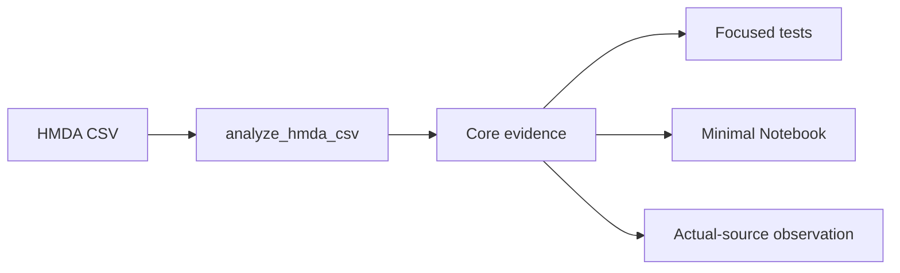

> [!NOTE]
> `analyze_hmda_csv` 하나를 계산 경계로 유지하면서 6개 core column evidence만 반환한다. Fixture·memory와 근거 없는 anomaly subsystem을 제거하고 Notebook smoke와 actual-source observation으로 Foundation acceptance를 닫는다.

## Context

- **Current State:** EDA package가 descriptive calculation과 함께 fixture, manifest, process memory runner, anomaly, freshness와 Profile mapping을 소유한다.
- **Constraints:** 원천은 read-only이며 성공·실패 모두 자체 DuckDB connection을 닫아야 한다. 현재 Gold mart를 설명하되 새 business grain을 정의하지 않는다.
- **Dependencies:** HMDA ingestion required-column contract, `mart_hmda_loan_outcomes`, `analyze_hmda_csv`, Marimo Notebook, Foundation readiness 문서.

## Goals / Non-Goals

| Goals | Non-Goals |
| --- | --- |
| 6개 core column의 재현 가능한 descriptive evidence | County·demographic EDA |
| `analyze_hmda_csv` public API 유지 | Unknown-code·numeric anomaly 판정 |
| 최소 Notebook과 자동 smoke | Resource hard-limit·OOM 보장 |
| Actual-source read-only observation | Full field inventory |
| 기존 extension을 단일 replacement로 전환 | Incident·remediation lifecycle 변경 |

## Architecture

### Components

| Component | Responsibility | Change |
| --- | --- | --- |
| `analysis.py` | Core schema와 descriptive metric 계산 | 6개 column과 core evidence로 축소 |
| `eda.__init__` | EDA public surface | `analyze_hmda_csv`만 유지 |
| `fixture.py`, `memory.py`, scripts | Synthetic resource validation | 제거 |
| `tests/hmda_data/eda/` | Contract와 failure boundary | Core correctness·Notebook smoke만 유지 |
| `notebooks/eda_mo.py` | Human-readable observation | input부터 grain까지 실행 graph 재구성 |
| `docs/references/hmda_eda.md` | Metric·command·latest runtime evidence | 제거된 subsystem 설명 삭제, actual-source 결과 갱신 |

### Boundaries

| Boundary | Owns | Does Not Own |
| --- | --- | --- |
| Ingestion | `county_code` 포함 7개 source column 존재와 Bronze 보존 | EDA metric |
| EDA | 6개 core column type compatibility와 descriptive metric | Domain anomaly·incident |
| Runtime evidence | Actual-source 1회 read-only observation | Performance·OOM guarantee |
| Notebook | 공유 evidence rendering | 별도 계산 계약 |

## Decisions

### D1. EDA core를 6개 column으로 고정한다

- **Decision** - `activity_year`, `state_code`, `loan_purpose`, `action_taken`, `loan_amount`, `income`만 EDA validation과 metric 대상으로 사용한다.
- **Rationale** - 현재 Gold mart와 Reliability MVP에 필요한 최소 volume, categorical과 numeric evidence를 제공한다.
- **Trade-off** - `county_code`와 demographic 분석은 후속 EDA에서 별도로 확장해야 한다.

### D2. Evidence에서 anomaly, freshness와 Profile mapping을 제거한다

- **Decision** - `anomalies`, freshness, schema hash와 `ProfileSnapshot` 대응을 반환 계약과 Notebook에서 제거한다.
- **Rationale** - Domain 근거 또는 source timestamp contract가 없고 reliability profile 책임과 중복된다.
- **Trade-off** - 향후 계약이 생기면 새 capability로 다시 도입해야 한다.

### D3. Fixture·memory subsystem은 deprecation 없이 제거한다

- **Decision** - fixture·manifest·memory module, runner script, export와 전용 test를 함께 삭제한다.
- **Rationale** - 현재 repository의 stable top-level EDA API는 `project_pivot.hmda_data.analyze_hmda_csv`이며 제거 대상은 Foundation 중 생성된 내부 helper다.
- **Trade-off** - `project_pivot.hmda_data.eda`에서 helper를 직접 import한 repository 내부 caller는 같은 change에서 수정해야 한다.

### D4. Notebook smoke는 pytest가 소유한다

- **Decision** - pytest integration test가 valid·invalid fixture를 주입해 종료 가능한 Marimo 실행을 호출하고 inspectable output과 exit status를 검증한다.
- **Rationale** - 자동 test command와 Notebook runtime을 하나의 validation surface로 연결하면서 interactive server lifecycle에 의존하지 않는다.
- **Trade-off** - Pixel layout과 interactive widget 동작은 자동 검증하지 않는다.

### D5. Actual-source evidence는 기존 EDA reference에 유지한다

- **Decision** - `docs/references/hmda_eda.md`에 최신 source identifier, 환경, 결과와 limitation을 기록하고 이전 memory benchmark section은 제거한다.
- **Rationale** - metric 정의와 실행법 가까이에 최신 관찰을 두며 별도 report를 중복 생성하지 않는다.
- **Trade-off** - 새 observation이 실행될 때 reference를 명시적으로 갱신해야 한다.

### D6. 기존 extension은 superseded 상태로 중지한다

- **Decision** - `hmda-eda-foundation-extension` proposal과 tasks에 replacement를 명시하고 추가 Apply를 금지한다.
- **Rationale** - 서로 반대되는 확장·축소 plan의 병행 구현을 막는다.
- **Trade-off** - 기존 완료 task는 historical context로 남지만 replacement의 완료 근거로 사용하지 않는다.

## Testability

| Boundary / Behavior | Test Strategy | Evidence |
| --- | --- | --- |
| 6개 core schema·metric | Component test | 예상 schema, volume, null, distribution, summary, grain |
| Removed evidence | Contract regression | 제거 key와 county EDA validation 부재 |
| Read-only·connection close | Failure-boundary test | 성공·parse·query failure 모두 close, source byte 동일 |
| Public API 축소 | Import contract test | top-level callable 유지, helper export 제거 |
| Notebook | Subprocess integration smoke | valid success, invalid explicit failure, no partial completion |
| Actual source | Manual runtime observation | command, environment, result, limitation |

- **TDD Boundary:** 기존 test를 먼저 6개 core contract와 제거된 surface에 맞춰 변경해 의도한 failure를 확인한다.
- **Failure Signals:** removed key 잔존, `county_code` 때문에 EDA 실패, partial evidence, connection leak, Notebook 비종료·partial rendering.

## Risks

| Risk | Impact | Mitigation |
| --- | --- | --- |
| 제거 대상 API의 숨은 caller | Import failure | repository search와 focused import test로 확인 |
| Notebook smoke가 CLI 세부 동작에 결합 | Version update 시 취약 | installed Marimo version의 종료 가능한 command만 adapter에 격리 |
| 실제 source 실행이 resource-heavy | 개발 환경 불안정 | 1회 read-only observation으로 제한하고 보장으로 해석하지 않음 |
| Spec 축소와 docs 불일치 | Foundation 상태 혼란 | canonical spec, reference, readiness md/yml을 같은 change에서 갱신 |

## Migration

| Phase | Change | Verification |
| ---: | --- | --- |
| 1 | 기존 extension을 superseded 처리하고 replacement plan을 승인한다. | 두 change가 병행 Apply되지 않음 |
| 2 | Core contract test를 RED로 고정한다. | 축소 전 구현이 의도한 이유로 실패 |
| 3 | Analysis와 public surface를 축소하고 subsystem을 삭제한다. | Component·import tests 통과 |
| 4 | Notebook과 문서를 core evidence에 맞춘다. | Notebook smoke·doc checks 통과 |
| 5 | Actual-source observation과 regression validation을 완료한다. | Reference evidence와 전체 결과 기록 |

- **Compatibility:** `analyze_hmda_csv` import path는 유지한다. Fixture·memory helper는 compatibility layer를 두지 않는다.
- **Rollback:** replacement change diff를 되돌리고 기존 extension을 재개하지 않는다. Resource validation이 필요하면 별도 change로 복원한다.
